# API接口文档

<cite>
**本文档引用的文件**
- [app.py](file://app.py)
- [api.js](file://frontend/src/api.js)
- [Chat.vue](file://frontend/src/components/Chat.vue)
- [base.html](file://templates/base.html)
- [package.json](file://frontend/package.json)
- [requirements.txt](file://requirements.txt)
</cite>

## 目录
1. [简介](#简介)
2. [项目结构](#项目结构)
3. [核心组件](#核心组件)
4. [架构概览](#架构概览)
5. [详细组件分析](#详细组件分析)
6. [依赖分析](#依赖分析)
7. [性能考虑](#性能考虑)
8. [故障排除指南](#故障排除指南)
9. [结论](#结论)
10. [附录](#附录)

## 简介

School_Web是一个基于Flask的多合一工具箱Web应用，提供了完整的API接口体系。该项目采用Python Flask作为后端框架，Vue.js作为前端框架，实现了现代化的Web应用程序架构。

本项目的核心特性包括：
- 完整的用户认证系统
- 相册管理系统
- 实时聊天系统
- 系统管理功能
- 多语言支持
- 安全防护机制

## 项目结构

项目采用前后端分离的架构设计，主要分为以下几个部分：

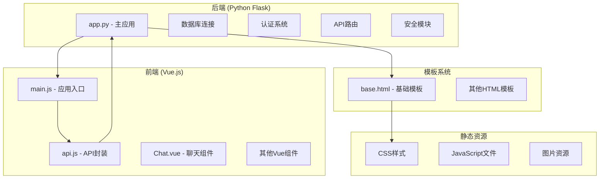

**图表来源**
- [app.py:1-50](file://app.py#L1-L50)
- [frontend/src/main.js:1-6](file://frontend/src/main.js#L1-L6)

**章节来源**
- [app.py:1-50](file://app.py#L1-L50)
- [frontend/src/main.js:1-6](file://frontend/src/main.js#L1-L6)

## 核心组件

### 认证系统

系统采用基于Session的认证机制，结合CSRF保护和权限控制：

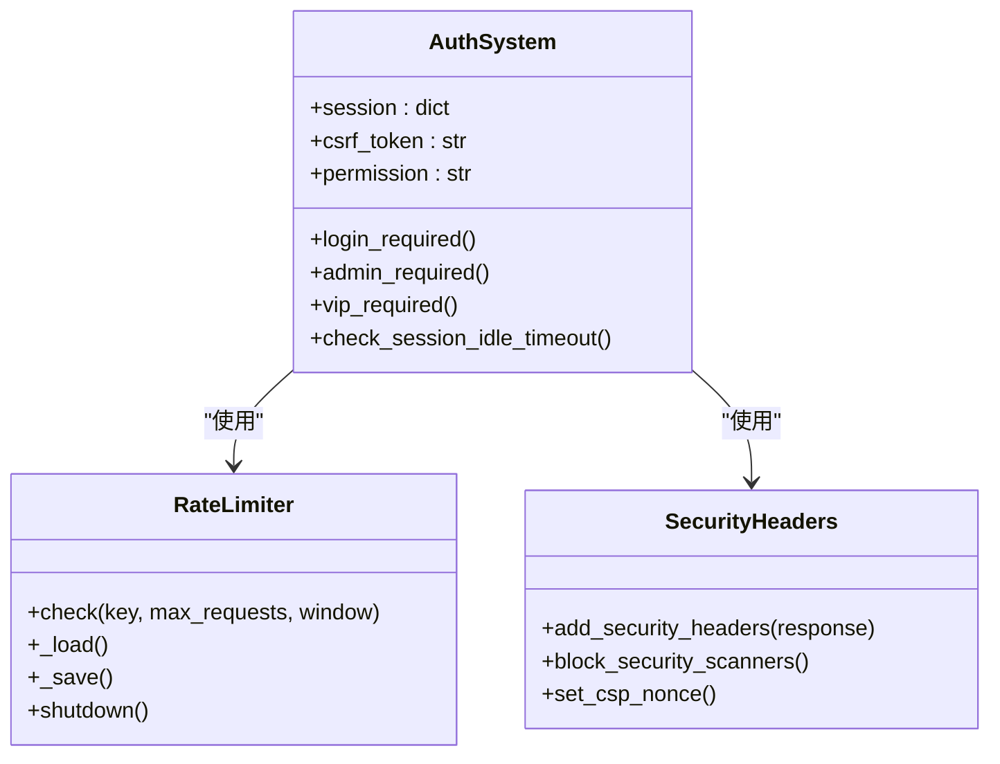

**图表来源**
- [app.py:908-964](file://app.py#L908-L964)
- [app.py:34-117](file://app.py#L34-L117)
- [app.py:645-677](file://app.py#L645-L677)

### 数据库管理

系统使用PyMySQL进行数据库操作，支持多种数据表结构：

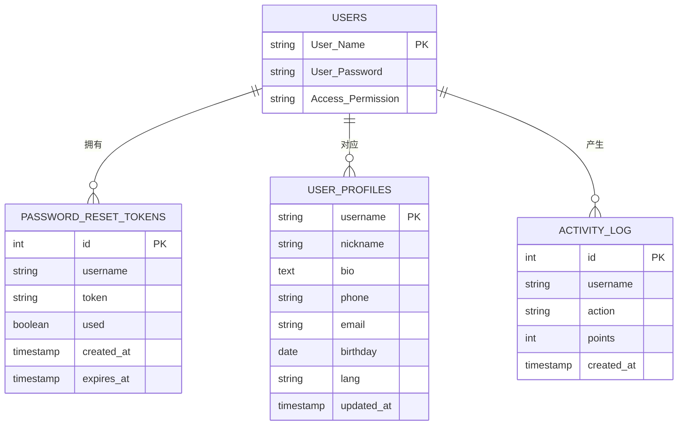

**图表来源**
- [app.py:250-282](file://app.py#L250-L282)
- [app.py:290-314](file://app.py#L290-L314)

**章节来源**
- [app.py:908-964](file://app.py#L908-L964)
- [app.py:34-117](file://app.py#L34-L117)
- [app.py:250-314](file://app.py#L250-L314)

## 架构概览

系统采用MVC架构模式，后端使用Flask框架，前端使用Vue.js：

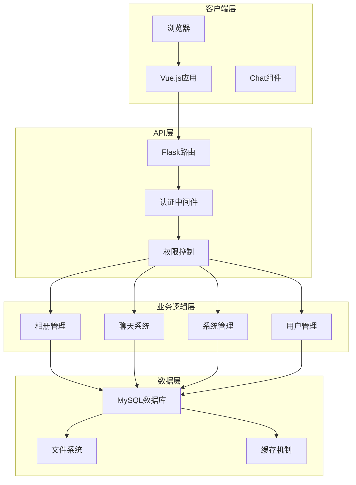

**图表来源**
- [app.py:122-142](file://app.py#L122-L142)
- [frontend/src/components/Chat.vue:1-214](file://frontend/src/components/Chat.vue#L1-L214)

**章节来源**
- [app.py:122-142](file://app.py#L122-L142)
- [frontend/src/components/Chat.vue:1-214](file://frontend/src/components/Chat.vue#L1-L214)

## 详细组件分析

### 用户认证API

#### 登录认证流程

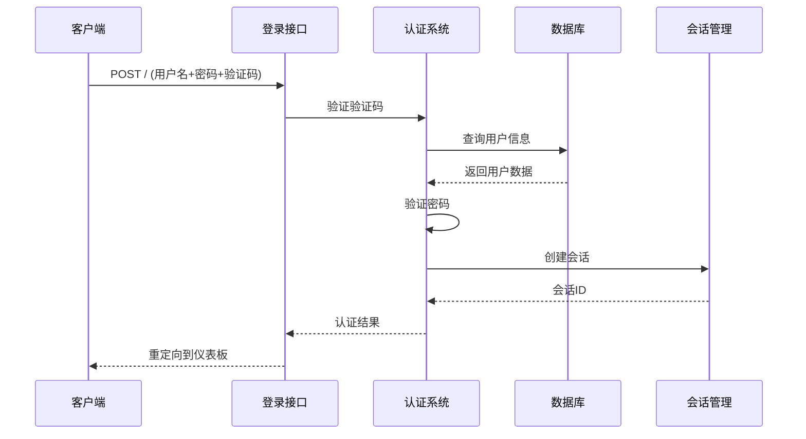

**图表来源**
- [app.py:1022-1117](file://app.py#L1022-L1117)
- [app.py:908-917](file://app.py#L908-L917)

#### 注册流程

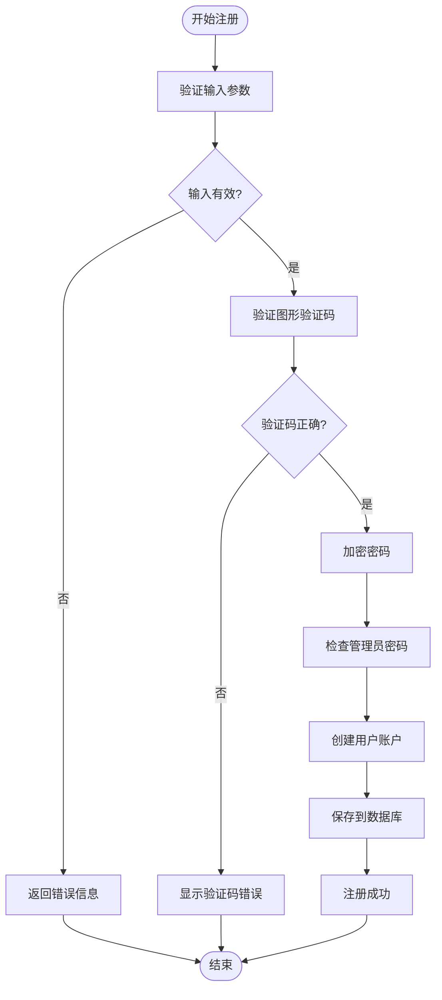

**图表来源**
- [app.py:1120-1189](file://app.py#L1120-L1189)

**章节来源**
- [app.py:1022-1189](file://app.py#L1022-L1189)

### 相册管理API

#### 图片上传流程

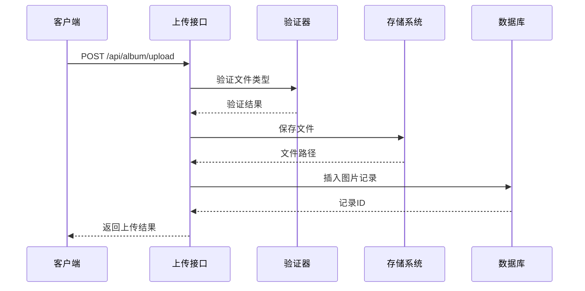

**图表来源**
- [app.py:2734-2810](file://app.py#L2734-L2810)

#### 图片管理功能

系统提供完整的相册管理功能，包括：

- **图片浏览**: 支持按分类、排序、搜索过滤
- **图片上传**: 支持多种格式，文件大小限制
- **图片下载**: 支持原图下载
- **图片分享**: 生成分享链接
- **图片评论**: 支持回复功能
- **图片点赞**: 支持点赞统计

**章节来源**
- [app.py:2538-2810](file://app.py#L2538-L2810)

### 聊天系统API

#### 实时聊天架构

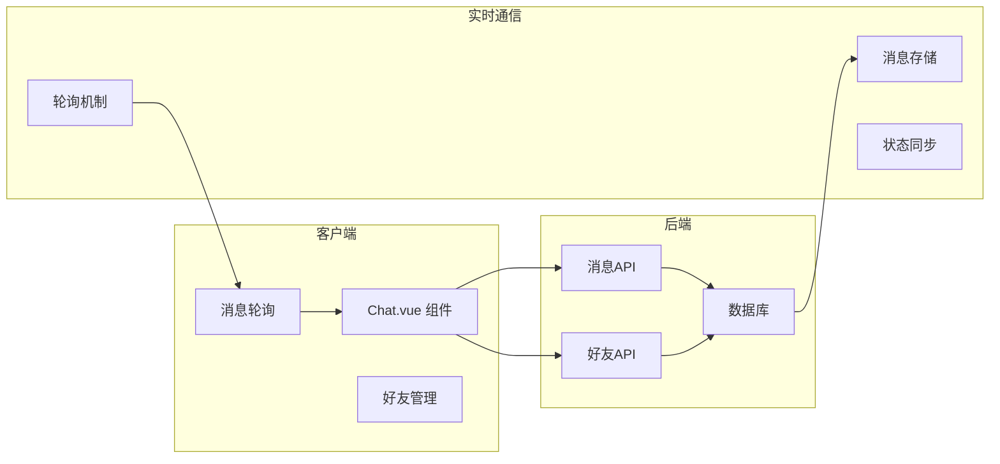

**图表来源**
- [frontend/src/components/Chat.vue:1-214](file://frontend/src/components/Chat.vue#L1-L214)
- [app.py:3547-3756](file://app.py#L3547-L3756)

#### 聊天功能详解

聊天系统支持以下功能：

- **世界频道**: 公共聊天室
- **私信功能**: 一对一聊天
- **好友系统**: 添加、接受、删除好友
- **消息搜索**: 按用户名搜索用户
- **消息撤回**: 发送者可撤回自己的消息

**章节来源**
- [frontend/src/components/Chat.vue:1-214](file://frontend/src/components/Chat.vue#L1-L214)
- [app.py:3547-3756](file://app.py#L3547-L3756)

### 系统管理API

#### 管理员功能

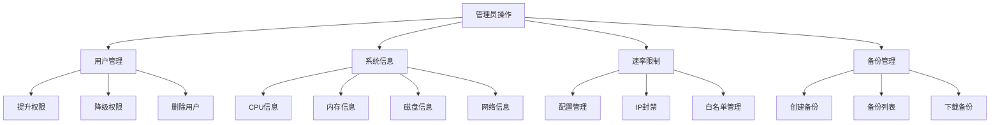

**图表来源**
- [app.py:4023-4189](file://app.py#L4023-L4189)
- [app.py:1828-1889](file://app.py#L1828-L1889)

**章节来源**
- [app.py:4023-4189](file://app.py#L4023-L4189)
- [app.py:1828-1889](file://app.py#L1828-L1889)

## 依赖分析

### 后端依赖

项目的主要后端依赖包括：

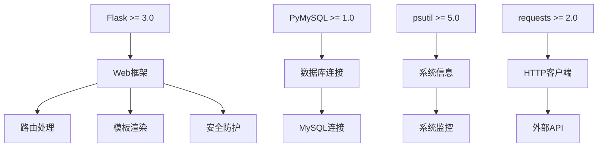

**图表来源**
- [requirements.txt:1-5](file://requirements.txt#L1-L5)

### 前端依赖

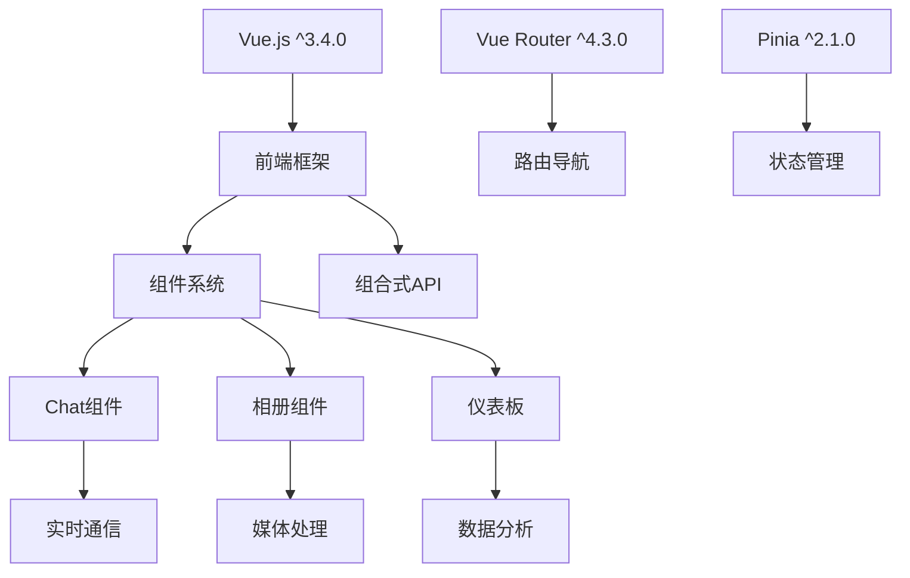

**图表来源**
- [frontend/package.json:1-21](file://frontend/package.json#L1-L21)

**章节来源**
- [requirements.txt:1-5](file://requirements.txt#L1-L5)
- [frontend/package.json:1-21](file://frontend/package.json#L1-L21)

## 性能考虑

### 速率限制机制

系统实现了多层次的速率限制机制：

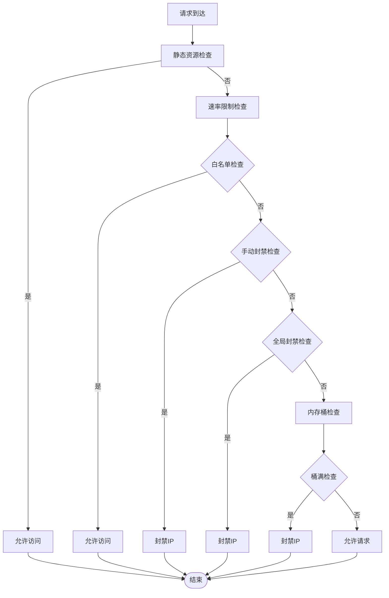

**图表来源**
- [app.py:517-565](file://app.py#L517-L565)
- [app.py:355-392](file://app.py#L355-L392)

### 缓存策略

系统采用了多种缓存策略来提升性能：

- **会话缓存**: 使用内存存储用户会话信息
- **地理位置缓存**: 缓存IP地理位置信息，减少外部API调用
- **配置缓存**: 缓存速率限制配置和白名单信息
- **模板缓存**: 缓存渲染后的HTML模板

**章节来源**
- [app.py:517-565](file://app.py#L517-L565)
- [app.py:4339-4458](file://app.py#L4339-L4458)

## 故障排除指南

### 常见问题诊断

#### 认证相关问题

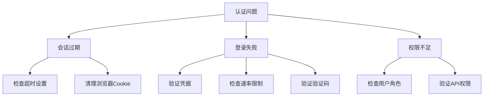

**图表来源**
- [app.py:567-596](file://app.py#L567-L596)
- [app.py:908-964](file://app.py#L908-L964)

#### API错误处理

系统提供了统一的错误处理机制：

| 状态码 | 错误类型 | 描述 |
|--------|----------|------|
| 400 | Bad Request | 请求参数错误或格式不正确 |
| 401 | Unauthorized | 未登录或会话无效 |
| 403 | Forbidden | 权限不足或访问被拒绝 |
| 404 | Not Found | 请求的资源不存在 |
| 429 | Too Many Requests | 请求过于频繁，触发速率限制 |
| 500 | Internal Server Error | 服务器内部错误 |

**章节来源**
- [app.py:4317-4334](file://app.py#L4317-L4334)

## 结论

School_Web项目提供了一个功能完整、安全性强的Web应用平台。其设计特点包括：

1. **模块化架构**: 清晰的前后端分离设计，便于维护和扩展
2. **安全防护**: 多层次的安全机制，包括认证、授权、速率限制等
3. **实时通信**: 基于轮询的聊天系统，确保消息传递的可靠性
4. **性能优化**: 多种缓存策略和性能优化技术
5. **用户体验**: 现代化的界面设计和良好的交互体验

该项目为类似的学生社区或校园应用提供了优秀的参考实现。

## 附录

### API使用示例

#### 基本API调用

```javascript
// 基础API封装
const BASE = '/api/album'

// 获取相册图片
fetch(`${BASE}/images?category=graduation&sort=newest`)
  .then(response => response.json())
  .then(data => console.log(data))

// 上传图片
const formData = new FormData()
formData.append('image', fileInput.files[0])
formData.append('category', 'graduation')
formData.append('name', '毕业照')

fetch(`${BASE}/upload`, {
  method: 'POST',
  credentials: 'include',
  body: formData
})
```

**章节来源**
- [frontend/src/api.js:1-45](file://frontend/src/api.js#L1-L45)

### 客户端集成指南

#### Vue.js集成

```javascript
// 在Vue组件中使用API
import { ref, onMounted } from 'vue'

export default {
  setup() {
    const images = ref([])
    const loading = ref(false)
    
    const fetchImages = async () => {
      loading.value = true
      try {
        const response = await fetch('/api/album/images?category=graduation')
        images.value = await response.json()
      } catch (error) {
        console.error('获取图片失败:', error)
      } finally {
        loading.value = false
      }
    }
    
    onMounted(fetchImages)
    
    return { images, loading }
  }
}
```

**章节来源**
- [frontend/src/components/Chat.vue:158-164](file://frontend/src/components/Chat.vue#L158-L164)

### WebSocket接口说明

**注意**: 经过代码分析，该项目使用的是基于轮询的聊天实现，而非真正的WebSocket。聊天系统通过定期轮询API来获取最新消息，这种方式虽然简单可靠，但在高并发场景下可能不如WebSocket高效。

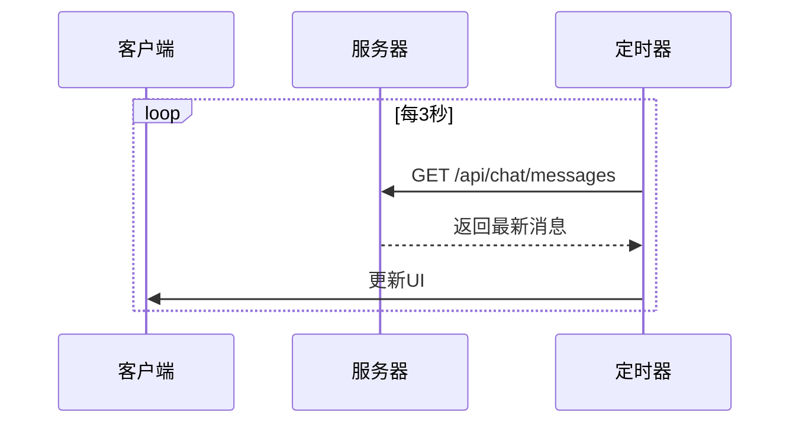

**图表来源**
- [frontend/src/components/Chat.vue:158-164](file://frontend/src/components/Chat.vue#L158-L164)