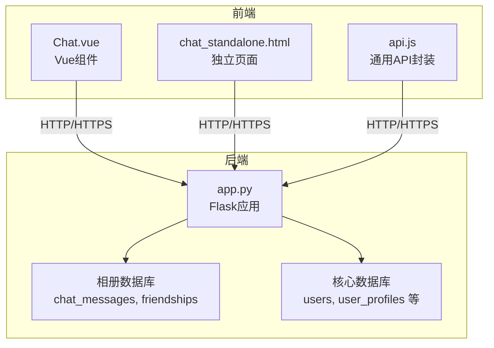
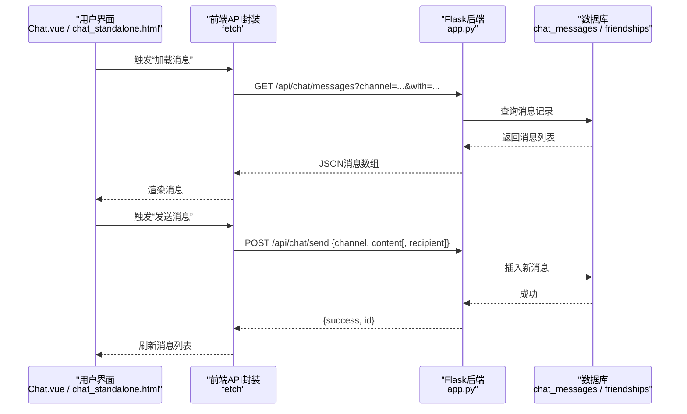
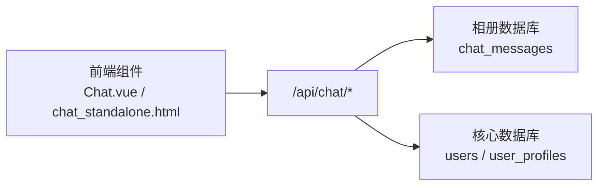

# 实时聊天API

<cite>
**本文档引用的文件**
- [app.py](file://app.py)
- [Chat.vue](file://frontend/src/components/Chat.vue)
- [chat_standalone.html](file://templates/chat_standalone.html)
- [api.js](file://frontend/src/api.js)
</cite>

## 目录
1. [简介](#简介)
2. [项目结构](#项目结构)
3. [核心组件](#核心组件)
4. [架构总览](#架构总览)
5. [详细组件分析](#详细组件分析)
6. [依赖分析](#依赖分析)
7. [性能考虑](#性能考虑)
8. [故障排查指南](#故障排查指南)
9. [结论](#结论)
10. [附录](#附录)

## 简介
本文件为实时聊天系统的完整API文档，涵盖以下能力：
- 聊天室消息发送与接收（世界频道与私信）
- 好友系统（添加、接受、删除、请求列表）
- 消息存储与历史记录查询
- 消息状态管理（撤回）
- 在线状态与频道切换
- WebSocket连接说明（本仓库采用轮询方案，未实现WebSocket）
- 实时通信最佳实践与性能优化建议

## 项目结构
前端采用Vue组件与模板两种实现方式，后端基于Flask提供REST API。

图表来源
- [app.py:3544-3754](file://app.py#L3544-L3754)
- [Chat.vue:1-214](file://frontend/src/components/Chat.vue#L1-L214)
- [chat_standalone.html:1-174](file://templates/chat_standalone.html#L1-L174)
- [api.js:1-45](file://frontend/src/api.js#L1-L45)

章节来源
- [app.py:3544-3754](file://app.py#L3544-L3754)
- [Chat.vue:1-214](file://frontend/src/components/Chat.vue#L1-L214)
- [chat_standalone.html:1-174](file://templates/chat_standalone.html#L1-L174)
- [api.js:1-45](file://frontend/src/api.js#L1-L45)

## 核心组件
- 聊天消息模型
  - 字段：id、channel、sender、recipient、content、created_at
  - 索引：channel、sender、recipient、created_at
- 好友关系模型
  - 字段：id、user1、user2、status、requester、created_at
  - 约束：唯一组合(user1,user2)

章节来源
- [app.py:803-828](file://app.py#L803-L828)

## 架构总览
后端通过Flask路由提供REST API，前端通过fetch进行HTTP调用，实现消息拉取、发送、好友管理与搜索。

图表来源
- [app.py:3546-3604](file://app.py#L3546-L3604)
- [Chat.vue:80-97](file://frontend/src/components/Chat.vue#L80-L97)
- [chat_standalone.html:73-112](file://templates/chat_standalone.html#L73-L112)

## 详细组件分析

### 聊天消息API
- 获取消息列表
  - 方法与路径：GET /api/chat/messages
  - 查询参数：
    - channel: world 或 dm（默认 world）
    - with: 当channel=dm时必填，另一方用户名
    - before: 上一页末尾id（用于翻页）
    - limit: 每页条数，默认50，上限100
  - 返回：消息数组，每项包含 id、channel、sender、content、created_at
  - 示例：
    - 获取世界频道最新50条：GET /api/chat/messages?channel=world&limit=50
    - 获取与某人私信历史：GET /api/chat/messages?channel=dm&with=Alice&limit=50
- 发送消息
  - 方法与路径：POST /api/chat/send
  - 请求体字段：channel、content、recipient（当channel=dm时必填）
  - 返回：{success: true, id: 新消息id}
  - 示例：
    - 发送到世界频道：POST /api/chat/send {channel:"world", content:"Hello"}
    - 发送私信：POST /api/chat/send {channel:"dm", recipient:"Bob", content:"Hi"}
- 撤回消息
  - 方法与路径：DELETE /api/chat/messages/{mid}
  - 权限：仅消息发送者或管理员可执行
  - 行为：将content标记为“[消息已撤回]”，不物理删除
  - 返回：{success: true}

章节来源
- [app.py:3546-3604](file://app.py#L3546-L3604)
- [app.py:3735-3754](file://app.py#L3735-L3754)
- [Chat.vue:80-97](file://frontend/src/components/Chat.vue#L80-L97)
- [chat_standalone.html:73-112](file://templates/chat_standalone.html#L73-L112)

### 好友系统API
- 获取好友列表
  - 方法与路径：GET /api/chat/friends
  - 返回：[{username, nickname}, ...]
- 获取好友请求
  - 方法与路径：GET /api/chat/friends/requests
  - 返回：[{from, nickname}, ...]
- 发送好友请求
  - 方法与路径：POST /api/chat/friends/request
  - 请求体：{username: 目标用户}
  - 返回：{success: true} 或错误
- 接受好友请求
  - 方法与路径：POST /api/chat/friends/accept
  - 请求体：{username: 请求发起者}
  - 返回：{success: true}
- 删除好友
  - 方法与路径：POST /api/chat/friends/remove
  - 请求体：{username: 要删除的好友}
  - 返回：{success: true}
- 用户搜索
  - 方法与路径：GET /api/chat/search?q=关键词
  - 返回：[{username, nickname}, ...]

章节来源
- [app.py:3631-3695](file://app.py#L3631-L3695)
- [app.py:3606-3629](file://app.py#L3606-L3629)
- [Chat.vue:99-135](file://frontend/src/components/Chat.vue#L99-L135)
- [chat_standalone.html:114-163](file://templates/chat_standalone.html#L114-L163)

### 消息存储与历史记录
- 存储机制
  - 表：chat_messages
  - 字段：id、channel、sender、recipient、content、created_at
  - 索引：加速按频道、发送者、接收者、时间的查询
- 历史记录查询
  - 支持分页：通过before参数指定上一页末尾id，limit限制数量
  - 默认按id倒序返回，再由后端反转顺序保证时间递增显示
- 消息状态管理
  - 撤回：更新content为固定提示文本，保持id不变，便于历史一致性

章节来源
- [app.py:803-816](file://app.py#L803-L816)
- [app.py:3546-3579](file://app.py#L3546-L3579)
- [app.py:3735-3754](file://app.py#L3735-L3754)

### 在线状态管理与频道切换
- 在线状态
  - 采用会话维持登录状态，IP空闲超时自动登出（2分钟）
  - 会话超时检测在请求前执行，若超时则重定向至登录页
- 频道切换
  - 世界频道：channel=world
  - 私信频道：channel=dm，并携带with=对方用户名
- 前端实现
  - Vue组件与独立HTML页面均定时轮询刷新消息与好友列表
  - 支持右键菜单撤回消息（仅发送者）

章节来源
- [app.py:508-592](file://app.py#L508-L592)
- [Chat.vue:155-156](file://frontend/src/components/Chat.vue#L155-L156)
- [chat_standalone.html:70-71](file://templates/chat_standalone.html#L70-L71)

### WebSocket连接说明
- 本仓库未实现WebSocket实时推送，采用前端定时轮询（约3秒一次）拉取消息与好友状态。
- 若需引入WebSocket，建议：
  - 使用Flask-SocketIO或类似库
  - 建立用户到房间的连接映射
  - 在消息入库后向相关房间广播
  - 结合Redis实现多实例共享状态

[本节为概念性说明，不直接分析具体文件]

## 依赖分析
- 前端到后端
  - Chat.vue与chat_standalone.html均通过fetch调用/app/chat*系列API
  - api.js提供通用fetch封装，但聊天模块直接使用/app/chat路径
- 后端到数据库
  - 相册数据库：chat_messages、friendships
  - 核心数据库：users、user_profiles等（用于搜索与用户信息）

图表来源
- [app.py:3546-3695](file://app.py#L3546-L3695)
- [Chat.vue:78-104](file://frontend/src/components/Chat.vue#L78-L104)
- [chat_standalone.html:73-163](file://templates/chat_standalone.html#L73-L163)

章节来源
- [app.py:3546-3695](file://app.py#L3546-L3695)
- [Chat.vue:78-104](file://frontend/src/components/Chat.vue#L78-L104)
- [chat_standalone.html:73-163](file://templates/chat_standalone.html#L73-L163)

## 性能考虑
- 前端轮询策略
  - 建议将轮询间隔调整为5–10秒，减少服务器压力
  - 对于高并发场景，可改为增量拉取（仅拉取新增消息）
- 数据库优化
  - 已有索引：channel、sender、recipient、created_at
  - 建议：为消息内容建立全文索引（如需按内容检索），或在业务层做关键词缓存
- 速率限制与安全
  - 后端对IP请求频率进行限制，超限封禁
  - 登录态保护：所有/api/chat*接口均要求登录
- 前端渲染
  - 大量消息时建议虚拟滚动
  - 撤回消息仅替换content，避免频繁重绘

[本节提供一般性建议，不直接分析具体文件]

## 故障排查指南
- 401 未登录
  - 现象：调用/api/chat/*返回“请先登录”
  - 处理：确保浏览器携带Cookie，或在请求中包含credentials: 'include'
- 403 权限不足
  - 现象：撤回他人消息或非管理员操作管理接口
  - 处理：仅消息发送者或管理员可撤回；检查用户权限
- 404 消息不存在
  - 现象：撤回不存在的消息id
  - 处理：确认mid正确，或先拉取最新消息列表
- 400 参数错误
  - 现象：channel为空、content为空、recipient缺失等
  - 处理：检查请求体字段与类型
- 500 数据库错误
  - 现象：数据库连接失败或写入异常
  - 处理：检查数据库连通性与权限

章节来源
- [app.py:3581-3604](file://app.py#L3581-L3604)
- [app.py:3735-3754](file://app.py#L3735-L3754)
- [app.py:907-916](file://app.py#L907-L916)

## 结论
本聊天系统通过简洁的REST API实现了消息收发、好友管理与历史查询，前端采用轮询策略满足实时性需求。后续可引入WebSocket与增量拉取、虚拟滚动与全文检索等优化手段，进一步提升用户体验与系统性能。

[本节为总结性内容，不直接分析具体文件]

## 附录

### API一览表
- GET /api/chat/messages
  - 查询参数：channel, with, before, limit
  - 返回：消息数组
- POST /api/chat/send
  - 请求体：channel, content, recipient(可选)
  - 返回：{success, id}
- DELETE /api/chat/messages/{mid}
  - 返回：{success}
- GET /api/chat/friends
  - 返回：好友列表
- GET /api/chat/friends/requests
  - 返回：待处理请求
- POST /api/chat/friends/request
  - 请求体：{username}
  - 返回：{success} 或错误
- POST /api/chat/friends/accept
  - 请求体：{username}
  - 返回：{success}
- POST /api/chat/friends/remove
  - 请求体：{username}
  - 返回：{success}
- GET /api/chat/search?q=关键词
  - 返回：用户列表

章节来源
- [app.py:3546-3695](file://app.py#L3546-L3695)