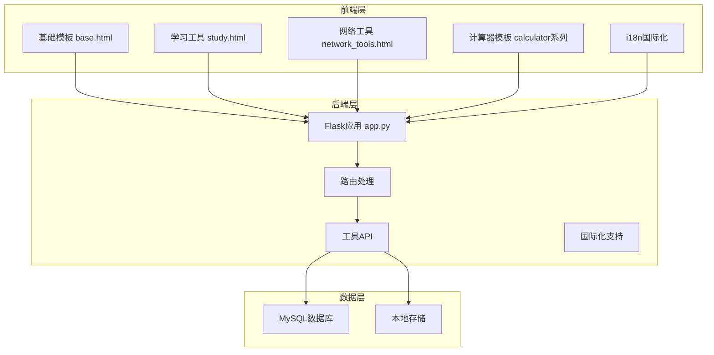
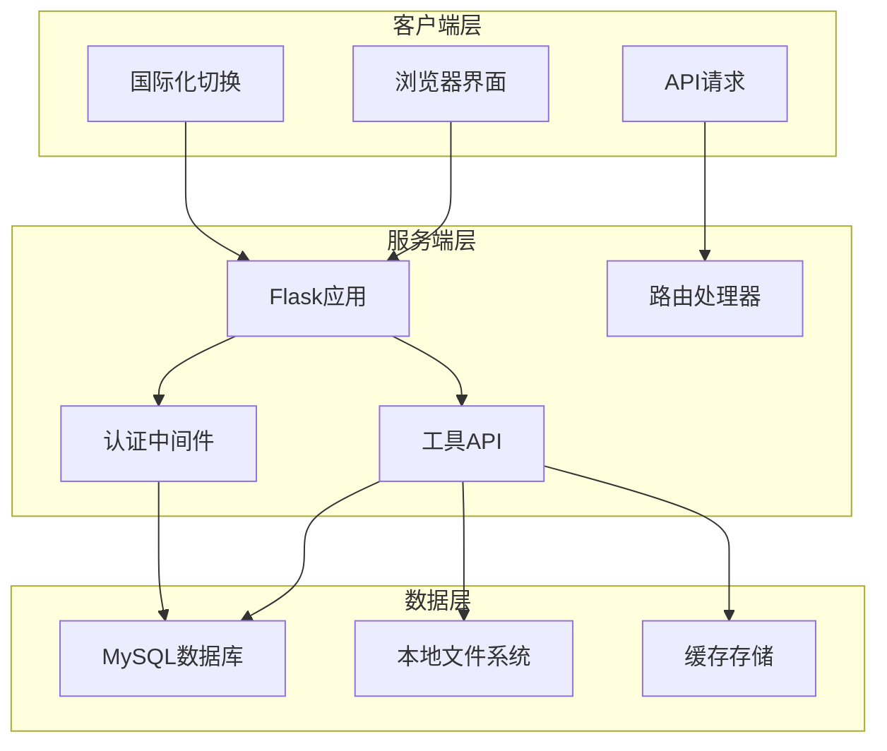
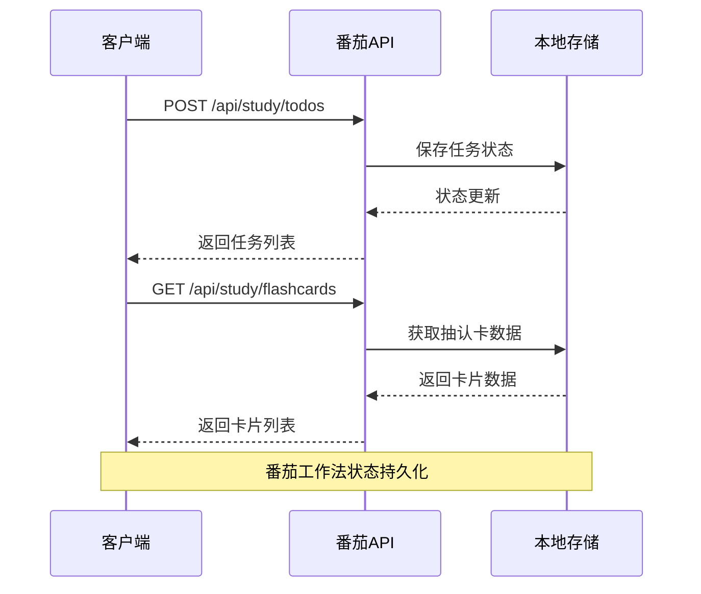
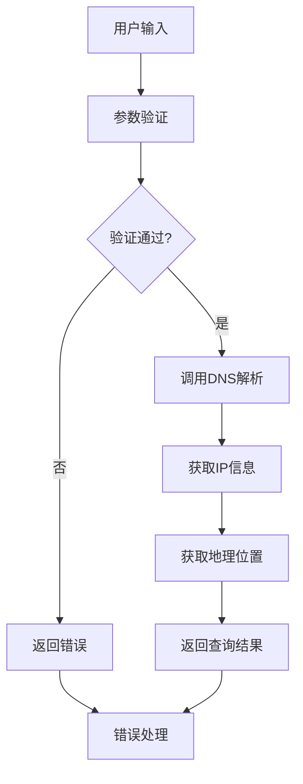
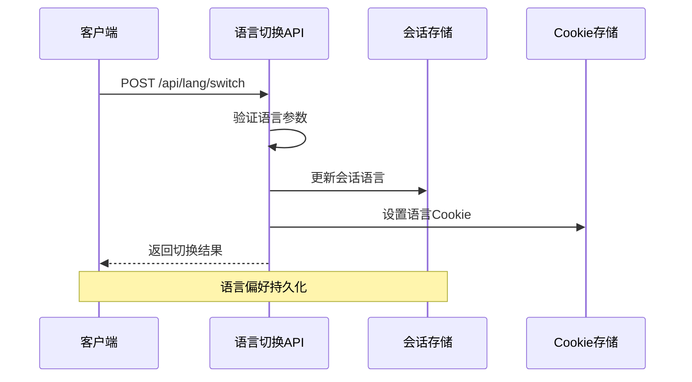
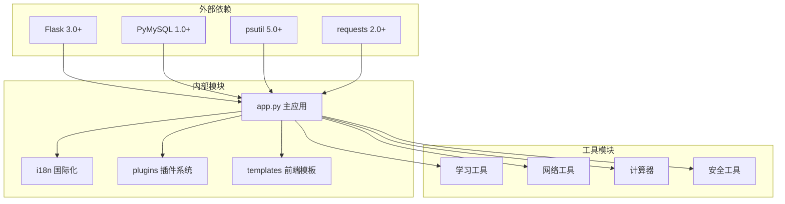

# 工具类API

<cite>
**本文档引用的文件**
- [app.py](file://app.py)
- [study.html](file://templates/study.html)
- [network_tools.html](file://templates/network_tools.html)
- [calculator.html](file://templates/calculator.html)
- [calculator_sci.html](file://templates/calculator_sci.html)
- [calculator_net.html](file://templates/calculator_net.html)
- [base.html](file://templates/base.html)
- [zh-CN.json](file://i18n/zh-CN.json)
- [en.json](file://i18n/en.json)
- [ko.json](file://i18n/ko.json)
</cite>

## 目录
1. [简介](#简介)
2. [项目结构](#项目结构)
3. [核心组件](#核心组件)
4. [架构概览](#架构概览)
5. [详细组件分析](#详细组件分析)
6. [依赖分析](#依赖分析)
7. [性能考虑](#性能考虑)
8. [故障排除指南](#故障排除指南)
9. [结论](#结论)
10. [附录](#附录)

## 简介
本项目是一个集成了多种工具类功能的Web应用，主要包含学习工具、网络诊断工具、计算器功能以及国际化支持。系统采用Flask后端配合前端模板渲染的方式，提供完整的工具类API接口。

## 项目结构
项目采用前后端分离的模板渲染架构，主要分为以下几个部分：



**图表来源**
- [base.html:1-337](file://templates/base.html#L1-L337)
- [app.py:1-800](file://app.py#L1-L800)

**章节来源**
- [base.html:1-337](file://templates/base.html#L1-L337)
- [app.py:1-800](file://app.py#L1-L800)

## 核心组件

### 学习工具模块
学习工具模块提供了完整的学习辅助功能，包括番茄工作法、待办清单、抽认卡、词典查询等核心功能。

**章节来源**
- [study.html:1-669](file://templates/study.html#L1-L669)

### 网络诊断工具模块
网络诊断工具模块集成了多种网络诊断功能，包括IP查询、端口扫描、DNS解析、Ping检测等网络诊断工具。

**章节来源**
- [network_tools.html:1-328](file://templates/network_tools.html#L1-L328)

### 计算器功能模块
计算器功能模块包含三种不同类型的计算器：普通计算器、科学计算器和网络计算器，满足不同的计算需求。

**章节来源**
- [calculator.html:1-111](file://templates/calculator.html#L1-L111)
- [calculator_sci.html:1-210](file://templates/calculator_sci.html#L1-L210)
- [calculator_net.html:1-188](file://templates/calculator_net.html#L1-L188)

### 国际化支持模块
国际化支持模块提供了多语言切换功能，支持简体中文、英语和韩语等多种语言。

**章节来源**
- [zh-CN.json:1-477](file://i18n/zh-CN.json#L1-L477)
- [en.json:1-477](file://i18n/en.json#L1-L477)
- [ko.json:1-486](file://i18n/ko.json#L1-L486)

## 架构概览



**图表来源**
- [app.py:119-195](file://app.py#L119-L195)
- [base.html:253-266](file://templates/base.html#L253-L266)

## 详细组件分析

### 学习工具API

#### 番茄工作法API
番茄工作法实现了经典的番茄工作法时间管理功能，支持专注时间和休息时间的切换。



**图表来源**
- [study.html:489-496](file://templates/study.html#L489-L496)
- [study.html:500-530](file://templates/study.html#L500-L530)

#### 待办清单API
待办清单提供了完整的任务管理功能，包括任务的增删改查和优先级管理。

**章节来源**
- [study.html:489-496](file://templates/study.html#L489-L496)

#### 抽认卡API
抽认卡系统支持卡片的创建、复习和难度评估，采用间隔重复算法优化记忆效果。

**章节来源**
- [study.html:500-530](file://templates/study.html#L500-L530)

#### 词典查询API
集成了外部词典API，提供英汉词典查询功能，支持单词发音、词性和例句展示。

**章节来源**
- [study.html:540-571](file://templates/study.html#L540-L571)

### 网络诊断工具API

#### IP查询API
IP查询功能支持域名解析和IP地址查询，提供详细的网络信息。



**图表来源**
- [network_tools.html:207-235](file://templates/network_tools.html#L207-L235)

#### 端口扫描API
端口扫描功能支持TCP端口扫描，提供目标主机的开放端口信息和操作系统识别。

**章节来源**
- [network_tools.html:207-235](file://templates/network_tools.html#L207-L235)

#### DNS解析API
DNS解析工具支持多种DNS记录类型的查询，包括A记录、MX记录、NS记录等。

**章节来源**
- [network_tools.html:214-216](file://templates/network_tools.html#L214-L216)

#### Ping检测API
Ping检测功能提供网络连通性测试，支持自定义探测次数和目标主机。

**章节来源**
- [network_tools.html:207-209](file://templates/network_tools.html#L207-L209)

### 计算器API

#### 普通计算器API
普通计算器提供基本的四则运算功能，支持连续计算和百分比计算。

**章节来源**
- [calculator.html:48-108](file://templates/calculator.html#L48-L108)

#### 科学计算器API
科学计算器支持三角函数、对数函数、幂运算等高级数学运算，支持角度制和弧度制切换。

**章节来源**
- [calculator_sci.html:74-207](file://templates/calculator_sci.html#L74-L207)

#### 网络计算器API
网络计算器专门用于网络相关的计算，包括子网计算、IP地址转换和网络掩码计算。

**章节来源**
- [calculator_net.html:71-185](file://templates/calculator_net.html#L71-L185)

### 国际化API

#### 语言切换API
语言切换API提供动态语言切换功能，支持简体中文、英语和韩语的无缝切换。



**图表来源**
- [base.html:253-266](file://templates/base.html#L253-L266)
- [app.py:214-228](file://app.py#L214-L228)

**章节来源**
- [base.html:253-266](file://templates/base.html#L253-L266)
- [app.py:214-228](file://app.py#L214-L228)

## 依赖分析



**图表来源**
- [requirements.txt:1-5](file://requirements.txt#L1-L5)
- [app.py:1-25](file://app.py#L1-L25)

**章节来源**
- [requirements.txt:1-5](file://requirements.txt#L1-L5)
- [app.py:1-25](file://app.py#L1-L25)

## 性能考虑
- **缓存策略**：使用本地存储和会话存储减少重复计算
- **异步处理**：网络工具采用异步请求避免阻塞UI
- **资源优化**：模板渲染和静态资源缓存优化加载性能
- **数据库优化**：合理的索引设计和查询优化

## 故障排除指南

### 常见问题及解决方案

#### 语言切换失效
- 检查Cookie设置是否正确
- 确认会话存储正常工作
- 验证语言文件完整性

#### 网络工具超时
- 检查网络连接状态
- 验证目标主机可达性
- 调整超时参数设置

#### 计算器异常
- 检查输入格式是否正确
- 验证数学表达式合法性
- 确认特殊函数参数范围

**章节来源**
- [app.py:214-228](file://app.py#L214-L228)
- [network_tools.html:207-235](file://templates/network_tools.html#L207-L235)

## 结论
本工具类API系统提供了完整的学习辅助、网络诊断和计算功能，具有良好的扩展性和用户体验。通过模块化的架构设计和完善的国际化支持，能够满足不同用户群体的需求。

## 附录

### API使用示例

#### 学习工具使用示例
```javascript
// 添加待办任务
fetch('/api/study/todos', {
    method: 'POST',
    headers: {'Content-Type': 'application/json'},
    body: JSON.stringify({
        title: '学习Flask',
        priority: 1,
        due_date: '2024-01-01'
    })
})

// 获取抽认卡复习
fetch('/api/study/flashcards/review?random=1')
```

#### 网络工具使用示例
```javascript
// IP查询
fetch('/api/network/ip_query', {
    method: 'POST',
    headers: {'Content-Type': 'application/json'},
    body: JSON.stringify({target: 'example.com'})
})

// 端口扫描
fetch('/api/network/port_scan', {
    method: 'POST',
    headers: {'Content-Type': 'application/json'},
    body: JSON.stringify({
        target: '192.168.1.1',
        start_port: 1,
        end_port: 1024
    })
})
```

#### 计算器使用示例
```javascript
// 网络计算器 - 子网计算
fetch('/api/calculator/net/subnet', {
    method: 'POST',
    headers: {'Content-Type': 'application/json'},
    body: JSON.stringify({
        ip: '192.168.1.1',
        mask: '255.255.255.0'
    })
})
```

#### 国际化使用示例
```javascript
// 切换语言
fetch('/api/lang/switch', {
    method: 'POST',
    headers: {'Content-Type': 'application/json'},
    body: JSON.stringify({lang: 'en'})
})
```