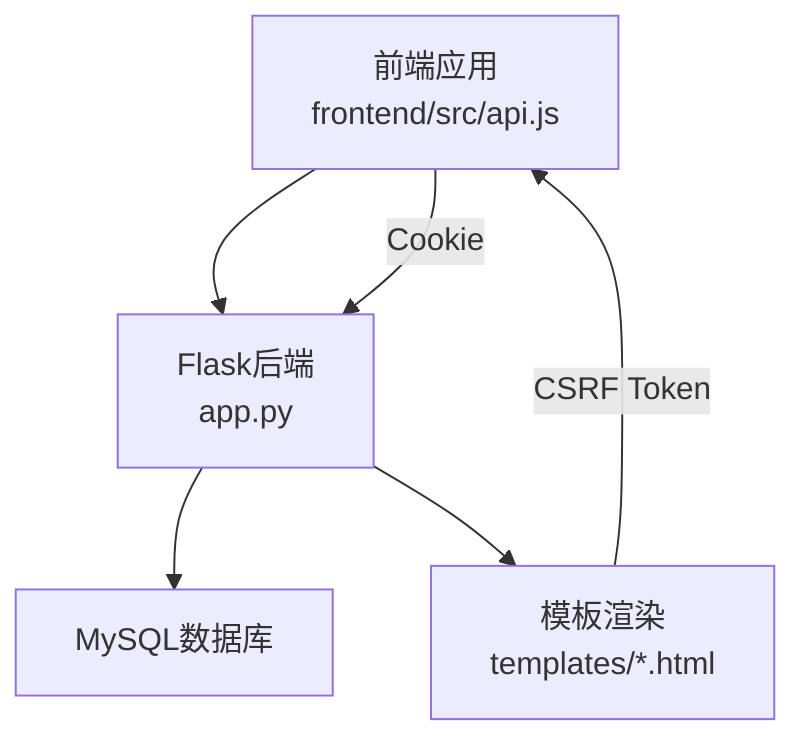
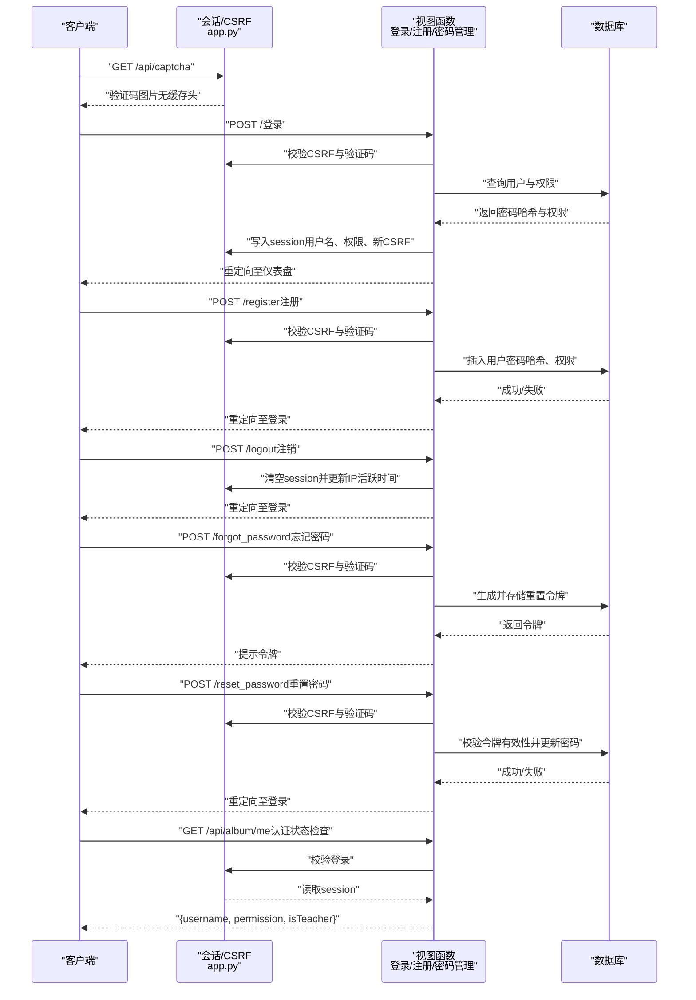
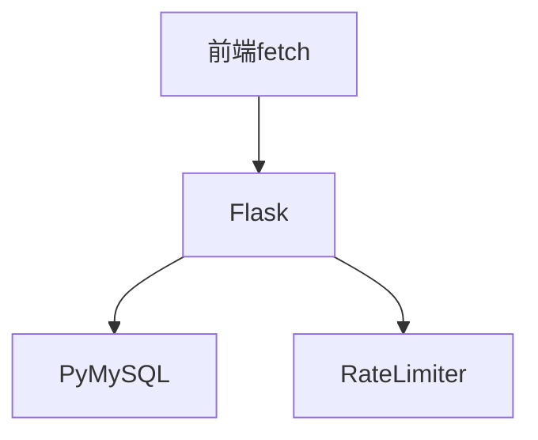

# 用户认证API

<cite>
**本文引用的文件**
- [app.py](file://app.py)
- [login.html](file://templates/login.html)
- [register.html](file://templates/register.html)
- [change_password.html](file://templates/change_password.html)
- [forgot_password.html](file://templates/forgot_password.html)
- [reset_password.html](file://templates/reset_password.html)
- [global_captcha.html](file://templates/global_captcha.html)
- [frontend/src/api.js](file://frontend/src/api.js)
- [requirements.txt](file://requirements.txt)
</cite>

## 目录
1. [简介](#简介)
2. [项目结构](#项目结构)
3. [核心组件](#核心组件)
4. [架构总览](#架构总览)
5. [详细组件分析](#详细组件分析)
6. [依赖分析](#依赖分析)
7. [性能考虑](#性能考虑)
8. [故障排查指南](#故障排查指南)
9. [结论](#结论)
10. [附录](#附录)

## 简介
本文件为“用户认证系统”的完整API文档，覆盖登录、注册、注销、密码管理等RESTful接口，以及Session认证机制、CSRF防护、验证码验证、安全响应头配置、会话管理策略、认证状态检查、权限验证与用户信息获取等。文档同时提供调用示例、错误处理说明与安全最佳实践。

## 项目结构
后端基于Flask实现，前端通过fetch调用后端API。认证相关的关键文件如下：
- 后端核心：app.py（路由、中间件、装饰器、安全策略）
- 前端API封装：frontend/src/api.js（统一携带Cookie凭据）
- 认证页面模板：templates/login.html、register.html、change_password.html、forgot_password.html、reset_password.html、global_captcha.html
- 依赖声明：requirements.txt

图表来源
- [app.py:119-139](file://app.py#L119-L139)
- [frontend/src/api.js:1-5](file://frontend/src/api.js#L1-L5)

章节来源
- [app.py:119-139](file://app.py#L119-L139)
- [frontend/src/api.js:1-5](file://frontend/src/api.js#L1-L5)
- [requirements.txt:1-5](file://requirements.txt#L1-L5)

## 核心组件
- 认证装饰器
  - 登录必需：login_required（API返回401，页面重定向至登录）
  - CSRF校验：csrf_required（表单POST校验_session中的_csrf_token或请求头X-CSRF-Token）
  - 权限控制：admin_required（管理员）、vip_required（VIP或管理员）、non_guest_required（非访客）
  - 数据库二次验证：db_captcha_required（API返回403，页面渲染db_captcha.html）
  - 文件管理器密码二次验证：fm_password_required（页面渲染fm_password.html）

- 会话与安全
  - Session配置：HttpOnly、SameSite=Lax、Secure按HTTPS环境自动开启、有效期2小时
  - 会话空闲超时：IP级2分钟无动作自动登出
  - 全站验证码门禁：已登录用户访问特定API需完成全局验证码验证
  - 安全响应头：X-Content-Type-Options、X-Frame-Options、X-XSS-Protection、Referrer-Policy、CSP（含nonce）、HSTS（生产环境）、Permissions-Policy

- 速率限制
  - 内存+文件持久化速率限制（RateLimiter类）
  - IP级全局请求频率限制（可配置）
  - 登录/注册/忘记密码等敏感操作独立速率限制

- 验证码
  - 图形验证码生成与校验（/api/captcha）
  - 登录/注册/忘记密码/重置密码/修改密码等场景的验证码校验

章节来源
- [app.py:907-964](file://app.py#L907-L964)
- [app.py:133-139](file://app.py#L133-L139)
- [app.py:508-593](file://app.py#L508-L593)
- [app.py:641-676](file://app.py#L641-L676)
- [app.py:31-114](file://app.py#L31-L114)
- [app.py:428-501](file://app.py#L428-L501)

## 架构总览
认证流程概览（登录、注册、注销、密码管理、状态检查）：

图表来源
- [app.py:1021-1117](file://app.py#L1021-L1117)
- [app.py:1119-1188](file://app.py#L1119-L1188)
- [app.py:1191-1203](file://app.py#L1191-L1203)
- [app.py:1209-1258](file://app.py#L1209-L1258)
- [app.py:1261-1321](file://app.py#L1261-L1321)
- [app.py:3118-3127](file://app.py#L3118-L3127)

## 详细组件分析

### 登录接口
- 路由
  - 方法：GET/POST
  - 路径：/
  - 功能：展示登录表单或处理登录逻辑
- 请求参数（POST）
  - username：字符串，必填
  - password：字符串，必填
  - captcha：字符串，必填（4位）
  - _csrf_token：表单隐藏字段，必填
- 成功响应
  - 重定向至仪表盘
  - 写入session：username、permission、新的_csrf_token
  - 记录活动日志
- 失败与错误
  - 验证码错误：返回登录页并提示
  - 账户锁定：连续错误达阈值锁定5分钟
  - 数据库错误：返回错误提示
  - API场景下（如前端直连）：返回JSON错误与401
- CSRF与验证码
  - 表单提交前生成并存储_csrf_token
  - 验证码校验通过后方可继续
- 速率限制
  - 每IP每60秒最多5次POST
- 安全响应头
  - 登录页HTML不缓存
- 会话管理
  - 登录成功后更新session与CSRF
  - 会话空闲超时检测（2分钟）

章节来源
- [app.py:1021-1117](file://app.py#L1021-L1117)
- [templates/login.html:8-26](file://templates/login.html#L8-L26)
- [app.py:428-501](file://app.py#L428-L501)
- [app.py:919-932](file://app.py#L919-L932)
- [app.py:508-593](file://app.py#L508-L593)
- [app.py:641-676](file://app.py#L641-L676)

### 注册接口
- 路由
  - 方法：GET/POST
  - 路径：/register
  - 功能：展示注册表单或处理注册逻辑
- 请求参数（POST）
  - username：字符串，必填
  - password：字符串，必填（至少8位且包含字母与数字）
  - confirm：字符串，必填（与password一致）
  - admin_pwd：字符串，选填（正确则授予管理员权限）
  - captcha：字符串，必填（4位）
  - _csrf_token：表单隐藏字段，必填
- 成功响应
  - 重定向至登录页，提示权限（管理员/访客）
  - 数据库插入用户（密码哈希存储）
- 失败与错误
  - 密码不一致、长度不足、缺少字母/数字
  - 验证码错误
  - 用户名冲突
  - 数据库错误
- 速率限制
  - 每IP每60秒最多5次POST
- 权限判定
  - 正确的admin_pwd授予管理员权限，否则默认访客

章节来源
- [app.py:1119-1188](file://app.py#L1119-L1188)
- [templates/register.html:8-38](file://templates/register.html#L8-L38)
- [app.py:428-501](file://app.py#L428-L501)

### 注销接口
- 路由
  - 方法：GET/POST
  - 路径：/logout
  - 功能：显示确认页（GET）或执行登出（POST）
- 行为
  - 清空session并更新IP活跃时间
  - 重定向至登录页
- 会话空闲超时
  - 登出后IP活跃时间被清理

章节来源
- [app.py:1191-1203](file://app.py#L1191-L1203)
- [app.py:508-593](file://app.py#L508-L593)

### 忘记密码接口
- 路径：/forgot_password
- 方法：GET/POST
- 请求参数（POST）
  - username：字符串，必填
  - captcha：字符串，必填（4位）
  - _csrf_token：表单隐藏字段，必填
- 行为
  - 校验验证码
  - 生成UUID令牌，有效期10分钟，写入password_reset_tokens表
  - 返回令牌（提示复制）
- 速率限制
  - 每IP每3分钟最多3次

章节来源
- [app.py:1209-1258](file://app.py#L1209-L1258)
- [templates/forgot_password.html:9-23](file://templates/forgot_password.html#L9-L23)
- [app.py:428-501](file://app.py#L428-L501)

### 重置密码接口
- 路径：/reset_password
- 方法：GET/POST
- 请求参数（POST）
  - username：字符串，必填
  - token：字符串，必填（来自忘记密码流程）
  - new_pwd：字符串，必填（至少8位且包含字母与数字）
  - confirm_pwd：字符串，必填（与new_pwd一致）
  - captcha：字符串，必填（4位）
  - _csrf_token：表单隐藏字段，必填
- 行为
  - 校验验证码
  - 校验令牌有效性与未过期
  - 新密码不得与旧密码相同
  - 更新密码并标记令牌为已使用
  - 重定向至登录页

章节来源
- [app.py:1261-1321](file://app.py#L1261-L1321)
- [templates/reset_password.html:8-35](file://templates/reset_password.html#L8-L35)
- [app.py:428-501](file://app.py#L428-L501)

### 修改密码接口
- 路径：/change_password（模板页面）
- 方法：GET/POST
- 请求参数（POST）
  - is_admin：布尔（管理员模式）
  - target_user：字符串（管理员可修改任意用户）
  - old_pwd：字符串（非管理员必填）
  - new_pwd：字符串，必填（至少8位且包含字母与数字）
  - confirm_pwd：字符串，必填（与new_pwd一致）
  - captcha：字符串，必填（4位）
  - _csrf_token：表单隐藏字段，必填
- 行为
  - 校验验证码
  - 非管理员需提供旧密码
  - 新密码不得与旧密码相同
  - 更新密码并记录日志

章节来源
- [app.py:3879-3950](file://app.py#L3879-L3950)
- [templates/change_password.html:12-59](file://templates/change_password.html#L12-L59)
- [app.py:428-501](file://app.py#L428-L501)

### 认证状态检查与用户信息
- 路径：/api/album/me
- 方法：GET
- 鉴权：login_required
- 响应
  - username：当前用户名
  - permission：当前权限（guest/vip/administrator）
  - isTeacher：是否管理员（布尔）

章节来源
- [app.py:3118-3127](file://app.py#L3118-L3127)

### CSRF防护机制
- 生成与存储
  - 每次进入受保护页面时生成随机_csrf_token并存储于session
- 校验策略
  - 非GET请求：校验表单字段或请求头X-CSRF-Token与session中的_csrf_token一致性
  - 校验采用恒等比较（防止时序攻击）
- 影响范围
  - 登录、注册、忘记密码、重置密码、修改密码、部分API等

章节来源
- [app.py:919-932](file://app.py#L919-L932)
- [templates/login.html:9](file://templates/login.html#L9)
- [templates/register.html:9](file://templates/register.html#L9)
- [templates/change_password.html:13](file://templates/change_password.html#L13)
- [templates/forgot_password.html:10](file://templates/forgot_password.html#L10)
- [templates/reset_password.html:9](file://templates/reset_password.html#L9)

### 验证码验证与全局验证码门禁
- 图形验证码
  - 生成：/api/captcha（返回PNG图片，禁用缓存）
  - 校验：登录/注册/忘记密码/重置密码/修改密码等场景
- 全局验证码门禁
  - 已登录用户访问非跳过路径的API时，若未完成全局验证码验证，则返回403或渲染验证码页面
  - 跳过列表：首页、注册、注销、忘记密码、重置密码、计算器、笔记、修改密码、个人资料、作者、聊天、验证码接口等

章节来源
- [app.py:428-501](file://app.py#L428-L501)
- [app.py:600-622](file://app.py#L600-L622)
- [templates/global_captcha.html:10-19](file://templates/global_captcha.html#L10-L19)

### 会话管理策略
- Session配置
  - HttpOnly=True、SameSite=Lax、Secure按HTTPS环境自动开启
  - 会话有效期2小时
- 会话空闲超时
  - IP级2分钟无动作自动登出，下次请求强制重新登录
- 会话清理
  - 注销时清空session并更新IP活跃时间

章节来源
- [app.py:133-139](file://app.py#L133-L139)
- [app.py:508-593](file://app.py#L508-L593)
- [app.py:1191-1203](file://app.py#L1191-L1203)

### 权限验证
- 权限枚举：guest、vip、administrator
- 装饰器
  - admin_required：仅管理员
  - vip_required：VIP或管理员
  - non_guest_required：非访客
  - login_required：登录必需（API返回401，页面重定向）
- 示例
  - /api/album/me：login_required
  - 管理员申请/审核：admin_required

章节来源
- [app.py:934-964](file://app.py#L934-L964)
- [app.py:3118-3127](file://app.py#L3118-L3127)

### 安全响应头配置
- X-Content-Type-Options: nosniff
- X-Frame-Options: SAMEORIGIN
- X-XSS-Protection: 1; mode=block
- Referrer-Policy: strict-origin-when-cross-origin
- Content-Security-Policy: 默认自站资源，脚本与样式使用nonce，禁止外站脚本与内联（除必要处）
- Strict-Transport-Security: 生产环境启用（HSTS）
- Permissions-Policy: camera/microphone/geolocation禁用
- Server头隐藏
- HTML页面禁用缓存

章节来源
- [app.py:641-676](file://app.py#L641-L676)

### API调用示例（基于前端封装）
- 基础
  - 所有API请求携带Cookie（credentials: include）
  - 前端封装位于frontend/src/api.js
- 示例
  - 获取当前用户信息：GET /api/album/me
  - 上传图片：POST /api/album/upload（multipart/form-data）
  - 修改密码：POST /change_password（表单，需_csrf_token与验证码）
  - 忘记密码：POST /forgot_password（表单，需_csrf_token与验证码）
  - 重置密码：POST /reset_password（表单，需_csrf_token与验证码）

章节来源
- [frontend/src/api.js:1-5](file://frontend/src/api.js#L1-L5)
- [app.py:3879-3950](file://app.py#L3879-L3950)
- [app.py:1209-1258](file://app.py#L1209-L1258)
- [app.py:1261-1321](file://app.py#L1261-L1321)

## 依赖分析
- 后端框架：Flask（版本要求见requirements.txt）
- 数据库：PyMySQL（MySQL）
- 速率限制：内存+文件持久化（RateLimiter类）
- 前端：fetch统一携带Cookie，便于Session认证

图表来源
- [requirements.txt:1-5](file://requirements.txt#L1-L5)
- [app.py:31-114](file://app.py#L31-L114)

章节来源
- [requirements.txt:1-5](file://requirements.txt#L1-L5)
- [app.py:31-114](file://app.py#L31-L114)

## 性能考虑
- 会话空闲超时（2分钟）可减少长时间占用的会话资源
- 速率限制（IP级与内存桶）降低暴力破解与滥用风险
- CSP与安全响应头减少XSS与点击劫持风险，间接提升整体安全性
- 建议
  - 对高频API引入缓存层（如Redis）以减轻数据库压力
  - 将验证码生成与校验逻辑异步化，避免阻塞请求线程
  - 使用HTTPS与HSTS，确保传输安全

## 故障排查指南
- 401 未授权
  - 未登录访问受login_required保护的API
  - 处理：先登录或携带有效Session
- 403 安全验证失败
  - CSRF校验失败或未完成全局验证码验证
  - 处理：确保表单包含_csrf_token或完成验证码验证
- 429 请求过于频繁
  - 触发速率限制
  - 处理：等待冷却时间或调整请求频率
- 403 需要数据库操作验证
  - 触发db_captcha_required装饰器
  - 处理：完成db_captcha页面的验证码校验
- 403 需要VIP或管理员权限
  - 触发vip_required装饰器
  - 处理：申请VIP或联系管理员
- 400 参数错误
  - 忘记密码/重置密码/修改密码时参数不合法
  - 处理：检查用户名、验证码、新密码与确认密码格式

章节来源
- [app.py:907-964](file://app.py#L907-L964)
- [app.py:966-988](file://app.py#L966-L988)
- [app.py:514-562](file://app.py#L514-L562)
- [app.py:1209-1258](file://app.py#L1209-L1258)
- [app.py:1261-1321](file://app.py#L1261-L1321)
- [app.py:3879-3950](file://app.py#L3879-L3950)

## 结论
本认证体系通过Session+CSRF+验证码+速率限制+安全响应头等多层防护，结合权限装饰器与会话空闲超时策略，提供了较为完善的用户认证与授权能力。建议在生产环境中启用HTTPS与HSTS，并根据业务流量进一步优化速率限制与缓存策略。

## 附录
- 常用路径速览
  - 登录：GET/POST /
  - 注册：GET/POST /register
  - 注销：GET/POST /logout
  - 忘记密码：GET/POST /forgot_password
  - 重置密码：GET/POST /reset_password
  - 修改密码：模板页面 /change_password
  - 验证码：GET /api/captcha
  - 认证状态：GET /api/album/me