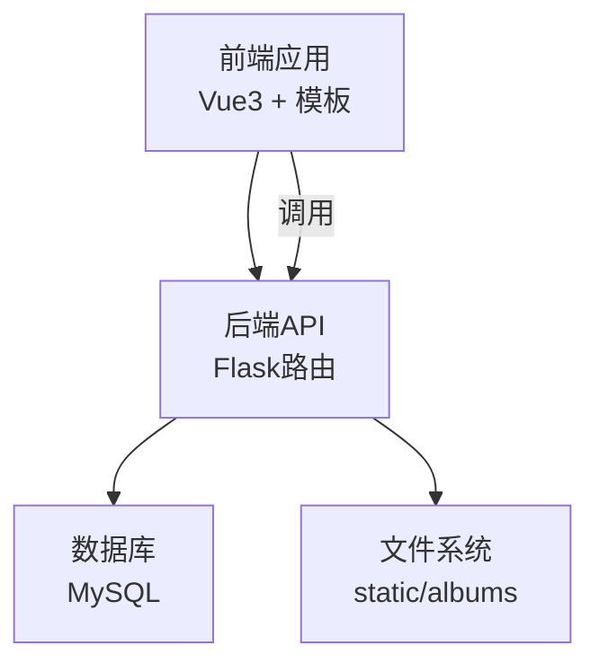
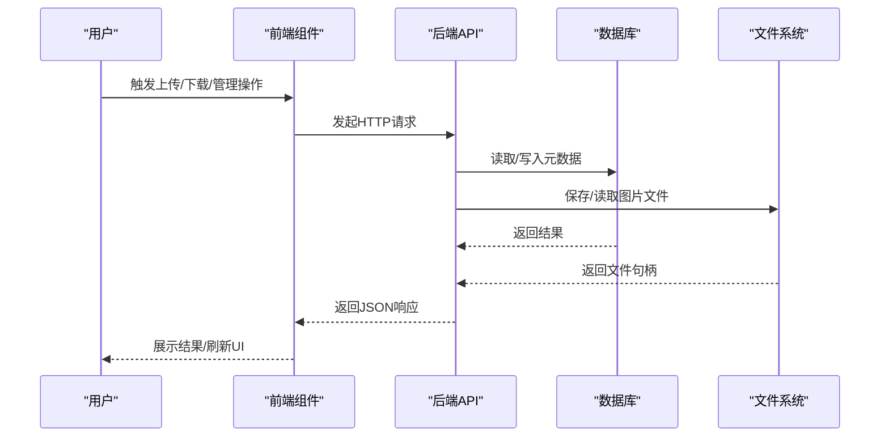
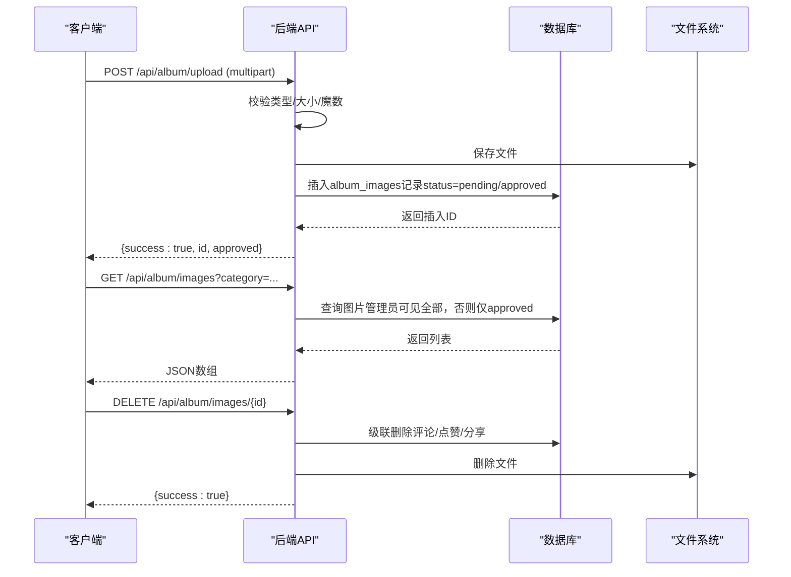
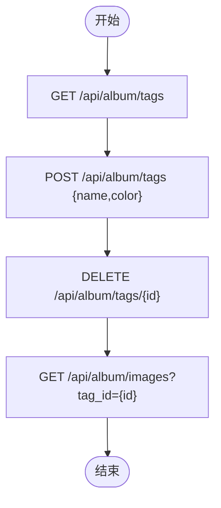
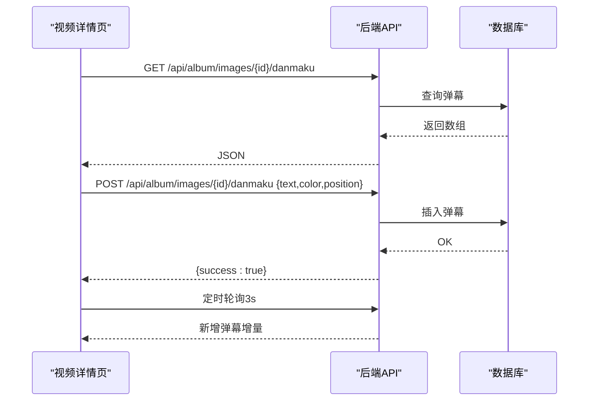
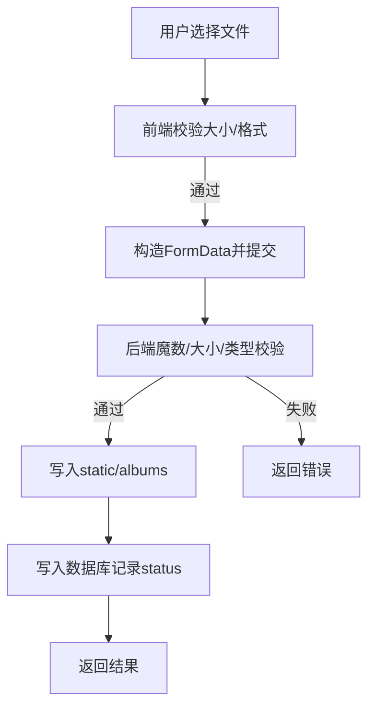
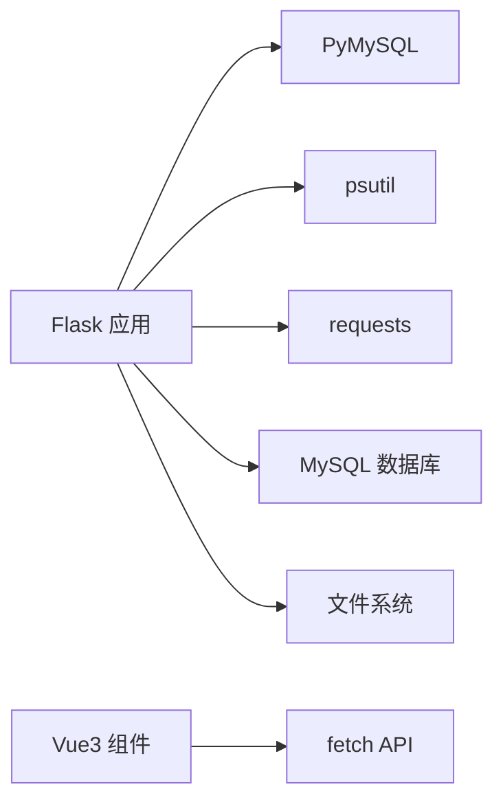

# 相册管理API

<cite>
**本文引用的文件**
- [app.py](file://app.py)
- [api.js](file://frontend/src/api.js)
- [ImageGrid.vue](file://frontend/src/components/ImageGrid.vue)
- [UploadModal.vue](file://frontend/src/components/UploadModal.vue)
- [Danmaku.vue](file://frontend/src/components/Danmaku.vue)
- [TagFilter.vue](file://frontend/src/components/TagFilter.vue)
- [album_vue3.html](file://templates/album_vue3.html)
- [requirements.txt](file://requirements.txt)
</cite>

## 目录
1. [简介](#简介)
2. [项目结构](#项目结构)
3. [核心组件](#核心组件)
4. [架构总览](#架构总览)
5. [详细组件分析](#详细组件分析)
6. [依赖分析](#依赖分析)
7. [性能考量](#性能考量)
8. [故障排查指南](#故障排查指南)
9. [结论](#结论)
10. [附录](#附录)

## 简介
本文件为“相册管理系统”的完整API文档，覆盖图片上传、下载、删除与管理、标签系统、弹幕功能、统计分析等能力。文档同时阐述文件上传处理流程、图片存储策略、权限控制与访问限制、安全考虑、相册分享、批量操作与性能优化建议，并提供基于前端组件的调用示例路径。

## 项目结构
- 后端采用Flask框架，路由集中在app.py中，数据库连接与相册扩展表初始化位于同一文件。
- 前端使用Vue3与模板页面结合，提供相册展示、上传、评论、点赞、弹幕、标签筛选等功能。
- 静态资源目录static/albums用于存放相册图片文件。
- 前端API封装位于frontend/src/api.js，各组件通过该封装调用后端接口。

**图表来源**
- [app.py:2516-2534](file://app.py#L2516-L2534)
- [album_vue3.html:207-392](file://templates/album_vue3.html#L207-L392)
- [api.js:1-45](file://frontend/src/api.js#L1-L45)

**章节来源**
- [app.py:2516-2534](file://app.py#L2516-L2534)
- [album_vue3.html:207-392](file://templates/album_vue3.html#L207-L392)
- [api.js:1-45](file://frontend/src/api.js#L1-L45)

## 核心组件
- 相册图片管理：列表查询、重命名、删除、审核（管理员）、下载、点赞、评论、分享。
- 标签系统：标签增删改查、按标签筛选图片。
- 弹幕功能：图片级弹幕发送与轮询展示。
- 统计分析：上传排行、评论排行、热门图片、总量统计。
- 文件上传：多文件上传、格式与大小校验、存储策略。
- 权限控制：访客限制、管理员权限、会话超时、全局验证码门禁。

**章节来源**
- [app.py:2536-2881](file://app.py#L2536-L2881)
- [app.py:3080-3126](file://app.py#L3080-L3126)
- [app.py:3128-3282](file://app.py#L3128-L3282)
- [api.js:1-45](file://frontend/src/api.js#L1-L45)
- [ImageGrid.vue:55-105](file://frontend/src/components/ImageGrid.vue#L55-L105)
- [UploadModal.vue:81-99](file://frontend/src/components/UploadModal.vue#L81-L99)

## 架构总览
后端通过Flask路由提供REST风格API，前端通过fetch调用这些接口。数据库负责存储图片元数据、评论、点赞、分享、标签等；文件系统负责存储实际图片文件。鉴权与安全通过会话、CSP、速率限制、白名单、验证码门禁等机制保障。

**图表来源**
- [app.py:2733-2810](file://app.py#L2733-L2810)
- [app.py:2858-2881](file://app.py#L2858-L2881)
- [api.js:1-45](file://frontend/src/api.js#L1-L45)

## 详细组件分析

### 图片上传与管理
- 上传接口
  - 方法与路径：POST /api/album/upload
  - 请求体：multipart/form-data，字段包括image（必填，仅图片）、category（可选，默认graduation）、name（可选，自定义名称）
  - 校验规则：仅允许jpg/png/gif/webp/bmp；大小≤10MB；文件头魔数校验
  - 存储策略：保存至static/albums，文件名使用UUID+原扩展名
  - 审核机制：非管理员上传默认状态为pending，管理员直接approved
  - 成功响应：返回id与approved标志
- 列表查询
  - 方法与路径：GET /api/album/images
  - 查询参数：category（默认graduation）、sort（newest/asc，默认newest）、search（模糊匹配name）、tag_id（按标签筛选）
  - 权限：非管理员仅能看到已审核图片
- 图片管理（管理员）
  - 重命名：PUT /api/album/images/{id}，请求体含name
  - 删除：DELETE /api/album/images/{id}，级联删除评论、点赞、分享链接并删除文件
- 审核（管理员）
  - 待审核列表：GET /api/album/pending
  - 待审核数量：GET /api/album/pending/count
  - 通过：POST /api/album/images/{id}/approve
  - 拒绝：POST /api/album/images/{id}/reject（删除记录与文件）
- 下载
  - 方法与路径：GET /api/album/images/{id}/download
  - 行为：以附件形式返回对应文件，文件名为name.ext或filename.ext
- 点赞
  - GET /api/album/images/{id}/like：返回count与当前用户是否已点赞
  - POST /api/album/images/{id}/like：点赞
  - DELETE /api/album/images/{id}/like：取消点赞
- 评论
  - 图片评论：GET /api/album/images/{id}/comments；POST /api/album/images/{id}/comments（text必填）
  - 总评论：GET /api/album/comments；POST /api/album/comments（text必填）；DELETE /api/album/comments/{id}
- 分享
  - 获取/创建：GET/POST /api/album/images/{id}/share（POST返回token）

**图表来源**
- [app.py:2733-2810](file://app.py#L2733-L2810)
- [app.py:2536-2576](file://app.py#L2536-L2576)
- [app.py:2577-2630](file://app.py#L2577-L2630)
- [app.py:2633-2731](file://app.py#L2633-L2731)
- [app.py:2858-2881](file://app.py#L2858-L2881)

**章节来源**
- [app.py:2733-2810](file://app.py#L2733-L2810)
- [app.py:2536-2576](file://app.py#L2536-L2576)
- [app.py:2577-2630](file://app.py#L2577-L2630)
- [app.py:2633-2731](file://app.py#L2633-L2731)
- [app.py:2858-2881](file://app.py#L2858-L2881)

### 标签系统API
- 标签列表与新增
  - GET /api/album/tags：返回标签数组
  - POST /api/album/tags：请求体{name, color}，创建新标签
- 标签删除
  - DELETE /api/album/tags/{id}
- 图片筛选
  - 在查询图片时传入tag_id参数即可按标签过滤

**图表来源**
- [app.py:3128-3282](file://app.py#L3128-L3282)
- [TagFilter.vue:30-37](file://frontend/src/components/TagFilter.vue#L30-L37)

**章节来源**
- [app.py:3128-3282](file://app.py#L3128-L3282)
- [TagFilter.vue:30-37](file://frontend/src/components/TagFilter.vue#L30-L37)

### 弹幕功能接口
- 发送弹幕
  - POST /api/album/images/{id}/danmaku：请求体{text, color, position}
- 获取弹幕
  - GET /api/album/images/{id}/danmaku：返回弹幕数组
- 前端实现要点
  - 定时轮询（如每3秒）拉取最新弹幕
  - 动画播放：随机垂直位置与速度，动画结束后清理

**图表来源**
- [app.py:2959-3014](file://app.py#L2959-L3014)
- [Danmaku.vue:28-73](file://frontend/src/components/Danmaku.vue#L28-L73)

**章节来源**
- [app.py:2959-3014](file://app.py#L2959-L3014)
- [Danmaku.vue:28-73](file://frontend/src/components/Danmaku.vue#L28-L73)

### 统计分析API
- 路径：GET /api/album/stats
- 返回内容：totalImages、totalComments、totalLikes、topUploaders（前5）、topCommenters（前5）、topLiked（前5）
- 适用场景：仪表盘、排行榜展示

**章节来源**
- [app.py:3080-3116](file://app.py#L3080-L3116)

### 文件上传处理与存储策略
- 上传处理
  - 校验：content-type以image/开头、文件大小≤10MB、魔数识别jpg/png/gif/webp/bmp
  - 保存：static/albums目录，文件名UUID+原扩展名
  - 审核：管理员直通，其他用户默认pending
- 前端上传组件
  - 支持多文件拖拽/选择、预览、批量命名
  - 逐个提交FormData，显示进度与结果

**图表来源**
- [app.py:2733-2810](file://app.py#L2733-L2810)
- [UploadModal.vue:61-99](file://frontend/src/components/UploadModal.vue#L61-L99)

**章节来源**
- [app.py:2733-2810](file://app.py#L2733-L2810)
- [UploadModal.vue:61-99](file://frontend/src/components/UploadModal.vue#L61-L99)

### 权限控制与访问限制
- 会话与角色
  - /api/album/me：返回当前用户权限与教师标识
- 访客限制
  - 上传接口标注@non_guest_required，访客无法上传
- 管理员权限
  - 图片重命名/删除、审核、同学录/事件/寄语管理、标签增删改等均需administrator
- 会话超时
  - IP空闲超过150秒自动登出，强制重新登录
- 全局验证码门禁
  - 非登录用户访问特定路径触发验证码校验；API路径在未验证时返回403
- 速率限制
  - 内存+持久化速率限制，支持白名单、手动封禁、封禁试探追加
- 安全响应头与CSP
  - X-Content-Type-Options、X-Frame-Options、X-XSS-Protection、Referrer-Policy、Strict-Transport-Security、Permissions-Policy
  - Content-Security-Policy使用nonce，避免unsafe-inline

**章节来源**
- [app.py:3118-3126](file://app.py#L3118-L3126)
- [app.py:508-593](file://app.py#L508-L593)
- [app.py:596-622](file://app.py#L596-L622)
- [app.py:348-413](file://app.py#L348-L413)
- [app.py:641-676](file://app.py#L641-L676)

### 相册分享
- 创建分享：POST /api/album/images/{id}/share，返回token
- 获取分享：GET /api/album/images/{id}/share（若已有token则返回）
- 使用场景：生成临时分享链接，便于外部访问

**章节来源**
- [app.py:2884-2900](file://app.py#L2884-L2900)

### 批量操作与分页查询
- 批量上传
  - 前端组件逐个提交，支持多文件选择与预览
- 分页与过滤
  - 图片列表支持search与tag_id过滤，sort支持newest/asc
  - 前端组件在URL中拼接category、sort、search、tag_id参数

**章节来源**
- [UploadModal.vue:81-99](file://frontend/src/components/UploadModal.vue#L81-L99)
- [ImageGrid.vue:55-105](file://frontend/src/components/ImageGrid.vue#L55-L105)
- [api.js:8-12](file://frontend/src/api.js#L8-L12)

### 前端调用示例（路径）
- 获取当前用户：GET /api/album/me
- 获取图片列表：GET /api/album/images?category=graduation&sort=newest&search=关键词&tag_id=1
- 上传图片：POST /api/album/upload（multipart）
- 点赞/取消：GET/POST/DELETE /api/album/images/{id}/like
- 发送图片评论：POST /api/album/images/{id}/comments
- 下载图片：GET /api/album/images/{id}/download
- 创建分享：POST /api/album/images/{id}/share
- 获取统计：GET /api/album/stats
- 标签管理：GET/POST/DELETE /api/album/tags
- 弹幕：GET/POST /api/album/images/{id}/danmaku

**章节来源**
- [api.js:7-44](file://frontend/src/api.js#L7-L44)
- [ImageGrid.vue:55-105](file://frontend/src/components/ImageGrid.vue#L55-L105)
- [UploadModal.vue:81-99](file://frontend/src/components/UploadModal.vue#L81-L99)
- [Danmaku.vue:30-59](file://frontend/src/components/Danmaku.vue#L30-L59)
- [TagFilter.vue:30-37](file://frontend/src/components/TagFilter.vue#L30-L37)

## 依赖分析
- 后端依赖
  - Flask、PyMySQL、psutil、requests
- 前端依赖
  - Vue3（模板页面与组件）
- 数据库表
  - album_images、album_likes、album_image_comments、album_share_links、album_tags、album_image_tags、album_danmaku、album_events、album_classmates、album_wishes

**图表来源**
- [requirements.txt:1-5](file://requirements.txt#L1-L5)
- [album_vue3.html:207-392](file://templates/album_vue3.html#L207-L392)

**章节来源**
- [requirements.txt:1-5](file://requirements.txt#L1-L5)
- [app.py:680-692](file://app.py#L680-L692)

## 性能考量
- 前端
  - 图片懒加载、缩略图展示、分页与搜索减少一次性数据量
  - 弹幕轮询间隔3秒，避免频繁请求
- 后端
  - 速率限制与封禁策略防止滥用
  - 非管理员仅查询approved图片，减少无效数据扫描
  - 上传时进行魔数与大小校验，避免无效写盘
- 存储
  - 文件名UUID化，避免冲突与路径遍历风险
  - 建议后续引入CDN与缩略图策略（当前实现未见压缩逻辑）

[本节为通用建议，不直接分析具体文件]

## 故障排查指南
- 上传失败
  - 检查文件类型与大小是否符合要求
  - 查看后端日志与数据库状态（pending/approved）
- 下载失败
  - 确认图片是否存在且文件系统中存在对应文件
- 权限问题
  - 非管理员无法重命名/删除/审核
  - 访客无法上传
- 会话超时
  - IP长时间无活动将被强制登出，需重新登录
- 验证码门禁
  - API路径在未验证时返回403，需完成验证码校验

**章节来源**
- [app.py:2733-2810](file://app.py#L2733-L2810)
- [app.py:2858-2881](file://app.py#L2858-L2881)
- [app.py:508-593](file://app.py#L508-L593)
- [app.py:596-622](file://app.py#L596-L622)

## 结论
本相册管理API围绕图片生命周期提供了完善的上传、审核、管理、分享、统计与互动能力，配合严格的权限控制与安全机制，满足教学场景下的相册展示与协作需求。建议后续引入图片压缩、CDN与缩略图策略以进一步提升性能与用户体验。

## 附录
- 相关路由与职责概览
  - /api/album/upload：上传图片
  - /api/album/images：查询图片列表
  - /api/album/images/{id}：管理图片（管理员）
  - /api/album/pending：待审核列表（管理员）
  - /api/album/images/{id}/approve：审核通过（管理员）
  - /api/album/images/{id}/reject：拒绝并删除（管理员）
  - /api/album/images/{id}/download：下载图片
  - /api/album/images/{id}/like：点赞/取消/统计
  - /api/album/images/{id}/comments：图片评论
  - /api/album/comments：总评论
  - /api/album/stats：统计
  - /api/album/tags：标签管理
  - /api/album/images/{id}/danmaku：弹幕
  - /api/album/me：用户信息

**章节来源**
- [app.py:2536-2881](file://app.py#L2536-L2881)
- [app.py:3080-3126](file://app.py#L3080-L3126)
- [app.py:3128-3282](file://app.py#L3128-L3282)