# 系统管理API

<cite>
**本文档引用的文件**
- [app.py](file://app.py)
- [plugins/__init__.py](file://plugins/__init__.py)
- [templates/system_monitor.html](file://templates/system_monitor.html)
- [templates/file_manager.html](file://templates/file_manager.html)
- [templates/db_query.html](file://templates/db_query.html)
- [templates/marketplace.html](file://templates/marketplace.html)
- [templates/backup.html](file://templates/backup.html)
- [templates/logs.html](file://templates/logs.html)
- [frontend/src/api.js](file://frontend/src/api.js)
</cite>

## 目录
1. [简介](#简介)
2. [项目结构](#项目结构)
3. [核心组件](#核心组件)
4. [架构概览](#架构概览)
5. [详细组件分析](#详细组件分析)
6. [依赖分析](#依赖分析)
7. [性能考虑](#性能考虑)
8. [故障排除指南](#故障排除指南)
9. [结论](#结论)

## 简介

系统管理API是School_Web项目的核心管理系统，提供了全面的系统监控、数据库管理、文件管理和插件管理功能。该系统采用Flask框架构建，集成了多种安全机制和管理工具，为用户提供了一个功能完整的管理系统。

系统管理API主要包含以下核心功能模块：
- 系统监控与状态查询
- 数据库连接与管理
- 文件系统操作
- 插件系统扩展
- 备份与恢复
- 安全日志管理

## 项目结构

该项目采用模块化的架构设计，主要分为以下几个部分：

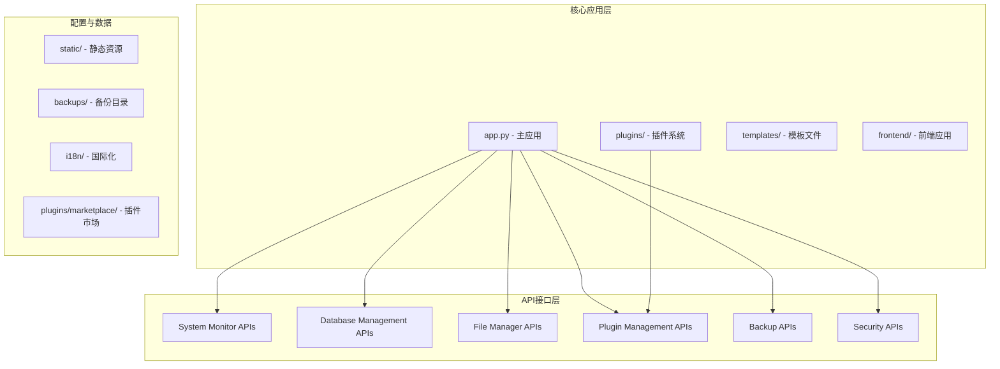

**图表来源**
- [app.py:1-50](file://app.py#L1-L50)
- [plugins/__init__.py:1-50](file://plugins/__init__.py#L1-L50)

**章节来源**
- [app.py:1-100](file://app.py#L1-L100)
- [plugins/__init__.py:1-50](file://plugins/__init__.py#L1-L50)

## 核心组件

### 系统监控组件

系统监控组件提供了实时的系统状态监控功能，包括硬件状态查询、进程管理、性能指标收集等。

#### 硬件状态查询API
- **/api/system_info** - 获取系统基本信息、CPU使用率、内存使用情况、磁盘空间、网络统计
- **/api/system_users** - 获取在线用户信息和活动状态

#### 性能指标收集
- 实时CPU使用率监控
- 内存使用情况统计
- 磁盘空间使用率
- 网络IO统计
- 在线用户活动跟踪

**章节来源**
- [app.py:1826-1955](file://app.py#L1826-L1955)

### 数据库管理组件

数据库管理组件提供了完整的数据库操作功能，包括表数据管理、SQL执行接口和数据可视化编辑。

#### 数据库操作API
- **/api/table/<table>/data** - 获取表数据
- **/api/table/<table>/insert** - 插入数据
- **/api/table/<table>/update** - 更新数据
- **/api/table/<table>/delete/<pk_val>** - 删除数据

#### 数据库查询界面
- **/db_query** - 数据库查询页面
- **/db_update** - 数据库可视化编辑页面

**章节来源**
- [app.py:2370-2485](file://app.py#L2370-L2485)
- [app.py:2500-2508](file://app.py#L2500-L2508)

### 文件管理组件

文件管理组件提供了安全的文件操作功能，包括目录浏览、文件上传下载和权限控制。

#### 文件操作API
- **/api/file/upload** - 文件上传
- **/api/file/download** - 文件下载（管理员权限）
- **/api/file/delete** - 文件删除（管理员权限）

#### 文件管理界面
- **/file_manager** - 文件管理器页面

**章节来源**
- [app.py:3814-3871](file://app.py#L3814-L3871)
- [app.py:3768-3811](file://app.py#L3768-L3811)

### 插件管理组件

插件管理组件提供了强大的插件系统，支持动态加载、卸载和管理插件。

#### 插件管理API
- **/api/admin/plugins** - 获取插件列表
- **/api/admin/plugins/<name>/load** - 加载插件
- **/api/admin/plugins/<name>/unload** - 卸载插件
- **/api/admin/plugins/reload** - 重新加载所有插件

#### 插件市场API
- **/api/admin/plugins/marketplace** - 插件市场列表
- **/api/admin/plugins/marketplace/upload** - 上传插件
- **/api/admin/plugins/marketplace/<int:plugin_id>** - 删除插件

**章节来源**
- [app.py:5200-5254](file://app.py#L5200-L5254)
- [app.py:5457-5556](file://app.py#L5457-L5556)

### 备份恢复组件

备份恢复组件提供了完整的文件备份和恢复功能，支持增量备份和差异比较。

#### 备份管理API
- **/api/backup/list** - 列出备份文件
- **/api/backup/create** - 创建备份
- **/api/backup/download/<filename>** - 下载备份
- **/api/backup/delete/<filename>** - 删除备份
- **/api/backup/delete-all** - 删除所有备份
- **/api/backup/prune** - 清理旧备份
- **/api/backup/restore** - 恢复备份
- **/api/backup/diff/<filename>** - 备份差异比较

**章节来源**
- [app.py:4714-4970](file://app.py#L4714-L4970)

### 安全审计组件

安全审计组件提供了全面的安全监控和日志管理功能。

#### 安全管理API
- **/api/admin/ip_stats** - IP统计信息
- **/api/admin/unblock** - 解封IP
- **/api/admin/whitelist** - 白名单管理
- **/api/admin/manual_block** - 手动封禁
- **/api/admin/batch** - 批量操作
- **/api/admin/rate_config** - 速率限制配置

#### 日志管理
- **/logs** - 日志查看页面
- **/logs/clear** - 清空日志

**章节来源**
- [app.py:4045-4284](file://app.py#L4045-L4284)
- [app.py:4287-4312](file://app.py#L4287-L4312)

## 架构概览

系统采用分层架构设计，各组件之间通过清晰的接口进行通信：

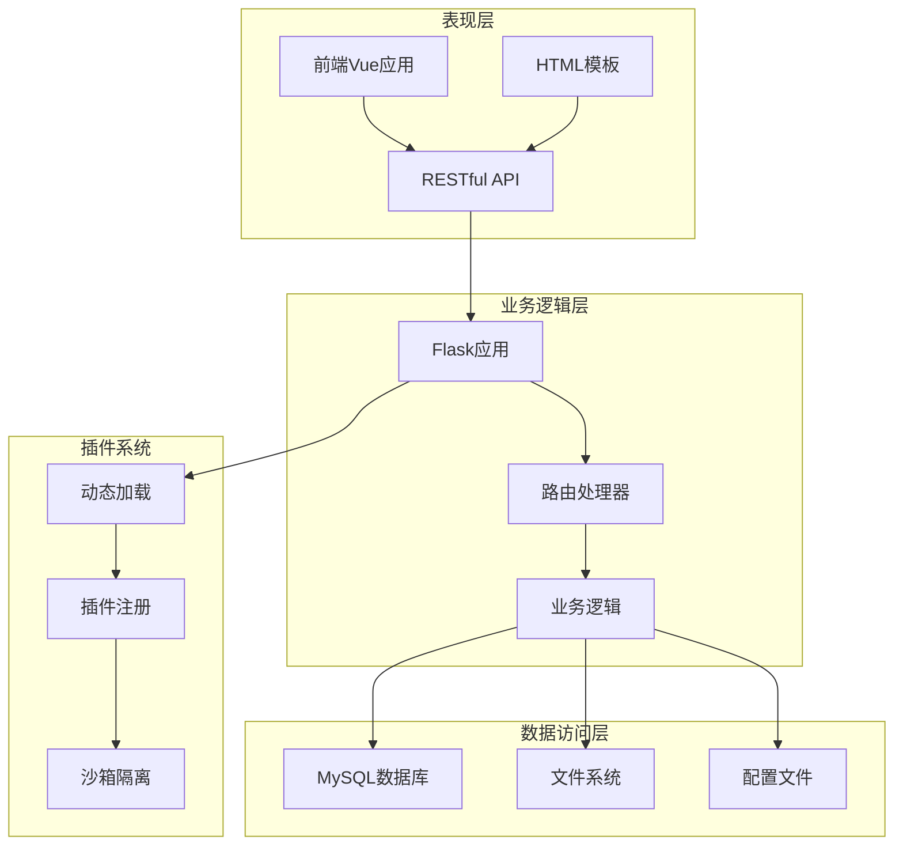

**图表来源**
- [app.py:119-139](file://app.py#L119-L139)
- [plugins/__init__.py:13-22](file://plugins/__init__.py#L13-L22)

## 详细组件分析

### 系统监控API分析

系统监控API提供了实时的系统状态监控功能：

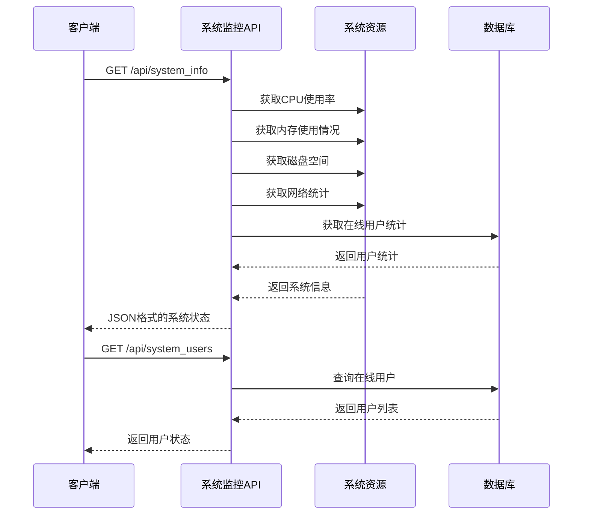

**图表来源**
- [app.py:1826-1955](file://app.py#L1826-L1955)

#### 系统监控数据模型

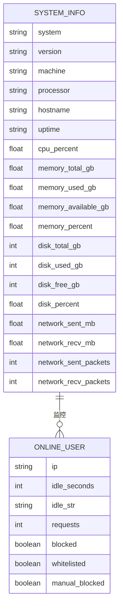

**图表来源**
- [app.py:1861-1955](file://app.py#L1861-L1955)

**章节来源**
- [app.py:1826-1955](file://app.py#L1826-L1955)
- [templates/system_monitor.html:37-270](file://templates/system_monitor.html#L37-L270)

### 数据库管理API分析

数据库管理API提供了完整的CRUD操作和数据管理功能：

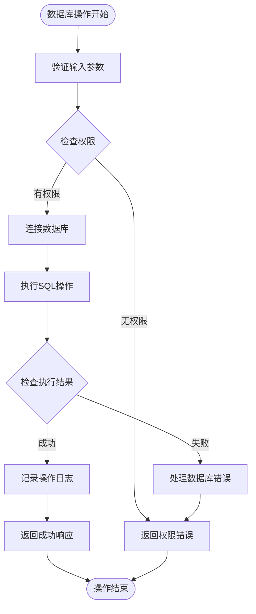

**图表来源**
- [app.py:2408-2485](file://app.py#L2408-L2485)

#### 数据库操作流程

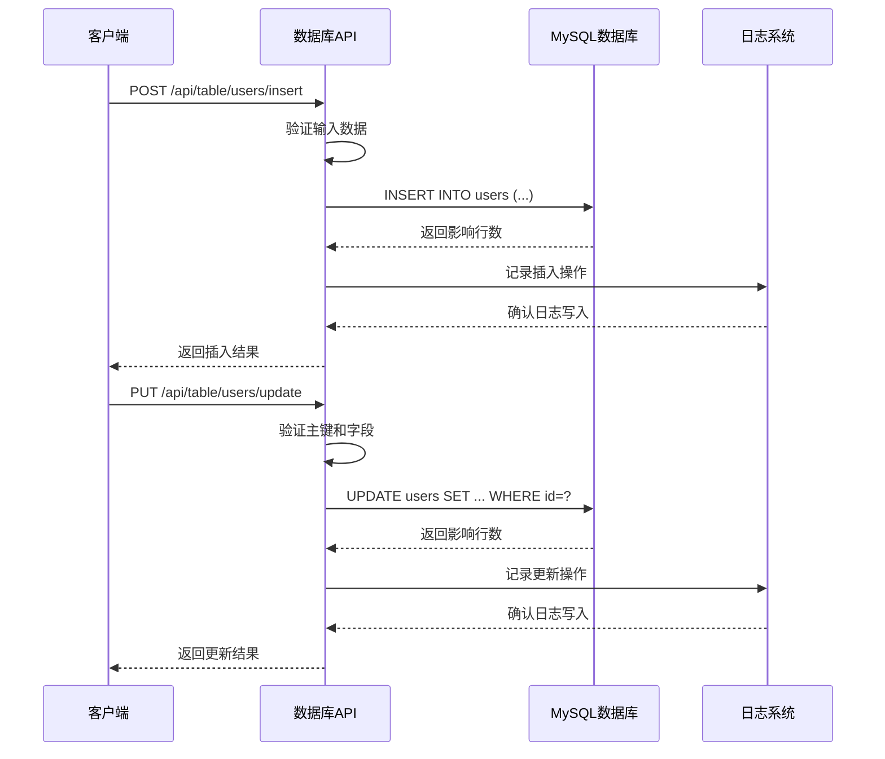

**图表来源**
- [app.py:2408-2462](file://app.py#L2408-L2462)

**章节来源**
- [app.py:2370-2485](file://app.py#L2370-L2485)
- [templates/db_query.html:1-52](file://templates/db_query.html#L1-L52)

### 文件管理API分析

文件管理API提供了安全的文件操作功能：

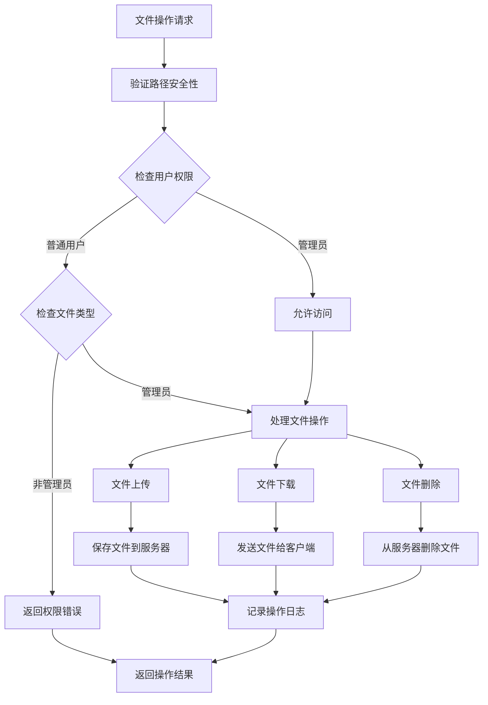

**图表来源**
- [app.py:3814-3871](file://app.py#L3814-L3871)

#### 文件操作权限矩阵

| 操作类型 | 权限要求 | 功能描述 |
|---------|---------|----------|
| 文件上传 | 登录用户 | 上传文件到指定目录 |
| 文件下载 | 管理员 | 下载服务器上的文件 |
| 文件删除 | 管理员 | 删除服务器上的文件 |
| 目录浏览 | 登录用户 | 浏览文件系统结构 |

**章节来源**
- [app.py:3814-3871](file://app.py#L3814-L3871)
- [templates/file_manager.html:1-60](file://templates/file_manager.html#L1-L60)

### 插件管理API分析

插件管理API提供了完整的插件生命周期管理：

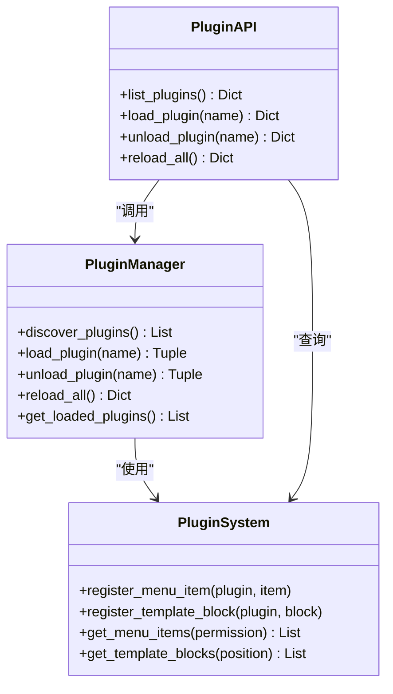

**图表来源**
- [plugins/__init__.py:25-136](file://plugins/__init__.py#L25-L136)
- [app.py:5200-5254](file://app.py#L5200-L5254)

#### 插件市场工作流程

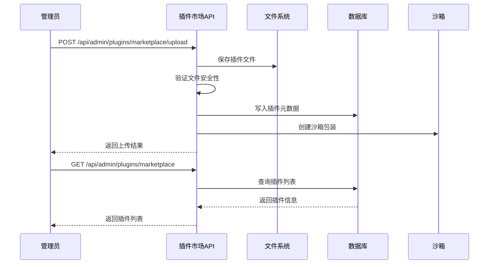

**图表来源**
- [app.py:5263-5393](file://app.py#L5263-L5393)

**章节来源**
- [plugins/__init__.py:1-249](file://plugins/__init__.py#L1-L249)
- [app.py:5200-5556](file://app.py#L5200-L5556)
- [templates/marketplace.html:93-142](file://templates/marketplace.html#L93-L142)

### 备份恢复API分析

备份恢复API提供了完整的数据保护功能：

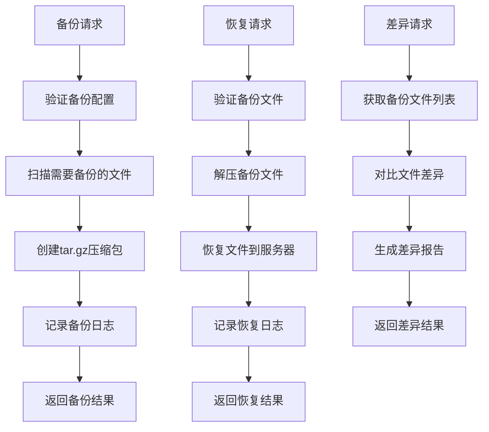

**图表来源**
- [app.py:4722-4970](file://app.py#L4722-L4970)

#### 备份配置管理

| 配置项 | 默认值 | 描述 |
|--------|--------|------|
| BACKUP_INCLUDES | static/albums, static/avatars, templates等 | 需要备份的文件和目录列表 |
| BACKUP_EXCLUDES | __pycache__, node_modules, .git等 | 需要排除的文件和目录模式 |
| 备份文件大小限制 | 2GB | 单个备份文件的最大大小 |
| 备份保留策略 | 默认保留10个最新备份 | 自动清理旧备份的数量 |

**章节来源**
- [app.py:4640-4671](file://app.py#L4640-L4671)
- [app.py:4714-4970](file://app.py#L4714-L4970)
- [templates/backup.html:174-462](file://templates/backup.html#L174-L462)

### 安全审计API分析

安全审计API提供了全面的安全监控和管理功能：

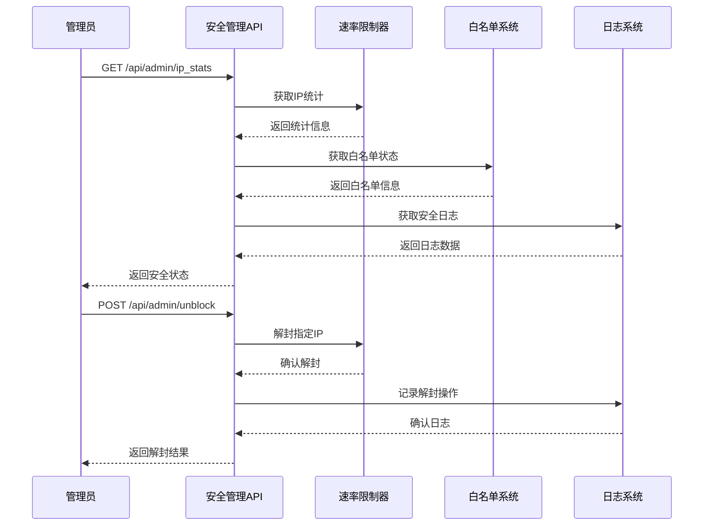

**图表来源**
- [app.py:4045-4284](file://app.py#L4045-L4284)

#### 安全配置参数

| 参数名称 | 默认值 | 描述 |
|----------|--------|------|
| RATE_LIMIT | 40 | 单IP在时间窗口内的最大请求数 |
| RATE_WINDOW | 10 | 速率限制的时间窗口（秒） |
| BLOCK_DURATION | 240 | IP封禁持续时间（秒） |
| BLOCK_PROBE_LIMIT | 50 | 封禁期间试探次数阈值 |
| BLOCK_EXTEND | 240 | 试探超限后追加封禁时间 |

**章节来源**
- [app.py:350-382](file://app.py#L350-L382)
- [app.py:4045-4284](file://app.py#L4045-L4284)
- [templates/logs.html:1-19](file://templates/logs.html#L1-L19)

## 依赖分析

系统采用了模块化的依赖管理方式，各组件之间的耦合度较低：

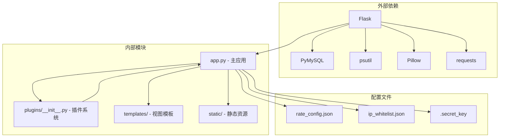

**图表来源**
- [app.py:1-28](file://app.py#L1-L28)
- [plugins/__init__.py:1-11](file://plugins/__init__.py#L1-L11)

### 核心依赖关系

系统的主要依赖关系包括：

1. **Flask框架** - 提供Web应用基础架构
2. **数据库连接** - PyMySQL用于MySQL数据库操作
3. **系统监控** - psutil用于系统资源监控
4. **图像处理** - Pillow用于验证码生成
5. **HTTP请求** - requests用于外部API调用

**章节来源**
- [app.py:1-28](file://app.py#L1-L28)
- [plugins/__init__.py:1-11](file://plugins/__init__.py#L1-L11)

## 性能考虑

系统在设计时充分考虑了性能优化：

### 缓存策略
- **IP地理位置缓存** - 使用内存缓存减少外部API调用
- **插件元数据缓存** - 减少重复的文件系统扫描
- **会话数据缓存** - 使用内存存储会话信息

### 异步处理
- **备份操作** - 使用异步方式处理大型文件备份
- **日志写入** - 异步写入日志文件，避免阻塞主线程
- **文件上传** - 支持大文件分块上传

### 资源优化
- **静态文件缓存** - 长时间缓存静态资源
- **数据库连接池** - 复用数据库连接减少开销
- **内存使用优化** - 限制单次操作的数据量

## 故障排除指南

### 常见问题及解决方案

#### 系统监控问题
**问题**: 系统监控数据不准确
**解决方案**: 
1. 检查psutil安装和版本
2. 验证系统权限是否足够
3. 重启监控服务

#### 数据库连接问题
**问题**: 数据库连接失败
**解决方案**:
1. 检查数据库配置参数
2. 验证网络连接
3. 查看数据库服务状态

#### 文件操作权限问题
**问题**: 文件上传/下载失败
**解决方案**:
1. 检查文件权限设置
2. 验证磁盘空间
3. 确认路径安全性

#### 插件加载失败
**问题**: 插件无法加载
**解决方案**:
1. 检查插件依赖
2. 验证插件兼容性
3. 查看插件错误日志

**章节来源**
- [app.py:4315-4333](file://app.py#L4315-L4333)

### 调试工具

系统提供了多种调试工具：
- **日志查看** - 查看详细的系统日志
- **IP统计** - 监控用户访问行为
- **错误报告** - 收集系统错误信息
- **性能监控** - 监控系统性能指标

## 结论

系统管理API提供了全面的系统管理功能，具有以下特点：

### 优势
1. **模块化设计** - 各功能模块独立，便于维护和扩展
2. **安全性强** - 多层安全防护，包括权限控制、输入验证、CSP等
3. **功能完整** - 覆盖系统管理的各个方面
4. **易于使用** - 提供直观的API接口和管理界面

### 扩展性
系统支持插件扩展，可以通过插件系统添加新的功能模块。插件系统采用沙箱隔离机制，确保插件的安全性。

### 维护性
- 清晰的代码结构和注释
- 完善的错误处理机制
- 详细的日志记录
- 自动化的备份恢复功能

该系统为School_Web项目提供了一个强大而灵活的管理系统，能够满足各种系统管理需求，并为未来的功能扩展奠定了良好的基础。