# Vue组件系统

<cite>
**本文引用的文件**
- [frontend/src/App.vue](file://frontend/src/App.vue)
- [frontend/src/main.js](file://frontend/src/main.js)
- [frontend/src/components/TopBar.vue](file://frontend/src/components/TopBar.vue)
- [frontend/src/components/ImageGrid.vue](file://frontend/src/components/ImageGrid.vue)
- [frontend/src/components/MessageBoard.vue](file://frontend/src/components/MessageBoard.vue)
- [frontend/src/components/Classmates.vue](file://frontend/src/components/Classmates.vue)
- [frontend/src/components/WishWall.vue](file://frontend/src/components/WishWall.vue)
- [frontend/src/components/Playlist.vue](file://frontend/src/components/Playlist.vue)
- [frontend/src/components/Timeline.vue](file://frontend/src/components/Timeline.vue)
- [frontend/src/components/StatsChart.vue](file://frontend/src/components/StatsChart.vue)
- [frontend/src/components/UploadModal.vue](file://frontend/src/components/UploadModal.vue)
- [frontend/src/components/ImageDetailModal.vue](file://frontend/src/components/ImageDetailModal.vue)
- [frontend/src/components/TagFilter.vue](file://frontend/src/components/TagFilter.vue)
- [frontend/src/components/MusicPlayer.vue](file://frontend/src/components/MusicPlayer.vue)
- [frontend/src/api.js](file://frontend/src/api.js)
- [frontend/package.json](file://frontend/package.json)
</cite>

## 目录
1. [简介](#简介)
2. [项目结构](#项目结构)
3. [核心组件](#核心组件)
4. [架构总览](#架构总览)
5. [详细组件分析](#详细组件分析)
6. [依赖关系分析](#依赖关系分析)
7. [性能考量](#性能考量)
8. [故障排查指南](#故障排查指南)
9. [结论](#结论)
10. [附录](#附录)

## 简介
本技术文档围绕 School_Web 的 Vue 3 组件化系统进行深入解析，覆盖组件层次结构、父子组件通信、props 传递与事件处理机制，并重点阐述 App.vue 根组件、TopBar 导航栏、ImageGrid 图片网格、Chat 聊天组件、MessageBoard 留言板等核心组件的设计与实现。同时提供组件开发规范、命名约定、复用策略、性能优化技巧与调试方法，帮助开发者高效维护与扩展该前端系统。

## 项目结构
前端采用 Vite + Vue 3 单页应用架构，入口为 main.js，根组件为 App.vue；业务功能通过多个功能域组件实现，如图片相册、留言区、同学录、寄语墙、歌单、时间轴、统计图表等。组件之间通过 props 下传与 emits 上抛实现数据流与事件通信，部分跨组件状态通过全局 window 对象共享。

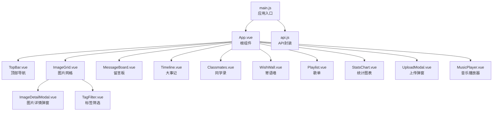

图示来源
- [frontend/src/main.js:1-6](file://frontend/src/main.js#L1-L6)
- [frontend/src/App.vue:1-99](file://frontend/src/App.vue#L1-L99)
- [frontend/src/components/TopBar.vue:1-42](file://frontend/src/components/TopBar.vue#L1-L42)
- [frontend/src/components/ImageGrid.vue:1-129](file://frontend/src/components/ImageGrid.vue#L1-L129)
- [frontend/src/components/MessageBoard.vue:1-80](file://frontend/src/components/MessageBoard.vue#L1-L80)
- [frontend/src/components/Timeline.vue:1-67](file://frontend/src/components/Timeline.vue#L1-L67)
- [frontend/src/components/Classmates.vue:1-113](file://frontend/src/components/Classmates.vue#L1-L113)
- [frontend/src/components/WishWall.vue:1-61](file://frontend/src/components/WishWall.vue#L1-L61)
- [frontend/src/components/Playlist.vue:1-71](file://frontend/src/components/Playlist.vue#L1-L71)
- [frontend/src/components/StatsChart.vue:1-77](file://frontend/src/components/StatsChart.vue#L1-L77)
- [frontend/src/components/UploadModal.vue:1-116](file://frontend/src/components/UploadModal.vue#L1-L116)
- [frontend/src/components/ImageDetailModal.vue:1-232](file://frontend/src/components/ImageDetailModal.vue#L1-L232)
- [frontend/src/components/TagFilter.vue:1-51](file://frontend/src/components/TagFilter.vue#L1-L51)
- [frontend/src/components/MusicPlayer.vue:1-132](file://frontend/src/components/MusicPlayer.vue#L1-L132)
- [frontend/src/api.js:1-45](file://frontend/src/api.js#L1-L45)

章节来源
- [frontend/src/main.js:1-6](file://frontend/src/main.js#L1-L6)
- [frontend/src/App.vue:1-99](file://frontend/src/App.vue#L1-L99)

## 核心组件
本节聚焦于关键组件的功能职责、数据流与交互方式，便于快速理解系统主干。

- App.vue 根组件
  - 负责页面布局与路由式内容切换（通过 tab 切换不同区域）
  - 管理全局状态：当前 tab、搜索词、排序、活跃标签、是否显示倒计时、当前用户与管理员标识
  - 与子组件通信：向 ImageGrid 传递 category/sort/search/tagId；向 MessageBoard、Timeline、Classmates、WishWall、Playlist、StatsChart 传递 isAdmin/currentUser
  - 事件处理：接收 UploadModal 的 uploaded 事件以切换 tab；接收 CountDown 的 close 事件隐藏倒计时；接收 TagFilter 的 filter 事件更新 activeTag 并触发搜索
  - 生命周期：mounted 时拉取当前用户信息，设置 isAdmin/currentUser

- TopBar 导航栏
  - 展示站点标识与用户状态（教师/学生徽章），未登录时提供登录入口
  - 在 mounted 时拉取用户信息，注入 window.__user 并派发 window 事件，供其他组件感知用户加载完成

- ImageGrid 图片网格
  - 接收 props：category、sort、search、tagId
  - 内部状态：images、loading、selectedImage、renameTarget、renameText、isTeacher
  - 功能：按条件加载图片列表，计算每张图片的评论数与点赞数；支持重命名与删除（仅教师）；打开图片详情弹窗；暴露 loadImages 暴露给父组件刷新
  - 事件：通过 ImageDetailModal 的 close/refresh 事件联动刷新

- MessageBoard 留言板
  - 接收 props：无
  - 内部状态：messages、text、loading、currentUser、isAdmin
  - 功能：加载/提交/删除留言；根据 isAdmin/currentUser 决定删除权限；调用 api.js 中的留言接口

- Classmates 同学录
  - 接收 props：isAdmin、currentUser
  - 内部状态：classmates、showForm、editingId、activeClass、表单数据 form
  - 功能：按班级/届次过滤展示；增删改查同学信息；仅创建者或管理员可编辑/删除

- WishWall 寄语墙
  - 接收 props：isAdmin、currentUser
  - 内部状态：wishes、content、isAnonymous
  - 功能：匿名/实名提交寄语；删除（后端鉴权）

- Playlist 歌单
  - 接收 props：isAdmin
  - 内部状态：songs、表单 form
  - 功能：添加/投票/删除歌曲；支持打开外链

- Timeline 大事记
  - 接收 props：isAdmin
  - 内部状态：events、showForm、表单 form
  - 功能：添加/删除事件

- StatsChart 统计图表
  - 内部状态：stats
  - 功能：渲染总图数量、评论数、点赞数；展示上传达人柱状图与最受欢迎照片列表

- UploadModal 上传弹窗
  - 内部状态：visible、category、files、uploading、progress、uploaded
  - 功能：多文件拖拽/选择预览、批量命名、上传并发出 uploaded 事件通知父组件

- ImageDetailModal 图片详情弹窗
  - 接收 props：image
  - 内部状态：comments、replyText、replyTo、liked、likeCount、shareLink、isAdmin、allTags/imageTags/selectedTags
  - 功能：点赞/下载/分享；标签编辑（自动保存）；评论列表与回复输入；通过 refresh/close 事件通知父组件刷新

- TagFilter 标签筛选
  - 接收 props：activeTag
  - 内部状态：tags、showAdd、newName、newColor
  - 功能：展示标签按钮、添加/删除标签；通过 filter 事件向上抛出选中的标签 ID

- MusicPlayer 背景音乐播放器
  - 内部状态：show、playing
  - 功能：通过 Web Audio API 生成环境音；控制开关与销毁音频上下文

章节来源
- [frontend/src/App.vue:47-84](file://frontend/src/App.vue#L47-L84)
- [frontend/src/components/TopBar.vue:15-31](file://frontend/src/components/TopBar.vue#L15-L31)
- [frontend/src/components/ImageGrid.vue:43-106](file://frontend/src/components/ImageGrid.vue#L43-L106)
- [frontend/src/components/MessageBoard.vue:23-65](file://frontend/src/components/MessageBoard.vue#L23-L65)
- [frontend/src/components/Classmates.vue:46-94](file://frontend/src/components/Classmates.vue#L46-L94)
- [frontend/src/components/WishWall.vue:28-45](file://frontend/src/components/WishWall.vue#L28-L45)
- [frontend/src/components/Playlist.vue:27-55](file://frontend/src/components/Playlist.vue#L27-L55)
- [frontend/src/components/Timeline.vue:28-51](file://frontend/src/components/Timeline.vue#L28-L51)
- [frontend/src/components/StatsChart.vue:43-54](file://frontend/src/components/StatsChart.vue#L43-L54)
- [frontend/src/components/UploadModal.vue:48-99](file://frontend/src/components/UploadModal.vue#L48-L99)
- [frontend/src/components/ImageDetailModal.vue:85-189](file://frontend/src/components/ImageDetailModal.vue#L85-L189)
- [frontend/src/components/TagFilter.vue:21-37](file://frontend/src/components/TagFilter.vue#L21-L37)
- [frontend/src/components/MusicPlayer.vue:11-118](file://frontend/src/components/MusicPlayer.vue#L11-L118)

## 架构总览
下图展示了组件间的依赖与数据流向：App.vue 作为中枢协调各功能模块；TopBar 提供用户上下文；ImageGrid 与 MessageBoard 等组件通过 API 封装与后端交互；UploadModal 与 ImageDetailModal 作为弹窗组件与 ImageGrid 形成父子/兄弟协作。

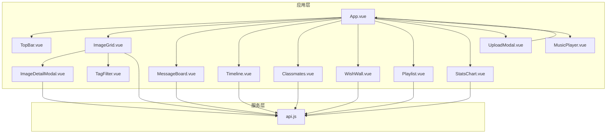

图示来源
- [frontend/src/App.vue:47-84](file://frontend/src/App.vue#L47-L84)
- [frontend/src/components/TopBar.vue:15-31](file://frontend/src/components/TopBar.vue#L15-L31)
- [frontend/src/components/ImageGrid.vue:43-106](file://frontend/src/components/ImageGrid.vue#L43-L106)
- [frontend/src/components/MessageBoard.vue:23-65](file://frontend/src/components/MessageBoard.vue#L23-L65)
- [frontend/src/components/Timeline.vue:28-51](file://frontend/src/components/Timeline.vue#L28-L51)
- [frontend/src/components/Classmates.vue:46-94](file://frontend/src/components/Classmates.vue#L46-L94)
- [frontend/src/components/WishWall.vue:28-45](file://frontend/src/components/WishWall.vue#L28-L45)
- [frontend/src/components/Playlist.vue:27-55](file://frontend/src/components/Playlist.vue#L27-L55)
- [frontend/src/components/StatsChart.vue:43-54](file://frontend/src/components/StatsChart.vue#L43-L54)
- [frontend/src/components/UploadModal.vue:48-99](file://frontend/src/components/UploadModal.vue#L48-L99)
- [frontend/src/components/ImageDetailModal.vue:85-189](file://frontend/src/components/ImageDetailModal.vue#L85-L189)
- [frontend/src/components/TagFilter.vue:21-37](file://frontend/src/components/TagFilter.vue#L21-L37)
- [frontend/src/components/MusicPlayer.vue:11-118](file://frontend/src/components/MusicPlayer.vue#L11-L118)
- [frontend/src/api.js:1-45](file://frontend/src/api.js#L1-L45)

## 详细组件分析

### App.vue 根组件
- 组件层次
  - 顶部导航：TopBar
  - 工具栏：TagFilter（在图片类 tab 显示）、搜索框与排序选择
  - 内容区：根据 tab 渲染不同组件
  - 全局弹窗：UploadModal、MusicPlayer
- 数据流
  - 状态：tab、search、sort、activeTag、showCountdown、isAdmin、currentUser
  - 事件：UploadModal 的 uploaded；CountDown 的 close；TagFilter 的 filter
- 生命周期
  - onMounted：拉取用户信息，设置 isAdmin/currentUser
- 通信机制
  - 子组件通过 emits 向父组件上报事件
  - 父组件通过 props 向子组件下发数据

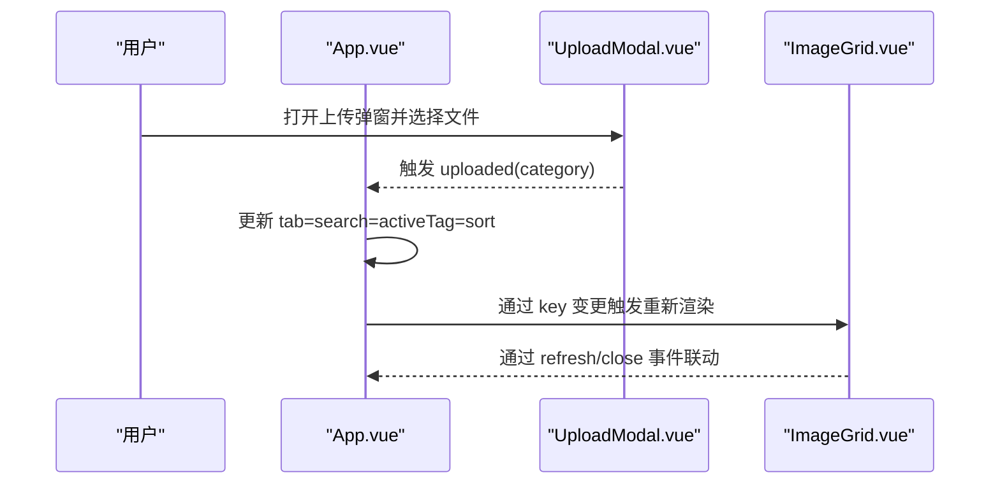

图示来源
- [frontend/src/App.vue:72-76](file://frontend/src/App.vue#L72-L76)
- [frontend/src/components/UploadModal.vue:52-99](file://frontend/src/components/UploadModal.vue#L52-L99)
- [frontend/src/components/ImageGrid.vue](file://frontend/src/components/ImageGrid.vue#L106)

章节来源
- [frontend/src/App.vue:47-84](file://frontend/src/App.vue#L47-L84)

### TopBar.vue 导航栏
- 用户信息获取与全局广播
  - mounted 拉取用户信息，注入 window.__user 并派发 window 事件，便于其他组件感知
- 权限展示
  - 根据 isTeacher 展示不同徽章样式

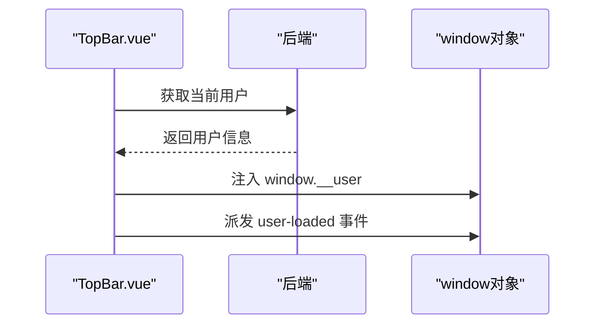

图示来源
- [frontend/src/components/TopBar.vue:20-31](file://frontend/src/components/TopBar.vue#L20-L31)

章节来源
- [frontend/src/components/TopBar.vue:15-31](file://frontend/src/components/TopBar.vue#L15-L31)

### ImageGrid.vue 图片网格
- props 与内部状态
  - props: category、sort、search、tagId
  - 内部状态：images、loading、selectedImage、renameTarget、renameText、isTeacher
- 加载与刷新
  - watch 监听 props 变化触发 loadImages
  - onMounted 首次加载并检测教师身份
  - expose 暴露 loadImages 供父组件调用
- 交互细节
  - 查看图片：打开 ImageDetailModal
  - 教师操作：重命名、删除
  - 计算每张图片的评论数与点赞数

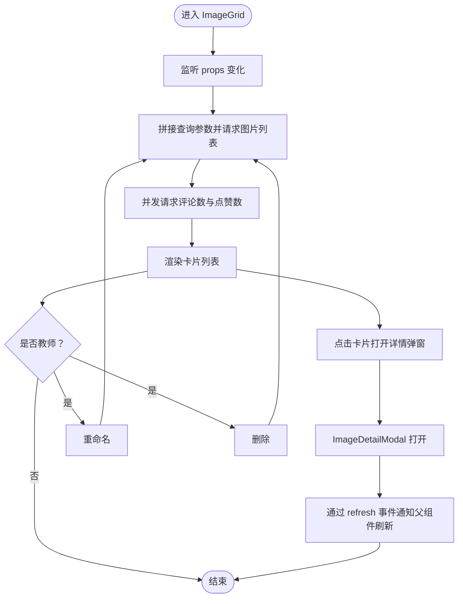

图示来源
- [frontend/src/components/ImageGrid.vue:55-106](file://frontend/src/components/ImageGrid.vue#L55-L106)
- [frontend/src/components/ImageDetailModal.vue:85-189](file://frontend/src/components/ImageDetailModal.vue#L85-L189)

章节来源
- [frontend/src/components/ImageGrid.vue:43-106](file://frontend/src/components/ImageGrid.vue#L43-L106)

### MessageBoard.vue 留言板
- 数据与权限
  - currentUser/isAdmin 由 App.vue 传入
  - 删除权限：仅作者或管理员
- 行为流程
  - 加载 -> 提交 -> 删除 -> 刷新

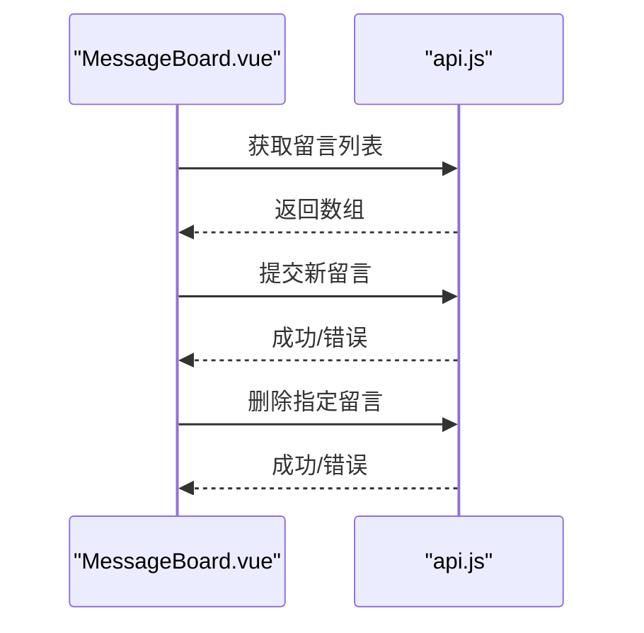

图示来源
- [frontend/src/components/MessageBoard.vue:33-65](file://frontend/src/components/MessageBoard.vue#L33-L65)
- [frontend/src/api.js:35-42](file://frontend/src/api.js#L35-L42)

章节来源
- [frontend/src/components/MessageBoard.vue:23-65](file://frontend/src/components/MessageBoard.vue#L23-L65)

### Classmates.vue 同学录
- 过滤与编辑
  - 支持按“届·班”过滤
  - 仅创建者或管理员可编辑/删除
- 表单校验
  - 添加时要求姓名必填

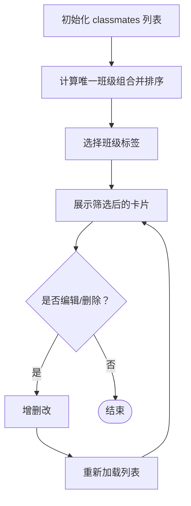

图示来源
- [frontend/src/components/Classmates.vue:55-94](file://frontend/src/components/Classmates.vue#L55-L94)

章节来源
- [frontend/src/components/Classmates.vue:46-94](file://frontend/src/components/Classmates.vue#L46-L94)

### WishWall.vue 寄语墙
- 匿名/实名发送
- 删除权限：后端鉴权

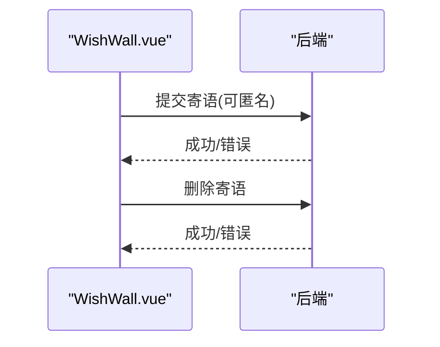

图示来源
- [frontend/src/components/WishWall.vue:39-45](file://frontend/src/components/WishWall.vue#L39-L45)

章节来源
- [frontend/src/components/WishWall.vue:28-45](file://frontend/src/components/WishWall.vue#L28-L45)

### Playlist.vue 歌单
- 投票与删除（管理员）
- 打开外链

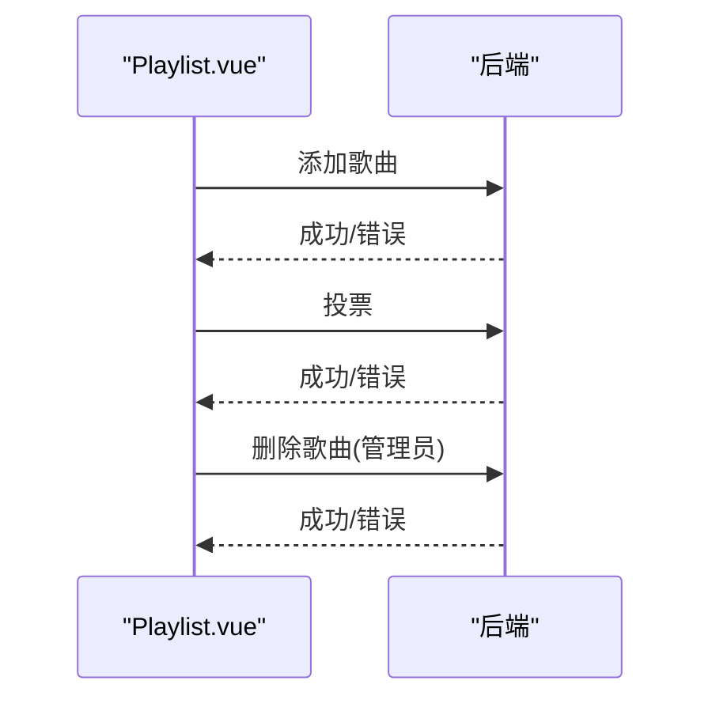

图示来源
- [frontend/src/components/Playlist.vue:36-55](file://frontend/src/components/Playlist.vue#L36-L55)

章节来源
- [frontend/src/components/Playlist.vue:27-55](file://frontend/src/components/Playlist.vue#L27-L55)

### Timeline.vue 大事记
- 管理员添加/删除事件
- 标题与日期必填校验

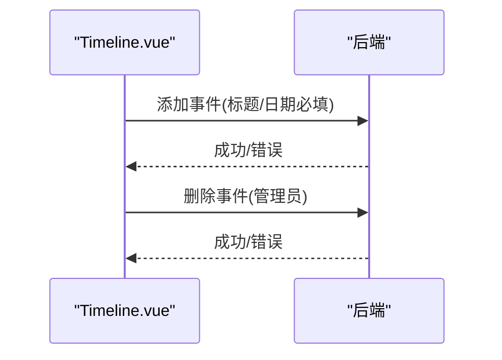

图示来源
- [frontend/src/components/Timeline.vue:39-51](file://frontend/src/components/Timeline.vue#L39-L51)

章节来源
- [frontend/src/components/Timeline.vue:28-51](file://frontend/src/components/Timeline.vue#L28-L51)

### StatsChart.vue 统计图表
- 渲染总图/评论/点赞
- 上传达人柱状图与最受欢迎照片列表

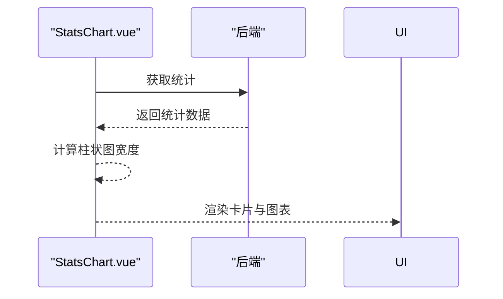

图示来源
- [frontend/src/components/StatsChart.vue:47-54](file://frontend/src/components/StatsChart.vue#L47-L54)

章节来源
- [frontend/src/components/StatsChart.vue:43-54](file://frontend/src/components/StatsChart.vue#L43-L54)

### UploadModal.vue 上传弹窗
- 文件选择/拖拽预览
- 分类选择与批量命名
- 逐个上传并发出 uploaded 事件

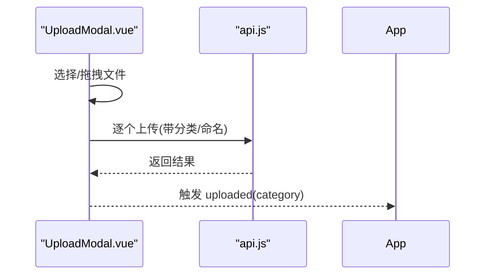

图示来源
- [frontend/src/components/UploadModal.vue:61-99](file://frontend/src/components/UploadModal.vue#L61-L99)
- [frontend/src/api.js](file://frontend/src/api.js#L33)

章节来源
- [frontend/src/components/UploadModal.vue:48-99](file://frontend/src/components/UploadModal.vue#L48-L99)

### ImageDetailModal.vue 图片详情弹窗
- 点赞/下载/分享
- 弹幕组件集成
- 标签编辑（自动保存）
- 评论列表与回复输入

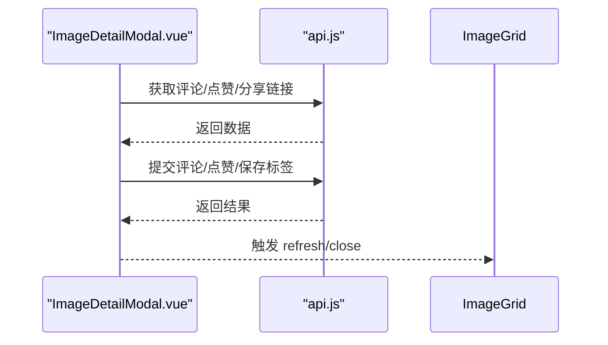

图示来源
- [frontend/src/components/ImageDetailModal.vue:144-189](file://frontend/src/components/ImageDetailModal.vue#L144-L189)
- [frontend/src/api.js:13-31](file://frontend/src/api.js#L13-L31)

章节来源
- [frontend/src/components/ImageDetailModal.vue:85-189](file://frontend/src/components/ImageDetailModal.vue#L85-L189)

### TagFilter.vue 标签筛选
- 展示标签按钮、添加/删除标签
- 通过 filter 事件向上抛出选中的标签 ID

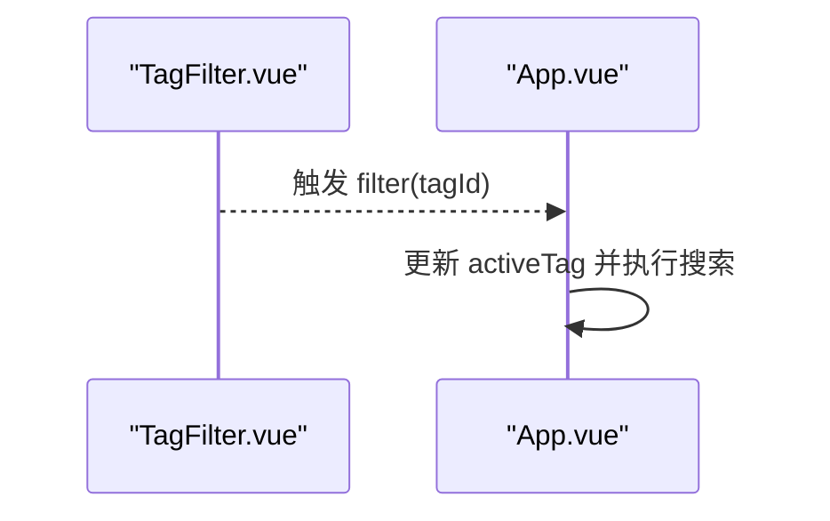

图示来源
- [frontend/src/components/TagFilter.vue:30-37](file://frontend/src/components/TagFilter.vue#L30-L37)
- [frontend/src/App.vue](file://frontend/src/App.vue#L76)

章节来源
- [frontend/src/components/TagFilter.vue:21-37](file://frontend/src/components/TagFilter.vue#L21-L37)

### MusicPlayer.vue 背景音乐播放器
- 使用 Web Audio API 生成环境音
- 控制开关并在卸载时释放资源

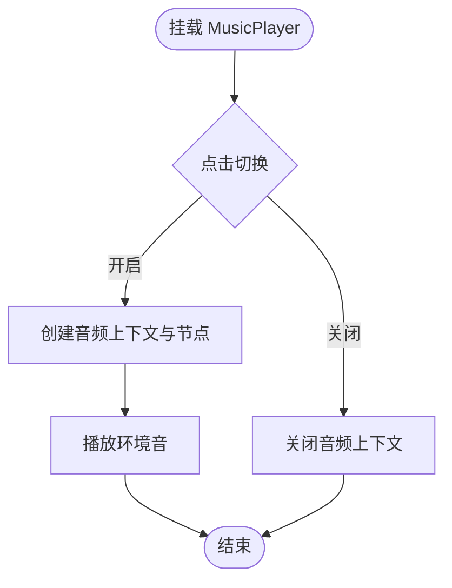

图示来源
- [frontend/src/components/MusicPlayer.vue:19-118](file://frontend/src/components/MusicPlayer.vue#L19-L118)

章节来源
- [frontend/src/components/MusicPlayer.vue:11-118](file://frontend/src/components/MusicPlayer.vue#L11-L118)

## 依赖关系分析
- 组件依赖
  - App.vue 依赖所有功能组件与弹窗组件
  - ImageGrid 依赖 ImageDetailModal 与 TagFilter
  - ImageDetailModal 依赖 Danmaku 与 api.js
  - 其他业务组件均依赖 api.js
- 外部依赖
  - Vue 3、Vue Router、Pinia、Vite、@vitejs/plugin-vue

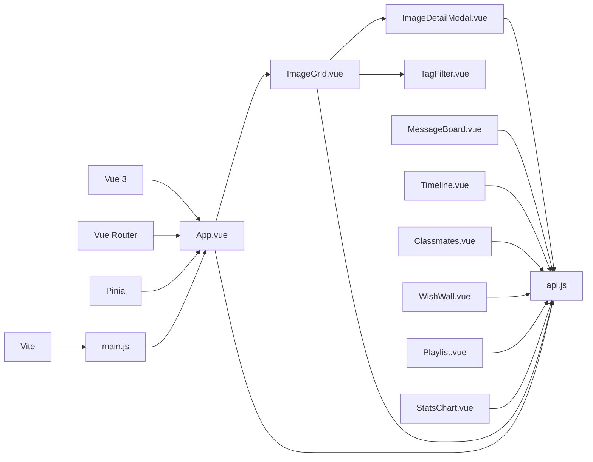

图示来源
- [frontend/package.json:11-20](file://frontend/package.json#L11-L20)
- [frontend/src/main.js:1-6](file://frontend/src/main.js#L1-L6)
- [frontend/src/App.vue:47-60](file://frontend/src/App.vue#L47-L60)
- [frontend/src/components/ImageGrid.vue:43-45](file://frontend/src/components/ImageGrid.vue#L43-L45)
- [frontend/src/components/ImageDetailModal.vue:85-88](file://frontend/src/components/ImageDetailModal.vue#L85-L88)
- [frontend/src/api.js:1-5](file://frontend/src/api.js#L1-L5)

章节来源
- [frontend/package.json:11-20](file://frontend/package.json#L11-L20)

## 性能考量
- 图片懒加载与骨架屏
  - ImageGrid 在卡片中使用懒加载属性，减少首屏压力
  - loading 状态下显示居中加载指示，改善用户体验
- 并发请求
  - ImageGrid 在加载图片后并发请求评论数与点赞数，提升响应速度
- 防抖搜索
  - App.vue 对搜索输入使用定时器防抖，降低频繁请求
- 资源释放
  - MusicPlayer 在卸载时关闭音频上下文，避免内存泄漏
- 列表渲染优化
  - 使用 v-for + key，合理拆分子组件，避免不必要的整树重渲染

## 故障排查指南
- 用户信息未加载
  - 检查 TopBar 的 mounted 请求与 window 事件派发逻辑
  - 确认后端 /api/album/me 接口可用且携带 cookies
- 图片列表为空或加载异常
  - 检查 ImageGrid 的请求参数与错误捕获
  - 确认后端 /api/album/images 接口返回格式
- 上传失败
  - 检查 UploadModal 的文件类型与大小限制
  - 确认 api.js uploadImage 的路径与 credentials
- 评论/点赞/标签保存失败
  - 检查 ImageDetailModal 的 API 调用与错误提示
- 音频无法播放
  - 确认浏览器允许自动播放，首次交互后再创建音频上下文

章节来源
- [frontend/src/components/TopBar.vue:20-31](file://frontend/src/components/TopBar.vue#L20-L31)
- [frontend/src/components/ImageGrid.vue:55-77](file://frontend/src/components/ImageGrid.vue#L55-L77)
- [frontend/src/components/UploadModal.vue:61-99](file://frontend/src/components/UploadModal.vue#L61-L99)
- [frontend/src/components/ImageDetailModal.vue:144-189](file://frontend/src/components/ImageDetailModal.vue#L144-L189)
- [frontend/src/components/MusicPlayer.vue:99-118](file://frontend/src/components/MusicPlayer.vue#L99-L118)

## 结论
该 Vue 3 组件系统以 App.vue 为核心，通过 props 与 emits 实现清晰的数据流与事件流，结合 API 封装与弹窗组件形成模块化的功能集合。系统具备良好的可维护性与扩展性，建议在后续迭代中引入 Pinia 管理跨组件状态、完善 TypeScript 类型定义，并进一步优化网络请求与缓存策略。

## 附录
- 组件开发规范
  - 命名：组件文件与导出名称一致，使用 PascalCase
  - Props：明确类型与默认值；尽量保持扁平结构
  - Emits：事件命名使用动词短语，遵循小驼峰
  - 样式：scoped 样式优先，必要时使用深度选择器
  - 事件：避免在模板中直接调用副作用函数，统一在方法中处理
- 复用策略
  - 将通用 UI 片段抽象为独立组件（如 TagFilter）
  - API 封装集中管理，统一处理 credentials 与错误
- 调试方法
  - 使用浏览器 Vue DevTools 观察组件树与状态
  - 在关键流程添加日志输出与断点
  - 对异步请求增加超时与重试机制