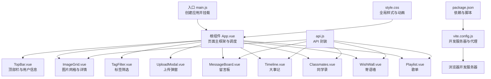
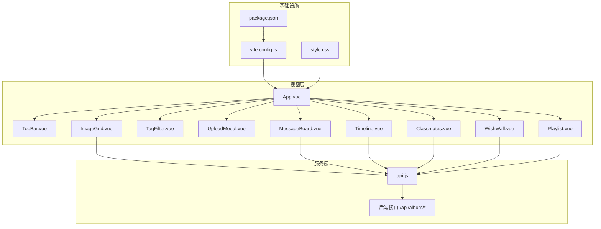
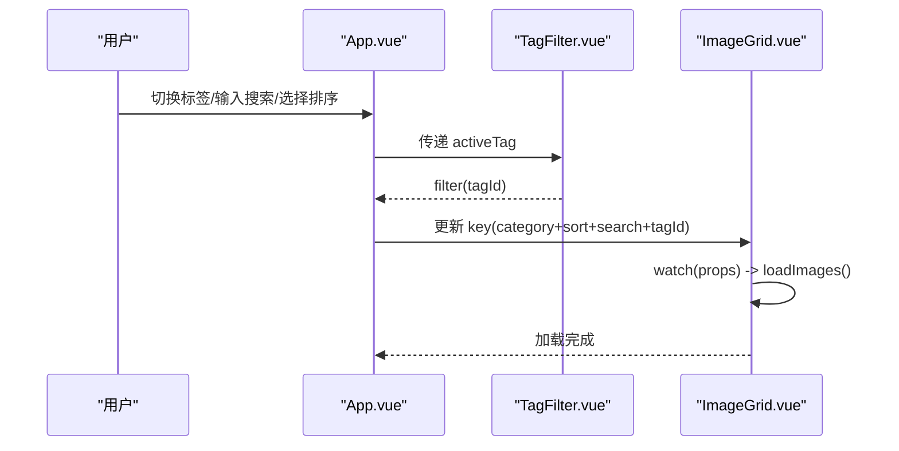
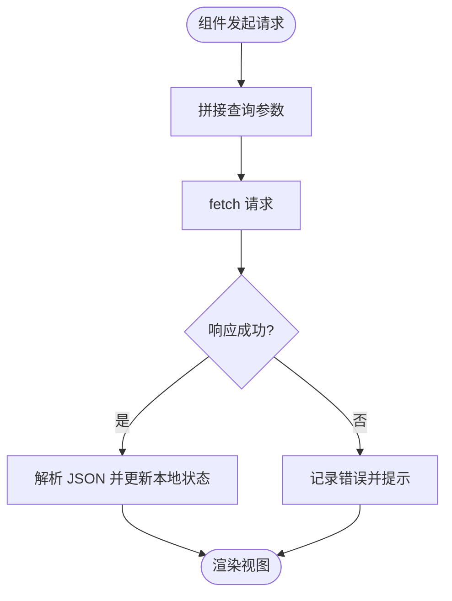
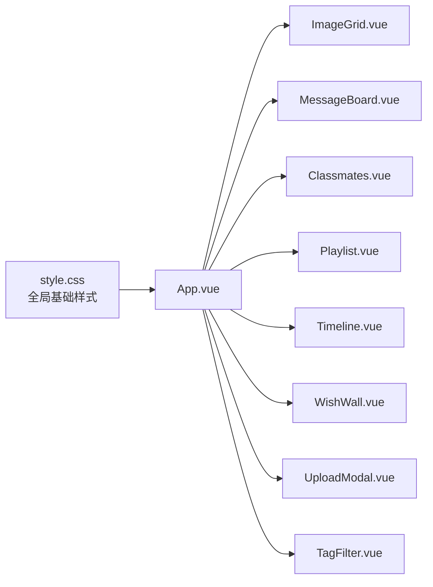
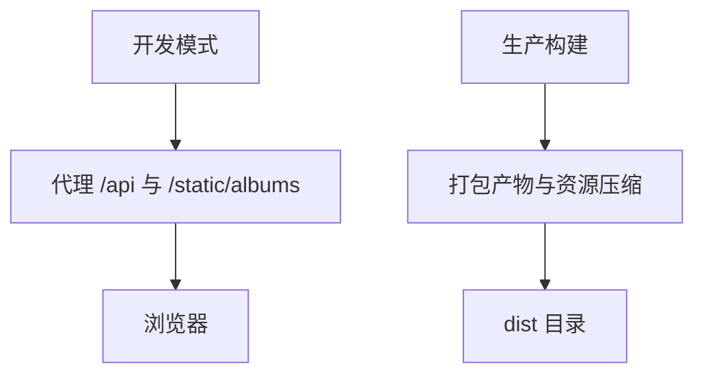
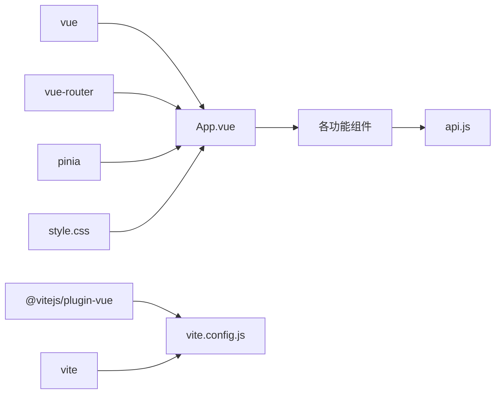

# 前端架构设计

<cite>
**本文引用的文件**
- [frontend/src/main.js](file://frontend/src/main.js)
- [frontend/src/App.vue](file://frontend/src/App.vue)
- [frontend/src/style.css](file://frontend/src/style.css)
- [frontend/vite.config.js](file://frontend/vite.config.js)
- [frontend/package.json](file://frontend/package.json)
- [frontend/src/api.js](file://frontend/src/api.js)
- [frontend/src/components/TopBar.vue](file://frontend/src/components/TopBar.vue)
- [frontend/src/components/ImageGrid.vue](file://frontend/src/components/ImageGrid.vue)
- [frontend/src/components/TagFilter.vue](file://frontend/src/components/TagFilter.vue)
- [frontend/src/components/UploadModal.vue](file://frontend/src/components/UploadModal.vue)
- [frontend/src/components/MessageBoard.vue](file://frontend/src/components/MessageBoard.vue)
- [frontend/src/components/Timeline.vue](file://frontend/src/components/Timeline.vue)
- [frontend/src/components/Classmates.vue](file://frontend/src/components/Classmates.vue)
- [frontend/src/components/WishWall.vue](file://frontend/src/components/WishWall.vue)
- [frontend/src/components/Playlist.vue](file://frontend/src/components/Playlist.vue)
</cite>

## 目录
1. [引言](#引言)
2. [项目结构](#项目结构)
3. [核心组件](#核心组件)
4. [架构总览](#架构总览)
5. [详细组件分析](#详细组件分析)
6. [依赖关系分析](#依赖关系分析)
7. [性能考虑](#性能考虑)
8. [故障排查指南](#故障排查指南)
9. [结论](#结论)
10. [附录](#附录)

## 引言
本设计文档面向 School_Web 的前端 Vue.js 3 应用，系统性阐述其架构设计与实现要点，覆盖组件化设计原则、状态管理模式、路由系统、组件系统、样式架构、构建配置、组件开发规范与最佳实践，并提供性能优化策略与调试技巧。该应用采用组合式 API（Composition API）与单文件组件（SFC）组织业务逻辑，通过集中式 API 封装对接后端服务，整体风格以简洁、模块化与可维护性为核心目标。

## 项目结构
前端位于 frontend 目录，采用典型的 Vue 3 单页应用布局：
- 入口文件负责挂载根组件与引入全局样式
- 根组件负责页面主框架、标签页切换、工具栏与子组件调度
- 组件目录按功能划分，每个组件自包含模板、脚本与样式
- 构建与开发服务器由 Vite 提供，支持热更新与代理转发
- 全局样式统一管理基础 UI 规范与动画

图表来源
- [frontend/src/main.js:1-6](file://frontend/src/main.js#L1-L6)
- [frontend/src/App.vue:1-99](file://frontend/src/App.vue#L1-L99)
- [frontend/src/style.css:1-59](file://frontend/src/style.css#L1-L59)
- [frontend/vite.config.js:1-21](file://frontend/vite.config.js#L1-L21)
- [frontend/package.json:1-21](file://frontend/package.json#L1-L21)
- [frontend/src/api.js:1-45](file://frontend/src/api.js#L1-L45)

章节来源
- [frontend/src/main.js:1-6](file://frontend/src/main.js#L1-L6)
- [frontend/src/App.vue:1-99](file://frontend/src/App.vue#L1-L99)
- [frontend/src/style.css:1-59](file://frontend/src/style.css#L1-L59)
- [frontend/vite.config.js:1-21](file://frontend/vite.config.js#L1-L21)
- [frontend/package.json:1-21](file://frontend/package.json#L1-L21)

## 核心组件
- 根组件 App.vue：负责标签页切换、搜索与排序、标签筛选联动、上传回调、音乐播放器与倒计时提示等；通过 ref 与事件在子组件间建立松耦合通信。
- 组件系统：采用组合式 API，组件内定义 props、emits、本地状态与副作用；通过事件总线与 window 全局对象进行跨组件广播。
- API 封装：集中于 api.js，统一处理凭据与响应解析，便于后续扩展拦截器与错误处理。
- 全局样式：style.css 提供通用按钮、输入框、模态框、动画与背景等基础样式，保证一致的视觉与交互体验。

章节来源
- [frontend/src/App.vue:47-84](file://frontend/src/App.vue#L47-L84)
- [frontend/src/api.js:1-45](file://frontend/src/api.js#L1-L45)
- [frontend/src/style.css:1-59](file://frontend/src/style.css#L1-L59)

## 架构总览
应用采用“根组件调度 + 功能组件自治”的架构模式：
- 根组件负责页面骨架与全局状态（当前标签、搜索词、排序、活跃标签、是否管理员、当前用户等）
- 子组件各自封装数据请求、权限判断与 UI 行为
- 通过 props 下发配置，通过 emits 上抛事件，形成清晰的数据流
- 全局样式与主题通过 CSS 变量与类名体系统一管理
- 构建层由 Vite 提供开发服务器与代理，生产环境进行代码分割与资源压缩

图表来源
- [frontend/src/App.vue:1-99](file://frontend/src/App.vue#L1-L99)
- [frontend/src/api.js:1-45](file://frontend/src/api.js#L1-L45)
- [frontend/vite.config.js:1-21](file://frontend/vite.config.js#L1-L21)
- [frontend/package.json:1-21](file://frontend/package.json#L1-L21)
- [frontend/src/style.css:1-59](file://frontend/src/style.css#L1-L59)

## 详细组件分析

### 组件系统设计
- 层次结构：根组件作为容器，子组件按功能拆分，彼此独立且通过 props 与 emits 解耦
- Props 传递：各组件接收来自父组件的状态与配置，如类别、排序、搜索词、活跃标签、管理员标识、当前用户等
- 事件处理：子组件通过 emits 上报状态变化或触发父组件动作，如上传完成、标签筛选变更、关闭弹窗等
- 生命周期：多数组件在 mounted 阶段发起数据请求，部分组件通过 watch 或外部 ref 暴露方法实现联动刷新

图表来源
- [frontend/src/App.vue:14-42](file://frontend/src/App.vue#L14-L42)
- [frontend/src/components/TagFilter.vue:1-51](file://frontend/src/components/TagFilter.vue#L1-L51)
- [frontend/src/components/ImageGrid.vue:43-106](file://frontend/src/components/ImageGrid.vue#L43-L106)

章节来源
- [frontend/src/App.vue:47-84](file://frontend/src/App.vue#L47-L84)
- [frontend/src/components/TagFilter.vue:21-38](file://frontend/src/components/TagFilter.vue#L21-L38)
- [frontend/src/components/ImageGrid.vue:43-106](file://frontend/src/components/ImageGrid.vue#L43-L106)

### 状态管理与数据流
- 当前实现：应用未集成 Pinia，状态主要通过组件局部状态与 props/emits 在父子间传递
- 推荐演进：对于跨组件共享的状态（如用户信息、全局搜索条件、主题偏好），建议引入 Pinia store，实现集中式状态与持久化
- 数据流管理：组件内部通过 API 封装进行数据读写，错误处理集中在调用点或统一拦截器中

图表来源
- [frontend/src/api.js:1-45](file://frontend/src/api.js#L1-L45)
- [frontend/src/components/ImageGrid.vue:55-77](file://frontend/src/components/ImageGrid.vue#L55-L77)

章节来源
- [frontend/src/api.js:1-45](file://frontend/src/api.js#L1-L45)
- [frontend/src/components/ImageGrid.vue:55-106](file://frontend/src/components/ImageGrid.vue#L55-L106)

### 样式架构
- CSS 模块化：组件采用 scoped 样式，避免样式污染；全局样式集中于 style.css，统一基础控件与动画
- 主题系统：通过颜色变量与类名体系实现主题一致性；支持教师/学生徽章与卡片阴影等视觉层级
- 响应式设计：使用弹性布局与媒体查询适配不同屏幕尺寸；图片网格与表单在小屏下自动换行

图表来源
- [frontend/src/style.css:1-59](file://frontend/src/style.css#L1-L59)
- [frontend/src/App.vue:87-99](file://frontend/src/App.vue#L87-L99)
- [frontend/src/components/ImageGrid.vue:109-129](file://frontend/src/components/ImageGrid.vue#L109-L129)
- [frontend/src/components/MessageBoard.vue:68-80](file://frontend/src/components/MessageBoard.vue#L68-L80)
- [frontend/src/components/Classmates.vue:97-113](file://frontend/src/components/Classmates.vue#L97-L113)
- [frontend/src/components/Playlist.vue:58-71](file://frontend/src/components/Playlist.vue#L58-L71)
- [frontend/src/components/Timeline.vue:54-67](file://frontend/src/components/Timeline.vue#L54-L67)
- [frontend/src/components/WishWall.vue:48-61](file://frontend/src/components/WishWall.vue#L48-L61)
- [frontend/src/components/UploadModal.vue:102-116](file://frontend/src/components/UploadModal.vue#L102-L116)
- [frontend/src/components/TagFilter.vue:40-51](file://frontend/src/components/TagFilter.vue#L40-L51)

章节来源
- [frontend/src/style.css:1-59](file://frontend/src/style.css#L1-L59)
- [frontend/src/components/ImageGrid.vue:109-129](file://frontend/src/components/ImageGrid.vue#L109-L129)
- [frontend/src/components/MessageBoard.vue:68-80](file://frontend/src/components/MessageBoard.vue#L68-L80)
- [frontend/src/components/Classmates.vue:97-113](file://frontend/src/components/Classmates.vue#L97-L113)
- [frontend/src/components/Playlist.vue:58-71](file://frontend/src/components/Playlist.vue#L58-L71)
- [frontend/src/components/Timeline.vue:54-67](file://frontend/src/components/Timeline.vue#L54-L67)
- [frontend/src/components/WishWall.vue:48-61](file://frontend/src/components/WishWall.vue#L48-L61)
- [frontend/src/components/UploadModal.vue:102-116](file://frontend/src/components/UploadModal.vue#L102-L116)
- [frontend/src/components/TagFilter.vue:40-51](file://frontend/src/components/TagFilter.vue#L40-L51)

### 前端构建配置
- Vite 插件：启用 @vitejs/plugin-vue，支持 Vue SFC 热更新
- 开发服务器：监听 3000 端口，开启 host 以允许宿主机访问
- 代理配置：将 /api 与 /static/albums 代理至后端服务，解决跨域与静态资源访问问题
- 生产构建：通过 npm scripts 执行 vite build，默认启用代码分割与资源压缩

图表来源
- [frontend/vite.config.js:1-21](file://frontend/vite.config.js#L1-L21)
- [frontend/package.json:6-10](file://frontend/package.json#L6-L10)

章节来源
- [frontend/vite.config.js:1-21](file://frontend/vite.config.js#L1-L21)
- [frontend/package.json:1-21](file://frontend/package.json#L1-L21)

### 组件开发规范与最佳实践
- 组件职责单一：每个组件聚焦一个功能域，避免过度耦合
- 明确 props 与 emits：对外暴露稳定接口，内部状态私有化
- 生命周期最小化：仅在 mounted 中发起必要请求，避免在模板中执行副作用
- 错误处理：在调用点捕获异常并提示，保持 UI 稳定
- 性能优化：长列表使用懒加载与虚拟滚动；频繁搜索使用防抖；大对象渲染使用计算属性缓存
- 可测试性：将副作用隔离在函数外，便于单元测试

章节来源
- [frontend/src/App.vue:47-84](file://frontend/src/App.vue#L47-L84)
- [frontend/src/components/ImageGrid.vue:55-106](file://frontend/src/components/ImageGrid.vue#L55-L106)
- [frontend/src/components/MessageBoard.vue:33-65](file://frontend/src/components/MessageBoard.vue#L33-L65)

## 依赖关系分析
- 运行时依赖：vue、vue-router、pinia
- 开发依赖：@vitejs/plugin-vue、vite
- 组件间依赖：根组件依赖所有功能组件；功能组件依赖 api.js；全局样式被所有组件引用

图表来源
- [frontend/package.json:11-19](file://frontend/package.json#L11-L19)
- [frontend/src/App.vue:49-60](file://frontend/src/App.vue#L49-L60)
- [frontend/src/api.js:1-45](file://frontend/src/api.js#L1-L45)
- [frontend/src/style.css:1-59](file://frontend/src/style.css#L1-L59)
- [frontend/vite.config.js:1-21](file://frontend/vite.config.js#L1-L21)

章节来源
- [frontend/package.json:1-21](file://frontend/package.json#L1-L21)
- [frontend/src/App.vue:49-60](file://frontend/src/App.vue#L49-L60)
- [frontend/src/api.js:1-45](file://frontend/src/api.js#L1-L45)
- [frontend/src/style.css:1-59](file://frontend/src/style.css#L1-L59)
- [frontend/vite.config.js:1-21](file://frontend/vite.config.js#L1-L21)

## 性能考虑
- 代码分割：Vite 默认按需加载模块，结合路由懒加载进一步减少首屏体积
- 资源压缩：生产构建自动压缩 JS/CSS/HTML，图片可通过 CDN 优化
- 渲染优化：图片懒加载、长列表虚拟化、计算属性缓存、防抖搜索
- 网络优化：合并请求、并发控制、失败重试、离线提示
- 缓存策略：合理设置响应头与本地缓存，避免重复请求

## 故障排查指南
- 开发服务器无法访问：检查 host 与端口配置，确认代理规则正确
- 跨域问题：确认代理路径覆盖 /api 与 /static/albums，后端允许跨域
- 登录状态异常：检查凭据携带（credentials: include），确认会话有效
- 图片加载失败：核对静态资源路径与后端映射，确保文件存在
- 上传失败：检查文件类型与大小限制，确认表单数据构造正确

章节来源
- [frontend/vite.config.js:6-19](file://frontend/vite.config.js#L6-L19)
- [frontend/src/components/UploadModal.vue:61-99](file://frontend/src/components/UploadModal.vue#L61-L99)
- [frontend/src/components/ImageGrid.vue:55-77](file://frontend/src/components/ImageGrid.vue#L55-L77)

## 结论
该前端应用以 Vue 3 组合式 API 为基础，采用模块化组件与集中式 API 封装，具备良好的可维护性与扩展性。建议后续引入 Pinia 实现跨组件状态管理与持久化，完善错误处理与拦截器机制，并持续优化性能与用户体验。通过本文档的规范与最佳实践，团队可在现有基础上稳步迭代，提升整体质量与稳定性。

## 附录
- 组件清单与职责概览
  - TopBar：用户信息展示与登录入口
  - ImageGrid：图片列表、详情、重命名与删除
  - TagFilter：标签增删改查与筛选
  - UploadModal：图片上传与预览
  - MessageBoard：留言发布与删除
  - Timeline：事件添加与删除
  - Classmates：同学信息增删改查与筛选
  - WishWall：寄语发布与删除
  - Playlist：歌曲投票与管理

章节来源
- [frontend/src/components/TopBar.vue:1-42](file://frontend/src/components/TopBar.vue#L1-L42)
- [frontend/src/components/ImageGrid.vue:1-129](file://frontend/src/components/ImageGrid.vue#L1-L129)
- [frontend/src/components/TagFilter.vue:1-51](file://frontend/src/components/TagFilter.vue#L1-L51)
- [frontend/src/components/UploadModal.vue:1-116](file://frontend/src/components/UploadModal.vue#L1-L116)
- [frontend/src/components/MessageBoard.vue:1-80](file://frontend/src/components/MessageBoard.vue#L1-L80)
- [frontend/src/components/Timeline.vue:1-67](file://frontend/src/components/Timeline.vue#L1-L67)
- [frontend/src/components/Classmates.vue:1-113](file://frontend/src/components/Classmates.vue#L1-L113)
- [frontend/src/components/WishWall.vue:1-61](file://frontend/src/components/WishWall.vue#L1-L61)
- [frontend/src/components/Playlist.vue:1-71](file://frontend/src/components/Playlist.vue#L1-L71)