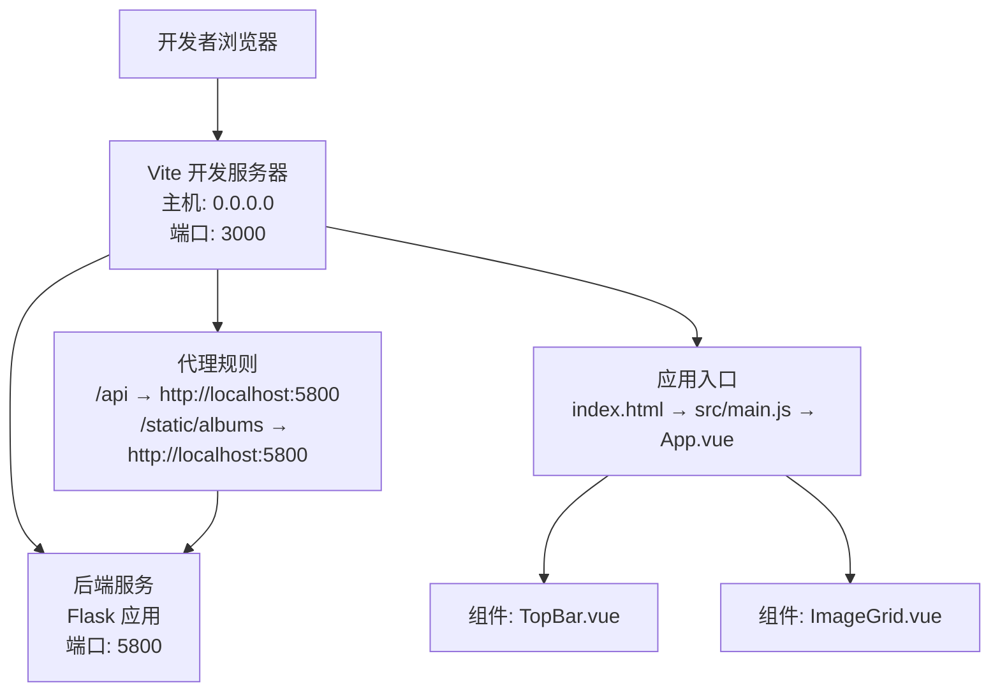
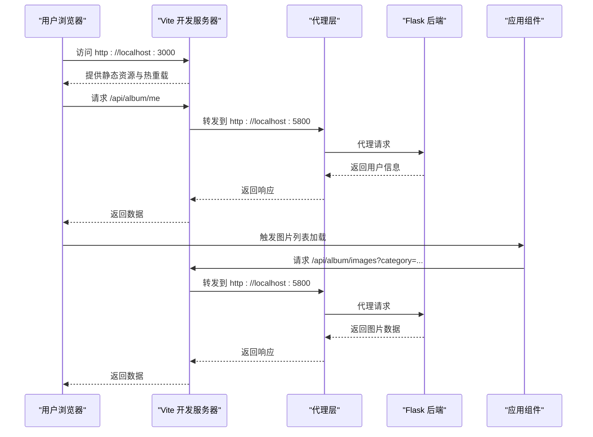
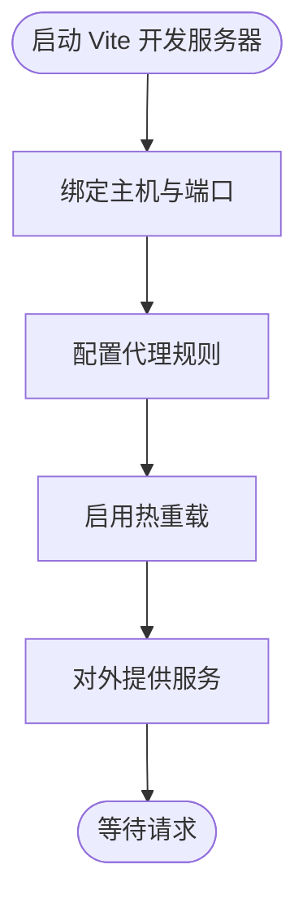
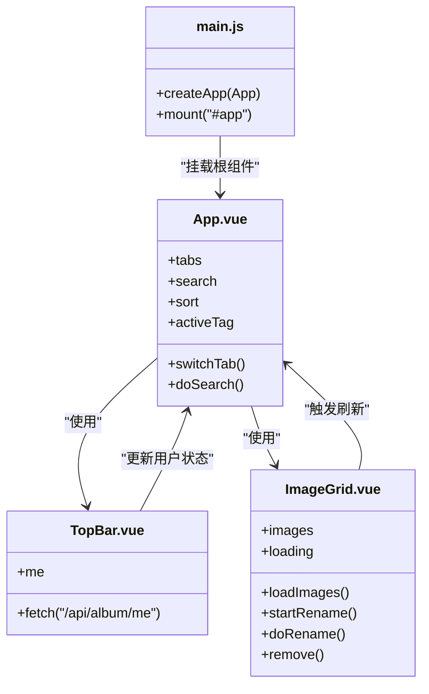
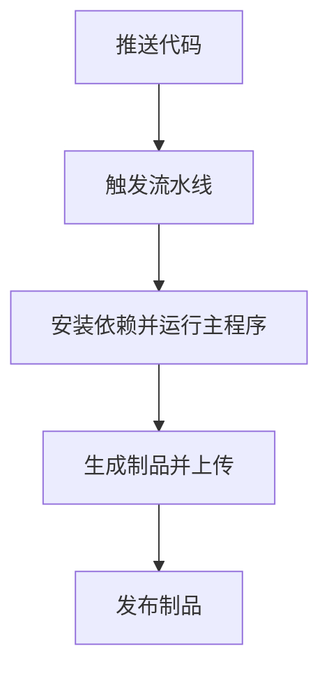
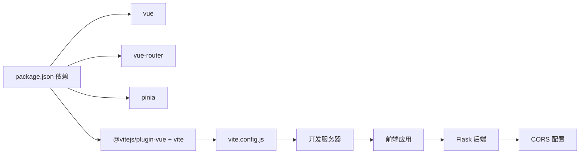

# 构建配置

<cite>
**本文引用的文件**
- [frontend/vite.config.js](file://frontend/vite.config.js)
- [frontend/package.json](file://frontend/package.json)
- [frontend/index.html](file://frontend/index.html)
- [frontend/src/main.js](file://frontend/src/main.js)
- [frontend/src/App.vue](file://frontend/src/App.vue)
- [.workflow/master-pipeline.yml](file://.workflow/master-pipeline.yml)
- [.workflow/branch-pipeline.yml](file://.workflow/branch-pipeline.yml)
- [.workflow/pr-pipeline.yml](file://.workflow/pr-pipeline.yml)
- [app.py](file://app.py)
- [frontend/src/components/TopBar.vue](file://frontend/src/components/TopBar.vue)
- [frontend/src/components/ImageGrid.vue](file://frontend/src/components/ImageGrid.vue)
- [frontend/src/style.css](file://frontend/src/style.css)
</cite>

## 目录
1. [简介](#简介)
2. [项目结构](#项目结构)
3. [核心组件](#核心组件)
4. [架构总览](#架构总览)
5. [详细组件分析](#详细组件分析)
6. [依赖关系分析](#依赖关系分析)
7. [性能考虑](#性能考虑)
8. [故障排查指南](#故障排查指南)
9. [结论](#结论)
10. [附录](#附录)

## 简介
本文件面向 School_Web 前端的构建与部署，聚焦 Vite 构建工具的配置与优化实践，涵盖开发服务器设置、代理配置、热重载机制、构建优化策略（代码分割、资源压缩、缓存策略）、打包配置选项（输出目录、公共路径、产物优化），以及开发与生产环境的准备流程。同时结合仓库中的 CI/CD 工作流，给出可落地的部署建议。

## 项目结构
前端工程位于 frontend 目录，采用 Vue 3 单页应用结构，入口为 index.html，运行时通过 /src/main.js 初始化应用。Vite 的开发服务器与代理规则在 vite.config.js 中集中配置，脚本命令在 package.json 中定义。

图表来源
- [frontend/vite.config.js:6-19](file://frontend/vite.config.js#L6-L19)
- [frontend/index.html:10](file://frontend/index.html#L10)
- [frontend/src/main.js:1-6](file://frontend/src/main.js#L1-L6)
- [frontend/src/App.vue:1-99](file://frontend/src/App.vue#L1-L99)
- [frontend/src/components/TopBar.vue:1-42](file://frontend/src/components/TopBar.vue#L1-L42)
- [frontend/src/components/ImageGrid.vue:1-129](file://frontend/src/components/ImageGrid.vue#L1-L129)

章节来源
- [frontend/package.json:1-21](file://frontend/package.json#L1-L21)
- [frontend/vite.config.js:1-21](file://frontend/vite.config.js#L1-L21)
- [frontend/index.html:1-13](file://frontend/index.html#L1-L13)
- [frontend/src/main.js:1-6](file://frontend/src/main.js#L1-L6)
- [frontend/src/App.vue:1-99](file://frontend/src/App.vue#L1-L99)

## 核心组件
- Vite 配置与插件
  - 使用官方 Vue 插件，启用对 .vue 文件的编译与热重载。
  - 开发服务器监听所有网络接口，便于容器或局域网访问。
- 代理配置
  - 将 /api 与 /static/albums 请求转发至后端服务，解决跨域与统一入口问题。
- 入口与初始化
  - index.html 引入模块入口脚本，main.js 创建 Vue 应用并挂载根组件。
- 应用与组件
  - App.vue 作为页面骨架，组合多个功能组件；TopBar.vue 与 ImageGrid.vue 展示用户态与图片列表等交互。

章节来源
- [frontend/vite.config.js:4-20](file://frontend/vite.config.js#L4-L20)
- [frontend/package.json:6-10](file://frontend/package.json#L6-L10)
- [frontend/index.html:9-11](file://frontend/index.html#L9-L11)
- [frontend/src/main.js:1-6](file://frontend/src/main.js#L1-L6)
- [frontend/src/App.vue:47-84](file://frontend/src/App.vue#L47-L84)
- [frontend/src/components/TopBar.vue:16-31](file://frontend/src/components/TopBar.vue#L16-L31)
- [frontend/src/components/ImageGrid.vue:55-105](file://frontend/src/components/ImageGrid.vue#L55-L105)

## 架构总览
下图展示从前端开发到后端服务的整体交互链路，包括开发服务器、代理、应用组件与后端接口的关系。

图表来源
- [frontend/vite.config.js:9-18](file://frontend/vite.config.js#L9-L18)
- [frontend/src/App.vue:78-84](file://frontend/src/App.vue#L78-L84)
- [frontend/src/components/TopBar.vue:20-31](file://frontend/src/components/TopBar.vue#L20-L31)
- [frontend/src/components/ImageGrid.vue:55-77](file://frontend/src/components/ImageGrid.vue#L55-L77)
- [app.py:131](file://app.py#L131)

## 详细组件分析

### Vite 开发服务器与代理配置
- 主机与端口
  - 开发服务器绑定 0.0.0.0，允许外部访问；端口固定为 3000。
- 代理规则
  - /api → http://localhost:5800：转发鉴权与业务接口。
  - /static/albums → http://localhost:5800：转发相册静态资源。
  - changeOrigin: true：解决跨域与 Host 头一致性问题。
- 热重载机制
  - 基于 Vue 插件与 Vite HMR，修改组件或样式后即时刷新，无需手动刷新。

图表来源
- [frontend/vite.config.js:6-19](file://frontend/vite.config.js#L6-L19)

章节来源
- [frontend/vite.config.js:6-20](file://frontend/vite.config.js#L6-L20)

### 打包与构建产物
- 构建命令
  - 使用 Vite 默认构建命令生成生产包。
- 输出目录
  - 未显式指定，遵循 Vite 默认输出目录（通常为 dist 或 build，视具体版本与配置而定）。当前仓库中存在 dist/ 与 build/ 目录，需在 CI/CD 中明确使用哪一个。
- 公共路径
  - 未显式配置，遵循 Vite 默认公共路径。若部署在子路径或 CDN，需在构建时显式设置 base。
- 产物优化
  - 未显式配置压缩与最小化策略，建议在生产构建时启用压缩与 Tree Shaking。

章节来源
- [frontend/package.json:8](file://frontend/package.json#L8)
- [frontend/vite.config.js:1-21](file://frontend/vite.config.js#L1-L21)

### 应用入口与组件交互
- 入口脚本
  - main.js 创建 Vue 应用并挂载根组件。
- 页面骨架
  - App.vue 定义顶部导航、标签页切换、工具栏与内容区，并按需渲染各功能组件。
- 组件职责
  - TopBar.vue：获取当前用户信息并暴露到全局，触发用户加载事件。
  - ImageGrid.vue：根据分类、排序、搜索与标签过滤加载图片列表，支持教师端操作（重命名、删除）。

图表来源
- [frontend/src/main.js:1-6](file://frontend/src/main.js#L1-L6)
- [frontend/src/App.vue:47-84](file://frontend/src/App.vue#L47-L84)
- [frontend/src/components/TopBar.vue:16-31](file://frontend/src/components/TopBar.vue#L16-L31)
- [frontend/src/components/ImageGrid.vue:43-106](file://frontend/src/components/ImageGrid.vue#L43-L106)

章节来源
- [frontend/src/main.js:1-6](file://frontend/src/main.js#L1-L6)
- [frontend/src/App.vue:1-99](file://frontend/src/App.vue#L1-L99)
- [frontend/src/components/TopBar.vue:1-42](file://frontend/src/components/TopBar.vue#L1-L42)
- [frontend/src/components/ImageGrid.vue:1-129](file://frontend/src/components/ImageGrid.vue#L1-L129)

### CI/CD 与部署准备
- 工作流概览
  - master 分支流水线：编译 Python 依赖并运行主程序，产物暂存并发布。
  - 分支流水线：非 master 分支同样进行编译与制品上传。
  - PR 流水线：针对 PR 场景的编译与制品上传。
- 前端构建建议
  - 在 CI 中增加前端构建步骤，使用 Vite 生成静态产物，并将其与后端制品合并发布。
  - 若后端以静态文件形式提供前端产物，需确保公共路径与路由一致。

图表来源
- [.workflow/master-pipeline.yml:20-55](file://.workflow/master-pipeline.yml#L20-L55)
- [.workflow/branch-pipeline.yml:5-53](file://.workflow/branch-pipeline.yml#L5-L53)
- [.workflow/pr-pipeline.yml:4-38](file://.workflow/pr-pipeline.yml#L4-L38)

章节来源
- [.workflow/master-pipeline.yml:1-55](file://.workflow/master-pipeline.yml#L1-L55)
- [.workflow/branch-pipeline.yml:1-53](file://.workflow/branch-pipeline.yml#L1-L53)
- [.workflow/pr-pipeline.yml:1-38](file://.workflow/pr-pipeline.yml#L1-L38)

## 依赖关系分析
- 前端依赖
  - 运行时：vue、vue-router、pinia。
  - 开发时：@vitejs/plugin-vue、vite。
- 后端集成
  - Flask 启用 CORS，允许来自前端开发服务器的跨域请求。
  - 会话安全配置与 Cookie 策略，保障前后端认证一致性。

图表来源
- [frontend/package.json:11-19](file://frontend/package.json#L11-L19)
- [frontend/vite.config.js:1-21](file://frontend/vite.config.js#L1-L21)
- [app.py:131](file://app.py#L131)

章节来源
- [frontend/package.json:1-21](file://frontend/package.json#L1-L21)
- [app.py:131](file://app.py#L131)

## 性能考虑
- 依赖预构建
  - Vite 默认对 node_modules 中的依赖进行预构建，减少冷启动时间。可在大型项目中通过配置优化预构建范围。
- Tree Shaking
  - 使用 ES Module 导入导出，确保未使用的代码被移除。保持依赖版本与 ESM 兼容。
- 代码分割
  - Vue Router 的路由级懒加载可进一步拆分包体，降低首屏体积。
- 资源压缩与缓存
  - 生产构建默认启用压缩；可结合 CDN 与 HTTP 缓存策略提升加载速度。
- 开发体验
  - 热重载与快速刷新显著提升迭代效率；代理避免跨域带来的调试成本。

## 故障排查指南
- 代理无法访问后端
  - 确认后端服务已在目标端口运行且可访问。
  - 检查代理规则是否覆盖所需路径前缀。
- 跨域问题
  - 确保后端已启用 CORS 并允许前端开发服务器地址。
- 用户信息获取失败
  - 检查会话与 Cookie 设置，确认 credentials: 'include' 的使用与后端 SameSite/Secure 配置一致。
- 图片资源 404
  - 确认 /static/albums 代理指向正确后端路径，且后端可提供对应静态资源。

章节来源
- [frontend/vite.config.js:9-18](file://frontend/vite.config.js#L9-L18)
- [app.py:131](file://app.py#L131)
- [frontend/src/components/TopBar.vue:20-31](file://frontend/src/components/TopBar.vue#L20-L31)
- [frontend/src/components/ImageGrid.vue:55-77](file://frontend/src/components/ImageGrid.vue#L55-L77)

## 结论
本项目基于 Vite 的开发与代理配置清晰，结合 Flask 的 CORS 与会话策略，实现了前后端一体化的开发体验。建议在生产构建中启用压缩与缓存策略，并在 CI/CD 中补充前端构建与产物发布流程，以完善端到端交付能力。

## 附录
- 开发环境启动
  - 使用开发脚本启动 Vite 服务器，访问 http://localhost:3000。
- 生产构建
  - 使用构建脚本生成静态产物，结合后端部署或 CDN 提供静态资源。
- 部署准备
  - 明确输出目录与公共路径，确保代理与路由一致；在 CI 中统一构建与发布流程。

章节来源
- [frontend/package.json:7](file://frontend/package.json#L7)
- [frontend/vite.config.js:1-21](file://frontend/vite.config.js#L1-L21)
- [.workflow/master-pipeline.yml:29-33](file://.workflow/master-pipeline.yml#L29-L33)