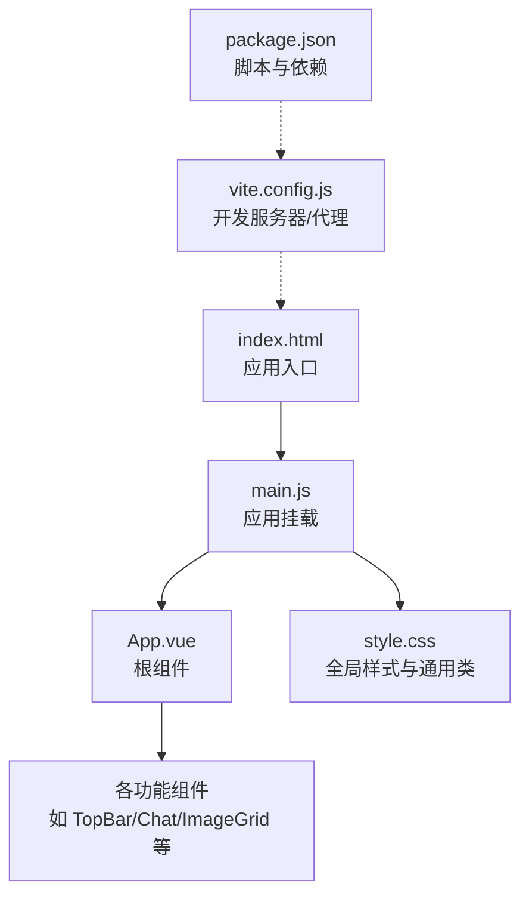
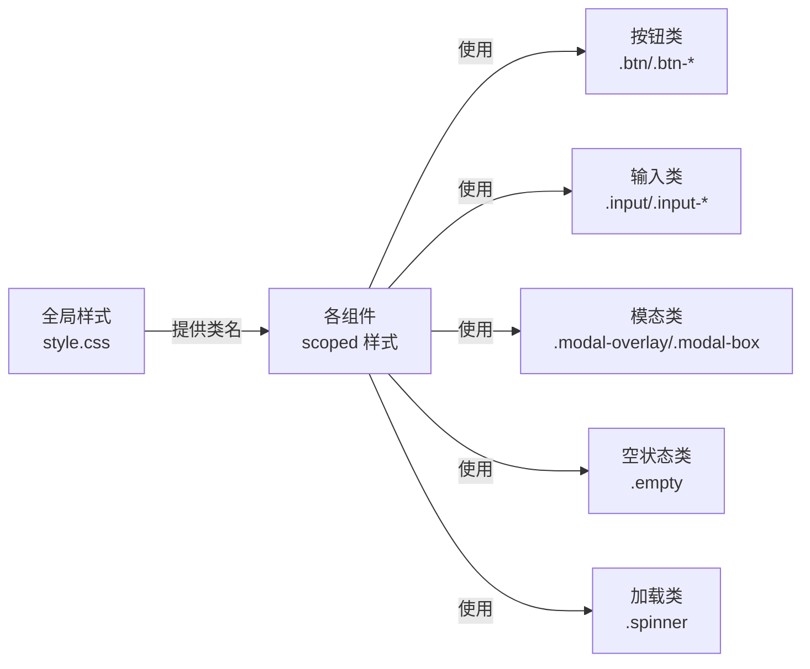
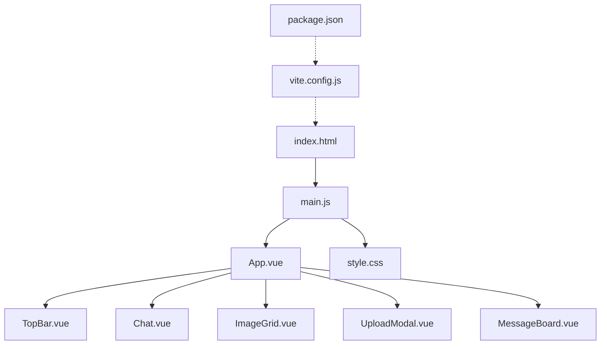

# 样式架构

<cite>
**本文引用的文件**
- [frontend/src/style.css](file://frontend/src/style.css)
- [frontend/src/main.js](file://frontend/src/main.js)
- [frontend/index.html](file://frontend/index.html)
- [frontend/package.json](file://frontend/package.json)
- [frontend/vite.config.js](file://frontend/vite.config.js)
- [frontend/src/App.vue](file://frontend/src/App.vue)
- [frontend/src/components/TopBar.vue](file://frontend/src/components/TopBar.vue)
- [frontend/src/components/Chat.vue](file://frontend/src/components/Chat.vue)
- [frontend/src/components/ImageGrid.vue](file://frontend/src/components/ImageGrid.vue)
- [frontend/src/components/UploadModal.vue](file://frontend/src/components/UploadModal.vue)
- [frontend/src/components/MessageBoard.vue](file://frontend/src/components/MessageBoard.vue)
- [frontend/src/api.js](file://frontend/src/api.js)
</cite>

## 目录
1. [引言](#引言)
2. [项目结构](#项目结构)
3. [核心组件](#核心组件)
4. [架构总览](#架构总览)
5. [详细组件分析](#详细组件分析)
6. [依赖关系分析](#依赖关系分析)
7. [性能考量](#性能考量)
8. [故障排查指南](#故障排查指南)
9. [结论](#结论)
10. [附录](#附录)

## 引言
本文件面向School_Web前端样式架构，系统梳理样式组织原则、模块化与组件样式隔离、主题系统（颜色、字体、间距）、响应式设计与断点、命名规范与复用策略，并结合现有代码给出性能优化、兼容性与可维护性建议。内容以Vue单文件组件中的scoped样式与全局基础样式为核心，辅以构建配置与入口文件，帮助开发者在保持一致性的同时提升可扩展性。

## 项目结构
前端采用Vite + Vue3组合，样式通过全局样式与组件级scoped样式协同工作：
- 全局样式集中于单一入口文件，负责基础重置、通用组件类与动画。
- 组件内部使用scoped样式，确保样式作用域隔离，避免全局污染。
- 构建阶段由Vite处理，支持热更新与生产打包。

图表来源
- [frontend/index.html:1-13](file://frontend/index.html#L1-L13)
- [frontend/src/main.js:1-6](file://frontend/src/main.js#L1-L6)
- [frontend/src/App.vue:1-99](file://frontend/src/App.vue#L1-L99)
- [frontend/src/style.css:1-59](file://frontend/src/style.css#L1-L59)
- [frontend/vite.config.js:1-21](file://frontend/vite.config.js#L1-L21)
- [frontend/package.json:1-21](file://frontend/package.json#L1-L21)

章节来源
- [frontend/index.html:1-13](file://frontend/index.html#L1-L13)
- [frontend/src/main.js:1-6](file://frontend/src/main.js#L1-L6)
- [frontend/src/style.css:1-59](file://frontend/src/style.css#L1-L59)
- [frontend/vite.config.js:1-21](file://frontend/vite.config.js#L1-L21)
- [frontend/package.json:1-21](file://frontend/package.json#L1-L21)

## 核心组件
- 全局样式与通用类：提供基础重置、按钮、输入框、模态框、单选组、上传区、加载指示器、空状态、文本修饰等通用类，便于跨组件复用。
- 组件scoped样式：每个功能组件自定义局部样式，保证样式隔离；同时可复用全局通用类，减少重复定义。
- 主题与视觉：以蓝色为主色调，配合浅色背景与卡片阴影，形成统一的视觉风格；部分组件包含媒体查询以适配移动端。

章节来源
- [frontend/src/style.css:1-59](file://frontend/src/style.css#L1-L59)
- [frontend/src/App.vue:87-99](file://frontend/src/App.vue#L87-L99)
- [frontend/src/components/TopBar.vue:34-42](file://frontend/src/components/TopBar.vue#L34-L42)
- [frontend/src/components/Chat.vue:167-214](file://frontend/src/components/Chat.vue#L167-L214)
- [frontend/src/components/ImageGrid.vue:109-129](file://frontend/src/components/ImageGrid.vue#L109-L129)
- [frontend/src/components/UploadModal.vue:102-116](file://frontend/src/components/UploadModal.vue#L102-L116)
- [frontend/src/components/MessageBoard.vue:68-80](file://frontend/src/components/MessageBoard.vue#L68-L80)

## 架构总览
样式架构遵循“全局基础 + 组件隔离”的双层设计：
- 全局层：统一字体、颜色、尺寸、动画与通用组件类，确保一致性。
- 组件层：通过scoped样式实现样式隔离，按需引入全局类，避免样式冲突。

图表来源
- [frontend/src/style.css:10-43](file://frontend/src/style.css#L10-L43)
- [frontend/src/App.vue:87-99](file://frontend/src/App.vue#L87-L99)
- [frontend/src/components/TopBar.vue:34-42](file://frontend/src/components/TopBar.vue#L34-L42)
- [frontend/src/components/Chat.vue:167-214](file://frontend/src/components/Chat.vue#L167-L214)
- [frontend/src/components/ImageGrid.vue:109-129](file://frontend/src/components/ImageGrid.vue#L109-L129)
- [frontend/src/components/UploadModal.vue:102-116](file://frontend/src/components/UploadModal.vue#L102-L116)
- [frontend/src/components/MessageBoard.vue:68-80](file://frontend/src/components/MessageBoard.vue#L68-L80)

## 详细组件分析

### 全局样式与通用类
- 基础重置与排版：统一内外边距、盒模型、字体族与正文颜色。
- 交互与焦点：按钮与表单元素继承字体，聚焦时移除默认outline，提升可用性。
- 通用组件类：
  - 按钮：主次按钮、尺寸、链接样式、危险按钮等。
  - 输入框：基础与小号输入框、聚焦态高亮。
  - 浮动操作按钮：固定定位、圆角、阴影、悬停缩放。
  - 模态框：遮罩层、容器、宽窄变体。
  - 单选组：标签与控件组合、强调色。
  - 上传区：虚线边框、悬停高亮、过渡动画。
  - 加载指示器：旋转动画、大小与颜色。
  - 空状态：居中、图标、辅助文案。
  - 文本修饰：小号与柔和色文本。
- 动画：渐变背景动画，用于页面背景的动态效果。

章节来源
- [frontend/src/style.css:1-59](file://frontend/src/style.css#L1-L59)

### 顶部栏组件（TopBar）
- 视觉：白色背景、底部边框、粘性定位、顶部固定。
- 用户信息：根据登录状态显示用户名、角色徽章与返回/登录按钮。
- 样式隔离：全部使用scoped样式，避免影响其他区域。

章节来源
- [frontend/src/components/TopBar.vue:1-42](file://frontend/src/components/TopBar.vue#L1-L42)

### 聊天组件（Chat）
- 结构：侧边栏（频道与好友列表）、主聊天区（消息列表与输入）、右键菜单。
- 响应式：在窄屏下侧边栏变为抽屉式滑出，菜单按钮仅在窄屏显示。
- 样式隔离：组件内scoped样式覆盖全局类，如消息气泡、输入框聚焦态等。
- 交互细节：消息气泡区分发送者与他人，支持消息撤回样式。

章节来源
- [frontend/src/components/Chat.vue:1-214](file://frontend/src/components/Chat.vue#L1-L214)

### 图片网格组件（ImageGrid）
- 视觉：卡片网格布局、悬停阴影与位移动画、懒加载图片。
- 行为：悬停显示操作按钮、空状态提示、加载指示器。
- 样式隔离：卡片、信息区、动作区均在组件内定义，复用全局输入与按钮类。

章节来源
- [frontend/src/components/ImageGrid.vue:1-129](file://frontend/src/components/ImageGrid.vue#L1-L129)

### 上传模态组件（UploadModal）
- 视觉：浮动加号按钮、窄型模态框、预览列表、移除按钮。
- 行为：分类选择、多选文件、拖拽支持、批量命名、上传进度反馈。
- 样式隔离：字段、标签、动作区、预览项等均在组件内定义。

章节来源
- [frontend/src/components/UploadModal.vue:1-116](file://frontend/src/components/UploadModal.vue#L1-L116)

### 留言板组件（MessageBoard）
- 视觉：输入框、消息卡片、头像占位、时间与正文。
- 行为：提交、删除、加载状态、空状态。
- 样式隔离：输入与消息卡片在组件内定义，复用全局按钮与文本类。

章节来源
- [frontend/src/components/MessageBoard.vue:1-80](file://frontend/src/components/MessageBoard.vue#L1-L80)

### 根组件（App）
- 视觉：选项卡导航、工具栏（搜索与排序）、主内容区。
- 行为：切换标签、触发搜索、排序控制、子组件渲染。
- 样式隔离：选项卡与工具栏在组件内定义，复用全局按钮与输入类。

章节来源
- [frontend/src/App.vue:1-99](file://frontend/src/App.vue#L1-L99)

## 依赖关系分析
- 入口与构建：index.html引入main.js，main.js导入App.vue与style.css；Vite配置开发服务器与API代理。
- 组件依赖：App作为根组件，按需引入各功能组件；组件间通过props与事件通信。
- 样式依赖：组件通过scoped样式与全局类协作；全局类被多个组件共享使用。

图表来源
- [frontend/index.html:1-13](file://frontend/index.html#L1-L13)
- [frontend/src/main.js:1-6](file://frontend/src/main.js#L1-L6)
- [frontend/src/App.vue:1-99](file://frontend/src/App.vue#L1-L99)
- [frontend/src/style.css:1-59](file://frontend/src/style.css#L1-L59)
- [frontend/vite.config.js:1-21](file://frontend/vite.config.js#L1-L21)
- [frontend/package.json:1-21](file://frontend/package.json#L1-L21)

章节来源
- [frontend/index.html:1-13](file://frontend/index.html#L1-L13)
- [frontend/src/main.js:1-6](file://frontend/src/main.js#L1-L6)
- [frontend/src/App.vue:1-99](file://frontend/src/App.vue#L1-L99)
- [frontend/src/style.css:1-59](file://frontend/src/style.css#L1-L59)
- [frontend/vite.config.js:1-21](file://frontend/vite.config.js#L1-L21)
- [frontend/package.json:1-21](file://frontend/package.json#L1-L21)

## 性能考量
- 样式体积控制
  - 合理拆分全局类与组件scoped样式，避免重复定义相同规则。
  - 使用通用类（如按钮、输入框）减少组件内冗余样式。
- 动画与过渡
  - 控制关键帧动画数量与复杂度，避免在大量元素上同时触发昂贵动画。
  - 对高频滚动区域（如消息列表）谨慎使用阴影与滤镜。
- 渲染性能
  - 避免在组件内频繁计算复杂选择器，优先使用简单类名。
  - 利用CSS变量抽象颜色与尺寸，便于统一调整且减少重绘。
- 打包与缓存
  - 通过Vite构建进行样式压缩与资源哈希，提升缓存命中率。
  - 将常用组件类抽取为全局类，降低重复打包体积。

## 故障排查指南
- 样式未生效
  - 检查组件是否使用scoped样式导致作用域限制；必要时将通用类迁移到全局样式。
  - 确认main.js正确导入style.css，且index.html中已挂载应用。
- 响应式异常
  - 确认媒体查询断点与组件布局逻辑一致；在窄屏下验证侧边栏抽屉行为。
- 交互问题
  - 检查按钮与输入框聚焦态样式是否被覆盖；确认outline移除与高亮策略一致。
- 动画卡顿
  - 减少同时运行的关键帧动画数量；优先使用transform与opacity属性。

章节来源
- [frontend/src/style.css:1-59](file://frontend/src/style.css#L1-L59)
- [frontend/src/components/Chat.vue:203-208](file://frontend/src/components/Chat.vue#L203-L208)
- [frontend/src/main.js:1-6](file://frontend/src/main.js#L1-L6)
- [frontend/index.html:1-13](file://frontend/index.html#L1-L13)

## 结论
当前样式架构以全局通用类与组件scoped样式相结合，实现了良好的样式隔离与复用。建议在保持现有结构的基础上，进一步引入CSS变量统一主题参数，完善命名规范与文档，逐步沉淀可复用的UI原子与分子组件，持续优化性能与可维护性。

## 附录

### 主题系统设计建议
- 颜色方案
  - 主色：蓝色系用于强调与交互元素。
  - 中性色：灰阶用于文本、边框与背景，确保对比度与可读性。
  - 状态色：绿色用于成功、红色用于危险，保持一致性。
- 字体规范
  - 正文字号与行高：保证长文本可读性。
  - 标题层级：明确字号与字重差异，增强层次感。
- 间距系统
  - 基于统一步进（如4px/8px/12px等）定义外边距、内边距与网格间距，提升一致性。

### 响应式设计与断点
- 断点建议：以768px为移动端临界值，配合flex与grid实现自适应布局。
- 移动端适配：优先考虑触摸目标尺寸、点击区域与滚动体验；在窄屏下采用抽屉式导航与紧凑布局。

### 样式开发规范
- 命名约定
  - 组件类：使用语义化前缀（如.chat-、.upload-），避免与通用类冲突。
  - 通用类：采用功能导向命名（如.btn、.input、.modal），便于跨组件复用。
- BEM方法论
  - 块-元素-修饰符清晰划分，避免深层嵌套与选择器复杂化。
- 样式复用策略
  - 将高频使用的布局与视觉模式抽取为通用类，减少重复定义。
  - 在组件内保留最小必要样式，其余通过全局类与CSS变量统一管理。

### 浏览器兼容性与可维护性
- 兼容性
  - 关注现代浏览器特性（如CSS Grid、Flexbox、CSS变量）的降级方案。
  - 对旧版浏览器进行渐进增强，确保核心功能可用。
- 可维护性
  - 统一命名与目录结构，建立样式文档与变更记录。
  - 通过构建工具自动校验样式质量，减少回归风险。