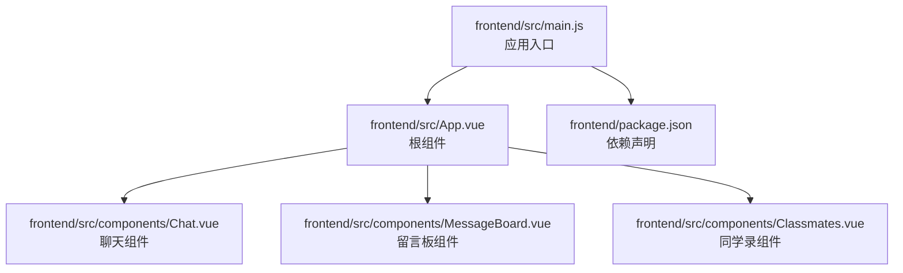
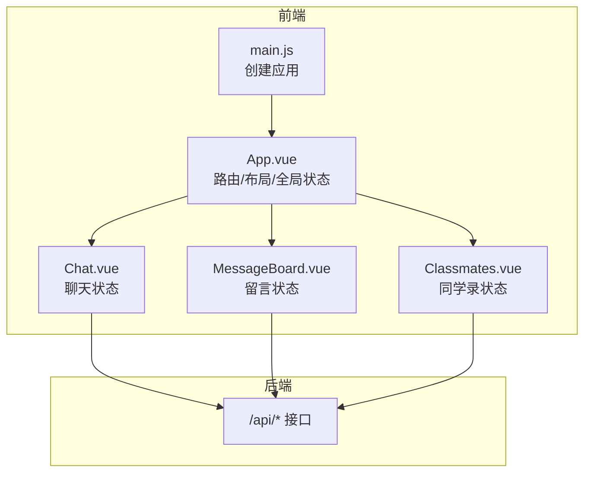
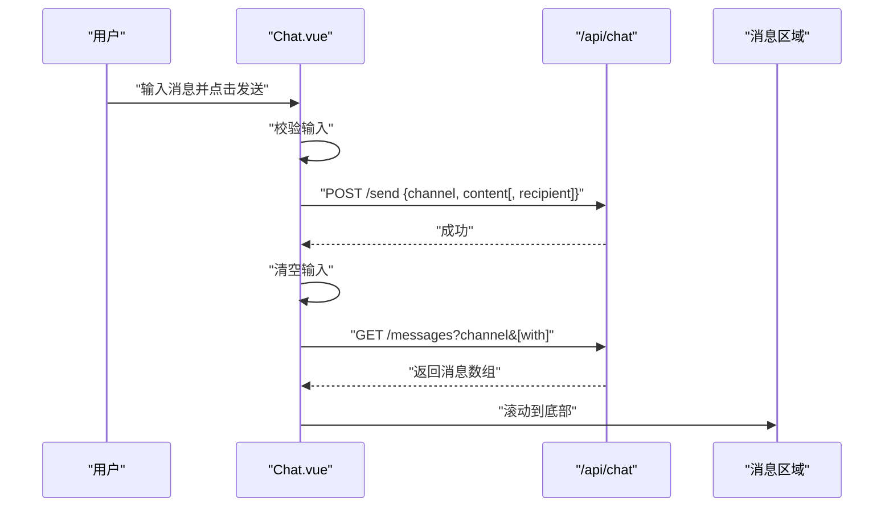
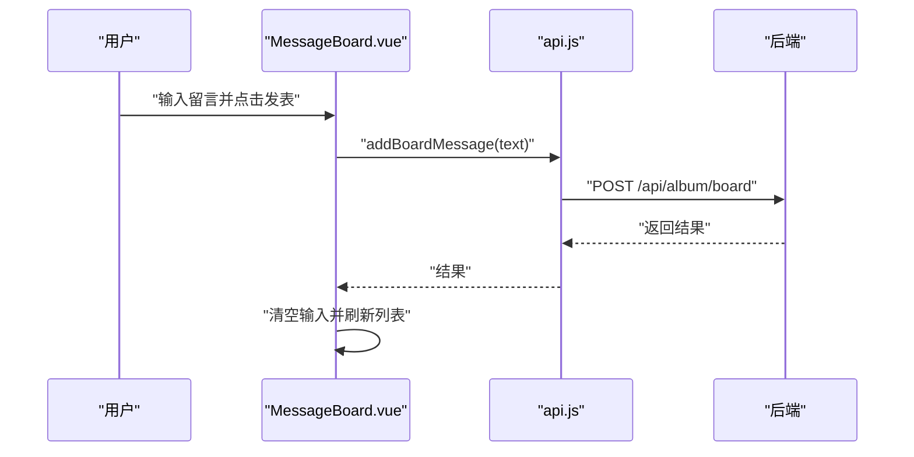
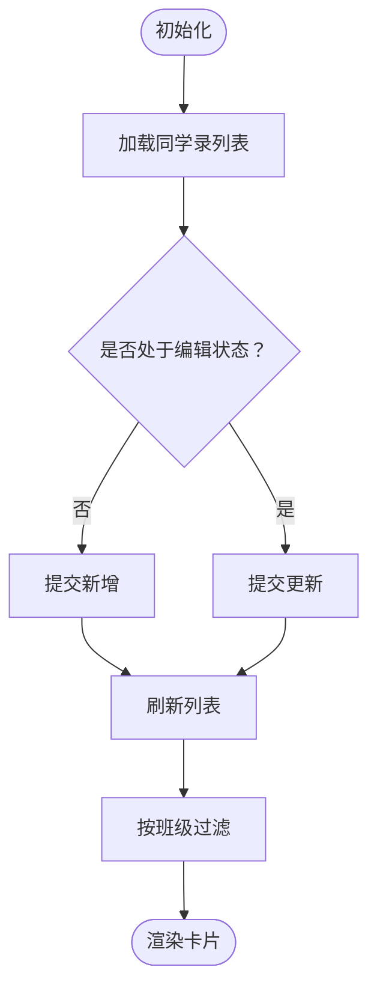
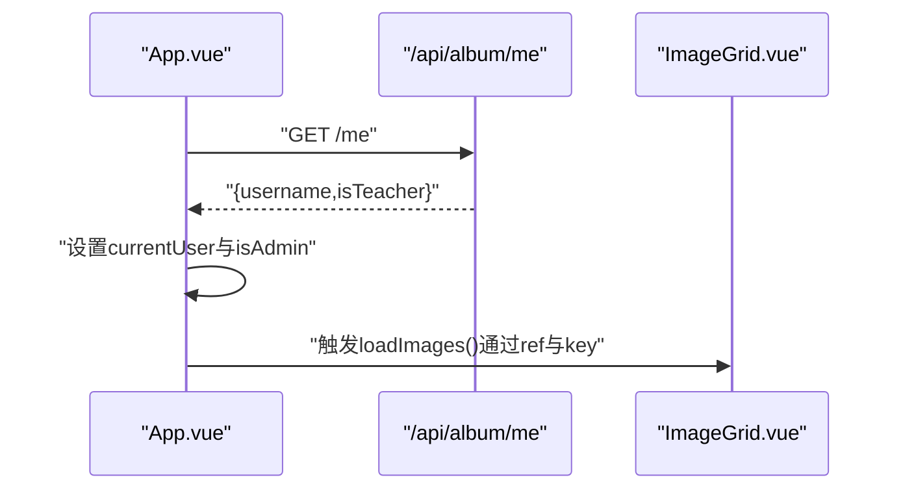
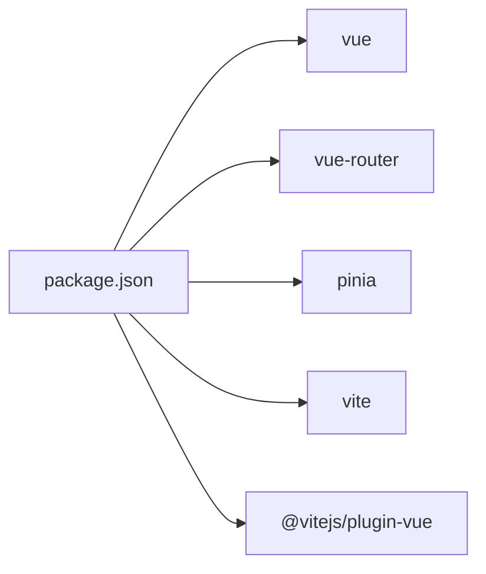

# 状态管理

<cite>
**本文引用的文件**
- [frontend/src/main.js](file://frontend/src/main.js)
- [frontend/package.json](file://frontend/package.json)
- [frontend/src/App.vue](file://frontend/src/App.vue)
- [frontend/src/components/Chat.vue](file://frontend/src/components/Chat.vue)
- [frontend/src/components/MessageBoard.vue](file://frontend/src/components/MessageBoard.vue)
- [frontend/src/components/Classmates.vue](file://frontend/src/components/Classmates.vue)
- [frontend/src/api.js](file://frontend/src/api.js)
</cite>

## 目录
1. [引言](#引言)
2. [项目结构](#项目结构)
3. [核心组件](#核心组件)
4. [架构总览](#架构总览)
5. [详细组件分析](#详细组件分析)
6. [依赖分析](#依赖分析)
7. [性能考虑](#性能考虑)
8. [故障排查指南](#故障排查指南)
9. [结论](#结论)
10. [附录](#附录)

## 引言
本文件面向School_Web前端状态管理系统，聚焦于Pinia状态管理架构与实践。当前仓库中未发现显式的store定义文件，但通过组件内的本地响应式数据与API交互，可以归纳出全局状态管理策略、状态同步与响应式更新方式，并给出持久化、调试、性能优化与错误处理的最佳实践建议。

## 项目结构
前端采用Vue 3 + Vite + Pinia组合，入口在main.js中挂载根组件App.vue；应用通过多个功能组件承载业务状态，如聊天、留言板、同学录等。组件内部以ref/computed/watch等响应式API管理本地状态，并通过fetch调用后端接口进行数据拉取与更新。

图示来源
- [frontend/src/main.js:1-6](file://frontend/src/main.js#L1-L6)
- [frontend/src/App.vue:1-99](file://frontend/src/App.vue#L1-L99)
- [frontend/src/components/Chat.vue:1-214](file://frontend/src/components/Chat.vue#L1-L214)
- [frontend/src/components/MessageBoard.vue:1-80](file://frontend/src/components/MessageBoard.vue#L1-L80)
- [frontend/src/components/Classmates.vue:1-113](file://frontend/src/components/Classmates.vue#L1-L113)
- [frontend/package.json:1-21](file://frontend/package.json#L1-L21)

章节来源
- [frontend/src/main.js:1-6](file://frontend/src/main.js#L1-L6)
- [frontend/package.json:1-21](file://frontend/package.json#L1-L21)

## 核心组件
- 应用入口与依赖
  - main.js负责创建Vue应用并挂载根组件。
  - package.json声明了vue、vue-router、pinia等依赖，表明项目具备使用Pinia的条件。
- 根组件App.vue
  - 管理页面级状态：当前标签页、搜索词、排序方式、活跃标签、是否显示倒计时、当前用户与管理员标识等。
  - 通过子组件传递属性与事件，协调各功能模块。
- 功能组件中的状态
  - Chat.vue：管理聊天频道、消息列表、输入文本、好友列表、搜索结果、侧边栏开关、轮询定时器等。
  - MessageBoard.vue：管理留言列表、输入文本、加载状态、当前用户与管理员标识。
  - Classmates.vue：管理同学录列表、表单数据、编辑状态、班级过滤等。

章节来源
- [frontend/src/main.js:1-6](file://frontend/src/main.js#L1-L6)
- [frontend/package.json:11-19](file://frontend/package.json#L11-L19)
- [frontend/src/App.vue:47-84](file://frontend/src/App.vue#L47-L84)
- [frontend/src/components/Chat.vue:61-164](file://frontend/src/components/Chat.vue#L61-L164)
- [frontend/src/components/MessageBoard.vue:23-65](file://frontend/src/components/MessageBoard.vue#L23-L65)
- [frontend/src/components/Classmates.vue:46-94](file://frontend/src/components/Classmates.vue#L46-L94)

## 架构总览
当前系统采用“组件内局部状态 + API交互”的轻量状态管理模式。Pinia虽已作为依赖引入，但未在仓库中直接体现store定义文件。因此，本节从概念层面梳理可落地的Pinia架构蓝图，帮助后续演进。

图示来源
- [frontend/src/main.js:1-6](file://frontend/src/main.js#L1-L6)
- [frontend/src/App.vue:14-44](file://frontend/src/App.vue#L14-L44)
- [frontend/src/components/Chat.vue:78](file://frontend/src/components/Chat.vue#L78)
- [frontend/src/components/MessageBoard.vue:25](file://frontend/src/components/MessageBoard.vue#L25)
- [frontend/src/components/Classmates.vue:73](file://frontend/src/components/Classmates.vue#L73)

## 详细组件分析

### Chat组件状态流
- 状态定义
  - 频道选择、私聊对象、消息列表、输入内容、当前用户、好友列表、请求列表、搜索关键词、搜索结果、侧边栏开关、滚动容器引用、轮询定时器。
- 行为与流程
  - 初始化：获取当前用户、加载消息与好友列表，启动轮询。
  - 发送消息：构造请求体，调用发送接口，清空输入并刷新消息列表。
  - 切换频道/私聊：根据频道与私聊对象拼接查询参数，重新加载消息。
  - 好友操作：发起请求、接受请求、移除好友，完成后刷新好友与请求列表。
  - 右键菜单：仅允许本人撤回未被撤回的消息，确认后调用删除接口并刷新。
- 响应式与副作用
  - 使用ref管理可变状态，nextTick确保DOM更新后再滚动到底部。
  - 使用setInterval定期轮询，组件卸载时清理定时器，避免内存泄漏。

图示来源
- [frontend/src/components/Chat.vue:87-97](file://frontend/src/components/Chat.vue#L87-L97)
- [frontend/src/components/Chat.vue:158-164](file://frontend/src/components/Chat.vue#L158-L164)

章节来源
- [frontend/src/components/Chat.vue:61-164](file://frontend/src/components/Chat.vue#L61-L164)

### MessageBoard组件状态流
- 状态定义
  - 留言列表、输入文本、加载状态、当前用户、管理员标识。
- 行为与流程
  - 初始化：加载留言列表；获取当前用户与权限。
  - 提交留言：校验输入，调用新增接口，清空输入并刷新列表。
  - 删除留言：校验权限，调用删除接口，刷新列表。
- 响应式与副作用
  - 加载状态用于控制加载指示器显示。
  - 权限判断决定删除按钮可见性与可用性。

图示来源
- [frontend/src/components/MessageBoard.vue:39-45](file://frontend/src/components/MessageBoard.vue#L39-L45)
- [frontend/src/components/MessageBoard.vue:58-65](file://frontend/src/components/MessageBoard.vue#L58-L65)
- [frontend/src/api.js](file://frontend/src/api.js)

章节来源
- [frontend/src/components/MessageBoard.vue:23-65](file://frontend/src/components/MessageBoard.vue#L23-L65)

### Classmates组件状态流
- 状态定义
  - 同学录列表、表单字段、编辑状态、活跃班级过滤、计算派生的班级集合与过滤后的列表。
- 行为与流程
  - 初始化：加载列表。
  - 新增/更新：校验必填项，调用对应接口，重置表单并刷新列表。
  - 编辑：填充表单并进入编辑状态。
  - 删除：确认后调用删除接口并刷新列表。
  - 过滤：按“届数·班级”聚合与筛选。
- 响应式与副作用
  - computed派生班级去重集合与过滤结果，减少重复计算。
  - props接收权限与当前用户，影响UI按钮与操作能力。

图示来源
- [frontend/src/components/Classmates.vue:74-94](file://frontend/src/components/Classmates.vue#L74-L94)
- [frontend/src/components/Classmates.vue:55-71](file://frontend/src/components/Classmates.vue#L55-L71)

章节来源
- [frontend/src/components/Classmates.vue:46-94](file://frontend/src/components/Classmates.vue#L46-L94)

### App.vue中的全局状态与路由
- 全局状态
  - 当前标签页、搜索词、排序方式、活跃标签、倒计时显示、管理员标识、当前用户名。
- 行为与流程
  - 标签切换时重置搜索与排序；触发子组件的loadImages以刷新相册视图。
  - 初始化时通过/me接口获取用户身份，设置管理员与当前用户状态。
- 响应式与副作用
  - 计算属性与watch结合防抖触发搜索；key强制重建子组件以刷新数据。

图示来源
- [frontend/src/App.vue:78-84](file://frontend/src/App.vue#L78-L84)
- [frontend/src/App.vue:34](file://frontend/src/App.vue#L34)

章节来源
- [frontend/src/App.vue:62-84](file://frontend/src/App.vue#L62-L84)

## 依赖分析
- Vue生态
  - vue：提供响应式系统与组件模型。
  - vue-router：提供路由能力（当前页面未直接使用router-view）。
- 状态管理
  - pinia：提供集中式状态管理能力，当前仓库未见store定义文件，建议后续引入。
- 构建与开发
  - vite：快速开发与构建工具。
  - @vitejs/plugin-vue：Vue单文件组件支持。

图示来源
- [frontend/package.json:11-19](file://frontend/package.json#L11-L19)

章节来源
- [frontend/package.json:1-21](file://frontend/package.json#L1-L21)

## 性能考虑
- 组件渲染优化
  - 使用computed缓存派生数据，避免重复计算。
  - 通过key强制重建子组件，确保数据刷新与DOM重置。
- 网络请求优化
  - 对搜索输入使用防抖（setTimeout），减少高频请求。
  - 聊天场景使用轮询，建议结合服务端推送或长连接降低延迟与带宽占用。
- 内存与资源
  - 轮询定时器需在组件卸载时清理，防止内存泄漏。
  - 大列表渲染时优先考虑虚拟滚动与分页加载。

## 故障排查指南
- 状态未更新
  - 检查是否使用了响应式ref/nextTick确保DOM更新后再操作。
  - 确认key变化是否触发了子组件重建。
- 请求失败
  - 检查fetch调用是否携带凭证（credentials: include）。
  - 校验后端接口路径与HTTP方法是否正确。
- 权限问题
  - 确保初始化时已获取用户身份与权限标识。
  - 在UI层对不可见/禁用按钮进行明确提示。
- 调试建议
  - 使用浏览器开发者工具Network面板观察请求与响应。
  - 在关键函数处添加日志输出，定位异步流程中的异常点。

## 结论
当前项目采用“组件内局部状态 + API交互”的轻量方案，满足基础功能需求。建议后续引入Pinia store统一管理全局状态（如用户信息、聊天会话、相册筛选条件等），并配合持久化插件实现跨会话恢复。同时完善调试工具链、错误处理与性能监控，持续提升用户体验与可维护性。

## 附录
- Pinia集成建议
  - 创建用户、聊天、相册等store，分别封装state、actions与持久化策略。
  - 将组件内的本地状态迁移至store，减少组件间耦合。
- 最佳实践清单
  - 状态结构扁平化、命名清晰、职责单一。
  - actions内聚业务逻辑，避免在组件模板中直接调用API。
  - 使用严格模式与类型约束（如TS）增强可维护性。
  - 对关键状态启用持久化，注意敏感信息脱敏与存储安全。
  - 建立统一的错误处理与重试机制，提供用户反馈。