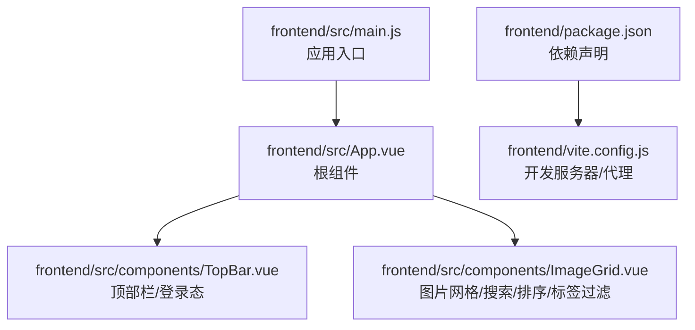
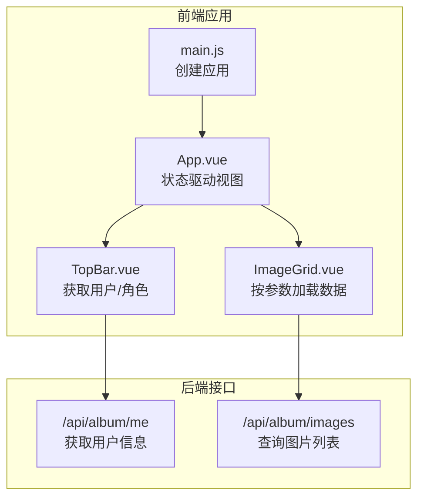
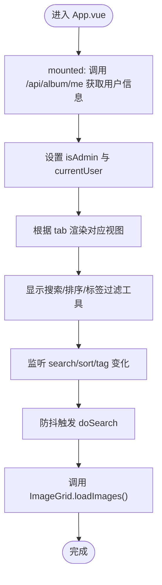
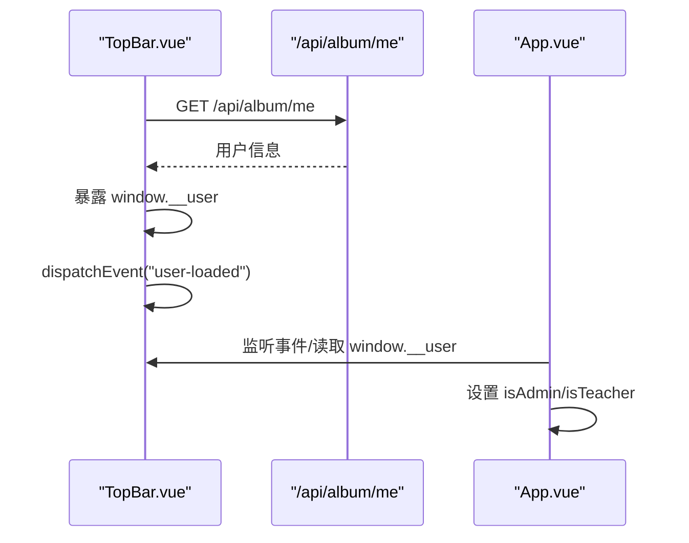
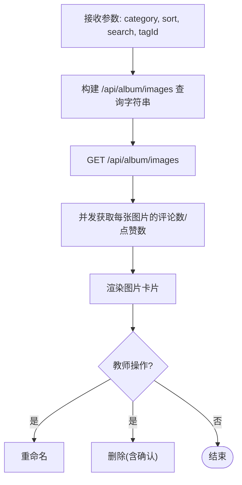
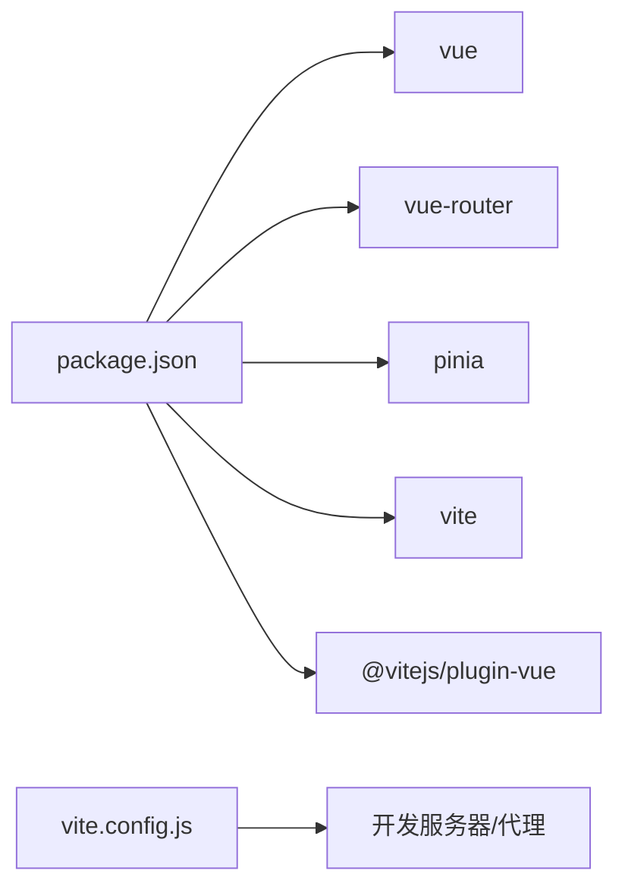

# 路由系统

<cite>
**本文引用的文件**
- [frontend/src/main.js](file://frontend/src/main.js)
- [frontend/src/App.vue](file://frontend/src/App.vue)
- [frontend/src/components/TopBar.vue](file://frontend/src/components/TopBar.vue)
- [frontend/src/components/ImageGrid.vue](file://frontend/src/components/ImageGrid.vue)
- [frontend/package.json](file://frontend/package.json)
- [frontend/vite.config.js](file://frontend/vite.config.js)
</cite>

## 目录
1. [简介](#简介)
2. [项目结构](#项目结构)
3. [核心组件](#核心组件)
4. [架构总览](#架构总览)
5. [详细组件分析](#详细组件分析)
6. [依赖关系分析](#依赖关系分析)
7. [性能考量](#性能考量)
8. [故障排查指南](#故障排查指南)
9. [结论](#结论)
10. [附录](#附录)

## 简介
本文件面向 School_Web 的前端路由系统，目标是为读者提供一套完整、可操作的技术文档，涵盖 Vue Router 配置与路由设计、嵌套路由与动态路由参数、页面导航机制、路由守卫与权限控制、懒加载与性能优化、最佳实践（命名规范、参数与查询字符串处理）、调试方法、错误处理与用户体验优化等主题。  
需要特别说明的是：当前仓库中未发现显式的路由配置文件（如 routes/index.js 或 router/index.js），前端采用“无路由”模式，通过应用内的状态切换实现多视图展示。因此本文在“路由系统”的范畴内，重点解释现有实现如何工作、如何扩展为标准的 Vue Router 应用，以及在现有模式下如何进行权限控制、导航与性能优化。

## 项目结构
前端位于 frontend 目录，核心入口为 main.js，根组件为 App.vue；各功能模块以组件形式组织在 src/components 下。package.json 显示依赖了 vue 与 vue-router；vite.config.js 提供开发服务器与代理配置。

图表来源
- [frontend/src/main.js:1-6](file://frontend/src/main.js#L1-L6)
- [frontend/src/App.vue:1-99](file://frontend/src/App.vue#L1-L99)
- [frontend/src/components/TopBar.vue:1-42](file://frontend/src/components/TopBar.vue#L1-L42)
- [frontend/src/components/ImageGrid.vue:1-129](file://frontend/src/components/ImageGrid.vue#L1-L129)
- [frontend/package.json:1-21](file://frontend/package.json#L1-L21)
- [frontend/vite.config.js:1-21](file://frontend/vite.config.js#L1-L21)

章节来源
- [frontend/src/main.js:1-6](file://frontend/src/main.js#L1-L6)
- [frontend/src/App.vue:1-99](file://frontend/src/App.vue#L1-L99)
- [frontend/package.json:1-21](file://frontend/package.json#L1-L21)
- [frontend/vite.config.js:1-21](file://frontend/vite.config.js#L1-L21)

## 核心组件
- 应用入口与挂载
  - main.js 创建并挂载 Vue 应用实例，未引入路由配置。
- 根组件与视图切换
  - App.vue 使用本地状态控制 tab 切换，配合若干子组件渲染不同视图区域（图片网格、留言板、时间线、同学录、寄语墙、歌单、统计等）。
- 登录态与权限
  - TopBar 在挂载时通过 /api/album/me 获取当前用户信息，暴露到 window 并广播事件，供其他组件使用。
- 图片网格与数据加载
  - ImageGrid 根据 category、sort、search、tagId 参数组合查询字符串，调用后端接口获取数据。

章节来源
- [frontend/src/main.js:1-6](file://frontend/src/main.js#L1-L6)
- [frontend/src/App.vue:1-99](file://frontend/src/App.vue#L1-L99)
- [frontend/src/components/TopBar.vue:1-42](file://frontend/src/components/TopBar.vue#L1-L42)
- [frontend/src/components/ImageGrid.vue:1-129](file://frontend/src/components/ImageGrid.vue#L1-L129)

## 架构总览
当前系统采用“无路由”模式：  
- 不使用 vue-router 的路由表与导航，而是通过 App.vue 内部状态（tab、search、sort、activeTag 等）驱动视图切换。
- 权限控制通过 TopBar 获取用户角色并在 App.vue 中暴露给子组件使用。
- 数据加载通过组件内部 watch 与 onMounted 生命周期触发，结合查询字符串参数传递。

图表来源
- [frontend/src/main.js:1-6](file://frontend/src/main.js#L1-L6)
- [frontend/src/App.vue:1-99](file://frontend/src/App.vue#L1-L99)
- [frontend/src/components/TopBar.vue:1-42](file://frontend/src/components/TopBar.vue#L1-L42)
- [frontend/src/components/ImageGrid.vue:1-129](file://frontend/src/components/ImageGrid.vue#L1-L129)

## 详细组件分析

### 组件：App.vue（视图切换与状态）
- 视图切换逻辑
  - 通过 tab 控制主内容区渲染的组件类型（图片网格、留言板、时间线、同学录、寄语墙、歌单、统计等）。
  - 搜索、排序、标签过滤参数通过 props 传递至 ImageGrid。
- 权限与用户信息
  - 在 mounted 中调用 /api/album/me 获取用户信息，设置 isAdmin 与 currentUser，供子组件使用。
- 交互行为
  - switchTab 清空搜索与标签，重置视图状态。
  - triggerSearch 与 doSearch 结合防抖，触发 ImageGrid.loadImages。
  - onTagFilter 更新 activeTag 并执行搜索。

图表来源
- [frontend/src/App.vue:47-84](file://frontend/src/App.vue#L47-L84)
- [frontend/src/App.vue:14-41](file://frontend/src/App.vue#L14-L41)

章节来源
- [frontend/src/App.vue:1-99](file://frontend/src/App.vue#L1-L99)

### 组件：TopBar.vue（登录态与权限）
- 功能要点
  - 挂载时请求 /api/album/me，成功则将用户信息暴露到 window 并广播事件，便于其他组件感知。
  - 根据用户角色渲染不同的徽章样式与返回链接。
- 与权限控制的关系
  - App.vue 读取 window.__user 或再次请求 /api/album/me，得到 isTeacher 后决定是否显示教师操作按钮。

图表来源
- [frontend/src/components/TopBar.vue:15-31](file://frontend/src/components/TopBar.vue#L15-L31)
- [frontend/src/App.vue:78-84](file://frontend/src/App.vue#L78-L84)

章节来源
- [frontend/src/components/TopBar.vue:1-42](file://frontend/src/components/TopBar.vue#L1-L42)
- [frontend/src/App.vue:67-84](file://frontend/src/App.vue#L67-L84)

### 组件：ImageGrid.vue（参数化查询与数据加载）
- 参数与查询字符串
  - 接收 category、sort、search、tagId 四个参数，拼接为 /api/album/images 的查询字符串。
- 加载流程
  - watch 监听上述参数变化，触发 loadImages。
  - onMounted 时若 window.__user 存在则直接使用，否则回退到 /api/album/me 获取用户角色。
  - 对每张图片并发请求评论数与点赞数，更新到本地状态。
- 交互与操作
  - 支持重命名与删除（教师可见），删除前确认提示。

图表来源
- [frontend/src/components/ImageGrid.vue:43-106](file://frontend/src/components/ImageGrid.vue#L43-L106)

章节来源
- [frontend/src/components/ImageGrid.vue:1-129](file://frontend/src/components/ImageGrid.vue#L1-L129)

### 扩展：如何接入标准 Vue Router（建议方案）
以下为将现有“无路由”模式迁移为标准 Vue Router 的建议步骤，帮助理解如何在不改变现有组件的前提下引入路由系统。

- 安装与引入
  - 已安装 vue 与 vue-router，确保版本兼容。
- 创建路由配置
  - 新建路由表，定义路径与组件映射（例如首页、图片、留言板、时间线、同学录、寄语墙、歌单、统计等）。
  - 对需要权限的页面（如时间线、同学录、寄语墙、歌单）设置路由元信息（meta）标记角色要求。
- 路由守卫与权限控制
  - 全局前置守卫：在进入路由前检查用户登录态与角色权限，必要时跳转至登录页或 403 页面。
  - 路由独享守卫：对特定页面在 beforeEnter 中校验权限。
- 动态路由与参数传递
  - 对需要动态参数的页面（如详情页）使用动态段（:id），在组件中通过 $route.params 获取。
  - 查询字符串通过 $route.query 获取，与现有组件参数传递方式一致。
- 嵌套路由
  - 将子页面（如时间线下的子视图）作为子路由，父路由负责承载布局与面包屑。
- 路由懒加载与代码分割
  - 将大型页面组件以异步组件方式导入，利用浏览器原生动态导入实现按需加载。
- 导航与导航栏
  - 使用 <router-link> 替代原生 a 标签，保持激活态样式一致。
  - 在 App.vue 中保留 Tab 切换思路，但改为通过路由参数或路由名称驱动视图。
- 性能优化
  - 合理拆分路由模块，避免单页过大。
  - 对频繁访问的页面启用 keep-alive 缓存。
- 最佳实践
  - 命名规范：路由名称使用 kebab-case 或 camelCase，保持一致性；路径使用短横线分隔。
  - 参数与查询字符串：优先使用路由参数传递必要标识，使用查询字符串传递筛选条件。
  - 错误处理：统一处理导航失败（重复导航、取消、中止、重定向）并记录日志。
  - 用户体验：在导航开始时显示加载指示，在路由切换后滚动到顶部或指定位置。

（本节为概念性扩展说明，不直接分析具体源码文件）

## 依赖关系分析
- 运行时依赖
  - vue 与 vue-router：提供响应式与路由能力。
  - pinia：状态管理（在当前实现中未见直接使用）。
- 开发与构建
  - vite 与 @vitejs/plugin-vue：开发服务器、热更新与 Vue 单文件编译。
  - vite.config.js：配置开发服务器、端口与代理（/api 与 /static/albums）。

图表来源
- [frontend/package.json:11-19](file://frontend/package.json#L11-L19)
- [frontend/vite.config.js:4-19](file://frontend/vite.config.js#L4-L19)

章节来源
- [frontend/package.json:1-21](file://frontend/package.json#L1-L21)
- [frontend/vite.config.js:1-21](file://frontend/vite.config.js#L1-L21)

## 性能考量
- 现有实现中的性能点
  - ImageGrid 对每张图片并发请求评论与点赞，注意网络并发与错误兜底。
  - App.vue 的搜索防抖（setTimeout）减少不必要的请求。
  - 图片懒加载（loading="lazy"）提升首屏渲染性能。
- 路由层面的优化建议（基于标准 Vue Router）
  - 路由懒加载：将大型页面组件以异步组件导入，减少首屏包体。
  - keep-alive：对频繁切换但不需要重新加载的页面启用缓存。
  - 路由预加载：对即将访问的页面进行预加载，改善切换体验。
  - 查询字符串与参数：避免冗余参数，合理使用 query 与 params，减少无效刷新。
  - 滚动行为：在路由切换后恢复或定位到合适位置，提升连续浏览体验。

（本节为通用性能指导，不直接分析具体源码文件）

## 故障排查指南
- 登录态与权限问题
  - 若 /api/album/me 请求失败，window.__user 为空，导致 App.vue 无法正确设置 isAdmin 与 currentUser。应检查后端接口可用性与跨域凭据配置。
- 图片加载异常
  - ImageGrid 在并发请求评论/点赞失败时会降级为 0，若出现大量 0，检查后端接口与网络状况。
- 搜索与过滤无效
  - 确认 App.vue 的 doSearch 是否被触发，watch 是否监听到参数变化；检查 ImageGrid 的查询字符串拼接逻辑。
- 开发服务器与代理
  - vite.config.js 中的代理配置指向 http://localhost:5800，请确保后端服务已启动且可访问。

章节来源
- [frontend/src/components/TopBar.vue:20-31](file://frontend/src/components/TopBar.vue#L20-L31)
- [frontend/src/components/ImageGrid.vue:55-77](file://frontend/src/components/ImageGrid.vue#L55-L77)
- [frontend/src/App.vue:72-76](file://frontend/src/App.vue#L72-L76)
- [frontend/vite.config.js:9-18](file://frontend/vite.config.js#L9-L18)

## 结论
当前 School_Web 前端采用“无路由”模式，通过应用内状态与组件协作实现多视图展示，并在 TopBar 中完成用户登录态与角色的获取，为后续权限控制提供基础。若要引入标准的 Vue Router，建议从路由表、守卫与权限、动态参数与查询字符串、懒加载与性能优化等方面逐步演进，同时保持现有组件的参数传递与数据加载逻辑不变，以降低迁移成本并提升可维护性。

## 附录
- 最佳实践清单（建议）
  - 路由命名：使用清晰、稳定的名称，避免硬编码路径。
  - 参数传递：必要标识使用 params，筛选条件使用 query。
  - 权限控制：在路由层统一拦截，避免在组件内重复判断。
  - 错误处理：捕获并记录导航失败类型，提供友好提示。
  - 用户体验：导航开始显示加载指示，切换后自动滚动到顶部或锚点。