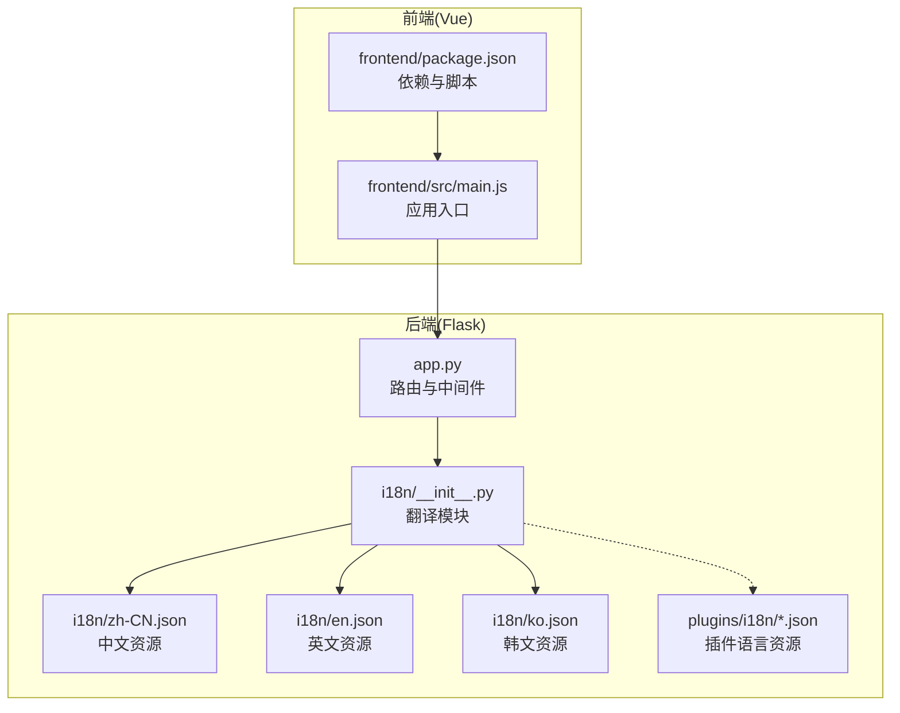
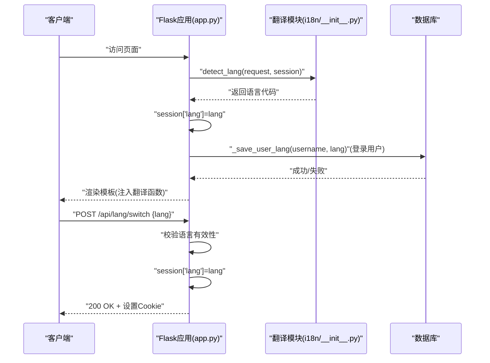
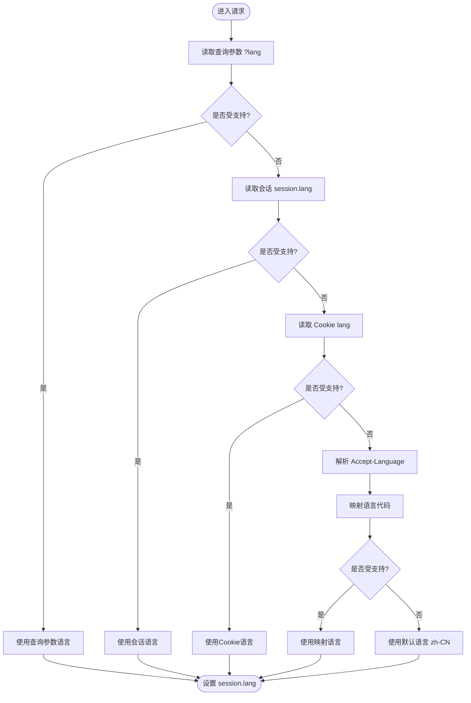
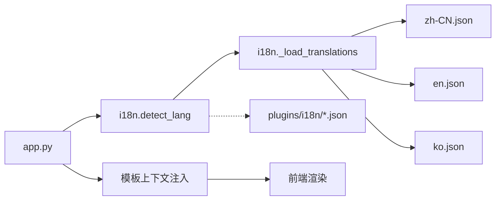

# 国际化系统

<cite>
**本文档引用的文件**
- [app.py](file://app.py)
- [i18n/__init__.py](file://i18n/__init__.py)
- [i18n/en.json](file://i18n/en.json)
- [i18n/zh-CN.json](file://i18n/zh-CN.json)
- [i18n/ko.json](file://i18n/ko.json)
- [plugins/i18n/ja.json](file://plugins/i18n/ja.json)
- [plugins/i18n/ko.json](file://plugins/i18n/ko.json)
- [frontend/src/main.js](file://frontend/src/main.js)
- [frontend/package.json](file://frontend/package.json)
</cite>

## 目录
1. [引言](#引言)
2. [项目结构](#项目结构)
3. [核心组件](#核心组件)
4. [架构概览](#架构概览)
5. [详细组件分析](#详细组件分析)
6. [依赖分析](#依赖分析)
7. [性能考虑](#性能考虑)
8. [故障排查指南](#故障排查指南)
9. [结论](#结论)
10. [附录](#附录)

## 引言
本文件面向国际化系统的技术文档，全面阐述多语言支持架构、语言检测机制、会话与持久化存储、语言包管理规范、动态语言切换流程、本地化最佳实践、翻译文件维护与更新流程、新增语言支持的开发指南与测试方法，以及性能优化与缓存策略。文档同时提供可视化图示帮助读者快速理解系统的工作原理。

## 项目结构
国际化系统由后端 Flask 应用与前端 Vue 应用共同组成，语言资源分布在独立的 JSON 文件中，并通过后端模块进行加载与注入。插件目录中也包含部分语言资源文件，用于扩展功能的本地化。



**图表来源**
- [app.py:167-232](file://app.py#L167-L232)
- [i18n/__init__.py:15-113](file://i18n/__init__.py#L15-L113)
- [i18n/zh-CN.json:1-477](file://i18n/zh-CN.json#L1-L477)
- [i18n/en.json:1-477](file://i18n/en.json#L1-L477)
- [i18n/ko.json:1-486](file://i18n/ko.json#L1-L486)
- [plugins/i18n/ja.json:1-17](file://plugins/i18n/ja.json#L1-L17)
- [plugins/i18n/ko.json:1-17](file://plugins/i18n/ko.json#L1-L17)
- [frontend/src/main.js:1-6](file://frontend/src/main.js#L1-L6)
- [frontend/package.json:1-21](file://frontend/package.json#L1-L21)

**章节来源**
- [app.py:167-232](file://app.py#L167-L232)
- [i18n/__init__.py:15-113](file://i18n/__init__.py#L15-L113)
- [frontend/src/main.js:1-6](file://frontend/src/main.js#L1-L6)
- [frontend/package.json:1-21](file://frontend/package.json#L1-L21)

## 核心组件
- 翻译模块：负责加载语言包、提供翻译函数、语言检测与预加载。
- 语言包：按语言划分的 JSON 文件，包含键值对与语言元数据。
- 后端中间件：在请求前设置语言、注入翻译上下文、处理语言切换 API。
- 前端应用：Vue 应用入口，与后端交互以获取语言上下文。

**章节来源**
- [i18n/__init__.py:50-113](file://i18n/__init__.py#L50-L113)
- [app.py:167-232](file://app.py#L167-L232)

## 架构概览
后端通过 before_request 中间件检测语言，优先级依次为查询参数、会话、Cookie、Accept-Language。检测结果写入会话，并在模板上下文中注入翻译函数与语言信息。前端通过后端注入的上下文渲染界面，语言切换通过 API 实现并持久化到 Cookie。



**图表来源**
- [app.py:167-232](file://app.py#L167-L232)
- [i18n/__init__.py:70-109](file://i18n/__init__.py#L70-L109)
- [app.py:200-215](file://app.py#L200-L215)

## 详细组件分析

### 翻译模块与语言检测
- 支持语言：中文、英文、韩文、日文。
- 语言检测优先级：查询参数 > 会话 > Cookie > Accept-Language。
- 预加载：启动时加载所有支持语言的资源，减少首次访问延迟。
- 翻译函数：支持占位符插值，若键缺失返回默认值或键本身。



**图表来源**
- [i18n/__init__.py:70-109](file://i18n/__init__.py#L70-L109)

**章节来源**
- [i18n/__init__.py:45-113](file://i18n/__init__.py#L45-L113)

### 语言包管理与JSON规范
- 文件命名：语言代码.json（如 zh-CN.json、en.json、ko.json、ja.json）。
- 元数据字段：
  - _lang：语言代码
  - _name：人类可读的语言名称
- 键值组织：
  - 功能模块键：nav_*、dashboard_*、system_*、network_*、database_*、files_*、album_*、chat_*、notes_*、calculator_*、calendar_*、admin_*、profile_*、common_*、study_*、market_*、backup_*、time_* 等。
  - 占位符插值：使用格式化语法，如 keep_n 的 n、备份数量 count、错误信息 error 等。
- 嵌套结构设计：
  - 采用扁平键值对，避免深层嵌套，便于维护与查找。
  - 插件语言资源位于 plugins/i18n/ 下，遵循相同规范。

**章节来源**
- [i18n/zh-CN.json:1-477](file://i18n/zh-CN.json#L1-L477)
- [i18n/en.json:1-477](file://i18n/en.json#L1-L477)
- [i18n/ko.json:1-486](file://i18n/ko.json#L1-L486)
- [plugins/i18n/ja.json:1-17](file://plugins/i18n/ja.json#L1-L17)
- [plugins/i18n/ko.json:1-17](file://plugins/i18n/ko.json#L1-L17)

### 动态语言切换与持久化
- 前端触发：调用 /api/lang/switch 接口，携带 lang 参数。
- 后端校验：类型与有效性检查，仅接受受支持语言。
- 会话更新：写入 session['lang']。
- Cookie持久化：设置 lang Cookie，有效期一年。
- 用户偏好持久化：登录用户将语言偏好写入数据库 user_profiles.lang。

```mermaid
sequenceDiagram
participant FE as "前端"
participant API as "后端API"
participant Session as "会话"
participant Cookie as "浏览器Cookie"
participant DB as "数据库"
FE->>API : "POST /api/lang/switch {lang}"
API->>API : "校验 lang 类型与有效性"
API->>Session : "session['lang']=lang"
API->>Cookie : "set-cookie : lang=...; max-age=31536000"
alt "已登录用户"
API->>DB : "UPDATE user_profiles SET lang=? WHERE username=?"
DB-->>API : "OK"
end
API-->>FE : "200 OK {ok : true, lang}"
```

**图表来源**
- [app.py:217-232](file://app.py#L217-L232)
- [app.py:200-215](file://app.py#L200-L215)

**章节来源**
- [app.py:217-232](file://app.py#L217-L232)
- [app.py:200-215](file://app.py#L200-L215)

### 会话管理与持久化存储
- 会话安全：HttpOnly、SameSite=Lax、根据环境变量决定 Secure。
- 会话生命周期：永久会话 2 小时。
- 用户语言偏好持久化：登录后将 lang 写入数据库 user_profiles.lang 字段。
- 速率限制与白名单：与国际化相关但非直接耦合，保障整体稳定性。

**章节来源**
- [app.py:136-142](file://app.py#L136-L142)
- [app.py:200-215](file://app.py#L200-L215)

### 本地化最佳实践
- 日期与时间：使用通用格式，避免文化特定格式；必要时在前端按语言格式化。
- 数字与货币：使用系统默认或浏览器本地化 API；避免硬编码符号与分隔符。
- 文本方向：当前语言均为 LTR，无需 RTL 处理。
- 插值与复数：统一使用占位符，避免拼接导致的歧义。
- 键命名：采用模块前缀 + 功能语义，保持一致性。

**章节来源**
- [i18n/zh-CN.json:301-302](file://i18n/zh-CN.json#L301-L302)
- [i18n/en.json:301-302](file://i18n/en.json#L301-L302)

### 翻译文件维护与更新流程
- 新增键：在各语言 JSON 中添加对应键值，保持键名一致。
- 修改键：谨慎变更键名，避免破坏多语言一致性；如有必要，提供向后兼容映射。
- 删除键：先迁移使用方，再清理旧键。
- 插件语言：在 plugins/i18n/ 下新增语言文件，遵循相同规范。
- 校验：使用 JSON 校验工具确保语法正确；在 CI 中加入校验步骤。

**章节来源**
- [plugins/i18n/ja.json:1-17](file://plugins/i18n/ja.json#L1-L17)
- [plugins/i18n/ko.json:1-17](file://plugins/i18n/ko.json#L1-L17)

### 新增语言支持的开发指南与测试方法
- 开发步骤：
  1) 在 i18n/ 下新增语言 JSON 文件，包含 _lang、_name 与完整键集。
  2) 在 i18n/__init__.py 中将新语言加入 SUPPORTED_LANGS。
  3) 在后端注入模板上下文处确保新语言可用。
  4) 前端路由与 UI 不涉及语言切换逻辑，无需额外改动。
- 测试方法：
  1) 通过查询参数 ?lang=xx 访问页面，验证界面语言。
  2) 切换语言 API：POST /api/lang/switch，验证会话与 Cookie。
  3) 登录后验证数据库 user_profiles.lang 是否更新。
  4) 刷新页面验证 Cookie 优先于 Accept-Language。
  5) 边界测试：无效语言、空语言、越权访问等。

**章节来源**
- [i18n/__init__.py:8-9](file://i18n/__init__.py#L8-L9)
- [i18n/__init__.py:45-47](file://i18n/__init__.py#L45-L47)
- [app.py:217-232](file://app.py#L217-L232)

## 依赖分析
- 后端依赖翻译模块：app.py 在 before_request 中调用 detect_lang 并注入上下文。
- 翻译模块依赖语言包：按需加载 JSON 文件，预加载支持语言。
- 前端依赖后端上下文：通过模板注入的翻译函数与语言信息渲染界面。
- 插件语言资源：与主系统并行加载，扩展菜单与界面文本。



**图表来源**
- [app.py:167-197](file://app.py#L167-L197)
- [i18n/__init__.py:15-113](file://i18n/__init__.py#L15-L113)

**章节来源**
- [app.py:167-197](file://app.py#L167-L197)
- [i18n/__init__.py:15-113](file://i18n/__init__.py#L15-L113)

## 性能考虑
- 预加载策略：启动时预加载所有支持语言，降低首次访问延迟。
- 缓存策略：翻译模块内部缓存已加载的语言包，避免重复 IO。
- 会话与 Cookie：减少数据库查询频率，提升响应速度。
- 前端构建：Vite 构建产物静态化，配合 CDN 可进一步加速。
- 优化建议：
  - 对大型 JSON 文件进行拆分（按功能模块）以按需加载。
  - 引入浏览器缓存策略，对静态语言包设置长缓存。
  - 在高并发场景下，考虑将语言包缓存至 Redis 或内存共享缓存。

[本节为通用性能指导，不直接分析具体文件]

## 故障排查指南
- 语言未生效：
  - 检查查询参数、会话与 Cookie 是否正确传递。
  - 确认语言代码在 SUPPORTED_LANGS 中。
- 切换失败：
  - 校验请求体类型与语言有效性。
  - 查看后端日志与响应状态码。
- 登录后语言未持久化：
  - 检查数据库 user_profiles 表是否存在 lang 字段。
  - 确认 _save_user_lang 执行路径。
- 语言包缺失：
  - 确认 JSON 文件语法正确且包含 _lang、_name。
  - 检查文件编码为 UTF-8。

**章节来源**
- [app.py:217-232](file://app.py#L217-L232)
- [app.py:200-215](file://app.py#L200-L215)
- [i18n/__init__.py:50-67](file://i18n/__init__.py#L50-L67)

## 结论
该国际化系统通过简洁的后端中间件与轻量的翻译模块实现了多语言支持，具备良好的扩展性与可维护性。通过明确的语言包规范、动态切换与持久化机制，能够满足多语言场景下的用户体验需求。建议在后续迭代中引入更细粒度的缓存与按需加载策略，以进一步提升性能与可扩展性。

## 附录
- 术语
  - 语言代码：如 zh-CN、en、ko、ja。
  - 会话：Flask session，存储用户偏好。
  - Cookie：浏览器存储，用于非登录用户的语言偏好。
  - 模板上下文：后端注入的翻译函数与语言信息，供前端渲染使用。

[本节为概念性内容，不直接分析具体文件]