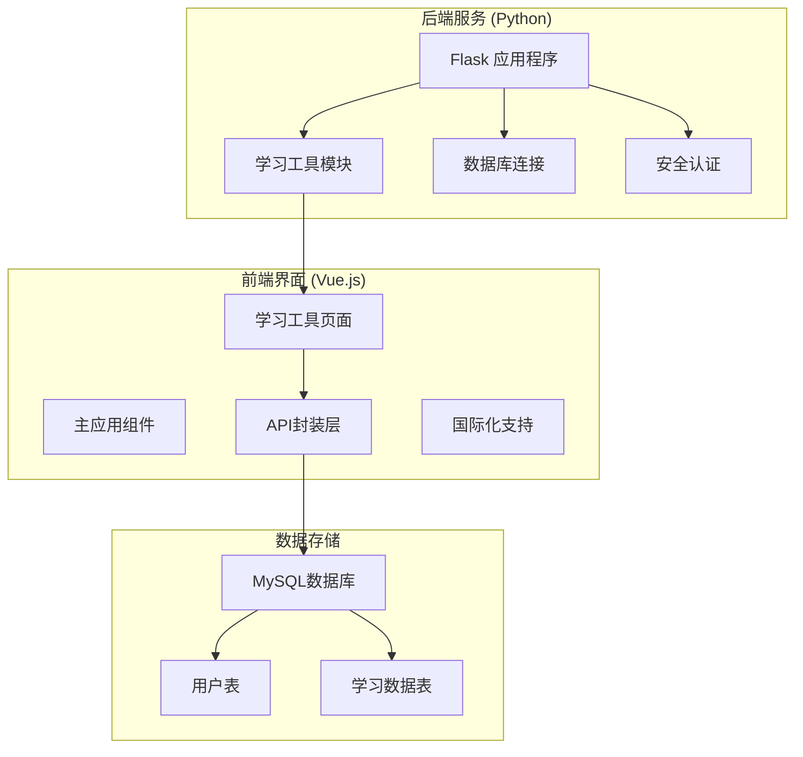
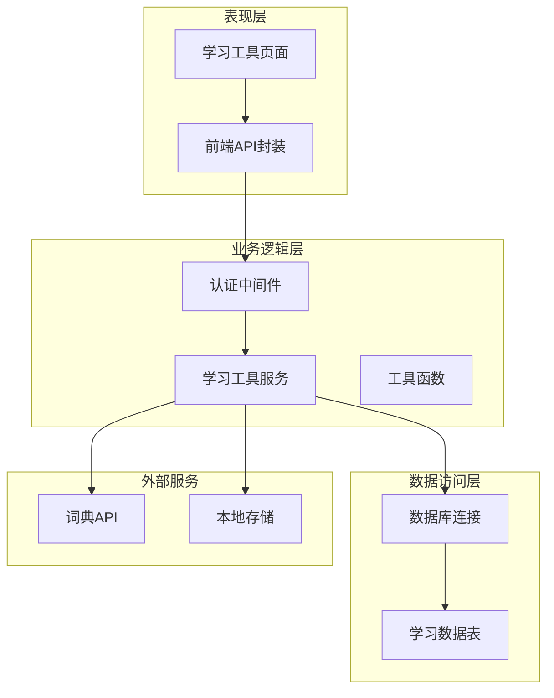
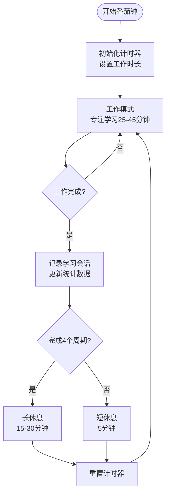
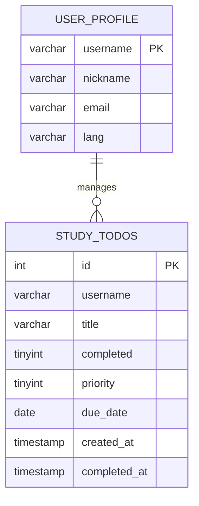
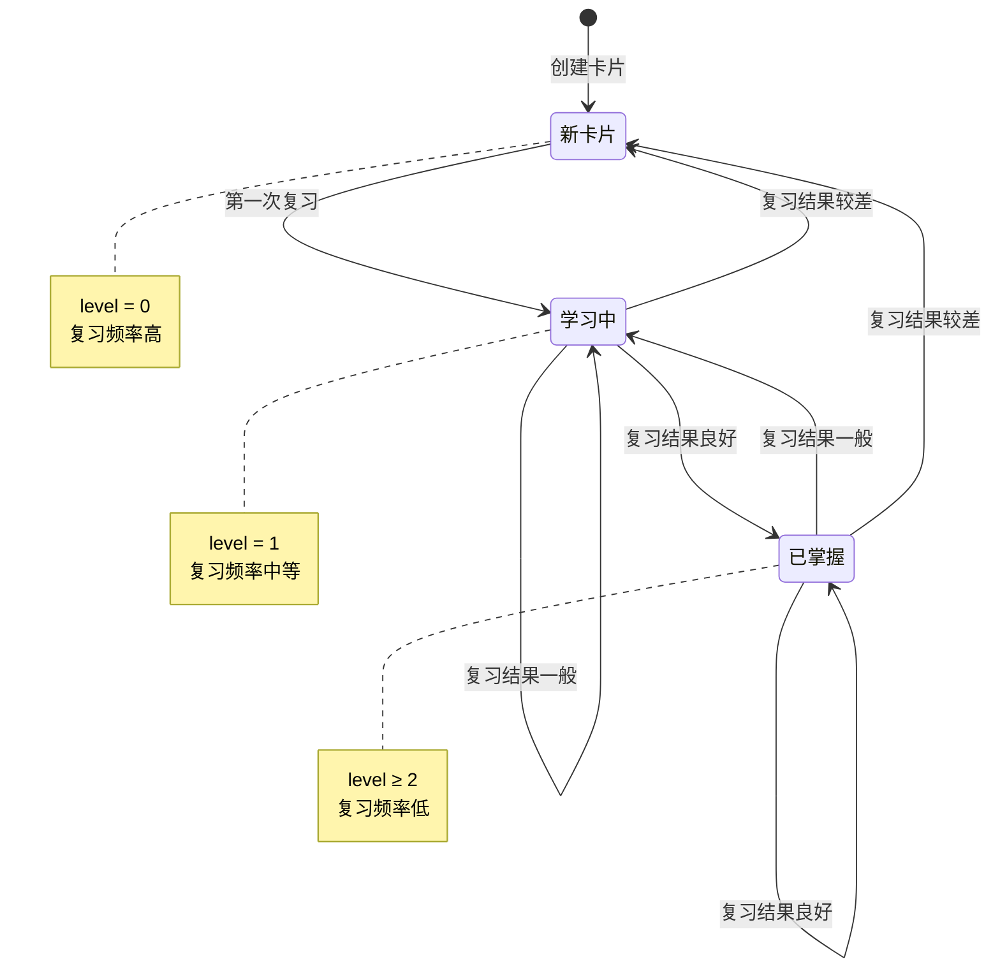
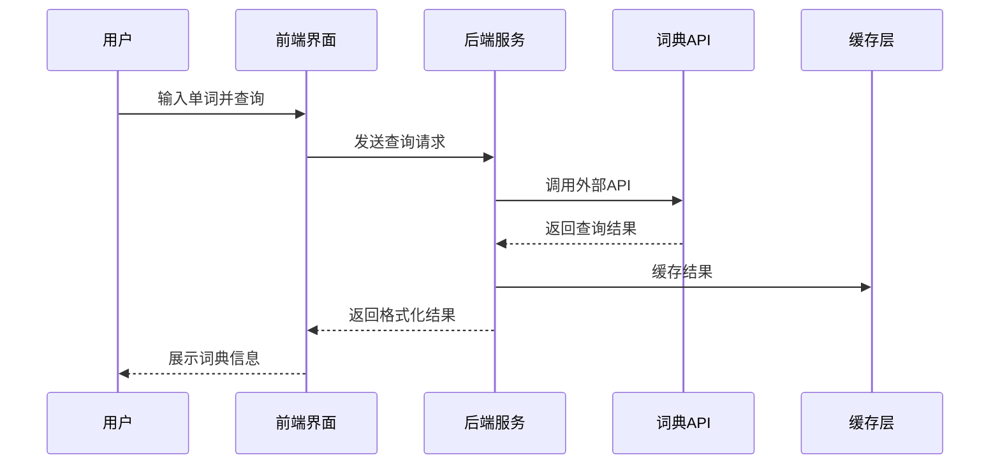
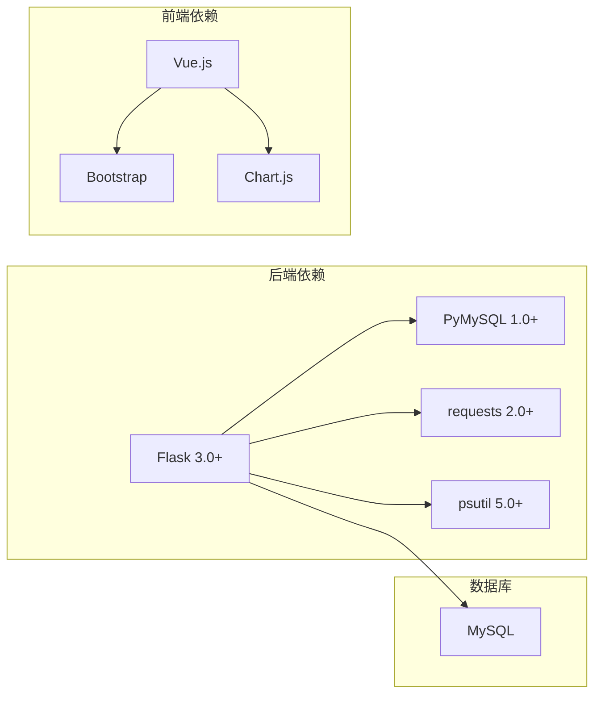

# 学习工具系统

<cite>
**本文档引用的文件**
- [app.py](file://app.py)
- [study.html](file://templates/study.html)
- [zh-CN.json](file://i18n/zh-CN.json)
- [requirements.txt](file://requirements.txt)
</cite>

## 目录
1. [简介](#简介)
2. [项目结构](#项目结构)
3. [核心组件](#核心组件)
4. [架构概览](#架构概览)
5. [详细组件分析](#详细组件分析)
6. [依赖分析](#依赖分析)
7. [性能考虑](#性能考虑)
8. [故障排除指南](#故障排除指南)
9. [结论](#结论)

## 简介
学习工具系统是一个集成了多种学习辅助功能的综合性Web应用，主要包含番茄工作法计时器、待办清单管理、抽认卡系统、英汉词典查询、单位换算和随机工具等功能模块。该系统采用前后端分离架构，后端基于Flask框架，前端使用Vue.js构建，提供完整的用户认证、数据持久化和多语言支持。

## 项目结构
学习工具系统采用模块化的项目组织方式，主要分为以下几个部分：

**图表来源**
- [app.py:4982-4989](file://app.py#L4982-L4989)
- [study.html:1-669](file://templates/study.html#L1-L669)

**章节来源**
- [app.py:4982-4989](file://app.py#L4982-L4989)
- [study.html:1-669](file://templates/study.html#L1-L669)

## 核心组件
系统的核心功能围绕四个主要学习模块构建：

### 1. 番茄工作法计时器
- 实现经典的番茄工作法流程：25分钟专注学习 + 5分钟短暂休息
- 支持自定义工作时长（25分钟或45分钟）
- 长休息模式：每完成4个番茄钟后进行15-30分钟长休息
- 本地状态持久化，支持断点续练

### 2. 待办清单管理系统
- 任务创建、编辑、删除和完成状态管理
- 优先级设置（普通/重要）
- 截止日期管理
- 实时统计和状态跟踪

### 3. 抽认卡系统
- 卡片内容管理（问题、答案、标签）
- 间隔重复算法实现
- 多级别记忆效果跟踪
- 随机复习模式

### 4. 英汉词典查询
- 集成外部词典API进行词汇查询
- 结果展示和示例句子
- 快速查询功能

**章节来源**
- [app.py:4992-5184](file://app.py#L4992-L5184)
- [study.html:347-571](file://templates/study.html#L347-L571)

## 架构概览
系统采用分层架构设计，确保各组件间的松耦合和高内聚：

**图表来源**
- [app.py:908-917](file://app.py#L908-L917)
- [app.py:874-881](file://app.py#L874-L881)

系统的关键特性包括：
- **用户认证**：基于Flask Session的完整认证体系
- **数据持久化**：MySQL数据库存储用户学习数据
- **跨域支持**：CORS配置支持前端开发环境
- **安全防护**：CSRF保护、输入验证、速率限制

**章节来源**
- [app.py:122-142](file://app.py#L122-L142)
- [app.py:908-917](file://app.py#L908-L917)

## 详细组件分析

### 番茄工作法计时器实现

#### 核心算法设计
番茄工作法采用固定周期的工作-休息模式，通过JavaScript定时器精确控制时间流转：

**图表来源**
- [study.html:377-418](file://templates/study.html#L377-L418)

#### 状态管理机制
系统实现了多层次的状态管理：

1. **实时状态**：浏览器内存中的当前计时状态
2. **本地持久化**：localStorage保存当日学习统计
3. **会话状态**：服务器端Session管理用户会话

#### 关键实现细节
- **进度环动画**：使用SVG圆形进度条实现直观的时间可视化
- **本地存储**：每日学习统计自动保存到localStorage
- **断点续练**：支持意外中断后的状态恢复

**章节来源**
- [study.html:347-460](file://templates/study.html#L347-L460)

### 待办清单管理系统

#### 数据模型设计
待办清单采用简洁高效的数据结构：

**图表来源**
- [app.py:838-848](file://app.py#L838-L848)

#### 功能特性
- **优先级排序**：重要任务优先显示
- **截止日期管理**：支持任务到期提醒
- **完成状态跟踪**：实时更新任务状态
- **统计分析**：待办、完成、总数统计

#### API接口设计
系统提供RESTful API接口：
- GET `/api/study/todos` - 获取待办列表
- POST `/api/study/todos` - 添加新任务
- POST `/api/study/todos/<id>/toggle` - 切换完成状态
- DELETE `/api/study/todos/<id>` - 删除任务

**章节来源**
- [app.py:4992-5068](file://app.py#L4992-L5068)

### 抽认卡系统

#### 间隔重复算法实现
抽认卡系统采用基于SM-2算法的间隔重复机制：

**图表来源**
- [app.py:5135-5154](file://app.py#L5135-L5154)

#### 记忆效果跟踪
系统提供多维度的学习进度跟踪：

| 级别 | 标识 | 描述 | 复习间隔 |
|------|------|------|----------|
| 0 | ? | 新卡片 | 高频复习 |
| 1 | · | 学习中 | 中等频率 |
| 2+ | ✓ | 已掌握 | 低频复习 |

#### 卡片管理功能
- **内容创建**：支持问题、答案、标签管理
- **复习模式**：按优先级和最后复习时间排序
- **随机模式**：打乱复习顺序，避免记忆惯性
- **统计分析**：按级别分类的学习进度可视化

**章节来源**
- [app.py:5071-5184](file://app.py#L5071-L5184)

### 英汉词典查询功能

#### API集成架构
系统集成了外部词典API，提供准确的词汇查询服务：

**图表来源**
- [study.html:540-571](file://templates/study.html#L540-L571)

#### 查询结果显示
词典查询结果包含以下信息：
- **基础信息**：单词、音标、词性
- **详细释义**：多个词性的定义列表
- **使用示例**：相关例句展示
- **快速查询**：提供常用词汇的快速查询入口

**章节来源**
- [study.html:540-571](file://templates/study.html#L540-L571)

## 依赖分析

### 技术栈依赖
系统采用现代化的技术栈组合：

**图表来源**
- [requirements.txt:1-5](file://requirements.txt#L1-L5)

### 安全依赖关系
系统实现了多层次的安全防护机制：

1. **认证安全**：基于Session的用户认证
2. **CSRF防护**：跨站请求伪造防护
3. **输入验证**：用户输入的HTML/JS标签清理
4. **速率限制**：防止暴力破解和滥用
5. **CSP策略**：内容安全策略防护

**章节来源**
- [app.py:908-989](file://app.py#L908-L989)

## 性能考虑
系统在设计时充分考虑了性能优化：

### 前端性能优化
- **懒加载**：按需加载学习工具模块
- **虚拟滚动**：大量数据的高效渲染
- **缓存策略**：本地存储和CDN缓存
- **异步加载**：避免阻塞主线程

### 后端性能优化
- **数据库索引**：为常用查询字段建立索引
- **连接池管理**：优化数据库连接复用
- **查询优化**：使用高效的SQL查询
- **缓存机制**：热点数据缓存

### 移动端适配
系统提供了完整的移动端响应式设计：
- **触摸友好**：按钮和交互元素适合触摸操作
- **屏幕适配**：自适应不同屏幕尺寸
- **性能优化**：移动设备上的性能优化

## 故障排除指南

### 常见问题诊断

#### 番茄钟功能异常
**症状**：计时器无法正常工作或状态丢失
**解决方案**：
1. 检查浏览器localStorage权限
2. 确认JavaScript执行环境正常
3. 查看浏览器开发者工具控制台错误

#### 待办清单同步问题
**症状**：任务状态无法正确同步
**解决方案**：
1. 检查网络连接状态
2. 验证用户登录状态
3. 清除浏览器缓存后重试

#### 抽认卡复习异常
**症状**：复习卡片无法加载或评分无效
**解决方案**：
1. 确认数据库连接正常
2. 检查用户权限
3. 验证卡片数据完整性

### 调试工具使用
系统提供了完善的调试和监控工具：
- **日志系统**：详细的操作日志记录
- **错误报告**：友好的错误信息展示
- **性能监控**：关键指标的实时监控
- **用户反馈**：问题反馈和建议收集

**章节来源**
- [app.py:887-906](file://app.py#L887-L906)

## 结论
学习工具系统通过精心设计的功能模块和可靠的架构实现，为用户提供了完整的在线学习体验。系统的主要优势包括：

1. **功能完整性**：涵盖现代学习方法的各个方面
2. **用户体验**：直观的界面设计和流畅的操作体验
3. **技术先进性**：采用现代Web技术栈
4. **安全性保障**：多层次的安全防护机制
5. **可扩展性**：模块化设计便于功能扩展

该系统不仅满足了基本的学习需求，还通过智能化的记忆算法和数据分析功能，帮助用户提高学习效率和质量。未来可以进一步增强个性化推荐、社交学习功能和跨平台同步能力。