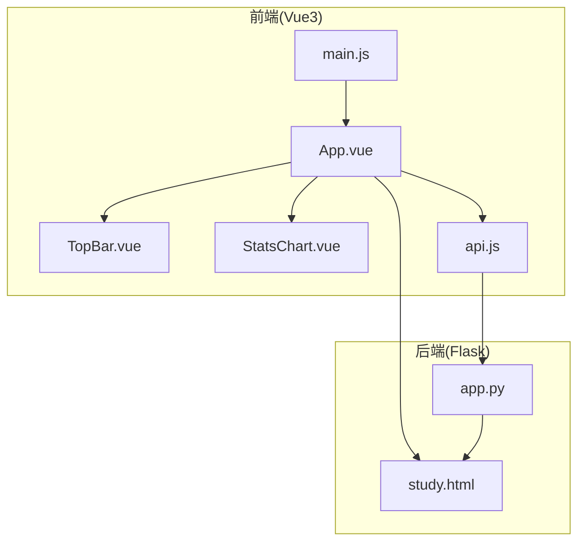
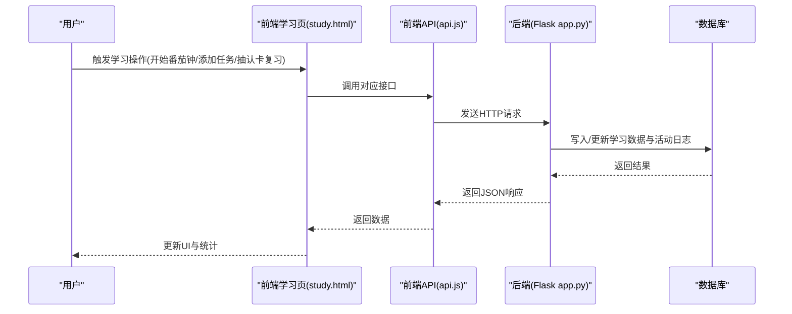
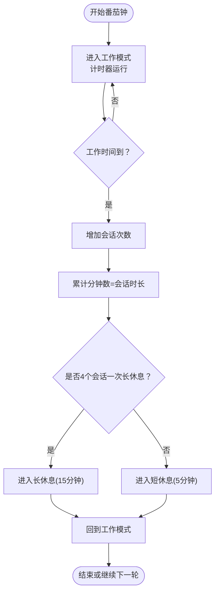
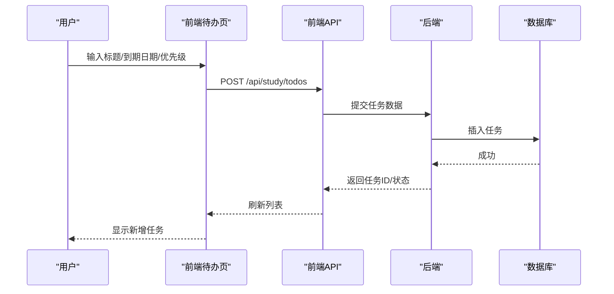
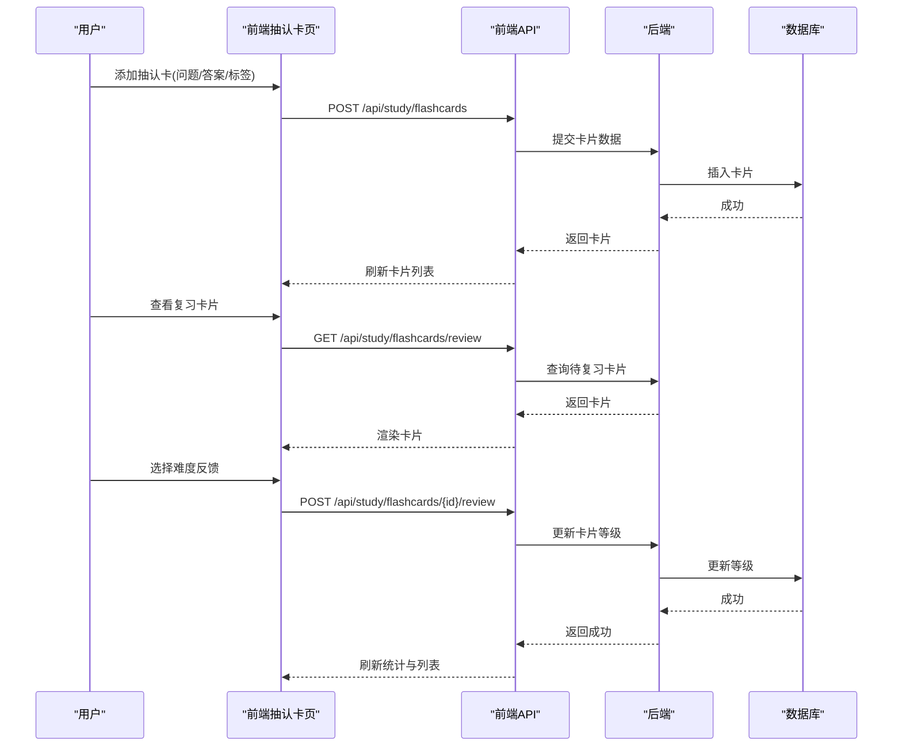
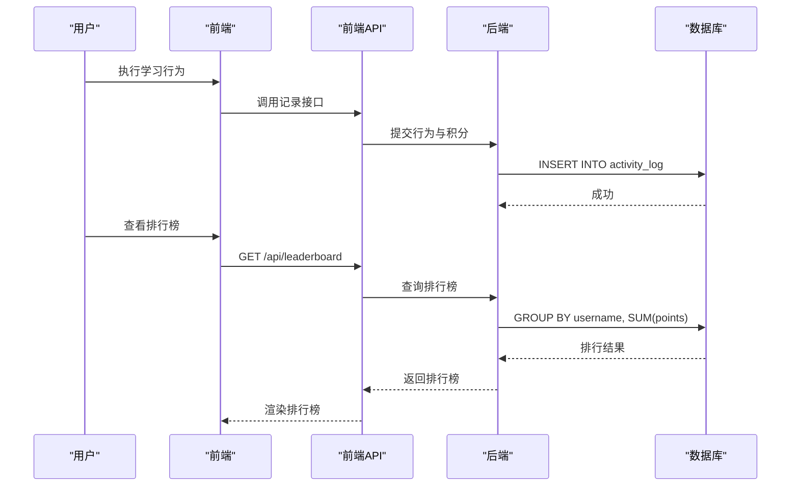
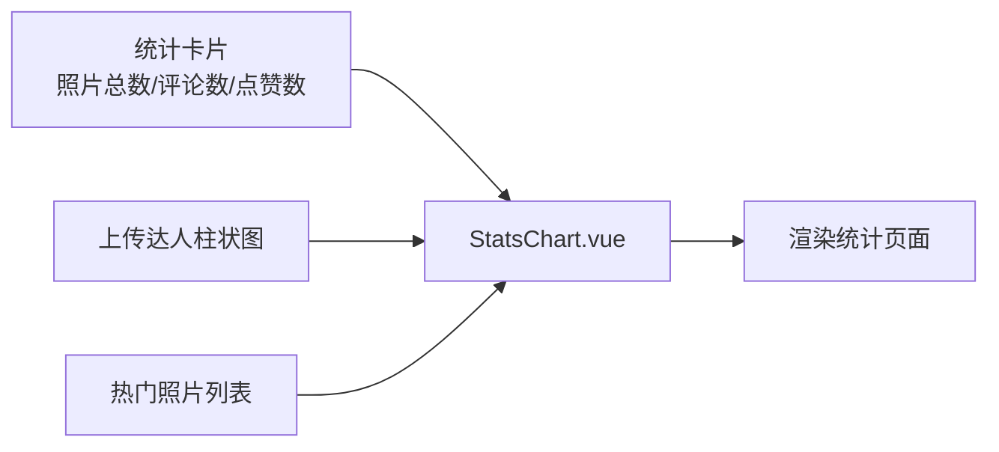
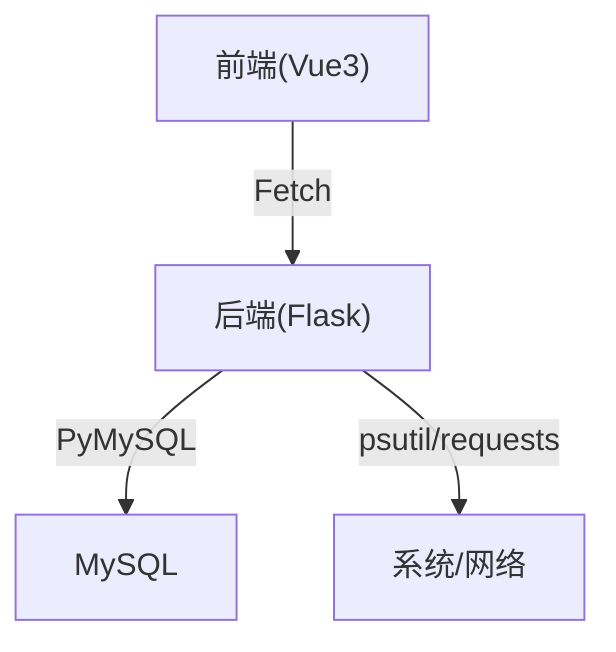

# 学习进度统计

<cite>
**本文引用的文件**
- [app.py](file://app.py)
- [study.html](file://templates/study.html)
- [StatsChart.vue](file://frontend/src/components/StatsChart.vue)
- [api.js](file://frontend/src/api.js)
- [TopBar.vue](file://frontend/src/components/TopBar.vue)
- [main.js](file://frontend/src/main.js)
- [requirements.txt](file://requirements.txt)
</cite>

## 目录
1. [引言](#引言)
2. [项目结构](#项目结构)
3. [核心组件](#核心组件)
4. [架构总览](#架构总览)
5. [详细组件分析](#详细组件分析)
6. [依赖分析](#依赖分析)
7. [性能考虑](#性能考虑)
8. [故障排查指南](#故障排查指南)
9. [结论](#结论)
10. [附录](#附录)

## 引言
本文件面向“学习进度统计系统”的综合文档，围绕数据采集、统计分析、可视化呈现、个性化报告、对比分析、成就与激励、以及数据导出等主题进行系统化梳理。当前仓库中与学习进度统计直接相关的能力主要体现在以下方面：
- 学习时间统计：基于番茄钟模块记录学习会话时长与累计时长。
- 任务完成记录：基于待办清单模块记录任务新增、完成与删除。
- 抽认卡掌握程度：基于抽认卡模块记录卡片等级与复习反馈。
- 成就与排行榜：基于活动日志与排行榜接口实现活跃度与排名。
- 可视化图表：前端组件提供柱状图、列表等基础展示形态。

后续章节将结合现有实现，提出可扩展的统计分析算法、个性化报告生成、对比分析与导出方案。

## 项目结构
系统采用前后端分离架构：
- 后端：Flask 应用，提供学习相关 API（待办、抽认卡、统计等）与通用安全与数据库初始化。
- 前端：Vue3 应用，负责学习功能界面与可视化组件（如统计图表）。

**图表来源**
- [main.js:1-6](file://frontend/src/main.js#L1-L6)
- [App.vue:1-99](file://frontend/src/App.vue#L1-L99)
- [TopBar.vue:1-42](file://frontend/src/components/TopBar.vue#L1-L42)
- [StatsChart.vue:1-77](file://frontend/src/components/StatsChart.vue#L1-L77)
- [api.js:1-45](file://frontend/src/api.js#L1-L45)
- [app.py:1-200](file://app.py#L1-L200)
- [study.html:1-669](file://templates/study.html#L1-L669)

**章节来源**
- [main.js:1-6](file://frontend/src/main.js#L1-L6)
- [App.vue:1-99](file://frontend/src/App.vue#L1-L99)
- [TopBar.vue:1-42](file://frontend/src/components/TopBar.vue#L1-L42)
- [StatsChart.vue:1-77](file://frontend/src/components/StatsChart.vue#L1-L77)
- [api.js:1-45](file://frontend/src/api.js#L1-L45)
- [app.py:1-200](file://app.py#L1-L200)
- [study.html:1-669](file://templates/study.html#L1-L669)

## 核心组件
- 学习功能页模板：提供番茄钟、待办清单、抽认卡等学习工具界面与交互逻辑。
- 前端统计组件：提供基础统计卡片与柱状图展示。
- 后端活动日志与排行榜：提供活跃度记录与排名查询能力。
- 前端 API 封装：统一后端接口调用方式。

**章节来源**
- [study.html:1-669](file://templates/study.html#L1-L669)
- [StatsChart.vue:1-77](file://frontend/src/components/StatsChart.vue#L1-L77)
- [app.py:1323-1417](file://app.py#L1323-L1417)
- [api.js:1-45](file://frontend/src/api.js#L1-L45)

## 架构总览
系统数据流概览：
- 用户在前端学习页进行学习活动（开始/暂停番茄钟、添加/完成任务、抽认卡复习等）。
- 前端通过封装的 API 将学习行为与数据提交至后端。
- 后端持久化学习数据并维护活动日志。
- 前端读取统计数据并渲染可视化图表。
- 排行榜与活跃度用于成就与激励。

**图表来源**
- [study.html:347-461](file://templates/study.html#L347-L461)
- [api.js:1-45](file://frontend/src/api.js#L1-L45)
- [app.py:1323-1417](file://app.py#L1323-L1417)

## 详细组件分析

### 学习时间统计（番茄钟）
- 功能要点
  - 记录番茄钟会话次数与累计分钟数，写入本地存储并在会话结束时持久化。
  - 支持工作/休息模式切换与定时提醒。
- 数据采集
  - 会话时长来源于工作模式时长配置与累计分钟数。
  - 会话次数与累计时长写入本地存储，便于跨页面与跨会话恢复。
- 可视化
  - 前端展示今日会话数与累计分钟数，配合进度环显示剩余时间。

**图表来源**
- [study.html:347-461](file://templates/study.html#L347-L461)

**章节来源**
- [study.html:49-95](file://templates/study.html#L49-L95)
- [study.html:347-461](file://templates/study.html#L347-L461)

### 任务完成记录（待办清单）
- 功能要点
  - 新增任务（标题、到期日期、优先级）。
  - 标记完成/删除任务。
  - 展示活动/完成/全部任务数量统计。
- 数据采集
  - 通过接口提交任务信息，后端持久化任务数据。
- 可视化
  - 列表展示任务项，支持勾选完成与删除。

**图表来源**
- [study.html:462-497](file://templates/study.html#L462-L497)
- [api.js:1-45](file://frontend/src/api.js#L1-L45)
- [app.py:1323-1417](file://app.py#L1323-L1417)

**章节来源**
- [study.html:97-134](file://templates/study.html#L97-L134)
- [study.html:462-497](file://templates/study.html#L462-L497)

### 抽认卡掌握程度（复习反馈）
- 功能要点
  - 新增抽认卡（问题、答案、标签）。
  - 复习抽认卡并给出难度反馈（忘记/较难/较易），更新卡片等级。
  - 展示“已掌握/学习中/新卡片”数量与占比。
- 数据采集
  - 通过接口提交抽认卡与复习反馈，后端更新卡片等级。
- 可视化
  - 使用进度条展示三类卡片占比，卡片列表支持展开查看答案。

**图表来源**
- [study.html:498-531](file://templates/study.html#L498-L531)
- [api.js:1-45](file://frontend/src/api.js#L1-L45)
- [app.py:1323-1417](file://app.py#L1323-L1417)

**章节来源**
- [study.html:136-201](file://templates/study.html#L136-L201)
- [study.html:498-531](file://templates/study.html#L498-L531)

### 成就与排行榜（活跃度系统）
- 功能要点
  - 记录用户活跃行为（如完成任务、复习卡片、学习时长等），累积积分。
  - 提供排行榜查询与个人排名查询。
- 数据采集
  - 活动日志表记录用户名、行为类型与积分。
- 可视化
  - 排行榜按总积分降序排列，访客优先级低于普通用户。

**图表来源**
- [app.py:1323-1417](file://app.py#L1323-L1417)

**章节来源**
- [app.py:1323-1417](file://app.py#L1323-L1417)

### 可视化图表设计（统计卡片与柱状图）
- 统计卡片：展示照片总数、评论数、点赞数等聚合指标。
- 柱状图：展示上传达人（按上传数量绘制横向柱状图）。
- 列表：展示最受欢迎照片（按点赞数排行）。

**图表来源**
- [StatsChart.vue:1-77](file://frontend/src/components/StatsChart.vue#L1-L77)

**章节来源**
- [StatsChart.vue:1-77](file://frontend/src/components/StatsChart.vue#L1-L77)

### 个性化报告生成（概念性设计）
- 报告内容建议
  - 学习时长趋势、任务完成率、抽认卡掌握曲线、知识点分布雷达图。
  - 基于用户偏好与目标设定的建议（如调整番茄钟时长、优先复习薄弱知识点）。
- 实现路径
  - 后端提供多维度统计接口（按天/周/月汇总学习时长、任务完成数、抽认卡等级分布）。
  - 前端整合数据并生成 PDF/HTML 报告（可借助第三方库或服务）。

[本节为概念性设计，不直接分析具体文件，故无“章节来源”]

### 对比分析（概念性设计）
- 时间段对比：同一用户在不同时间段的学习效率与任务完成情况对比。
- 科目/知识点对比：不同科目的学习时长与掌握程度对比。
- 方法对比：不同学习方法（如番茄钟 vs. 固定时段）的效果对比。
- 实现路径
  - 后端提供按时间聚合与按标签/科目聚合的统计接口。
  - 前端以折线图/柱状图/饼图等形式展示对比结果。

[本节为概念性设计，不直接分析具体文件，故无“章节来源”]

### 成就系统（概念性设计）
- 徽章与积分
  - 连续学习天数、累计学习时长、任务完成数量、抽认卡掌握数量等维度触发徽章与积分。
- 排行榜
  - 基于活跃度与积分的实时排行榜，支持按班级/年级/全校维度。
- 实现路径
  - 后端维护徽章规则与积分计算逻辑，前端展示徽章与排行榜。

[本节为概念性设计，不直接分析具体文件，故无“章节来源”]

### 数据导出（概念性设计）
- 导出格式：PDF、Excel、HTML 报告。
- 导出内容：学习时长、任务完成记录、抽认卡复习记录、排行榜与成就。
- 实现路径
  - 后端提供导出接口，前端触发下载或打印。

[本节为概念性设计，不直接分析具体文件，故无“章节来源”]

## 依赖分析
- 前端依赖
  - Vue3、浏览器 Fetch API、本地存储（localStorage）。
- 后端依赖
  - Flask、PyMySQL、psutil、requests。
- 关系图

**图表来源**
- [requirements.txt:1-5](file://requirements.txt#L1-L5)
- [app.py:680-693](file://app.py#L680-L693)

**章节来源**
- [requirements.txt:1-5](file://requirements.txt#L1-L5)
- [app.py:680-693](file://app.py#L680-L693)

## 性能考虑
- 前端
  - 使用本地存储缓存当日学习数据，减少重复请求。
  - 按需加载统计与列表数据，避免一次性渲染大量节点。
- 后端
  - 使用数据库索引优化排行榜与统计查询。
  - 限制接口请求频率，避免高并发下的性能瓶颈。

[本节提供一般性指导，不直接分析具体文件，故无“章节来源”]

## 故障排查指南
- 接口调用失败
  - 检查后端数据库连接与表结构初始化是否正常。
  - 确认前端 API 路径与后端路由一致。
- 排行榜为空
  - 确认活动日志中是否存在用户行为记录。
  - 检查数据库权限与连接配置。
- 前端统计不更新
  - 检查本地存储键名与序列化格式是否正确。
  - 确认统计接口返回的数据结构与前端解析一致。

**章节来源**
- [app.py:680-693](file://app.py#L680-L693)
- [study.html:347-461](file://templates/study.html#L347-L461)
- [StatsChart.vue:47-54](file://frontend/src/components/StatsChart.vue#L47-L54)

## 结论
当前系统已具备学习时间统计、任务完成记录、抽认卡掌握程度与活跃度排行榜的基础能力。在此基础上，可通过扩展后端统计接口、完善前端可视化与报告生成、引入对比分析与成就系统，进一步构建完整的“学习进度统计系统”。建议优先实现：
- 多维度统计接口（按天/周/月汇总学习时长、任务完成数、抽认卡等级分布）。
- 个性化报告生成与导出。
- 对比分析与成就系统。

[本节为总结性内容，不直接分析具体文件，故无“章节来源”]

## 附录
- 前端入口与组件组织
  - 入口应用：创建 Vue 应用并挂载根组件。
  - 根组件：包含顶部栏、标签页导航与各功能区域。
  - 统计组件：提供基础统计卡片与柱状图展示。
  - API 封装：统一后端接口调用方式。

**章节来源**
- [main.js:1-6](file://frontend/src/main.js#L1-L6)
- [App.vue:1-99](file://frontend/src/App.vue#L1-L99)
- [TopBar.vue:1-42](file://frontend/src/components/TopBar.vue#L1-L42)
- [StatsChart.vue:1-77](file://frontend/src/components/StatsChart.vue#L1-L77)
- [api.js:1-45](file://frontend/src/api.js#L1-L45)