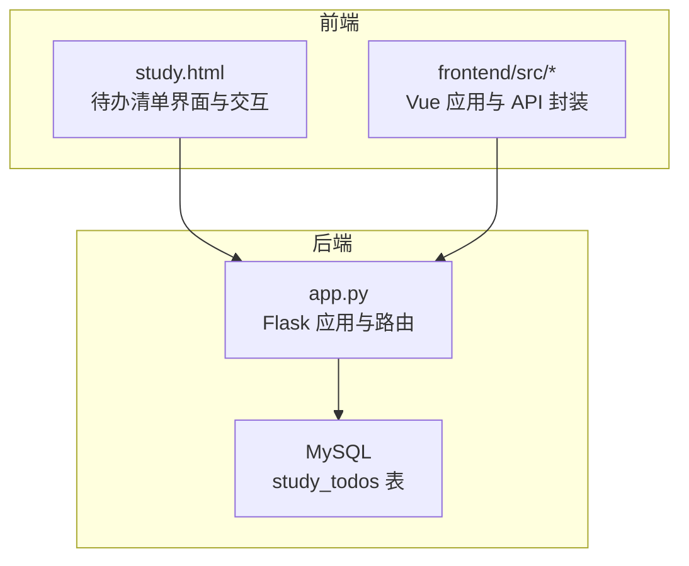
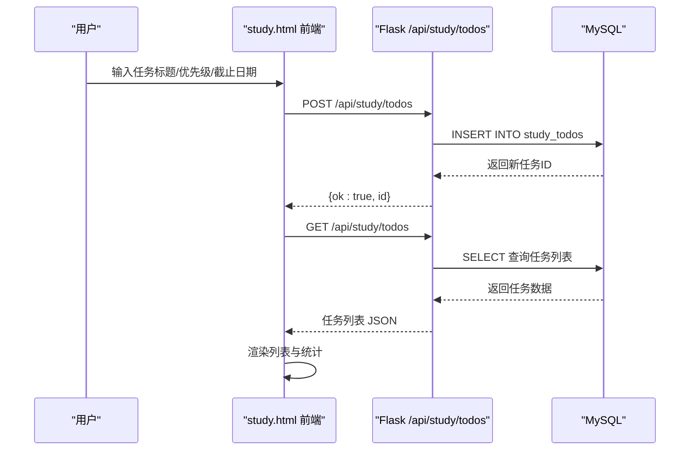
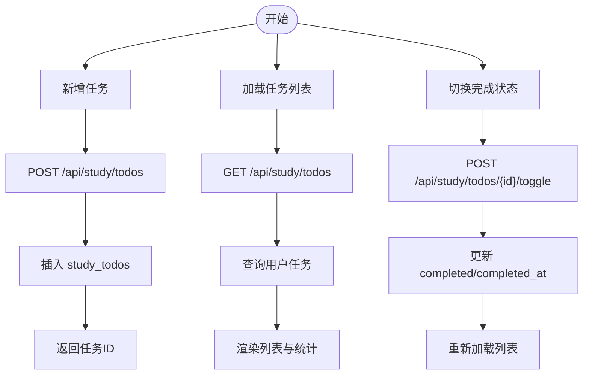
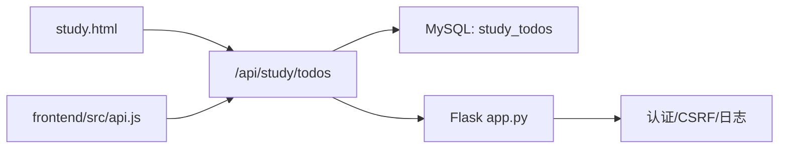

# 待办清单

<cite>
**本文档引用的文件**
- [app.py](file://app.py)
- [study.html](file://templates/study.html)
- [api.js](file://frontend/src/api.js)
- [main.js](file://frontend/src/main.js)
- [App.vue](file://frontend/src/App.vue)
</cite>

## 目录
1. [简介](#简介)
2. [项目结构](#项目结构)
3. [核心组件](#核心组件)
4. [架构总览](#架构总览)
5. [详细组件分析](#详细组件分析)
6. [依赖分析](#依赖分析)
7. [性能考虑](#性能考虑)
8. [故障排查指南](#故障排查指南)
9. [结论](#结论)

## 简介
本文件面向“待办清单”子系统，基于现有代码库梳理其功能与实现，重点覆盖以下能力：
- 任务管理：创建、编辑、删除、标记完成状态
- 优先级系统：支持高、中、低三个等级的任务优先级设置与视觉标识
- 任务分类与标签：按项目、类别或重要性组织任务
- 提醒机制：截止日期提醒、重复任务设置与通知方式配置
- 搜索与过滤：按状态、优先级、标签等条件筛选
- 数据同步与备份：确保多设备间的数据一致性
- 统计分析：完成率、效率趋势与时间分配报告

说明：当前仓库中“待办清单”功能主要位于学习工具模块（study）中，前端采用 Vue 3 + 原生 JS 的混合实现，后端通过 Flask 提供 REST API。

## 项目结构
待办清单相关代码分布于以下位置：
- 后端 Flask 应用（app.py）：定义数据库表结构、认证中间件、CSRF 校验、日志与活动记录，并提供 /api/study/todos 相关接口
- 前端模板 study.html：包含待办清单的 HTML 结构与 JavaScript 交互逻辑
- 前端 Vue 应用（frontend/src）：包含 Vue 3 应用入口与通用 API 封装，但待办清单主界面由 study.html 提供
- 数据库初始化：在 app.py 中创建 study_todos 表，包含用户名、标题、完成状态、优先级、截止日期等字段

图表来源
- [app.py:837-848](file://app.py#L837-L848)
- [study.html:97-116](file://templates/study.html#L97-L116)

章节来源
- [app.py:837-848](file://app.py#L837-L848)
- [study.html:97-116](file://templates/study.html#L97-L116)

## 核心组件
- 数据模型（study_todos）
  - 字段：id、username、title、completed、priority、due_date、created_at、completed_at
  - 关键约束：username 与会话绑定，完成状态与完成时间联动
- 后端接口
  - POST /api/study/todos：新增任务（含优先级与截止日期）
  - DELETE /api/study/todos/{id}：删除任务
  - POST /api/study/todos/{id}/toggle：切换完成状态
- 前端界面
  - study.html 提供任务列表渲染、新增、删除、完成切换与统计展示
  - 前端 Vue 应用提供通用 API 封装（与待办清单界面解耦）

章节来源
- [app.py:5013-5067](file://app.py#L5013-L5067)
- [study.html:462-496](file://templates/study.html#L462-L496)

## 架构总览
待办清单采用前后端分离架构：
- 前端负责用户交互与视图渲染（study.html + Vue 应用）
- 后端提供 REST API 并进行身份认证、CSRF 校验与数据持久化
- 数据库存储任务元数据与状态变更历史

图表来源
- [app.py:5013-5033](file://app.py#L5013-L5033)
- [study.html:462-496](file://templates/study.html#L462-L496)

## 详细组件分析

### 数据模型与表结构
- study_todos 表
  - 主要字段：username（用户）、title（标题）、completed（完成状态）、priority（优先级）、due_date（截止日期）、created_at（创建时间）、completed_at（完成时间）
  - 业务要点：完成状态切换时自动更新 completed_at；新增任务记录活动日志

章节来源
- [app.py:837-848](file://app.py#L837-L848)
- [app.py:5013-5067](file://app.py#L5013-L5067)

### 任务管理流程
- 新增任务
  - 前端收集标题、优先级、截止日期，调用 POST /api/study/todos
  - 后端清洗输入、插入数据库并返回新 ID
- 删除任务
  - 前端调用 DELETE /api/study/todos/{id}
  - 后端按用户与 ID 删除
- 切换完成状态
  - 前端调用 POST /api/study/todos/{id}/toggle
  - 后端使用 1-completed 实现布尔翻转，并更新完成时间

图表来源
- [app.py:5013-5067](file://app.py#L5013-L5067)
- [study.html:462-496](file://templates/study.html#L462-L496)

章节来源
- [app.py:5013-5067](file://app.py#L5013-L5067)
- [study.html:462-496](file://templates/study.html#L462-L496)

### 优先级系统设计
- 前端界面提供优先级下拉框（普通/重要），对应后端 priority 字段
- 视觉标识：列表项中根据 priority 值显示星标符号
- 设计建议：若需扩展为高/中/低三级，可在前端增加选项并在后端以数值或枚举表示

章节来源
- [study.html:107-115](file://templates/study.html#L107-L115)
- [study.html](file://templates/study.html#L475)

### 任务分类与标签
- 当前 study_todos 表未包含标签字段
- 抽认卡模块（study_flashcards）具备 tags 字段，可作为标签设计参考
- 建议：为 study_todos 增加 tags 字段，并在前端提供标签筛选与编辑功能

章节来源
- [app.py:849-861](file://app.py#L849-L861)
- [app.py:5071-5093](file://app.py#L5071-L5093)

### 提醒机制实现
- 截止日期提醒：后端存储 due_date，前端在列表中展示日期
- 重复任务与通知：当前未发现重复任务与通知推送的实现
- 建议：引入定时任务或客户端本地提醒，结合 due_date 与完成状态进行提醒触发

章节来源
- [app.py:837-848](file://app.py#L837-L848)
- [study.html](file://templates/study.html#L477)

### 搜索与过滤
- 前端支持按标题关键词搜索与排序（最新/最早）
- 后端 study_todos 未提供按优先级、标签的过滤接口
- 建议：在后端 /api/study/todos 增加查询参数（status/priority/tag），并完善前端筛选 UI

章节来源
- [study.html:97-116](file://templates/study.html#L97-L116)
- [app.py:837-848](file://app.py#L837-L848)

### 数据同步与备份
- 同步：通过 /api/study/todos 接口实现跨设备一致的任务状态
- 备份：后端提供 /backup 页面与备份目录，但 study_todos 表未在备份清单中显式列出
- 建议：将 study_todos 纳入备份策略，确保多设备数据一致性

章节来源
- [app.py:4673-4679](file://app.py#L4673-L4679)
- [app.py:837-848](file://app.py#L837-L848)

### 统计分析
- 前端统计：显示进行中、已完成、总数
- 后端统计：当前未提供完成率、效率趋势与时间分配报告接口
- 建议：新增 /api/study/todos/stats 接口，返回完成率、按时完成率、平均耗时等指标

章节来源
- [study.html:117-126](file://templates/study.html#L117-L126)
- [study.html:483-485](file://templates/study.html#L483-L485)

## 依赖分析
- 前端依赖
  - study.html 直接依赖 /api/study/todos 接口
  - Vue 应用提供通用 API 封装（与待办清单界面解耦）
- 后端依赖
  - MySQL：study_todos 表
  - Flask：路由、认证、CSRF、日志与活动记录
  - 安全中间件：速率限制、白名单、CSP、XSS/点击劫持防护

图表来源
- [study.html:462-496](file://templates/study.html#L462-L496)
- [api.js:1-45](file://frontend/src/api.js#L1-L45)
- [app.py:5013-5067](file://app.py#L5013-L5067)

章节来源
- [study.html:462-496](file://templates/study.html#L462-L496)
- [api.js:1-45](file://frontend/src/api.js#L1-L45)
- [app.py:5013-5067](file://app.py#L5013-L5067)

## 性能考虑
- 前端渲染：列表项较多时建议虚拟滚动与懒加载
- 后端查询：为 username、created_at、completed 等常用字段建立索引
- 缓存策略：对静态筛选结果与热门查询进行短期缓存
- 网络优化：合并请求、减少不必要的重绘与回流

## 故障排查指南
- 登录状态异常
  - 现象：访问 /api/study/todos 返回未登录
  - 处理：确认浏览器 Cookie 与会话有效，检查 CSRF Token
- 数据库连接失败
  - 现象：接口返回 DB 错误
  - 处理：检查数据库配置与连接池状态
- 输入校验失败
  - 现象：新增任务返回标题不能为空
  - 处理：确认请求体格式与字段长度限制

章节来源
- [app.py:907-916](file://app.py#L907-L916)
- [app.py:5017-5019](file://app.py#L5017-L5019)
- [app.py:5020-5033](file://app.py#L5020-L5033)

## 结论
当前仓库中的“待办清单”功能已实现基础的任务 CRUD 与完成状态管理，并具备优先级与截止日期提醒的基础能力。为进一步完善系统，建议：
- 扩展优先级为高/中/低三级并完善视觉标识
- 引入标签字段与筛选功能
- 实现重复任务与通知机制
- 增加统计分析接口与备份策略
- 优化前端性能与用户体验