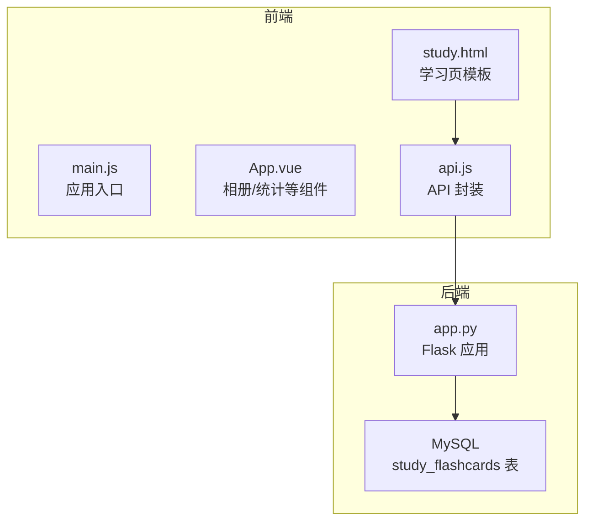
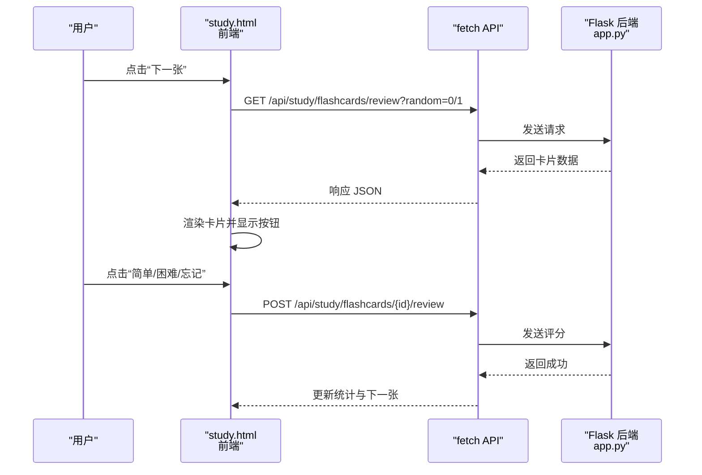
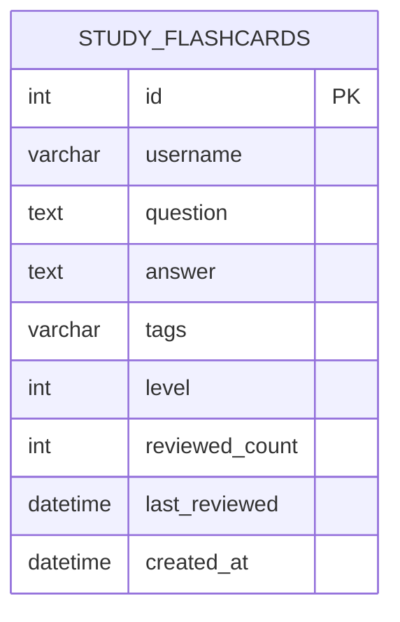
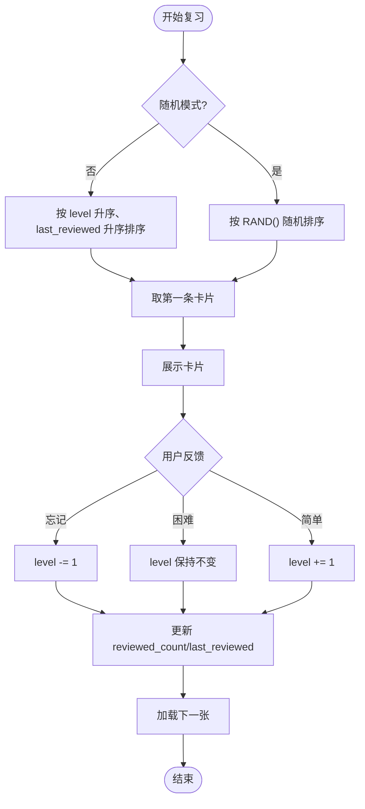
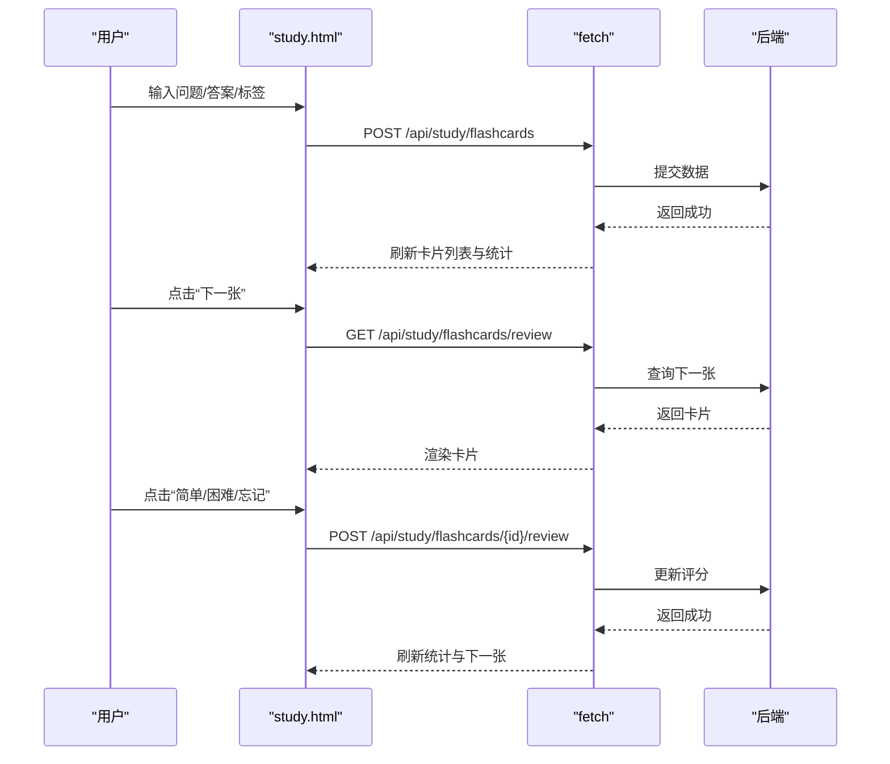
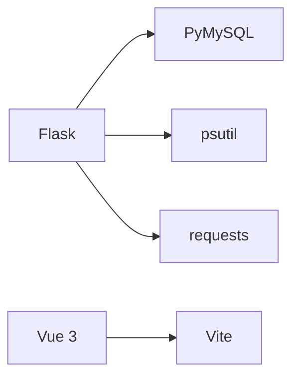

# 抽认卡系统

<cite>
**本文档引用的文件**
- [app.py](file://app.py)
- [study.html](file://templates/study.html)
- [api.js](file://frontend/src/api.js)
- [main.js](file://frontend/src/main.js)
- [App.vue](file://frontend/src/App.vue)
- [i18n/__init__.py](file://i18n/__init__.py)
- [i18n/zh-CN.json](file://i18n/zh-CN.json)
- [requirements.txt](file://requirements.txt)
</cite>

## 目录
1. [引言](#引言)
2. [项目结构](#项目结构)
3. [核心组件](#核心组件)
4. [架构总览](#架构总览)
5. [详细组件分析](#详细组件分析)
6. [依赖分析](#依赖分析)
7. [性能考虑](#性能考虑)
8. [故障排查指南](#故障排查指南)
9. [结论](#结论)
10. [附录](#附录)

## 引言
本项目是一个基于 Flask 的学习工具平台，其中抽认卡模块提供了间隔重复（Spaced Repetition）的学习功能。系统支持用户创建、复习、管理和统计自己的抽认卡，并通过简单的“忘记/困难/简单”三档反馈驱动复习计划的动态调整。前端采用 Vue 3 构建，后端提供 RESTful API，数据库使用 MySQL。

## 项目结构
- 后端入口与路由：Flask 应用位于根目录的主程序文件中，包含学习相关的抽认卡 API。
- 前端应用：Vue 3 应用位于 frontend/src，通过 fetch 调用后端 /api/study/* 接口。
- 模板与界面：学习页模板位于 templates/study.html，包含抽认卡的 UI 与交互逻辑。
- 国际化：i18n 模块提供多语言支持，模板中通过 _() 函数渲染本地化文案。
- 依赖：requirements.txt 指定 Flask、PyMySQL、psutil、requests 等依赖。

图表来源
- [main.js:1-6](file://frontend/src/main.js#L1-L6)
- [App.vue:1-99](file://frontend/src/App.vue#L1-L99)
- [study.html:1-669](file://templates/study.html#L1-L669)
- [api.js:1-45](file://frontend/src/api.js#L1-L45)
- [app.py:5070-5183](file://app.py#L5070-L5183)

章节来源
- [app.py:1-200](file://app.py#L1-L200)
- [study.html:1-669](file://templates/study.html#L1-L669)
- [api.js:1-45](file://frontend/src/api.js#L1-L45)
- [main.js:1-6](file://frontend/src/main.js#L1-L6)
- [App.vue:1-99](file://frontend/src/App.vue#L1-L99)
- [i18n/__init__.py:1-113](file://i18n/__init__.py#L1-L113)
- [i18n/zh-CN.json:358-439](file://i18n/zh-CN.json#L358-L439)
- [requirements.txt:1-5](file://requirements.txt#L1-L5)

## 核心组件
- 抽认卡 API
  - 获取卡片列表：/api/study/flashcards（支持按标签过滤）
  - 添加卡片：/api/study/flashcards（POST）
  - 删除卡片：/api/study/flashcards/{id}（DELETE）
  - 复习卡片：/api/study/flashcards/{id}/review（POST）
  - 下一张复习卡片：/api/study/flashcards/review（GET，支持随机模式）
- 前端交互
  - 学习页模板 study.html 中包含抽认卡的 UI、翻面交互与按钮反馈。
  - api.js 封装了 /api/album 前缀的 API（与抽认卡不同域），但抽认卡直接使用 study.html 中的 fetch 路径。
- 数据模型
  - study_flashcards 表：存储用户抽认卡的字段包括 id、username、question、answer、tags、level、reviewed_count、last_reviewed、created_at 等。

章节来源
- [app.py:5070-5183](file://app.py#L5070-L5183)
- [study.html:498-530](file://templates/study.html#L498-L530)

## 架构总览
抽认卡系统采用前后端分离架构：
- 前端负责用户交互与视图渲染，调用后端提供的 REST API。
- 后端负责业务逻辑与数据持久化，提供稳定的数据接口。
- 数据库层使用 MySQL，study_flashcards 表承载抽认卡数据。

图表来源
- [study.html:522-530](file://templates/study.html#L522-L530)
- [app.py:5156-5183](file://app.py#L5156-L5183)

## 详细组件分析

### 抽认卡数据模型与表结构
- 表名：study_flashcards
- 字段要点：id、username、question、answer、tags、level、reviewed_count、last_reviewed、created_at
- 用途：存储用户的抽认卡内容与复习状态，支撑复习调度与统计

图表来源
- [app.py:849-860](file://app.py#L849-L860)

章节来源
- [app.py:849-860](file://app.py#L849-L860)

### 复习调度与排序策略
- 默认排序：按 level 升序、last_reviewed 升序取第一条，优先复习等级低且最久未复习的卡片。
- 随机模式：开启随机开关时，按 RAND() 随机挑选一张卡片。
- 复习评分：POST /api/study/flashcards/{id}/review，传入 level（-1 忘记，0 困难，1 简单），后端更新 level、reviewed_count、last_reviewed。

图表来源
- [app.py:5156-5183](file://app.py#L5156-L5183)
- [app.py:5134-5153](file://app.py#L5134-L5153)

章节来源
- [app.py:5156-5183](file://app.py#L5156-L5183)
- [app.py:5134-5153](file://app.py#L5134-L5153)

### 前端交互与状态管理
- 界面元素：新建卡片表单、复习面板（正面/背面）、统计条（已掌握/学习中/未掌握）、卡片列表。
- 交互流程：
  - 新建卡片：输入问题/答案/标签，提交后刷新列表与统计。
  - 复习：点击“下一张”获取卡片，点击卡片翻面，选择“忘记/困难/简单”进行评分。
  - 随机模式：勾选随机开关后，下一张卡片随机出现。
- 统计：根据 level 分类统计数量与占比，实时更新。

图表来源
- [study.html:515-530](file://templates/study.html#L515-L530)
- [app.py:5096-5153](file://app.py#L5096-L5153)

章节来源
- [study.html:136-201](file://templates/study.html#L136-L201)
- [study.html:515-530](file://templates/study.html#L515-L530)

### 复杂度与性能特性
- 复习查询
  - 默认模式：ORDER BY level ASC, last_reviewed ASC LIMIT 1，时间复杂度 O(n log n)，n 为用户卡片数；实际取 1 条，开销较小。
  - 随机模式：ORDER BY RAND() LIMIT 1，随机访问，适合打乱顺序，但 RAND() 在大数据集上可能较慢。
- 评分更新：UPDATE study_flashcards SET level=..., reviewed_count=..., last_reviewed=NOW()，单条写入，复杂度 O(1)。
- 建议
  - 对 study_flashcards 表按 username、level、last_reviewed 建立索引，优化默认排序查询。
  - 若卡片量较大，可考虑在应用层维护“待复习队列”，减少数据库排序压力。

章节来源
- [app.py:5156-5183](file://app.py#L5156-L5183)
- [app.py:5134-5153](file://app.py#L5134-L5153)

### 错误处理与边界情况
- 参数校验：添加卡片时要求 question 与 answer 非空，否则返回错误。
- 权限控制：所有学习相关 API 均需登录，后端通过装饰器校验会话。
- 数据一致性：评分更新使用事务性写入，确保 reviewed_count 与 last_reviewed 同步更新。
- 前端容错：网络异常时，界面保持静默或提示，避免崩溃。

章节来源
- [app.py:5096-5116](file://app.py#L5096-L5116)
- [app.py:5134-5153](file://app.py#L5134-L5153)

### 国际化与本地化
- 多语言支持：i18n 模块加载 zh-CN/en/ja/ko 等语言包，模板通过 _() 函数渲染本地化文案。
- 学习页文案：study.html 中大量使用 _("study_*") 键，涵盖抽认卡、番茄钟、词典等功能的界面文本。

章节来源
- [i18n/__init__.py:1-113](file://i18n/__init__.py#L1-L113)
- [i18n/zh-CN.json:358-439](file://i18n/zh-CN.json#L358-L439)
- [study.html:358-439](file://templates/study.html#L358-L439)

## 依赖分析
- 后端依赖
  - Flask：Web 框架
  - PyMySQL：MySQL 连接与查询
  - psutil、requests：系统监控与外部请求支持
- 前端依赖
  - Vue 3：组件化开发
  - Vite：构建工具（由 package.json 指定）

图表来源
- [requirements.txt:1-5](file://requirements.txt#L1-L5)

章节来源
- [requirements.txt:1-5](file://requirements.txt#L1-L5)

## 性能考虑
- 数据库索引：建议为 study_flashcards(username, level, last_reviewed) 建立复合索引，提升默认排序效率。
- 查询优化：随机模式使用 RAND()，在大表上可能成为瓶颈；可考虑应用层随机池或分页游标。
- 缓存策略：对常用统计（如各等级卡片数量）可引入短期缓存，降低重复计算。
- 并发控制：后端已内置速率限制与会话超时机制，避免滥用与资源争用。

## 故障排查指南
- 无法加载卡片
  - 检查 /api/study/flashcards 是否返回 200，若 500，确认数据库连接正常。
  - 确认用户已登录，会话有效。
- 复习评分无效
  - 检查 /api/study/flashcards/{id}/review 的请求体是否包含 level 字段。
  - 确认卡片属于当前用户，避免越权更新。
- 随机模式不生效
  - 确认前端随机开关已勾选，请求参数 random=1。
- 本地化文案缺失
  - 检查 i18n 语言包是否存在对应键，或模板中是否使用了正确的 _("study_*") 键。

章节来源
- [app.py:5070-5183](file://app.py#L5070-L5183)
- [study.html:522-530](file://templates/study.html#L522-L530)
- [i18n/__init__.py:50-67](file://i18n/__init__.py#L50-L67)

## 结论
本抽认卡系统以简洁的“忘记/困难/简单”反馈为核心，结合默认与随机两种复习策略，实现了基础而有效的间隔重复机制。前端通过 study.html 提供直观的交互体验，后端以 Flask 提供稳定的 API 支撑。为进一步提升体验，建议完善统计与报告、批量导入导出、以及更精细的自适应复习调度策略。

## 附录

### API 规范（抽认卡）
- 获取卡片列表
  - 方法：GET
  - 路径：/api/study/flashcards
  - 查询参数：tag（可选，按标签模糊匹配）
  - 返回：卡片数组（包含 id、question、answer、tags、level、reviewed_count、last_reviewed）
- 添加卡片
  - 方法：POST
  - 路径：/api/study/flashcards
  - 请求体：{ question, answer, tags }
  - 返回：{ ok, id }
- 删除卡片
  - 方法：DELETE
  - 路径：/api/study/flashcards/{id}
  - 返回：{ ok }
- 复习评分
  - 方法：POST
  - 路径：/api/study/flashcards/{id}/review
  - 请求体：{ level }（-1 忘记，0 困难，1 简单）
  - 返回：{ ok }
- 下一张复习卡片
  - 方法：GET
  - 路径：/api/study/flashcards/review
  - 查询参数：random（0/1，是否随机）
  - 返回：{ card: { id, question, answer, tags, level, reviewed_count } } 或 { card: null }

章节来源
- [app.py:5070-5183](file://app.py#L5070-L5183)