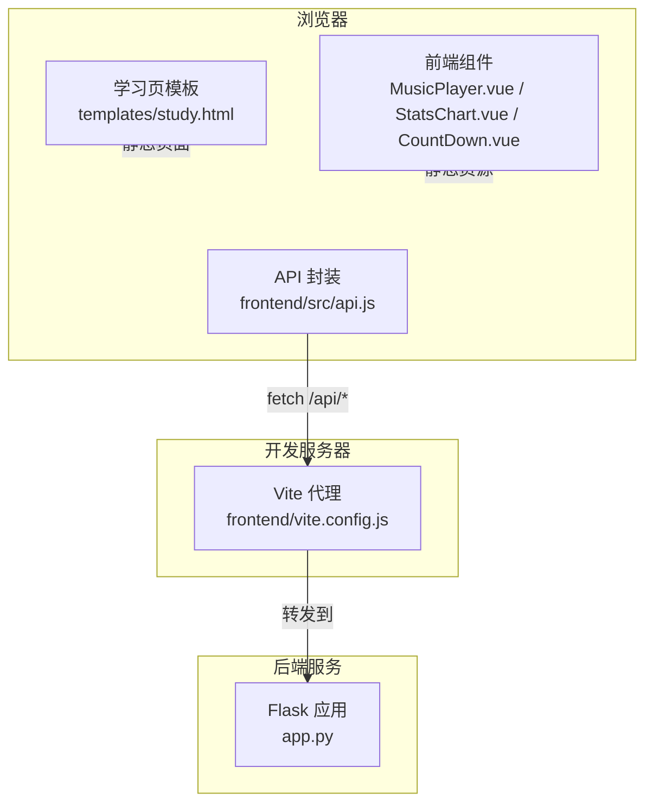
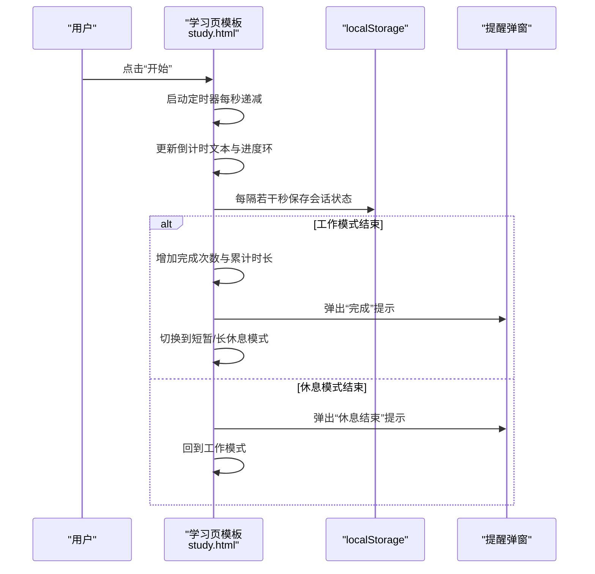
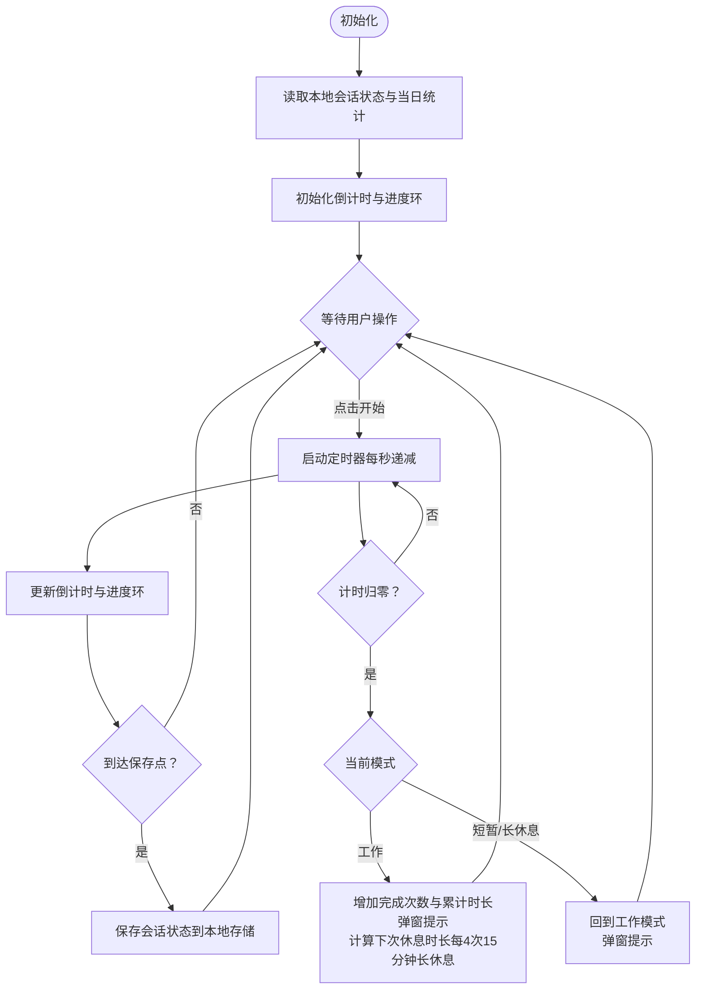
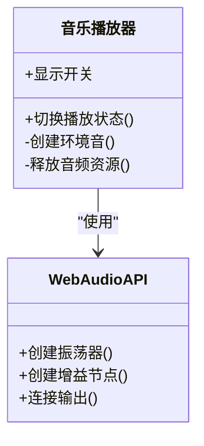
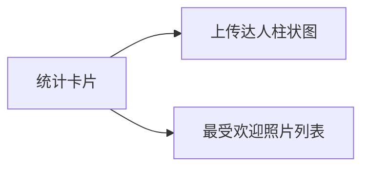
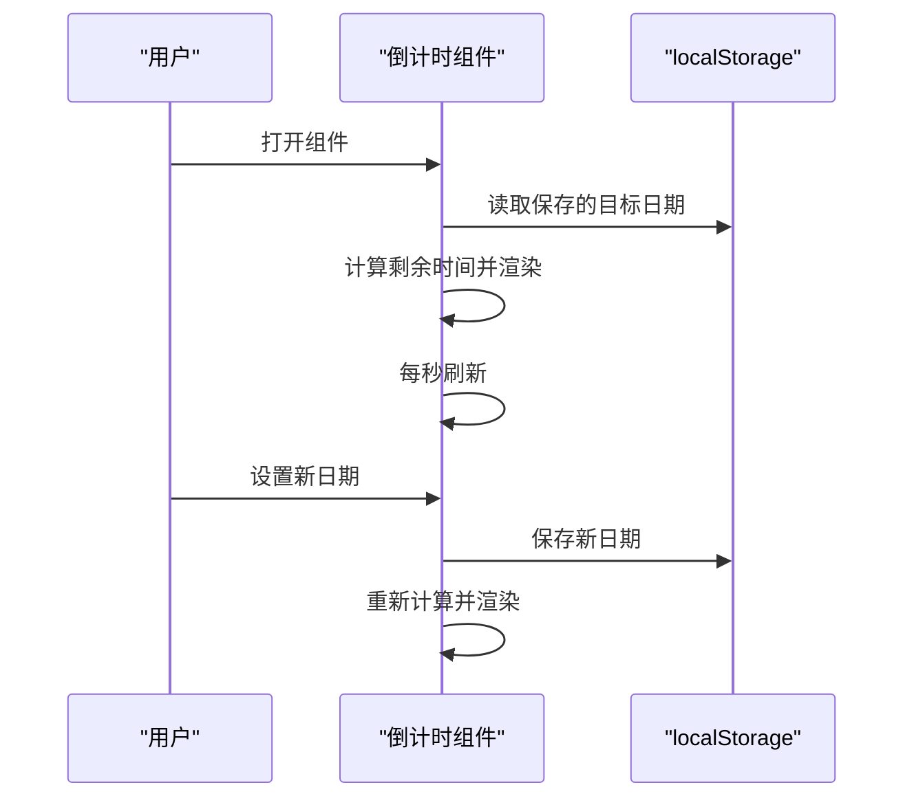
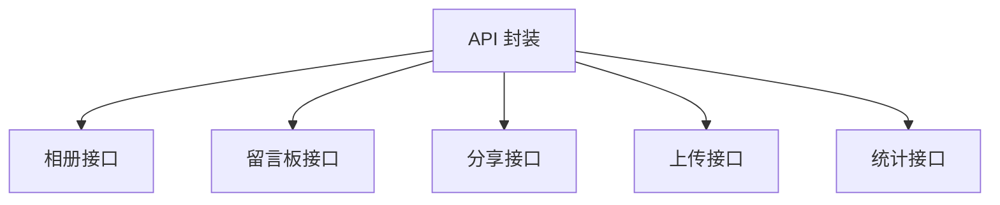
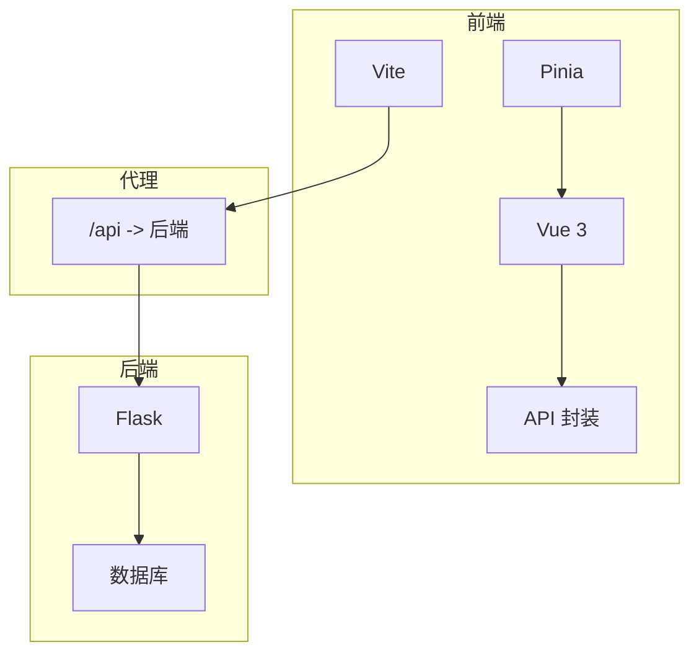

# 番茄工作法

<cite>
**本文引用的文件**
- [study.html](file://templates/study.html)
- [app.py](file://app.py)
- [package.json](file://frontend/package.json)
- [vite.config.js](file://frontend/vite.config.js)
- [api.js](file://frontend/src/api.js)
- [StatsChart.vue](file://frontend/src/components/StatsChart.vue)
- [MusicPlayer.vue](file://frontend/src/components/MusicPlayer.vue)
- [CountDown.vue](file://frontend/src/components/CountDown.vue)
- [App.vue](file://frontend/src/App.vue)
- [style.css](file://frontend/src/style.css)
</cite>

## 目录
1. [简介](#简介)
2. [项目结构](#项目结构)
3. [核心组件](#核心组件)
4. [架构总览](#架构总览)
5. [详细组件分析](#详细组件分析)
6. [依赖关系分析](#依赖关系分析)
7. [性能考虑](#性能考虑)
8. [故障排查指南](#故障排查指南)
9. [结论](#结论)
10. [附录](#附录)

## 简介
本文件面向“番茄工作法”功能的实现与使用，基于现有代码库中的学习页模板与前端组件进行系统化梳理。内容涵盖计时器核心算法（工作时间、短暂休息、长休息循环）、用户界面设计（倒计时显示、进度环可视化、控制按钮、声音提醒）、统计数据收集机制（当日完成数、总专注时长、历史记录）、自定义配置选项（工作时长、休息时长、提醒音效、专注模式）以及用户体验优化建议（键盘快捷键、移动端适配、离线使用）。

## 项目结构
该功能主要由后端模板与前端组件共同构成：
- 后端模板：学习页包含“番茄钟”区域，提供计时器逻辑、本地存储与基础统计展示。
- 前端组件：提供音乐播放器、统计图表等辅助功能，与后端模板通过静态页面交互。
- 构建与代理：Vite 开发服务器代理 /api 请求至后端服务。

**图示来源**
- [study.html](file://templates/study.html)
- [vite.config.js](file://frontend/vite.config.js)
- [api.js](file://frontend/src/api.js)
- [app.py](file://app.py)

**章节来源**
- [study.html](file://templates/study.html)
- [vite.config.js](file://frontend/vite.config.js)
- [package.json](file://frontend/package.json)

## 核心组件
- 计时器与进度环（学习页模板）
  - 提供圆形进度环、倒计时文本、开始/暂停/重置按钮。
  - 支持工作模式与短暂/长休息模式切换，按 4 次工作后进入长休息。
  - 使用本地存储持久化当前会话状态与当日统计数据。
- 音乐播放器（前端组件）
  - 提供背景音开关，使用 Web Audio API 生成环境音。
- 统计图表（前端组件）
  - 展示照片类应用的统计卡片与排行榜，作为通用统计展示组件。
- 倒计时组件（前端组件）
  - 展示特定日期倒计时，用于其他场景的时间提示。
- API 封装（前端模块）
  - 统一的 fetch 封装，便于扩展后端接口。

**章节来源**
- [study.html](file://templates/study.html)
- [MusicPlayer.vue](file://frontend/src/components/MusicPlayer.vue)
- [StatsChart.vue](file://frontend/src/components/StatsChart.vue)
- [CountDown.vue](file://frontend/src/components/CountDown.vue)
- [api.js](file://frontend/src/api.js)

## 架构总览
下图展示了“番茄钟”在浏览器中的运行流程：用户操作触发计时器逻辑，定时更新进度环与倒计时文本；会话状态与当日统计写入本地存储；长休息结束后弹窗提醒。

**图示来源**
- [study.html](file://templates/study.html)

## 详细组件分析

### 计时器与进度环（学习页模板）
- 功能要点
  - 倒计时显示：分:秒格式。
  - 圆形进度环：基于 SVG 圆环的 stroke-dashoffset 实现，随剩余时间推进。
  - 控制按钮：开始、暂停、重置；根据运行状态禁用/启用。
  - 模式切换：工作/短暂休息/长休息；默认工作 25 分钟，每 4 次工作后进入长休息 15 分钟，其余为 5 分钟。
  - 任务标注：可输入任务名，完成后展示。
  - 统计展示：当日完成次数与总专注分钟数。
- 状态持久化
  - 会话状态：当前秒数、是否运行、模式、完成次数、累计分钟、任务名、工作时长、保存时间。
  - 当日统计：以日期为键，存储当日完成次数与分钟数。
- 事件与回调
  - 初始化：读取本地保存的会话状态与当日统计，恢复计时器。
  - 运行中：定时更新 UI 并周期性保存状态。
  - 结束：根据模式切换下一阶段，并弹窗提醒。

**图示来源**
- [study.html](file://templates/study.html)

**章节来源**
- [study.html](file://templates/study.html)

### 音乐播放器（前端组件）
- 功能要点
  - 提供背景音开关按钮，点击切换静音/播放。
  - 使用 Web Audio API 生成环境音（多层正弦波 + 缓慢调制），并控制主音量。
  - 组件卸载时释放音频资源。
- 适用场景
  - 与“番茄钟”配合，营造专注氛围；也可独立使用。

**图示来源**
- [MusicPlayer.vue](file://frontend/src/components/MusicPlayer.vue)

**章节来源**
- [MusicPlayer.vue](file://frontend/src/components/MusicPlayer.vue)

### 统计图表（前端组件）
- 功能要点
  - 展示统计卡片（照片总数、评论数、点赞数）。
  - 展示上传达人柱状图与最受欢迎照片列表。
  - 使用渐变样式与动画过渡提升视觉体验。
- 适用场景
  - 作为通用统计展示组件，可迁移到其他业务场景。

**图示来源**
- [StatsChart.vue](file://frontend/src/components/StatsChart.vue)

**章节来源**
- [StatsChart.vue](file://frontend/src/components/StatsChart.vue)

### 倒计时组件（前端组件）
- 功能要点
  - 显示距离目标日期的天/时/分/秒。
  - 支持设置目标日期并保存到本地存储。
  - 每秒刷新一次，组件卸载时清理定时器。

**图示来源**
- [CountDown.vue](file://frontend/src/components/CountDown.vue)

**章节来源**
- [CountDown.vue](file://frontend/src/components/CountDown.vue)

### API 封装（前端模块）
- 功能要点
  - 统一封装 fetch 请求，自动携带凭据。
  - 提供相册、留言板、分享、上传、统计等接口方法。
- 适用场景
  - 为后续扩展后端接口提供统一入口。

**图示来源**
- [api.js](file://frontend/src/api.js)

**章节来源**
- [api.js](file://frontend/src/api.js)

## 依赖关系分析
- 前端依赖
  - Vue 3、Vue Router、Pinia（状态管理）。
  - Vite 开发工具链与插件。
- 代理配置
  - /api 前缀代理到后端服务，/static/albums 代理到后端静态资源。
- 后端依赖
  - Flask、PyMySQL、psutil、requests 等。

**图示来源**
- [package.json](file://frontend/package.json)
- [vite.config.js](file://frontend/vite.config.js)
- [app.py](file://app.py)

**章节来源**
- [package.json](file://frontend/package.json)
- [vite.config.js](file://frontend/vite.config.js)
- [app.py](file://app.py)

## 性能考虑
- 计时器节流
  - 使用每秒更新策略，避免频繁 DOM 操作；仅在必要时保存状态到本地存储。
- 进度环优化
  - 使用 SVG stroke-dasharray/dashoffset 实现平滑过渡，减少重绘。
- 音频资源管理
  - 组件卸载时关闭音频上下文，释放节点，避免内存泄漏。
- 本地存储
  - 会话状态与当日统计均采用 JSON 字符串存储，注意键空间与大小限制。

[本节为通用指导，无需具体文件分析]

## 故障排查指南
- 计时器无法启动
  - 检查按钮状态与定时器是否被正确启用/禁用。
  - 确认本地存储未损坏，必要时清除相关键值。
- 进度环不更新
  - 确认总时长计算与百分比映射逻辑一致。
  - 检查 SVG 元素是否存在且样式未被覆盖。
- 弹窗提醒未出现
  - 确认模式切换分支与弹窗触发条件。
- 音频无法播放
  - 检查浏览器自动播放策略与用户手势要求。
  - 确认组件未提前释放音频上下文。
- 统计数据异常
  - 检查当日统计键的日期格式与 JSON 结构。
  - 确认本地存储可用且未被清理。

**章节来源**
- [study.html](file://templates/study.html)
- [MusicPlayer.vue](file://frontend/src/components/MusicPlayer.vue)

## 结论
该实现以学习页模板为核心，结合本地存储与基础 UI 组件，完整实现了“番茄工作法”的核心流程：工作-短暂休息-长休息循环、倒计时与进度环可视化、会话与当日统计持久化。前端组件提供了可复用的音乐播放器与统计展示能力，便于进一步扩展。后续可在后端引入数据库与接口，完善历史记录与跨设备同步，并补充键盘快捷键、移动端适配与离线使用能力。

[本节为总结，无需具体文件分析]

## 附录

### 自定义配置与扩展建议
- 工作时长调整
  - 当前默认 25 分钟，可通过模式按钮切换至 45 分钟；可扩展为用户自定义输入框并持久化。
- 休息时长设置
  - 短暂休息默认 5 分钟，长休息默认 15 分钟；可提供下拉菜单或输入框进行自定义。
- 提醒音效选择
  - 当前使用浏览器弹窗提示；可扩展为选择不同音效或静音模式。
- 专注模式
  - 可增加“勿扰”开关，屏蔽弹窗与通知；或集成深色主题与专注白噪音。
- 键盘快捷键
  - 支持空格键开始/暂停，Esc 重置；结合焦点管理提升无障碍体验。
- 移动端适配
  - 优化触摸按钮尺寸与布局；在横屏状态下调整进度环位置。
- 离线使用
  - 使用 Service Worker 缓存静态资源；将关键状态迁移至 IndexedDB 以增强可靠性。

[本节为概念性建议，无需具体文件分析]