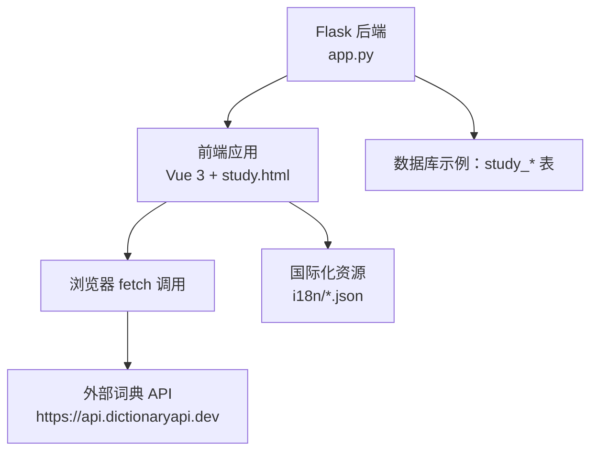
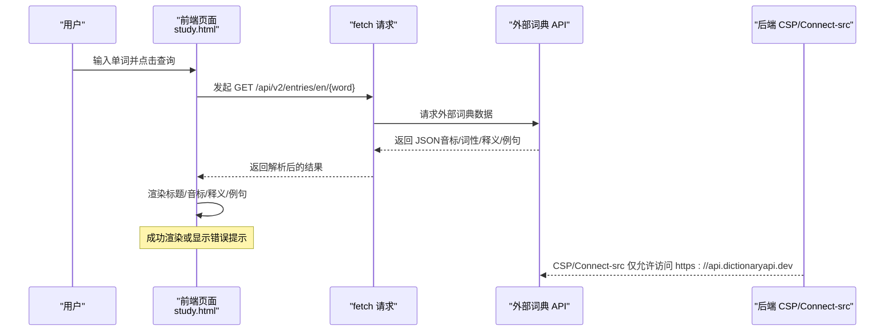
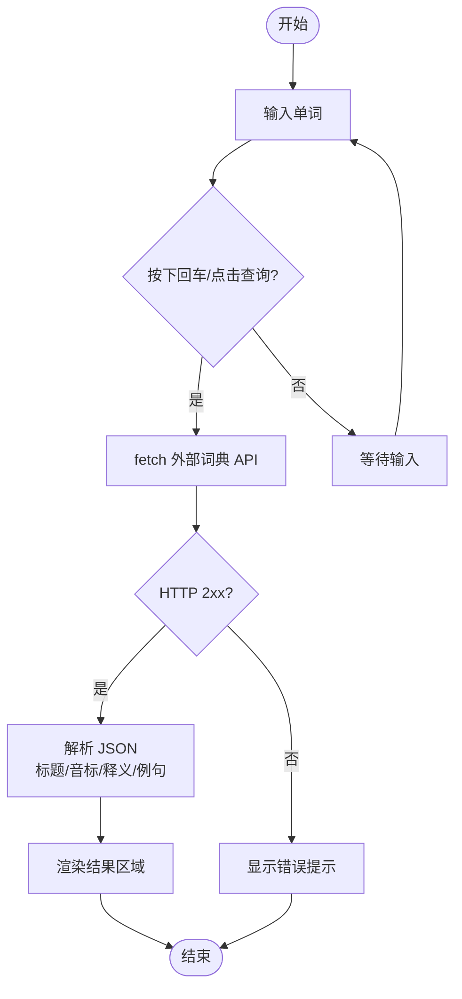
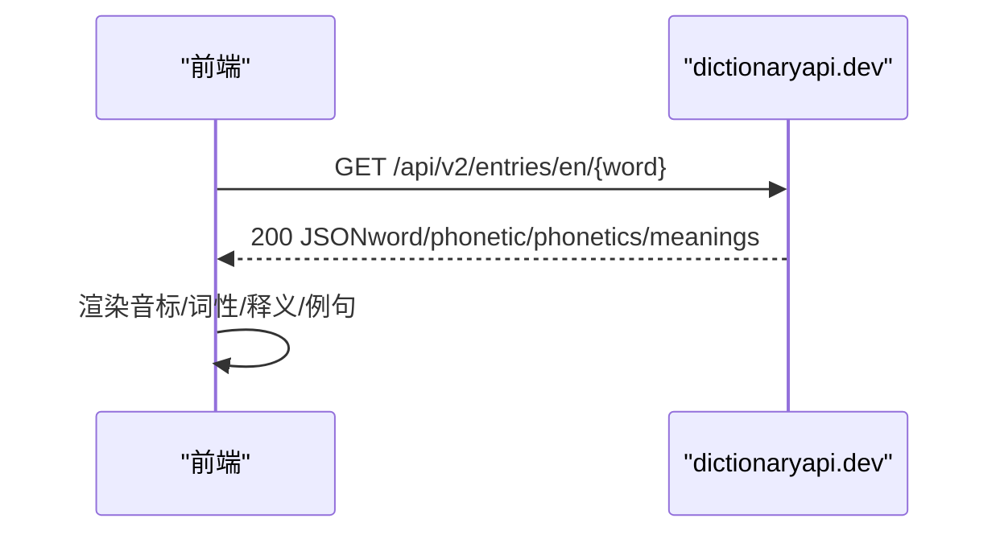
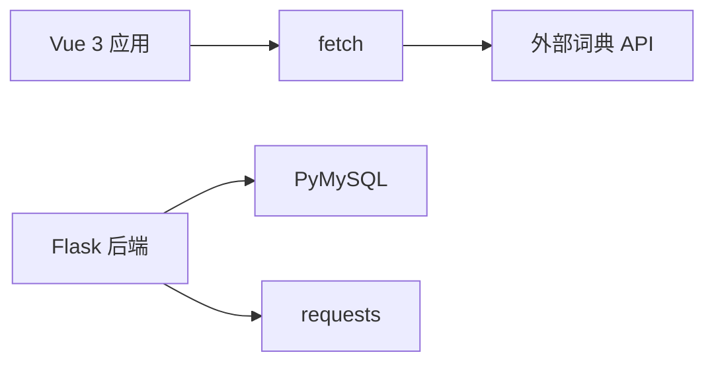

# 词典查询

<cite>
**本文档引用的文件**   
- [app.py](file://app.py)
- [study.html](file://templates/study.html)
- [api.js](file://frontend/src/api.js)
- [main.js](file://frontend/src/main.js)
- [en.json](file://i18n/en.json)
- [zh-CN.json](file://i18n/zh-CN.json)
- [requirements.txt](file://requirements.txt)
</cite>

## 目录
1. [引言](#引言)
2. [项目结构](#项目结构)
3. [核心组件](#核心组件)
4. [架构总览](#架构总览)
5. [详细组件分析](#详细组件分析)
6. [依赖分析](#依赖分析)
7. [性能考虑](#性能考虑)
8. [故障排查指南](#故障排查指南)
9. [结论](#结论)
10. [附录](#附录)

## 引言
本文件面向“词典查询”功能的完整实现文档，聚焦于前端与后端的协作方式、与外部词典服务的集成、查询接口设计、结果缓存策略、离线能力、多语言支持、高级功能（收藏、学习笔记、发音朗读、相关推荐）、用户体验优化（智能提示、拼写纠错、查询历史）。本文档基于仓库现有代码进行分析与总结，确保技术细节与实现一致。

## 项目结构
- 前端采用 Vue 3 应用，入口位于 frontend/src/main.js，组件与页面逻辑集中在 templates/study.html 中的“学习工具”页签。
- 后端基于 Flask，提供安全响应头、CORS、速率限制、国际化等基础设施，并在 study.html 中直接调用外部词典 API。
- 国际化资源位于 i18n 目录，包含英文与中文词条。

图表来源
- [study.html:540-571](file://templates/study.html#L540-L571)
- [app.py:659-676](file://app.py#L659-L676)

章节来源
- [main.js:1-6](file://frontend/src/main.js#L1-L6)
- [study.html:1-669](file://templates/study.html#L1-L669)
- [app.py:659-676](file://app.py#L659-L676)

## 核心组件
- 外部词典服务集成：前端直接调用 https://api.dictionaryapi.dev 的公开 REST API，获取单词的音标、词性、释义与例句。
- 查询界面：study.html 中的“英汉词典”页签提供输入框、触发按钮、结果显示区域与错误提示。
- 多语言支持：i18n 目录提供英文与中文词条，study.html 中的占位符与按钮文案来自国际化资源。
- 安全与性能：后端设置 CSP 与 connect-src，限制对外部词典 API 的访问域；前端通过 fetch 发起跨域请求。

章节来源
- [study.html:204-234](file://templates/study.html#L204-L234)
- [study.html:540-571](file://templates/study.html#L540-L571)
- [en.json:412-420](file://i18n/en.json#L412-L420)
- [zh-CN.json:412-420](file://i18n/zh-CN.json#L412-L420)
- [app.py:659-661](file://app.py#L659-L661)

## 架构总览
词典查询的端到端流程如下：
- 用户在前端输入单词，点击查询或按回车。
- 前端通过 fetch 调用外部词典 API 获取数据。
- 后端设置 CSP 与 connect-src，允许访问词典 API。
- 前端解析返回的 JSON，渲染音标、词性、释义与例句。
- 错误处理：当外部 API 返回非 2xx 或异常时，显示错误提示。

图表来源
- [study.html:540-571](file://templates/study.html#L540-L571)
- [app.py:659-661](file://app.py#L659-L661)

## 详细组件分析

### 组件一：词典查询界面与交互
- 功能要点
  - 输入框与查询按钮：支持回车触发查询。
  - 结果展示：标题（单词）、音标、词性与释义列表、例句。
  - 错误处理：非 2xx 或异常时显示错误提示。
  - 快速尝试：提供常用单词的快速查询按钮。
- 数据流
  - 前端从外部 API 获取数据，解析字段并填充 DOM。
  - 未找到单词时显示“未找到该单词”的提示文案。

图表来源
- [study.html:540-571](file://templates/study.html#L540-L571)

章节来源
- [study.html:204-234](file://templates/study.html#L204-L234)
- [study.html:540-571](file://templates/study.html#L540-L571)
- [en.json:412-420](file://i18n/en.json#L412-L420)
- [zh-CN.json:412-420](file://i18n/zh-CN.json#L412-L420)

### 组件二：外部词典服务集成
- 集成方式
  - 前端直接调用 https://api.dictionaryapi.dev/api/v2/entries/en/{word}。
  - 后端 CSP 与 connect-src 明确允许访问该域名。
- 数据获取与解析
  - 字段映射：单词标题、音标、词性、释义与例句。
  - 未找到时返回非 2xx，前端显示“未找到该单词”。

图表来源
- [study.html:540-571](file://templates/study.html#L540-L571)
- [app.py:659-661](file://app.py#L659-L661)

章节来源
- [study.html:540-571](file://templates/study.html#L540-L571)
- [app.py:659-661](file://app.py#L659-L661)

### 组件三：多语言支持
- 前端界面文案来自 i18n 资源文件，study.html 中通过模板占位符渲染。
- 支持英文与中文词条，界面与提示文案随语言切换而变化。

章节来源
- [en.json:412-420](file://i18n/en.json#L412-L420)
- [zh-CN.json:412-420](file://i18n/zh-CN.json#L412-L420)
- [study.html:204-234](file://templates/study.html#L204-L234)

### 组件四：结果缓存策略
- 现状
  - 前端未实现本地缓存逻辑；每次查询均发起网络请求。
- 建议
  - 浏览器层面：利用 Cache-Control/ETag 实现条件请求与缓存命中。
  - 应用层面：在前端增加本地缓存（IndexedDB/LocalStorage），对近期查询结果进行缓存，降低重复请求。
  - 后端层面：可引入 Redis/本地内存缓存，减少对外部 API 的瞬时压力。

[本节为通用建议，不直接分析具体文件]

### 组件五：离线支持与数据同步
- 现状
  - 词典查询依赖外部 API，未见本地词典数据库或离线查询实现。
- 建议
  - 离线词典：将常用单词与释义导入本地数据库（SQLite/IndexedDB），提供基础离线查询能力。
  - 数据同步：用户登录后，将收藏、学习笔记等数据同步至后端数据库，离线时本地存储，联网后增量同步。

[本节为通用建议，不直接分析具体文件]

### 组件六：高级功能（收藏、学习笔记、发音朗读、相关推荐）
- 收藏与学习笔记
  - 后端存在 study_todos 与 study_flashcards 等学习类数据表，可作为收藏与笔记的存储基础。
  - 建议在词典结果页增加“加入收藏/添加笔记”按钮，调用后端对应 API。
- 发音朗读
  - 外部 API 返回的音标文本可结合 Web Speech API 进行语音播报（需浏览器支持与权限）。
- 相关推荐
  - 可基于词性、释义关键词构建推荐算法，或调用外部语义服务进行相似词推荐。

章节来源
- [app.py:5013-5067](file://app.py#L5013-L5067)
- [app.py:5070-5183](file://app.py#L5070-L5183)

### 组件七：用户体验优化（智能提示、拼写纠错、查询历史）
- 智能提示与拼写纠错
  - 建议在输入框增加自动补全与拼写纠错（如调用浏览器 spellcheck 或第三方服务）。
- 查询历史
  - 前端可将最近查询记录保存在 LocalStorage，提供下拉历史列表，提升易用性。

[本节为通用建议，不直接分析具体文件]

## 依赖分析
- 外部依赖
  - requests：用于后端与外部服务通信（本项目前端直连外部 API，未见后端代理逻辑）。
  - Flask、PyMySQL：后端框架与数据库连接。
- 前端依赖
  - Vue 3：页面与交互逻辑。
  - fetch：发起跨域请求。

图表来源
- [requirements.txt:1-5](file://requirements.txt#L1-L5)
- [study.html:540-571](file://templates/study.html#L540-L571)

章节来源
- [requirements.txt:1-5](file://requirements.txt#L1-L5)
- [study.html:540-571](file://templates/study.html#L540-L571)

## 性能考虑
- 网络请求
  - 外部 API 响应时间与稳定性直接影响查询体验，建议在前端增加加载状态与超时处理。
- 缓存与并发
  - 对高频查询词建立本地缓存，避免重复请求。
  - 控制并发请求数量，防止外部 API 限流。
- 安全与合规
  - 后端 CSP 严格限定 connect-src，仅允许访问词典 API，降低中间人攻击风险。

[本节提供通用指导，不直接分析具体文件]

## 故障排查指南
- 外部 API 不可用
  - 现象：查询无结果或报错。
  - 排查：检查 dictionaryapi.dev 的可用性与网络连通性；确认浏览器控制台是否有跨域或网络错误。
- 跨域与 CSP 限制
  - 现象：请求被阻止或出现 CSP 警告。
  - 排查：确认后端 CSP 与 connect-src 是否包含 https://api.dictionaryapi.dev。
- 未找到单词
  - 现象：显示“未找到该单词”。
  - 排查：检查拼写、大小写与特殊字符；尝试更常见的同义词或变体形式。

章节来源
- [app.py:659-661](file://app.py#L659-L661)
- [study.html:540-571](file://templates/study.html#L540-L571)

## 结论
本项目已实现基础的词典查询功能：前端直连外部词典 API，后端通过 CSP/Connect-src 限制访问域，界面提供单词、音标、词性、释义与例句的展示。为进一步提升性能与用户体验，建议引入本地缓存、离线词典、收藏与学习笔记、发音朗读与相关推荐等高级功能，并完善智能提示、拼写纠错与查询历史等交互优化。

[本节为总结性内容，不直接分析具体文件]

## 附录
- 关键实现位置
  - 词典查询脚本：[study.html:540-571](file://templates/study.html#L540-L571)
  - 外部 API 访问域：[app.py:659-661](file://app.py#L659-L661)
  - 多语言词条：[en.json:412-420](file://i18n/en.json#L412-L420)、[zh-CN.json:412-420](file://i18n/zh-CN.json#L412-L420)
  - 学习工具相关 API（可复用为收藏/笔记）：[app.py:5013-5067](file://app.py#L5013-L5067)、[app.py:5070-5183](file://app.py#L5070-L5183)