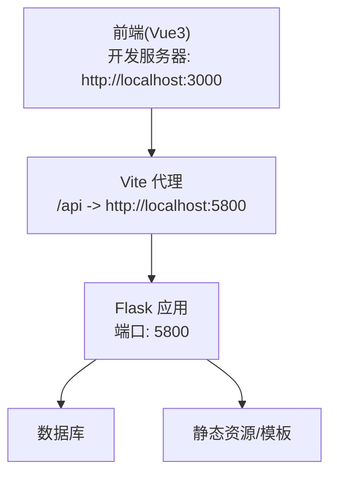
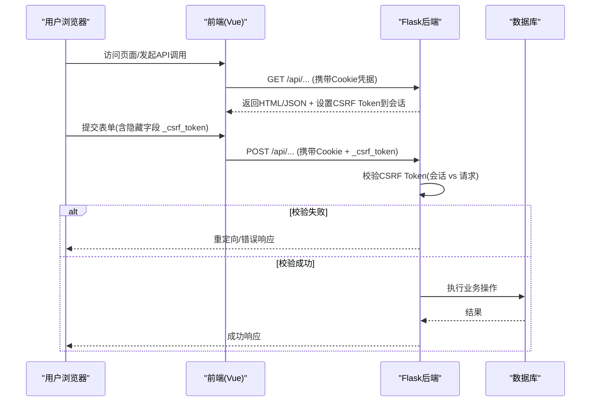
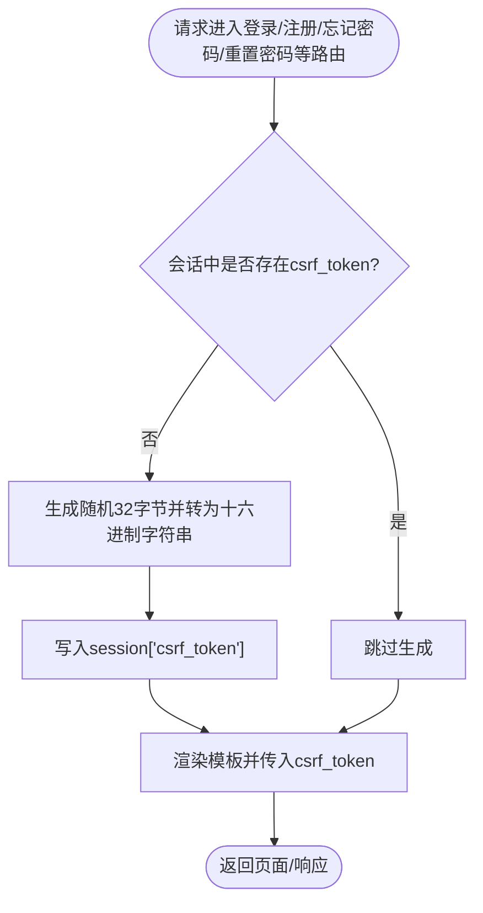
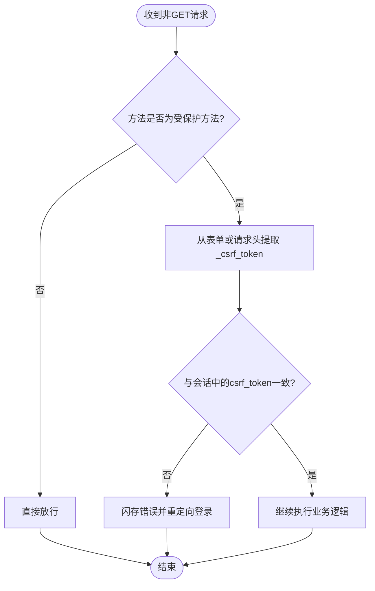
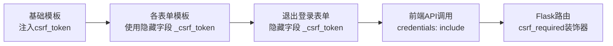
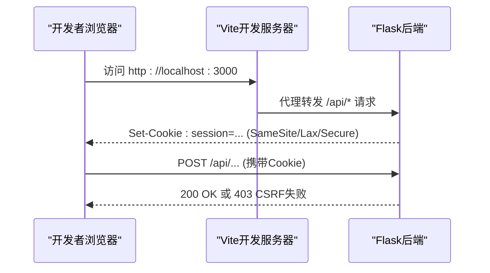
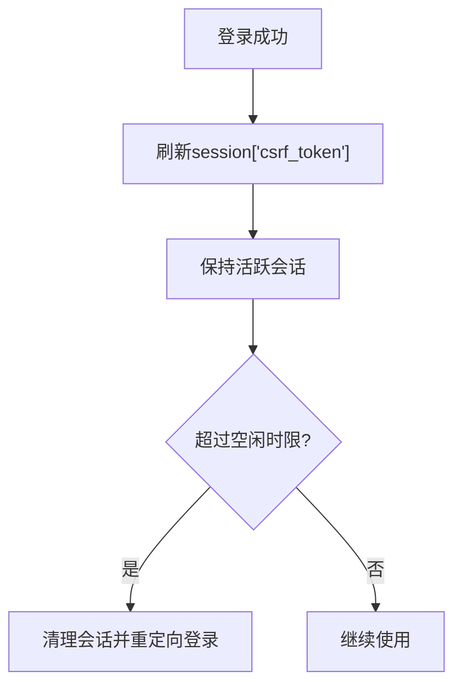
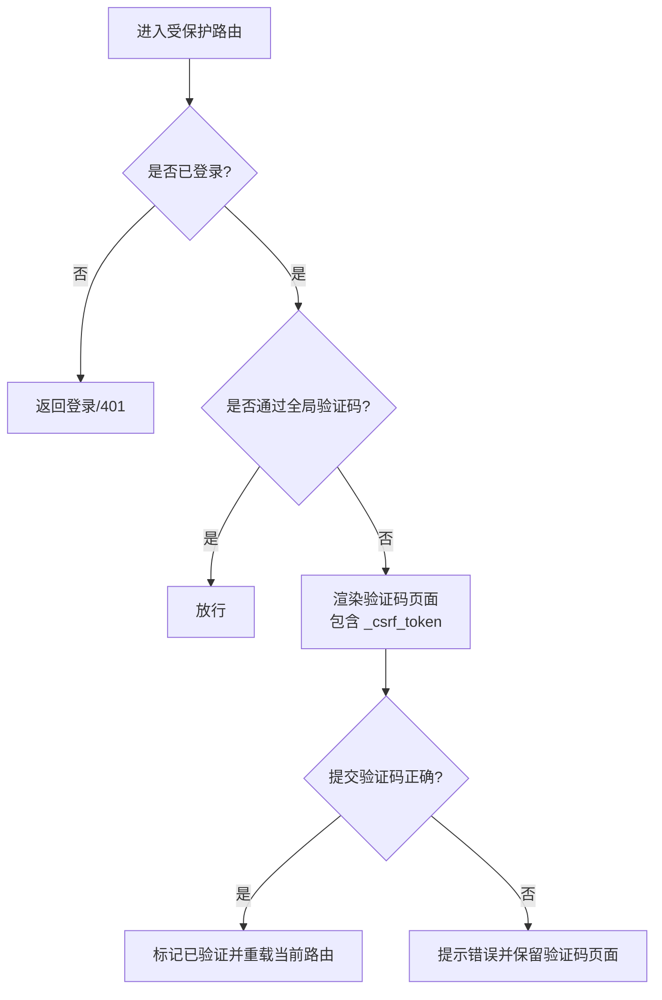
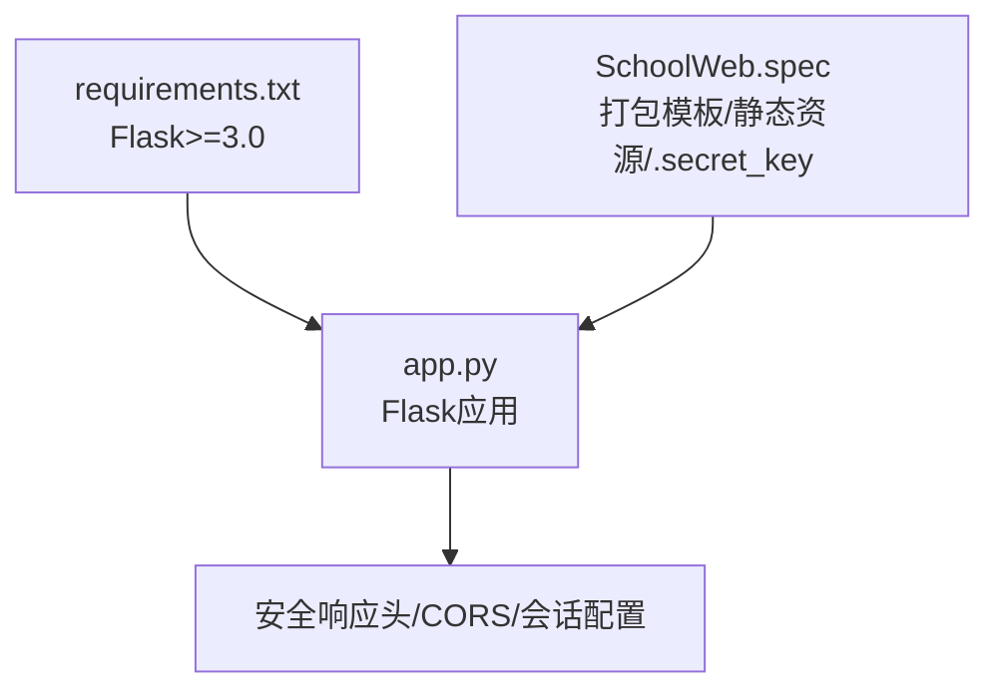

# CSRF防护机制

<cite>
**本文引用的文件**
- [app.py](file://app.py)
- [requirements.txt](file://requirements.txt)
- [SchoolWeb.spec](file://SchoolWeb.spec)
- [templates/base.html](file://templates/base.html)
- [templates/global_captcha.html](file://templates/global_captcha.html)
- [templates/db_captcha.html](file://templates/db_captcha.html)
- [templates/forgot_password.html](file://templates/forgot_password.html)
- [templates/reset_password.html](file://templates/reset_password.html)
- [frontend/src/api.js](file://frontend/src/api.js)
- [frontend/vite.config.js](file://frontend/vite.config.js)
- [安全措施清单.md](file://安全措施清单.md)
</cite>

## 目录
1. [引言](#引言)
2. [项目结构](#项目结构)
3. [核心组件](#核心组件)
4. [架构总览](#架构总览)
5. [详细组件分析](#详细组件分析)
6. [依赖分析](#依赖分析)
7. [性能考量](#性能考量)
8. [故障排查指南](#故障排查指南)
9. [结论](#结论)
10. [附录](#附录)

## 引言
本文件系统性阐述本项目的CSRF（跨站请求伪造）防护机制，涵盖攻击原理、防护策略、Token生成与验证流程、跨域处理、Flask应用中的实现细节（Token存储、验证逻辑、安全配置）、全局CSRF Token生成与验证、会话管理与生命周期、安全性考虑、最佳实践（前端集成、错误处理与调试技巧），并提供实际代码位置索引与常见问题解决方案。

## 项目结构
本项目采用前后端分离架构：
- 后端：基于Flask的应用，负责会话、CSRF Token生成与校验、安全响应头、CORS配置等。
- 前端：基于Vue3的静态资源，通过Vite开发服务器代理转发到后端API，使用同源或跨域（本地开发）场景下的会话凭据传递。

图表来源
- [frontend/vite.config.js:1-20](file://frontend/vite.config.js#L1-L20)
- [app.py:129-139](file://app.py#L129-L139)

章节来源
- [frontend/vite.config.js:1-20](file://frontend/vite.config.js#L1-L20)
- [app.py:129-139](file://app.py#L129-L139)

## 核心组件
- CSRF装饰器：用于对非GET请求进行CSRF Token校验。
- 会话级CSRF Token：每个会话生成独立Token，随表单隐藏字段传递。
- 全局验证码门禁：在敏感操作前要求用户完成验证码，阻断自动化攻击。
- 安全响应头与CORS：统一设置安全头，配置跨域与凭据支持。
- 前端API封装：统一携带凭据，便于CSRF Token随请求一并提交。

章节来源
- [app.py:919-932](file://app.py#L919-L932)
- [app.py:1020-1116](file://app.py#L1020-L1116)
- [app.py:1119-1188](file://app.py#L1119-L1188)
- [app.py:1209-1258](file://app.py#L1209-L1258)
- [app.py:1261-1319](file://app.py#L1261-L1319)
- [app.py:642-676](file://app.py#L642-L676)
- [app.py:131](file://app.py#L131)
- [templates/base.html:196-199](file://templates/base.html#L196-L199)
- [templates/global_captcha.html:10-18](file://templates/global_captcha.html#L10-L18)
- [templates/db_captcha.html:10-18](file://templates/db_captcha.html#L10-L18)
- [templates/forgot_password.html:9-22](file://templates/forgot_password.html#L9-L22)
- [templates/reset_password.html:8-26](file://templates/reset_password.html#L8-L26)
- [frontend/src/api.js:1-45](file://frontend/src/api.js#L1-L45)

## 架构总览
CSRF防护在请求生命周期中的关键节点如下：

图表来源
- [app.py:919-932](file://app.py#L919-L932)
- [app.py:1020-1116](file://app.py#L1020-L1116)
- [app.py:1119-1188](file://app.py#L1119-L1188)
- [app.py:1209-1258](file://app.py#L1209-L1258)
- [app.py:1261-1319](file://app.py#L1261-L1319)
- [templates/base.html:196-199](file://templates/base.html#L196-L199)
- [templates/global_captcha.html:10-18](file://templates/global_captcha.html#L10-L18)
- [frontend/src/api.js:1-45](file://frontend/src/api.js#L1-L45)

## 详细组件分析

### CSRF Token生成与存储
- 生成时机：在多个GET/POST路由入口处，若会话中不存在CSRF Token，则生成并写入会话。
- 存储位置：Flask会话对象，随Cookie传输。
- Token格式：十六进制字符串，长度约64字符（32字节随机数的十六进制表示）。

图表来源
- [app.py:1024-1026](file://app.py#L1024-L1026)
- [app.py:1122-1124](file://app.py#L1122-L1124)
- [app.py:1212-1214](file://app.py#L1212-L1214)
- [app.py:1264-1266](file://app.py#L1264-L1266)

章节来源
- [app.py:1024-1026](file://app.py#L1024-L1026)
- [app.py:1122-1124](file://app.py#L1122-L1124)
- [app.py:1212-1214](file://app.py#L1212-L1214)
- [app.py:1264-1266](file://app.py#L1264-L1266)

### CSRF验证流程
- 适用范围：对非GET/HEAD/OPTIONS/TRACE请求进行校验。
- 校验来源：优先从表单字段获取，其次从请求头获取。
- 校验方法：使用常量时间比较函数对比期望值与请求值。
- 失败处理：闪存提示并重定向至登录页。

图表来源
- [app.py:919-932](file://app.py#L919-L932)

章节来源
- [app.py:919-932](file://app.py#L919-L932)

### 全局CSRF Token注入与前端集成
- 模板注入：基础模板将CSRF Token注入到上下文，各表单模板可直接使用。
- 登出表单：导航栏中的退出登录表单显式包含隐藏的CSRF Token字段。
- 前端API：fetch请求默认携带Cookie凭据，确保CSRF Token随请求一起发送。

图表来源
- [templates/base.html:196-199](file://templates/base.html#L196-L199)
- [templates/global_captcha.html:10-18](file://templates/global_captcha.html#L10-L18)
- [templates/db_captcha.html:10-18](file://templates/db_captcha.html#L10-L18)
- [templates/forgot_password.html:9-22](file://templates/forgot_password.html#L9-L22)
- [templates/reset_password.html:8-26](file://templates/reset_password.html#L8-L26)
- [frontend/src/api.js:1-45](file://frontend/src/api.js#L1-L45)
- [app.py:919-932](file://app.py#L919-L932)

章节来源
- [templates/base.html:196-199](file://templates/base.html#L196-L199)
- [templates/global_captcha.html:10-18](file://templates/global_captcha.html#L10-L18)
- [templates/db_captcha.html:10-18](file://templates/db_captcha.html#L10-L18)
- [templates/forgot_password.html:9-22](file://templates/forgot_password.html#L9-L22)
- [templates/reset_password.html:8-26](file://templates/reset_password.html#L8-L26)
- [frontend/src/api.js:1-45](file://frontend/src/api.js#L1-L45)
- [app.py:919-932](file://app.py#L919-L932)

### 跨域与会话凭据
- CORS配置：允许指定来源，支持凭据传递。
- 开发代理：前端开发服务器通过代理将/api请求转发到后端，避免跨域问题。
- 凭据传递：前端fetch默认携带Cookie，确保CSRF Token生效。

图表来源
- [app.py:131](file://app.py#L131)
- [frontend/vite.config.js:9-18](file://frontend/vite.config.js#L9-L18)
- [frontend/src/api.js:1-45](file://frontend/src/api.js#L1-L45)

章节来源
- [app.py:131](file://app.py#L131)
- [frontend/vite.config.js:9-18](file://frontend/vite.config.js#L9-L18)
- [frontend/src/api.js:1-45](file://frontend/src/api.js#L1-L45)

### 会话管理与Token生命周期
- 会话安全设置：HttpOnly、SameSite=Lax、Secure按环境变量自动配置。
- 会话超时：IP级空闲超时，超时后强制重新登录。
- Token更新：登录成功后刷新CSRF Token，降低泄露风险。

图表来源
- [app.py:133-139](file://app.py#L133-L139)
- [app.py:508-593](file://app.py#L508-L593)
- [app.py:1076](file://app.py#L1076)
- [app.py:1095](file://app.py#L1095)

章节来源
- [app.py:133-139](file://app.py#L133-L139)
- [app.py:508-593](file://app.py#L508-L593)
- [app.py:1076](file://app.py#L1076)
- [app.py:1095](file://app.py#L1095)

### 全局验证码门禁与CSRF协同
- 触发条件：已登录用户访问特定路由且未通过全局验证码验证。
- 验证方式：提交验证码并通过后设置“已验证”标志，后续请求无需重复验证。
- 与CSRF结合：验证码页面表单同样包含CSRF Token隐藏字段。

图表来源
- [app.py:596-622](file://app.py#L596-L622)
- [templates/global_captcha.html:10-18](file://templates/global_captcha.html#L10-L18)

章节来源
- [app.py:596-622](file://app.py#L596-L622)
- [templates/global_captcha.html:10-18](file://templates/global_captcha.html#L10-L18)

### 安全响应头与CSP
- 统一设置安全响应头，包括X-Content-Type-Options、X-Frame-Options、X-XSS-Protection、Referrer-Policy、Strict-Transport-Security等。
- CSP使用nonce，配合模板注入，限制脚本与样式的来源，减少XSS风险，间接增强CSRF防护效果。

章节来源
- [app.py:642-676](file://app.py#L642-L676)
- [templates/base.html:8](file://templates/base.html#L8)

## 依赖分析
- Flask版本：>=3.0，满足现代安全特性与性能。
- CORS：启用并允许指定来源，支持凭据传递，便于前端开发与部署。
- 打包配置：.spec文件包含模板、静态资源与密钥文件，确保CSRF密钥与模板正确打包。

图表来源
- [requirements.txt:1](file://requirements.txt#L1)
- [SchoolWeb.spec:8](file://SchoolWeb.spec#L8)
- [app.py:129-139](file://app.py#L129-L139)
- [app.py:642-676](file://app.py#L642-L676)

章节来源
- [requirements.txt:1](file://requirements.txt#L1)
- [SchoolWeb.spec:8](file://SchoolWeb.spec#L8)
- [app.py:129-139](file://app.py#L129-L139)
- [app.py:642-676](file://app.py#L642-L676)

## 性能考量
- CSRF Token生成：使用系统熵源生成，开销极小。
- 校验算法：常量时间比较，避免时序攻击，性能稳定。
- 会话超时：减少长期活跃会话带来的潜在风险，同时降低服务端状态维护压力。
- 前端代理：开发阶段通过Vite代理减少跨域带来的额外握手成本。

## 故障排查指南
- CSRF校验失败
  - 现象：提交表单后被重定向到登录页或出现安全验证失败提示。
  - 排查要点：
    - 确认表单包含隐藏字段 _csrf_token，且值来自会话。
    - 确认前端请求携带Cookie（credentials: include）。
    - 确认CORS配置允许来源并支持凭据。
  - 参考位置：
    - [app.py:919-932](file://app.py#L919-L932)
    - [templates/base.html:196-199](file://templates/base.html#L196-L199)
    - [frontend/src/api.js:1-45](file://frontend/src/api.js#L1-L45)
    - [app.py:131](file://app.py#L131)

- 验证码门禁导致的循环跳转
  - 现象：反复弹出验证码页面。
  - 排查要点：
    - 确认验证码提交正确后会话中设置“已验证”标志。
    - 确认后续请求不再触发全局验证码门禁。
  - 参考位置：
    - [app.py:596-622](file://app.py#L596-L622)
    - [templates/global_captcha.html:10-18](file://templates/global_captcha.html#L10-L18)

- 跨域与凭据问题
  - 现象：开发环境中API请求失败或CSRF Token未生效。
  - 排查要点：
    - 确认Vite代理配置指向后端地址。
    - 确认Flask CORS允许来源并支持凭据。
    - 确认前端fetch使用credentials: include。
  - 参考位置：
    - [frontend/vite.config.js:9-18](file://frontend/vite.config.js#L9-L18)
    - [app.py:131](file://app.py#L131)
    - [frontend/src/api.js:1-45](file://frontend/src/api.js#L1-L45)

- 会话超时导致的频繁登录
  - 现象：长时间无操作后被强制登出。
  - 排查要点：
    - 检查会话空闲超时配置与实际行为。
    - 确认用户活动是否及时更新最后活跃时间。
  - 参考位置：
    - [app.py:508-593](file://app.py#L508-L593)

## 结论
本项目通过“会话级CSRF Token + 全局验证码门禁 + 统一安全响应头 + CORS凭据支持”的组合策略，构建了多层次的CSRF防护体系。Token生成与校验逻辑简洁可靠，配合会话超时与CSP等安全头，有效降低了CSRF与XSS等攻击面。前端通过统一API封装与代理配置，确保CSRF Token随请求自然传递，提升整体安全性与可用性。

## 附录

### 最佳实践清单
- 前端集成
  - 所有表单均包含隐藏字段 _csrf_token。
  - fetch请求统一携带凭据（credentials: include）。
  - 开发环境使用Vite代理，避免跨域带来的CSRF挑战。
- 安全配置
  - 会话Cookie设置HttpOnly、SameSite=Lax、Secure按环境自动配置。
  - 统一设置安全响应头，CSP使用nonce限制资源来源。
  - CORS允许可信来源并支持凭据。
- 生命周期与更新
  - 登录成功后刷新CSRF Token，降低泄露风险。
  - 定期清理过期会话与验证码，避免状态膨胀。
- 错误处理与调试
  - CSRF失败时明确提示并引导重新登录。
  - 验证码门禁失败时给出具体错误信息并保留当前页面状态。
  - 使用日志与监控定位异常请求模式。

### 常见问题与解决方案
- 问题：CSRF校验失败但Token存在
  - 解决：检查请求是否携带Cookie；确认表单字段名与模板注入一致；核对会话是否被清理。
- 问题：跨域请求CSRF不生效
  - 解决：确认CORS允许来源并支持凭据；前端fetch使用credentials: include；开发使用Vite代理。
- 问题：验证码门禁循环触发
  - 解决：确认验证码提交正确后会话标记“已验证”；检查路由是否被误判为需要验证码。