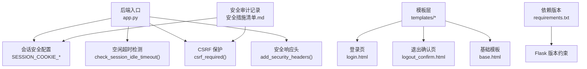
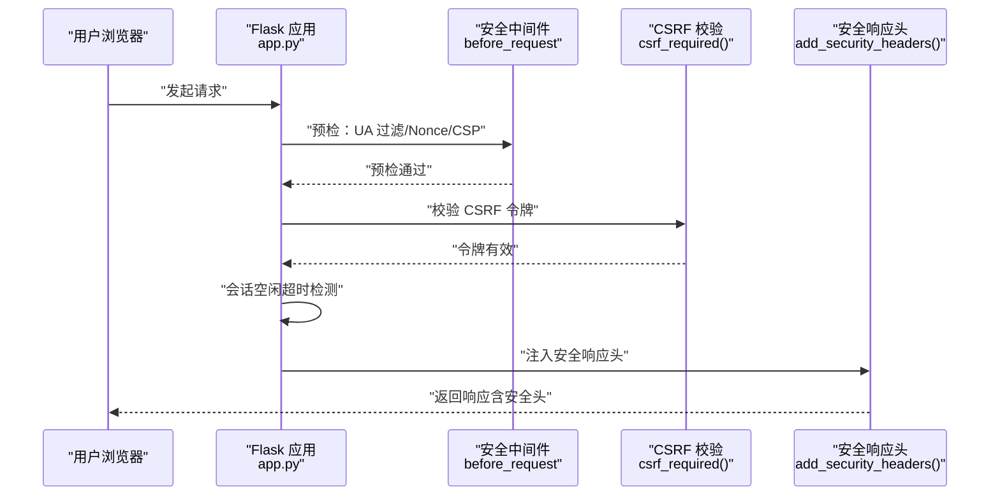
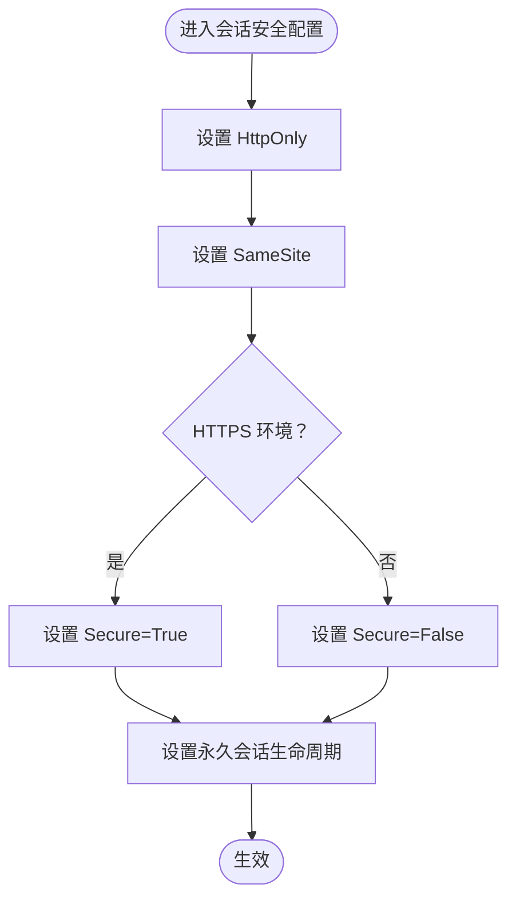
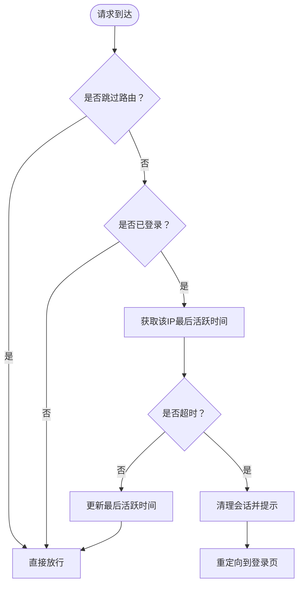
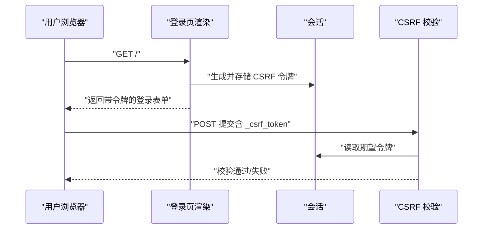
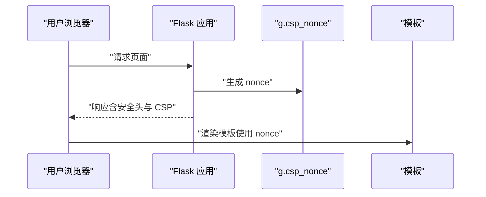
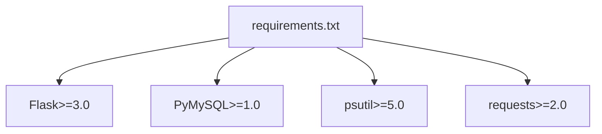

# 会话安全管理

<cite>
**本文引用的文件**
- [app.py](file://app.py)
- [安全措施清单.md](file://安全措施清单.md)
- [templates/login.html](file://templates/login.html)
- [templates/logout_confirm.html](file://templates/logout_confirm.html)
- [templates/base.html](file://templates/base.html)
- [requirements.txt](file://requirements.txt)
</cite>

## 目录
1. [简介](#简介)
2. [项目结构](#项目结构)
3. [核心组件](#核心组件)
4. [架构总览](#架构总览)
5. [详细组件分析](#详细组件分析)
6. [依赖分析](#依赖分析)
7. [性能考量](#性能考量)
8. [故障排查指南](#故障排查指南)
9. [结论](#结论)
10. [附录](#附录)

## 简介
本文件围绕 Flask 应用中的会话安全管理进行系统化技术文档整理，重点涵盖以下方面：
- Flask 会话 Cookie 的安全配置：HttpOnly、SameSite、Secure 属性的作用与配置方法
- 会话超时机制：空闲超时检测、自动登出逻辑与用户体验优化
- 会话持久化策略：会话数据存储、加密机制与安全传输
- 会话固定攻击防护与会话劫持防范措施
- 会话安全最佳实践：生产环境部署建议与安全审计要点

## 项目结构
本项目采用典型的 Flask 单体应用结构，会话安全相关的关键实现集中在后端入口文件与模板层：
- 后端入口与会话配置：app.py
- 模板层：templates 下的登录、退出确认等页面
- 安全审计与修复记录：安全措施清单.md
- 依赖版本：requirements.txt

图表来源
- [app.py:133-139](file://app.py#L133-L139)
- [app.py:564-593](file://app.py#L564-L593)
- [app.py:919-932](file://app.py#L919-L932)
- [app.py:641-676](file://app.py#L641-L676)
- [templates/login.html:1-37](file://templates/login.html#L1-L37)
- [templates/logout_confirm.html:1-18](file://templates/logout_confirm.html#L1-L18)
- [templates/base.html:1-337](file://templates/base.html#L1-L337)
- [安全措施清单.md:1-120](file://安全措施清单.md#L1-L120)
- [requirements.txt:1-5](file://requirements.txt#L1-L5)

章节来源
- [app.py:133-139](file://app.py#L133-L139)
- [app.py:564-593](file://app.py#L564-L593)
- [app.py:919-932](file://app.py#L919-L932)
- [app.py:641-676](file://app.py#L641-L676)
- [templates/login.html:1-37](file://templates/login.html#L1-L37)
- [templates/logout_confirm.html:1-18](file://templates/logout_confirm.html#L1-L18)
- [templates/base.html:1-337](file://templates/base.html#L1-L337)
- [安全措施清单.md:1-120](file://安全措施清单.md#L1-L120)
- [requirements.txt:1-5](file://requirements.txt#L1-L5)

## 核心组件
- 会话安全配置
  - HttpOnly：防止客户端脚本读取 Cookie，降低 XSS 风险
  - SameSite：限制跨站携带 Cookie，缓解 CSRF 与部分劫持风险
  - Secure：仅在 HTTPS 环境下发送 Cookie，防止中间人窃听
  - 永久会话生命周期：PERMANENT_SESSION_LIFETIME 控制会话有效期
- 空闲超时检测
  - 基于 IP 的最后活跃时间记录，超时后自动清理会话并引导重新登录
- CSRF 保护
  - 为表单生成一次性 CSRF 令牌，提交时进行严格比对
- 安全响应头
  - 统一设置安全相关响应头，增强浏览器侧防护
- 模板层集成
  - 登录页、退出确认页等模板中嵌入 CSRF 令牌与交互逻辑

章节来源
- [app.py:133-139](file://app.py#L133-L139)
- [app.py:564-593](file://app.py#L564-L593)
- [app.py:919-932](file://app.py#L919-L932)
- [app.py:641-676](file://app.py#L641-L676)
- [templates/login.html:8-26](file://templates/login.html#L8-L26)
- [templates/logout_confirm.html:8-14](file://templates/logout_confirm.html#L8-L14)

## 架构总览
下图展示会话安全在请求生命周期中的关键节点与交互：

图表来源
- [app.py:149-156](file://app.py#L149-L156)
- [app.py:158-161](file://app.py#L158-L161)
- [app.py:919-932](file://app.py#L919-L932)
- [app.py:641-676](file://app.py#L641-L676)
- [app.py:564-593](file://app.py#L564-L593)

## 详细组件分析

### 会话 Cookie 安全属性配置
- HttpOnly
  - 作用：禁止 JavaScript 读取会话 Cookie，显著降低 XSS 成功概率
  - 配置位置：会话安全配置块
- SameSite
  - 作用：限制跨站请求携带 Cookie，缓解 CSRF 与部分劫持
  - 配置位置：会话安全配置块
- Secure
  - 作用：仅在 HTTPS 环境下发送 Cookie，防止明文传输
  - 配置位置：会话安全配置块；根据环境变量自动启用
- 永久会话生命周期
  - 作用：控制会话有效期，缩短会话暴露窗口
  - 配置位置：会话安全配置块

图表来源
- [app.py:133-139](file://app.py#L133-L139)

章节来源
- [app.py:133-139](file://app.py#L133-L139)
- [安全措施清单.md:46-48](file://安全措施清单.md#L46-L48)

### 空闲超时机制与自动登出
- 实现原理
  - 记录每个 IP 的最后活跃时间
  - 在每次请求前检查是否超过空闲阈值
  - 超时则清理会话并提示用户重新登录
- 用户体验优化
  - 仅对已登录用户生效
  - 排除静态资源与特定页面，避免误触发
  - 自动重定向至登录页并提示未操作时长

图表来源
- [app.py:564-593](file://app.py#L564-L593)

章节来源
- [app.py:564-593](file://app.py#L564-L593)

### CSRF 保护与令牌管理
- 令牌生成
  - 登录页渲染时生成一次性 CSRF 令牌并写入会话
- 提交校验
  - 非 GET 请求必须携带有效 CSRF 令牌
  - 使用恒等比较函数进行安全比对
- 令牌轮换
  - 登录成功后更换 CSRF 令牌，降低长期复用风险

图表来源
- [app.py:1024-1026](file://app.py#L1024-L1026)
- [app.py:919-932](file://app.py#L919-L932)
- [app.py:1076](file://app.py#L1076)

章节来源
- [app.py:1024-1026](file://app.py#L1024-L1026)
- [app.py:919-932](file://app.py#L919-L932)
- [app.py:1076](file://app.py#L1076)
- [templates/login.html:8-26](file://templates/login.html#L8-L26)

### 安全响应头与 CSP 集成
- 统一安全响应头
  - X-Content-Type-Options、X-Frame-Options、X-XSS-Protection、Referrer-Policy、Permissions-Policy
  - HSTS：生产环境启用
- CSP 集成
  - 为每个请求生成随机 nonce 并注入到模板
  - 模板中使用 nonce 使内联脚本与样式合法化，减少 unsafe-inline 使用

图表来源
- [app.py:641-676](file://app.py#L641-L676)
- [app.py:158-161](file://app.py#L158-L161)
- [templates/base.html:8](file://templates/base.html#L8)
- [templates/base.html:233](file://templates/base.html#L233)

章节来源
- [app.py:641-676](file://app.py#L641-L676)
- [app.py:158-161](file://app.py#L158-L161)
- [templates/base.html:8](file://templates/base.html#L8)
- [templates/base.html:233](file://templates/base.html#L233)

### 会话固定攻击防护与会话劫持防范
- 会话固定攻击防护
  - 登录成功后更换 CSRF 令牌与会话标识，避免攻击者复用会话
- 会话劫持防范
  - HttpOnly、SameSite、Secure 三重保障
  - 空闲超时自动登出，缩短会话暴露窗口
  - HSTS 与 CSP 等响应头强化传输与脚本执行安全

章节来源
- [app.py:1076](file://app.py#L1076)
- [app.py:133-139](file://app.py#L133-L139)
- [app.py:564-593](file://app.py#L564-L593)
- [app.py:641-676](file://app.py#L641-L676)

## 依赖分析
- Flask 版本约束
  - 项目要求 Flask≥3.0，确保具备较新的安全特性与行为
- 第三方库
  - PyMySQL：数据库访问
  - psutil、requests：系统监控与网络请求辅助

图表来源
- [requirements.txt:1-5](file://requirements.txt#L1-L5)

章节来源
- [requirements.txt:1-5](file://requirements.txt#L1-L5)

## 性能考量
- 会话空闲超时检测
  - 使用内存字典记录 IP 最后活跃时间，复杂度 O(1) 查找与更新
  - 仅对已登录用户生效，避免对匿名用户的额外开销
- CSRF 校验
  - 恒等比较函数确保令牌比对安全且高效
- 响应头注入
  - 每请求生成一次 nonce，成本极低
- 速率限制与封禁
  - 采用滑动窗口与内存队列，避免频繁磁盘 IO

章节来源
- [app.py:564-593](file://app.py#L564-L593)
- [app.py:919-932](file://app.py#L919-L932)
- [app.py:641-676](file://app.py#L641-L676)

## 故障排查指南
- 会话 Cookie 未按预期生效
  - 检查环境变量 HTTPS 设置，确认 Secure 属性是否正确
  - 确认 SameSite 配置与前端跨域策略一致
- 登录后频繁被重定向到登录页
  - 检查空闲超时阈值与 IP 记录是否异常
  - 确认模板中是否正确传递 CSRF 令牌
- CSRF 校验失败
  - 确认表单中包含 _csrf_token 字段
  - 检查令牌生成与提交流程是否完整
- 安全响应头缺失
  - 确认 after_request 钩子是否生效
  - 检查生产环境是否正确关闭调试模式

章节来源
- [app.py:133-139](file://app.py#L133-L139)
- [app.py:564-593](file://app.py#L564-L593)
- [app.py:919-932](file://app.py#L919-L932)
- [app.py:641-676](file://app.py#L641-L676)
- [templates/login.html:8-26](file://templates/login.html#L8-L26)

## 结论
本项目在会话安全管理方面采取了多层防护策略：通过 HttpOnly、SameSite、Secure 三重 Cookie 安全属性，结合空闲超时与 CSRF 令牌校验，有效降低了会话固定与劫持风险；同时通过统一的安全响应头与 CSP 集成，进一步增强了传输与脚本执行层面的安全性。建议在生产环境中遵循本文最佳实践，持续进行安全审计与优化。

## 附录
- 最佳实践摘要
  - 始终启用 HttpOnly、SameSite、Secure
  - 合理设置会话生命周期与空闲超时
  - 登录成功后更换 CSRF 令牌与会话标识
  - 生产环境启用 HSTS，严格控制 CSP 与响应头
  - 定期审查与更新安全配置与依赖版本