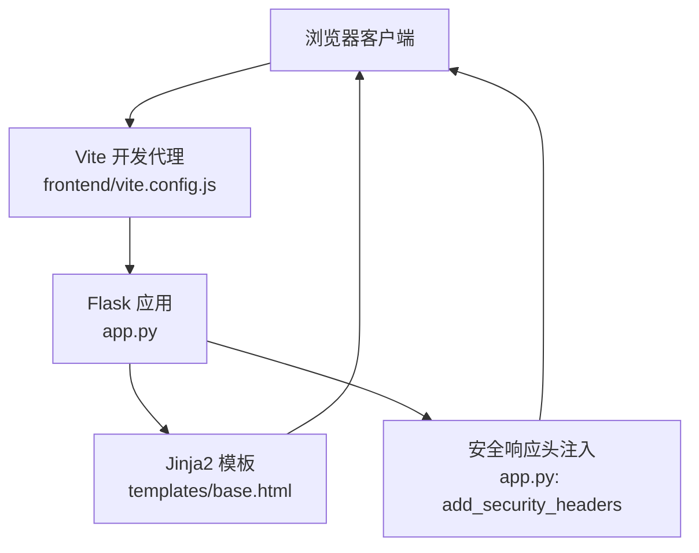
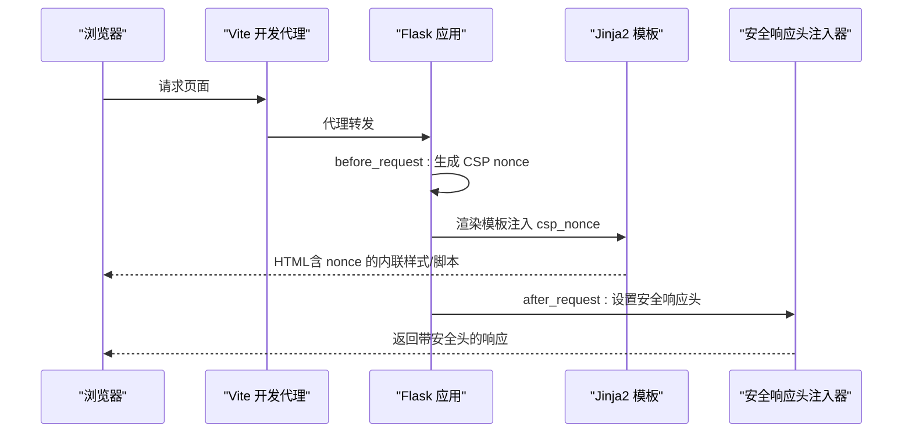
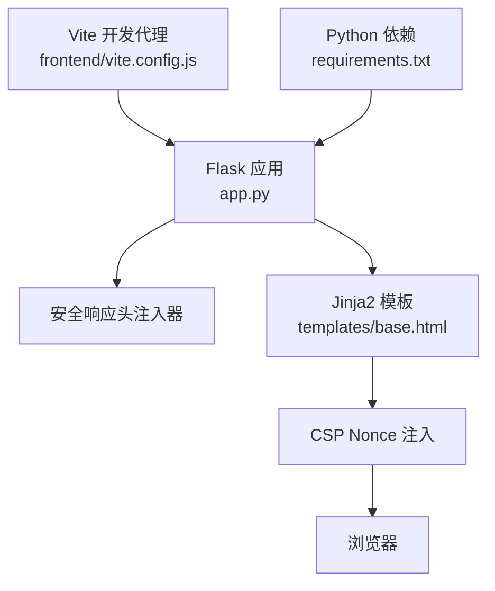

# 安全响应头配置

<cite>
**本文引用的文件**
- [app.py](file://app.py)
- [templates/base.html](file://templates/base.html)
- [安全措施清单.md](file://安全措施清单.md)
- [requirements.txt](file://requirements.txt)
- [frontend/vite.config.js](file://frontend/vite.config.js)
</cite>

## 目录
1. [简介](#简介)
2. [项目结构](#项目结构)
3. [核心组件](#核心组件)
4. [架构总览](#架构总览)
5. [详细组件分析](#详细组件分析)
6. [依赖分析](#依赖分析)
7. [性能考虑](#性能考虑)
8. [故障排除指南](#故障排除指南)
9. [结论](#结论)
10. [附录](#附录)

## 简介
本技术文档围绕本项目的“安全响应头”配置进行系统化梳理与实操指导，重点涵盖以下方面：
- 常见安全响应头的作用与配置要点：X-Content-Type-Options、X-Frame-Options、X-XSS-Protection、Referrer-Policy、Permissions-Policy、Strict-Transport-Security（HSTS）。
- 内容安全策略（CSP）的实现细节：nonce 机制、指令配置、浏览器兼容性与渐进迁移策略。
- 其他安全头与最佳实践：开发环境 vs 生产环境差异、测试方法与故障排除。
- 实际配置示例与安全评估工具使用指南。

本项目已在运行时统一注入安全响应头，并通过模板渲染将 CSP nonce 注入到内联样式与脚本中，形成“每请求轮换”的动态策略，显著降低 XSS 风险。

## 项目结构
本项目采用 Python Flask 后端与 Jinja2 模板渲染的前后端分离风格，前端由 Vite 提供开发服务器代理后端 API。安全响应头主要在后端统一注入，模板中通过上下文变量注入 CSP nonce，前端静态资源通过 CDN 引入。

图表来源
- [app.py:641-676](file://app.py#L641-L676)
- [templates/base.html:8](file://templates/base.html#L8)
- [frontend/vite.config.js:1-21](file://frontend/vite.config.js#L1-L21)

章节来源
- [app.py:641-676](file://app.py#L641-L676)
- [templates/base.html:1-337](file://templates/base.html#L1-L337)
- [frontend/vite.config.js:1-21](file://frontend/vite.config.js#L1-L21)

## 核心组件
- 安全响应头注入器：在每次 HTTP 响应后统一设置安全相关头部，包括 MIME 嗅探防护、点击劫持防护、XSS 过滤器、Referrer 策略、权限策略、缓存控制以及 HSTS（生产环境）。
- CSP nonce 生成与注入：在请求前生成随机 nonce 并注入到模板上下文，模板中的内联样式与脚本通过 nonce 指令放行，避免使用不安全的内联策略。
- 模板层 CSP 使用：模板中通过 nonce 变量渲染内联样式与脚本，确保每请求的 CSP 放行令牌唯一。

章节来源
- [app.py:158-178](file://app.py#L158-L178)
- [app.py:641-676](file://app.py#L641-L676)
- [templates/base.html:8](file://templates/base.html#L8)
- [templates/base.html:233](file://templates/base.html#L233)
- [templates/base.html:269](file://templates/base.html#L269)

## 架构总览
下图展示了安全响应头在请求生命周期中的作用路径，以及 CSP nonce 的生成与模板注入流程。

图表来源
- [app.py:158-178](file://app.py#L158-L178)
- [app.py:641-676](file://app.py#L641-L676)
- [templates/base.html:8](file://templates/base.html#L8)
- [templates/base.html:233](file://templates/base.html#L233)
- [templates/base.html:269](file://templates/base.html#L269)

## 详细组件分析

### 安全响应头注入器（add_security_headers）
- 功能定位：统一为所有响应设置安全相关头部，覆盖 MIME 嗅探、点击劫持、XSS 过滤、Referrer 策略、权限策略、缓存控制与 HSTS（生产环境）。
- 关键行为：
  - 设置 X-Content-Type-Options 为 nosniff，阻止浏览器对响应内容进行 MIME 类型嗅探。
  - 设置 X-Frame-Options 为 SAMEORIGIN，防止页面被嵌入到第三方页面中，降低点击劫持风险。
  - 设置 X-XSS-Protection 为 1; mode=block，启用旧版 XSS 过滤器（现代浏览器已弃用，仍保留以增强兼容性）。
  - 设置 Referrer-Policy 为 strict-origin-when-cross-origin，平衡隐私与功能需求。
  - 设置 Permissions-Policy 为 camera=(), microphone=(), geolocation=()，明确禁止摄像头、麦克风与地理定位权限。
  - 对 HTML 响应设置 Cache-Control、Pragma、Expires，避免敏感页面被缓存。
  - 在非调试环境（生产）设置 Strict-Transport-Security，启用 HTTPS 强制与子域名包含。
- 注意事项：
  - 若路由处理器已显式设置 Content-Security-Policy，则注入器不会覆盖，以便插件或特定路由按需定制 CSP。
  - 服务器头（Server）在注入器中被移除，隐藏版本信息。

章节来源
- [app.py:641-676](file://app.py#L641-L676)

### CSP nonce 机制与模板注入
- nonce 生成：在请求前生成随机十六进制字符串作为 CSP nonce，并存储在 g 上下文中。
- 模板注入：通过上下文处理器将 csp_nonce 注入到所有模板，模板中内联样式与脚本通过 nonce 指令放行。
- 指令配置要点：
  - default-src 限定为 self，限制默认来源。
  - script-src 包含 self、unsafe-inline（为兼容大量内联事件处理器）、动态 nonce 以及受信任的 CDN 源。
  - style-src 限定为 self 与动态 nonce，移除 unsafe-inline，提升样式注入防护。
  - font-src、img-src、connect-src 限定为受信任源，避免任意来源加载资源。
  - frame-ancestors 限定为 self，与 X-Frame-Options 协同。
  - form-action 限定为 self，限制表单提交目标。
- 浏览器兼容性与迁移策略：
  - 保留 unsafe-inline 以兼容现有内联事件处理器，建议逐步迁移到外链脚本并通过 nonce 放行。
  - CDN 资源建议配合 Subresource Integrity（SRI）以进一步增强完整性校验。

章节来源
- [app.py:158-178](file://app.py#L158-L178)
- [app.py:641-676](file://app.py#L641-L676)
- [templates/base.html:8](file://templates/base.html#L8)
- [templates/base.html:233](file://templates/base.html#L233)
- [templates/base.html:269](file://templates/base.html#L269)

### HSTS（严格传输安全）
- 配置位置：在非调试环境（生产）设置 Strict-Transport-Security，启用 HTTPS 强制与子域名包含。
- 配置要点：
  - max-age=31536000：一年有效期。
  - includeSubDomains：对所有子域名生效。
  - 预加载（preload）：当前未启用，若需启用需满足预加载站点要求并提交至厂商审核。
- 生产环境建议：
  - 确保全站 HTTPS，且证书有效。
  - 如需预加载，先在非预加载模式验证无误后再提交预加载。

章节来源
- [app.py:672-675](file://app.py#L672-L675)

### 其他安全头
- Referrer-Policy：strict-origin-when-cross-origin，跨域时仅发送来源协议与主机名，兼顾隐私与功能。
- Permissions-Policy：camera=(), microphone=(), geolocation=()，明确禁止摄像头、麦克风与地理定位权限。
- 缓存控制：对 HTML 响应设置 no-store、must-revalidate、no-cache、Expires=0，避免敏感页面被缓存。

章节来源
- [app.py:641-676](file://app.py#L641-L676)

### 开发环境 vs 生产环境差异
- 开发环境（FLASK_DEBUG=开启）：不设置 HSTS，便于本地 HTTP 调试。
- 生产环境（FLASK_DEBUG=关闭）：启用 HSTS、严格缓存控制与安全响应头。
- 建议：
  - 开发时使用 HTTPS（如自签名证书）以模拟生产环境。
  - 通过环境变量控制安全头开关，避免误配置。

章节来源
- [app.py:672-675](file://app.py#L672-L675)

### 测试方法与评估工具
- 浏览器开发者工具：
  - Network 面板查看响应头，确认 X-Content-Type-Options、X-Frame-Options、X-XSS-Protection、Referrer-Policy、Permissions-Policy、HSTS（生产）等是否存在。
  - Console 查看 CSP 报告（若有 CSP 报告端点），确认 nonce 是否匹配。
- 在线安全扫描工具：
  - 使用在线安全评估工具（如 SSL Labs、SecurityHeaders.io）对站点进行全面扫描，核对响应头与 CSP 配置。
- 本项目内置工具：
  - “网络工具”页提供“HTTP Headers”与“SSL Check”，可用于快速验证响应头与证书状态。

章节来源
- [templates/network_tools.html:279-304](file://templates/network_tools.html#L279-L304)

## 依赖分析
- 后端框架：Flask（版本要求见 requirements.txt），提供请求/响应钩子与模板渲染能力。
- 前端开发：Vite 提供开发服务器与代理，将前端请求转发至后端 API，便于本地联调。
- 安全头依赖：
  - 后端统一注入安全响应头。
  - 模板层通过上下文变量注入 CSP nonce，确保每请求唯一性。
  - 生产环境启用 HSTS，开发环境关闭。

图表来源
- [app.py:641-676](file://app.py#L641-L676)
- [templates/base.html:8](file://templates/base.html#L8)
- [frontend/vite.config.js:1-21](file://frontend/vite.config.js#L1-L21)
- [requirements.txt:1-5](file://requirements.txt#L1-L5)

章节来源
- [requirements.txt:1-5](file://requirements.txt#L1-L5)
- [frontend/vite.config.js:1-21](file://frontend/vite.config.js#L1-L21)
- [app.py:641-676](file://app.py#L641-L676)

## 性能考虑
- nonce 生成：每请求生成随机 nonce，开销极小，但需注意在高并发场景下的上下文传递与模板渲染成本。
- CSP 指令复杂度：合理拆分 script-src 与 style-src，避免过多源导致解析与匹配开销。
- HSTS：仅在生产环境启用，避免开发环境不必要的重定向与握手成本。
- 缓存控制：对敏感页面禁用缓存，避免重复请求带来的安全风险，同时减少不必要的缓存命中。

## 故障排除指南
- CSP 报错（脚本/样式被阻止）：
  - 确认模板中内联样式与脚本是否正确使用 nonce 变量。
  - 检查 CSP 注入器是否覆盖了路由自定义的 CSP（若覆盖，需在路由层显式包含 nonce）。
  - 逐步移除 unsafe-inline，将内联事件迁移到外链脚本并通过 nonce 放行。
- HSTS 生效问题：
  - 确认生产环境未开启 FLASK_DEBUG，否则不会注入 HSTS。
  - 确认全站 HTTPS 且证书有效。
- 缓存控制导致页面不更新：
  - 检查响应头中 Cache-Control、Pragma、Expires 是否对 HTML 生效。
  - 对开发阶段可临时放宽缓存策略，生产环境保持严格。
- 旧版 XSS 头（X-XSS-Protection）：
  - 现代浏览器已弃用，建议逐步移除，但仍可保留以增强兼容性。

章节来源
- [app.py:641-676](file://app.py#L641-L676)
- [templates/base.html:8](file://templates/base.html#L8)
- [templates/base.html:233](file://templates/base.html#L233)
- [templates/base.html:269](file://templates/base.html#L269)

## 结论
本项目通过“后端统一注入 + 模板 nonce 注入”的方式，构建了完善的响应头安全体系，覆盖 MIME 嗅探、点击劫持、XSS 过滤、Referrer 策略、权限策略与 HSTS（生产）。CSP 通过每请求轮换的 nonce 令牌，显著提升了对内联脚本与样式的防护能力。建议在后续迭代中逐步移除 unsafe-inline，为 CDN 资源添加 SRI，并在满足条件时启用 HSTS 预加载，持续提升整体安全性与合规性。

## 附录

### 实际配置示例（路径指引）
- 安全响应头注入器：[app.py:641-676](file://app.py#L641-L676)
- CSP nonce 生成与注入：[app.py:158-178](file://app.py#L158-L178)
- 模板中内联样式与脚本的 nonce 使用：[templates/base.html:8](file://templates/base.html#L8)、[templates/base.html:233](file://templates/base.html#L233)、[templates/base.html:269](file://templates/base.html#L269)
- 开发代理配置（前端）：[frontend/vite.config.js:1-21](file://frontend/vite.config.js#L1-L21)
- 依赖版本要求：[requirements.txt:1-5](file://requirements.txt#L1-L5)

### 安全评估工具使用指南
- 在线扫描：使用 SSL Labs、SecurityHeaders.io 等工具对站点进行全面扫描，核对响应头与 CSP 配置。
- 本项目内置工具：通过“网络工具”页的“HTTP Headers”与“SSL Check”快速验证响应头与证书状态。
- 报告解读：关注 HSTS、CSP、Referrer-Policy、Permissions-Policy 等关键项是否符合预期。

章节来源
- [templates/network_tools.html:279-304](file://templates/network_tools.html#L279-L304)
- [安全措施清单.md:43-71](file://安全措施清单.md#L43-L71)
- [安全措施清单.md:76-92](file://安全措施清单.md#L76-L92)