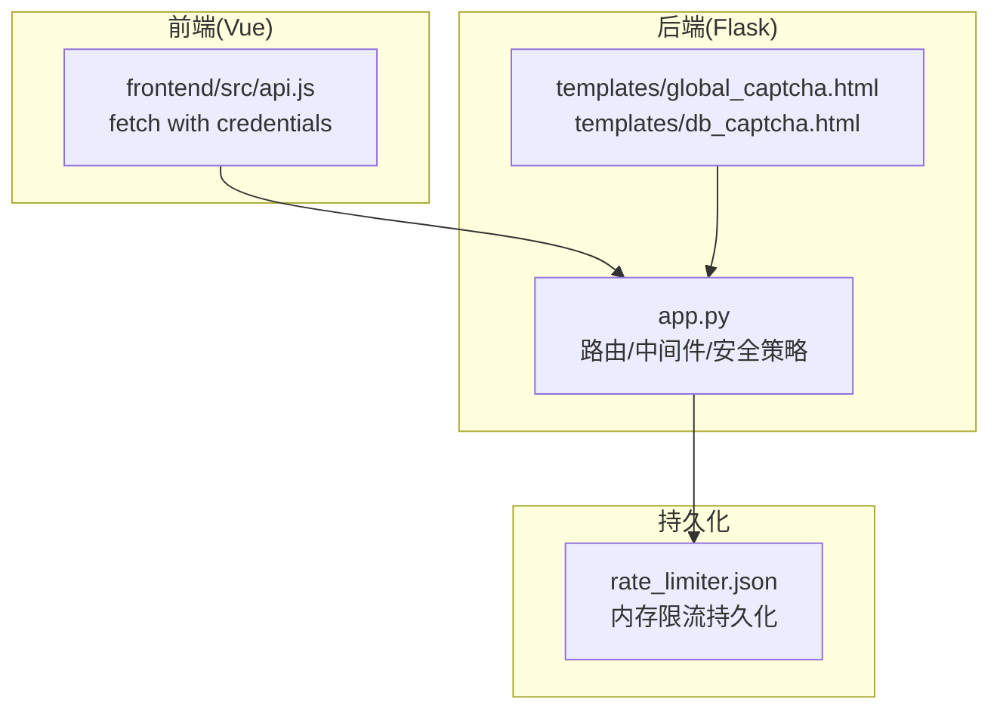
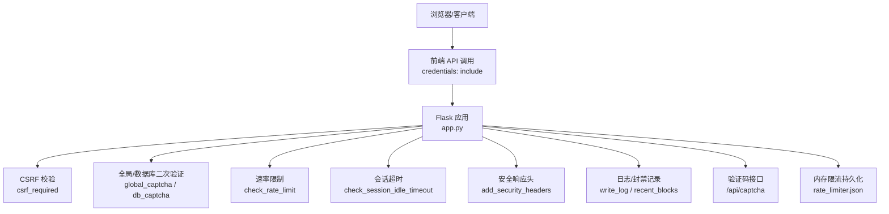
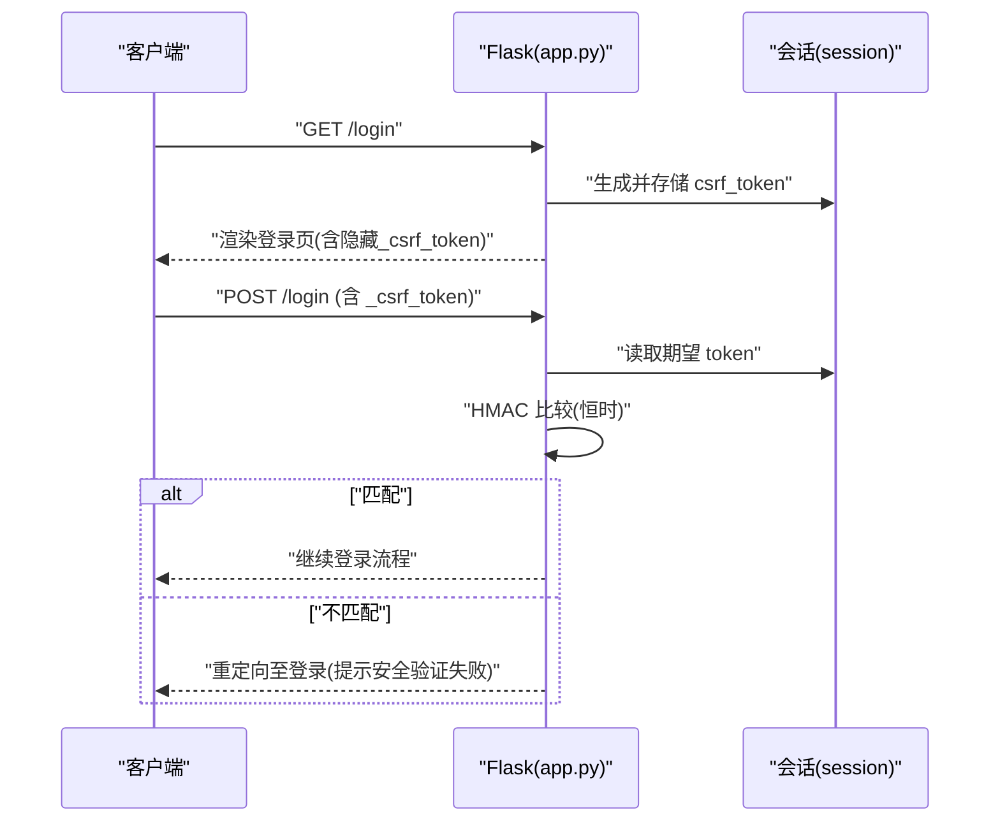
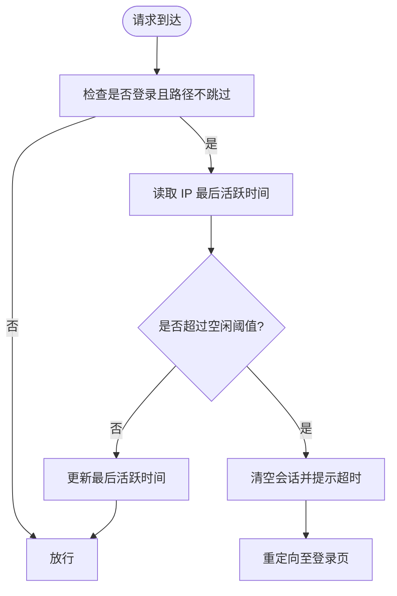
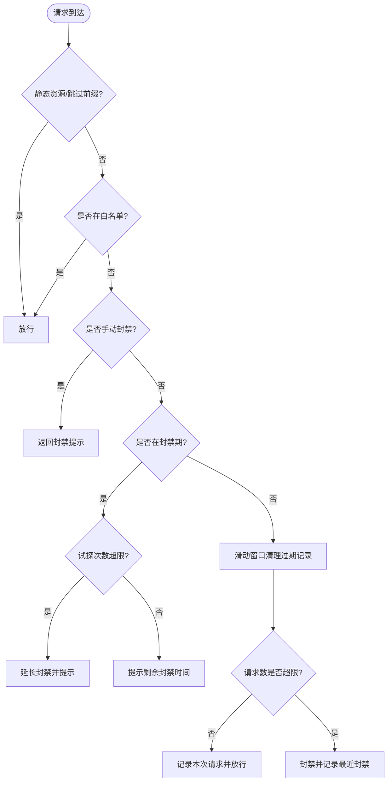
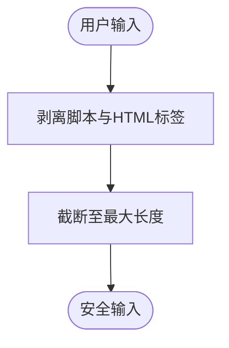
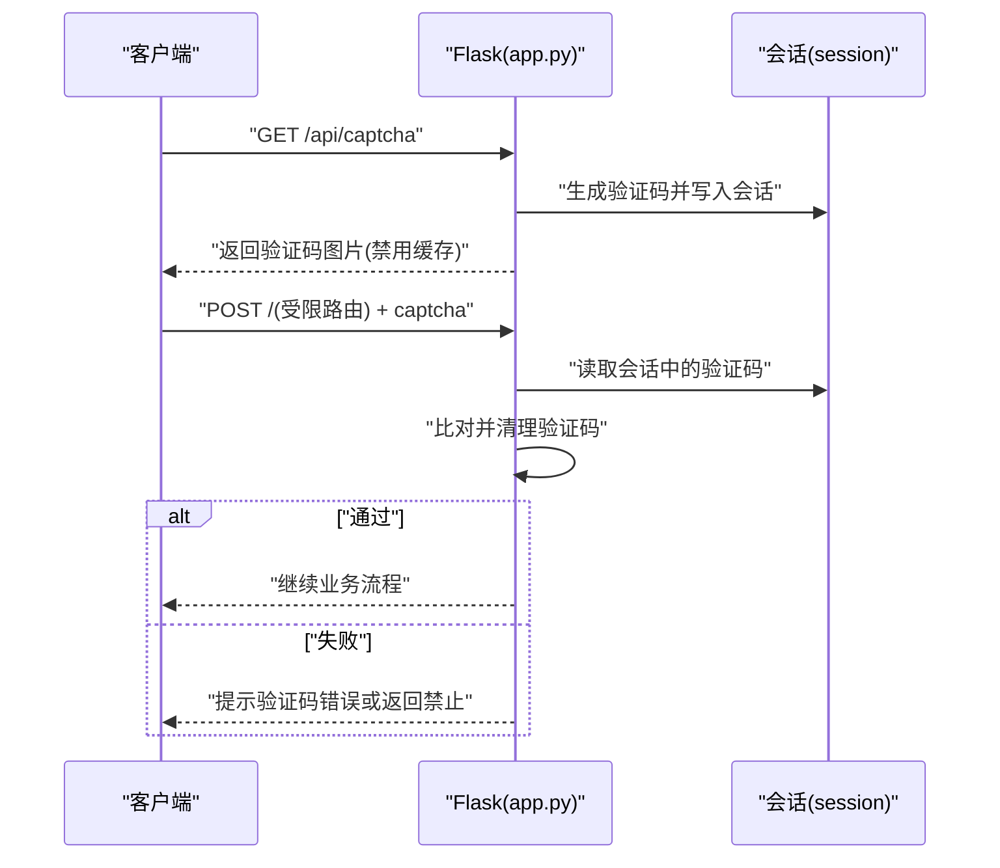
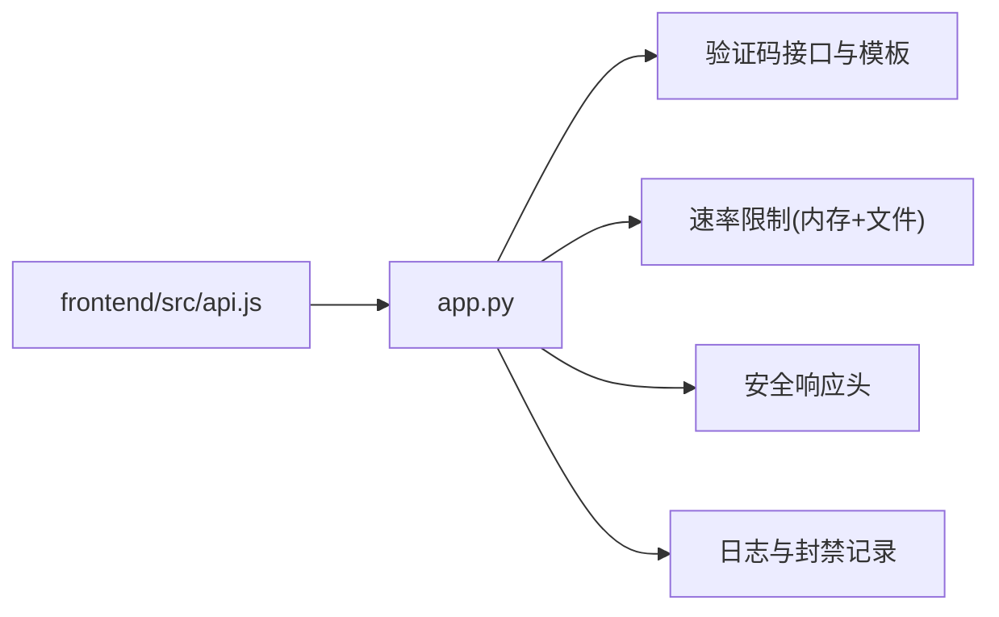

# 安全机制设计

<cite>
**本文引用的文件**
- [app.py](file://app.py)
- [templates/global_captcha.html](file://templates/global_captcha.html)
- [templates/db_captcha.html](file://templates/db_captcha.html)
- [frontend/src/api.js](file://frontend/src/api.js)
- [rate_limiter.json](file://rate_limiter.json)
</cite>

## 目录
1. [引言](#引言)
2. [项目结构](#项目结构)
3. [核心组件](#核心组件)
4. [架构总览](#架构总览)
5. [详细组件分析](#详细组件分析)
6. [依赖分析](#依赖分析)
7. [性能考虑](#性能考虑)
8. [故障排查指南](#故障排查指南)
9. [结论](#结论)
10. [附录](#附录)

## 引言
本文件面向“安全机制设计”的目标，系统梳理并解读代码库中已实现的安全能力，涵盖以下主题：
- CSRF 防护：Token 生成、验证流程与跨域处理
- 会话安全：Session 配置、超时控制与安全 Cookie 设置
- 速率限制：内存限流、持久化配置与白名单机制
- 输入验证与清理：SQL 注入防护、XSS 防护与恶意内容过滤
- 验证码系统：图形验证码生成、验证逻辑与频率限制
- 安全响应头：CSP、HSTS 与安全策略
- 安全审计与监控：日志记录与封禁追踪

## 项目结构
本项目采用后端单体应用（Flask）与前端静态资源分离的组织方式。与安全相关的关键位置如下：
- 后端入口与安全中间件：app.py
- 全局验证码模板：templates/global_captcha.html、templates/db_captcha.html
- 前端 API 调用：frontend/src/api.js（含凭据传递）
- 速率限制持久化：rate_limiter.json

图表来源
- [app.py](file://app.py)
- [templates/global_captcha.html](file://templates/global_captcha.html)
- [templates/db_captcha.html](file://templates/db_captcha.html)
- [frontend/src/api.js](file://frontend/src/api.js)
- [rate_limiter.json](file://rate_limiter.json)

章节来源
- [app.py](file://app.py)
- [templates/global_captcha.html](file://templates/global_captcha.html)
- [templates/db_captcha.html](file://templates/db_captcha.html)
- [frontend/src/api.js](file://frontend/src/api.js)
- [rate_limiter.json](file://rate_limiter.json)

## 核心组件
- CSRF 防护：基于服务端生成的随机 Token，结合 HMAC 比较进行严格校验，支持表单与自定义请求头两种提交方式
- 会话安全：启用 HttpOnly、SameSite/Lax、条件性 Secure Cookie，并设置固定时长的永久会话生命周期
- 速率限制：双重维度（IP+路由）、内存队列与持久化文件，支持封禁、试探延长与白名单豁免
- 输入清理：统一的 HTML/脚本标签剥离与长度限制，降低 XSS 风险
- 验证码系统：图形验证码生成与验证，配合全局与数据库级二次验证
- 安全响应头：CSP（nonce 动态注入）、XSS/Frame/类型嗅探保护、Referrer 策略、HSTS（生产环境）、Permissions-Policy
- 审计与监控：活动日志、最近封禁记录、登录锁定与失败统计

章节来源
- [app.py](file://app.py)
- [templates/global_captcha.html](file://templates/global_captcha.html)
- [templates/db_captcha.html](file://templates/db_captcha.html)
- [frontend/src/api.js](file://frontend/src/api.js)
- [rate_limiter.json](file://rate_limiter.json)

## 架构总览
下图展示安全相关模块之间的交互关系与数据流向。

图表来源
- [app.py](file://app.py)
- [frontend/src/api.js](file://frontend/src/api.js)
- [templates/global_captcha.html](file://templates/global_captcha.html)
- [templates/db_captcha.html](file://templates/db_captcha.html)
- [rate_limiter.json](file://rate_limiter.json)

## 详细组件分析

### CSRF 防护机制
- Token 生成：在登录页与注册页首次渲染时生成随机 CSRF Token 并写入会话
- Token 验证：对非 GET/HEAD/OPTIONS/TRACE 的请求，从表单或自定义请求头提取 Token，并与会话中的期望值进行恒时比较
- 跨域处理：CORS 支持凭据与特定来源白名单；CSRF 依赖同源表单提交，避免跨站请求滥用

图表来源
- [app.py](file://app.py)

章节来源
- [app.py](file://app.py)

### 会话安全管理
- Session 配置：HttpOnly、SameSite=Lax、Secure 条件启用（HTTPS 环境）
- 生命周期：永久会话有效期为固定时长
- 会话超时：基于 IP 的空闲超时检测，超时后清空会话并提示重新登录
- 凭据传递：前端 fetch 默认携带 cookies，确保会话在跨域场景下的可用性（受 CORS 与 SameSite 影响）

图表来源
- [app.py](file://app.py)
- [frontend/src/api.js](file://frontend/src/api.js)

章节来源
- [app.py](file://app.py)
- [frontend/src/api.js](file://frontend/src/api.js)

### 速率限制实现
- 内存限流：按 (IP, 路由) 维度维护滑动窗口队列，超限即封禁
- 持久化：内存状态定期去抖保存到文件，进程重启后可恢复近期记录
- 白名单：支持 IP 白名单与手动封禁列表，白名单 IP 直接豁免
- 配置化：支持从文件加载速率参数（窗口、上限、封禁时长等），便于动态调整
- 试探延长：封禁期内若持续试探，将追加封禁时长

图表来源
- [app.py](file://app.py)
- [rate_limiter.json](file://rate_limiter.json)

章节来源
- [app.py](file://app.py)
- [rate_limiter.json](file://rate_limiter.json)

### 输入验证与清理策略
- 统一清理：剥离内联脚本与 HTML 标签，限制最大长度，减少 XSS 与注入风险
- 登录/注册/重置密码等敏感路径：对输入进行类型校验、长度与格式约束，并结合哈希存储

图表来源
- [app.py](file://app.py)

章节来源
- [app.py](file://app.py)

### 验证码系统
- 图形验证码：生成 4 位字符（排除易混淆字符），带噪点、曲线与轻微模糊，输出 PNG 并禁用缓存
- 验证流程：生成验证码并写入会话；提交时比对并清理会话中的验证码与时间戳
- 全局门禁：未登录用户访问受限路由时触发全局验证码页面；API 路由在未通过验证时返回禁止响应
- 数据库二次验证：对数据库写操作增加二次验证码校验，防止自动化攻击

图表来源
- [app.py](file://app.py)
- [templates/global_captcha.html](file://templates/global_captcha.html)
- [templates/db_captcha.html](file://templates/db_captcha.html)

章节来源
- [app.py](file://app.py)
- [templates/global_captcha.html](file://templates/global_captcha.html)
- [templates/db_captcha.html](file://templates/db_captcha.html)

### 安全响应头配置
- X-Content-Type-Options：阻止 MIME 嗅探
- X-Frame-Options：同源嵌入
- X-XSS-Protection：启用 XSS 过滤
- Referrer-Policy：严格跨域策略
- Content-Security-Policy：默认仅自源，脚本/样式使用 nonce 动态注入，保留少量外部资源域名
- HSTS：生产环境启用，强制 HTTPS
- Permissions-Policy：摄像头/麦克风/定位等权限默认禁用
- Server：隐藏版本信息
- 缓存控制：敏感页面禁用缓存

章节来源
- [app.py](file://app.py)

### 安全审计与监控
- 日志：统一写入文件，记录登录、失败、重置、封禁、VIP/管理员审核等关键事件
- 最近封禁：内存记录最近封禁列表，便于通知与追踪
- 登录锁定：针对用户名的失败尝试计数与临时锁定
- 速率配置：支持动态加载/保存速率参数，便于运维调整

章节来源
- [app.py](file://app.py)

## 依赖分析
- 前端与后端交互：前端 API 调用默认携带凭据，确保跨域场景下的会话一致性
- 会话与 CSRF：CSRF 依赖同源表单提交，结合会话中的 Token 实现跨站防护
- 速率限制与持久化：内存状态与文件持久化协同，保证进程重启后的连续性
- 模板与验证码：全局与数据库二次验证模板负责引导用户完成验证码校验

图表来源
- [frontend/src/api.js](file://frontend/src/api.js)
- [app.py](file://app.py)

章节来源
- [frontend/src/api.js](file://frontend/src/api.js)
- [app.py](file://app.py)

## 性能考虑
- 速率限制：滑动窗口与去抖保存降低磁盘 IO；建议在高并发场景引入分布式缓存（如 Redis）替代内存与文件持久化
- CSP：nonce 动态注入带来少量 CPU 开销，但换取更强的 XSS 防护；可评估将部分内联样式迁移到外链以进一步收紧策略
- 验证码：图片生成涉及计算与 I/O，建议引入缓存层与 CDN 以减轻后端压力
- 会话超时：基于 IP 的空闲检测为 O(1) 操作，影响较小；建议结合用户维度与更细粒度的令牌刷新机制

## 故障排查指南
- CSRF 校验失败
  - 确认表单中包含隐藏的 CSRF Token，或请求头携带 X-CSRF-Token
  - 检查会话是否正确生成并存储 Token
  - 参考路径：[app.py](file://app.py)
- 会话超时被强制登出
  - 检查是否长时间无操作导致空闲超时
  - 确认会话生命周期与超时阈值配置
  - 参考路径：[app.py](file://app.py)
- 请求被限流/封禁
  - 查看最近封禁记录与封禁原因
  - 检查是否命中白名单或手动封禁
  - 参考路径：[app.py](file://app.py)，[rate_limiter.json](file://rate_limiter.json)
- 验证码无效
  - 确认会话中验证码已生成且未过期
  - 检查提交的验证码大小写与格式
  - 参考路径：[app.py](file://app.py)，[templates/global_captcha.html](file://templates/global_captcha.html)，[templates/db_captcha.html](file://templates/db_captcha.html)
- 跨域问题
  - 确认 CORS 配置与来源白名单
  - 检查前端 fetch 是否携带 credentials
  - 参考路径：[app.py](file://app.py)，[frontend/src/api.js](file://frontend/src/api.js)

章节来源
- [app.py](file://app.py)
- [templates/global_captcha.html](file://templates/global_captcha.html)
- [templates/db_captcha.html](file://templates/db_captcha.html)
- [frontend/src/api.js](file://frontend/src/api.js)
- [rate_limiter.json](file://rate_limiter.json)

## 结论
本项目在安全层面实现了较为完善的基线能力：CSRF 防护、会话安全、速率限制、输入清理、验证码与安全响应头。建议后续在高并发与跨域场景下引入分布式缓存与更严格的跨域策略，同时持续推进前端内联脚本清理与 CSP 收敛，以进一步提升整体安全性与可维护性。

## 附录
- 关键实现参考路径
  - CSRF 与会话：[app.py](file://app.py)
  - 速率限制与持久化：[app.py](file://app.py)，[rate_limiter.json](file://rate_limiter.json)
  - 验证码与模板：[app.py](file://app.py)，[templates/global_captcha.html](file://templates/global_captcha.html)，[templates/db_captcha.html](file://templates/db_captcha.html)
  - 前端凭据传递：[frontend/src/api.js](file://frontend/src/api.js)