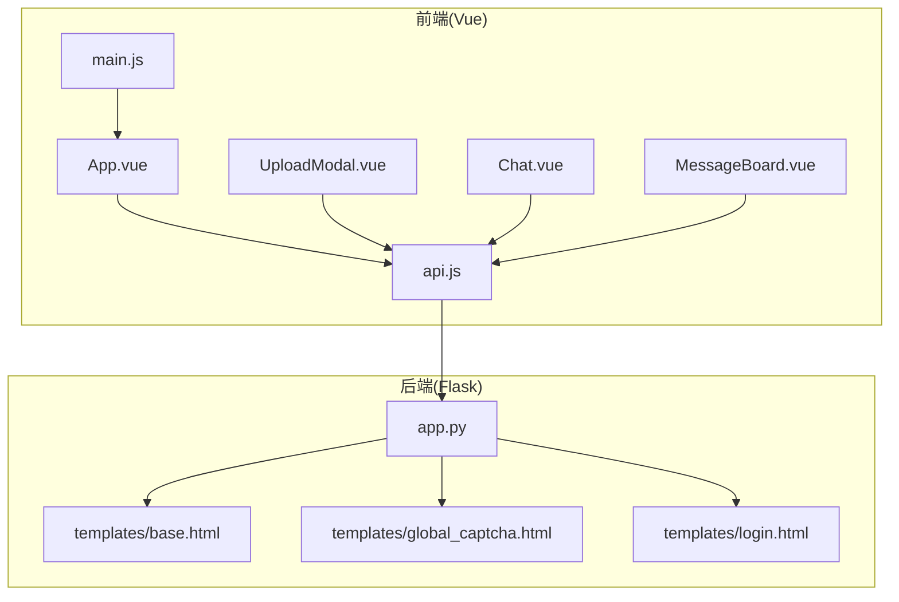
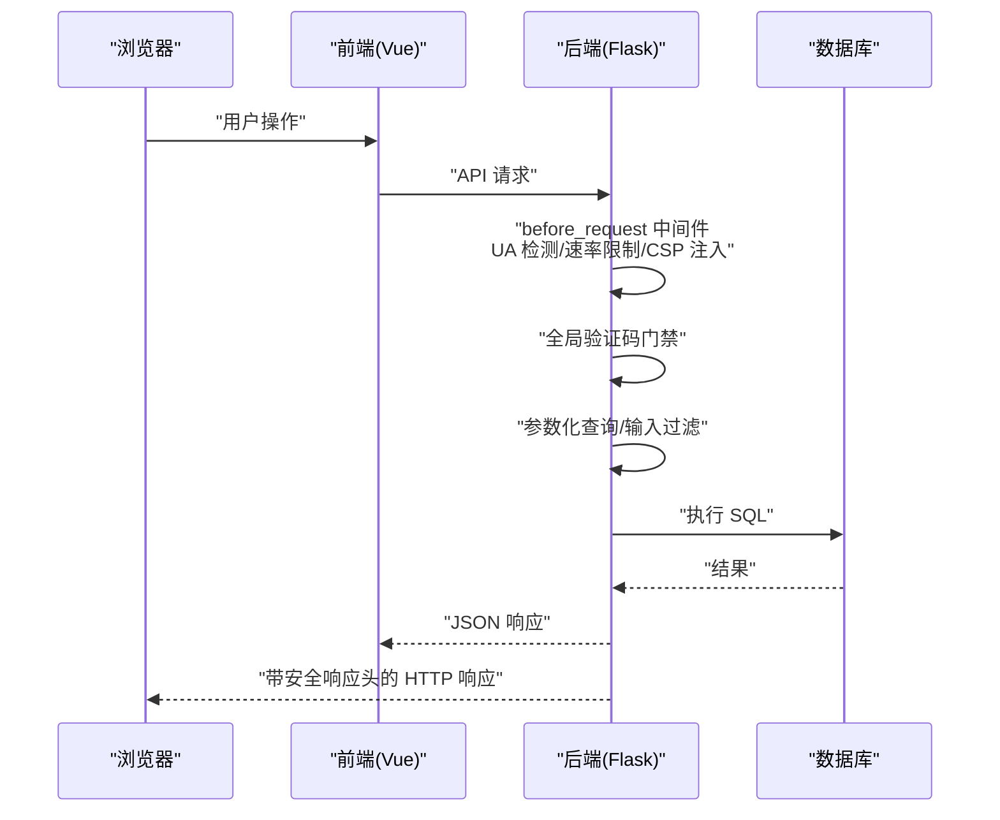
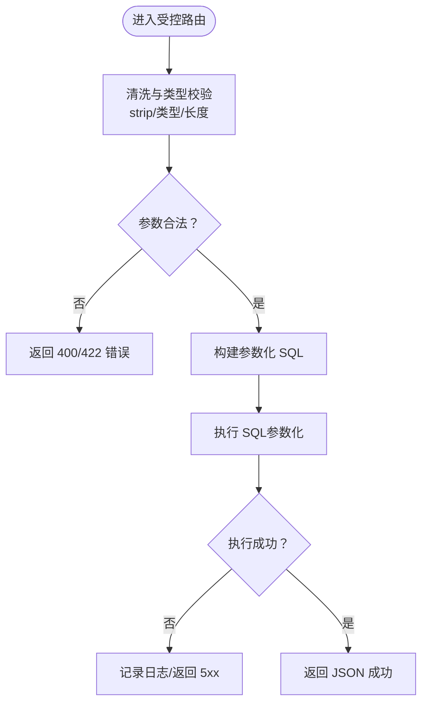
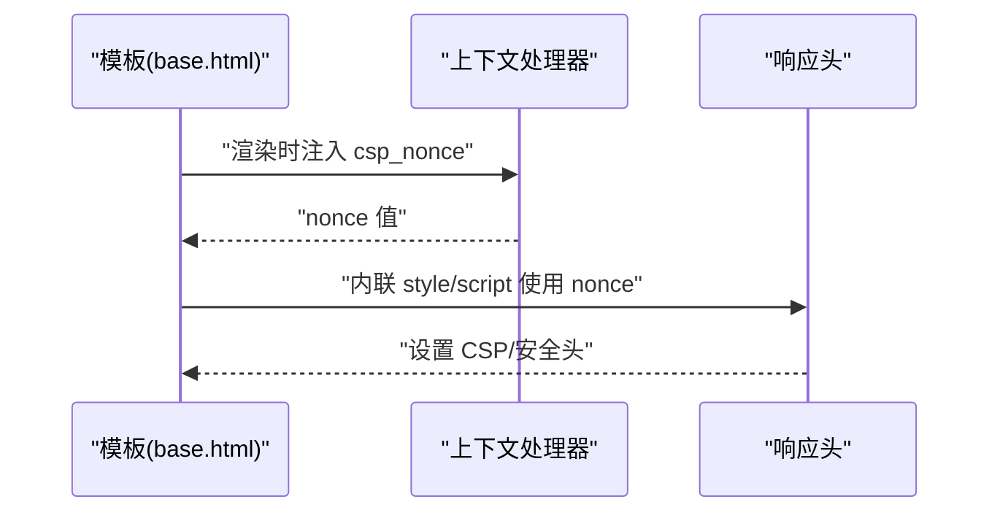
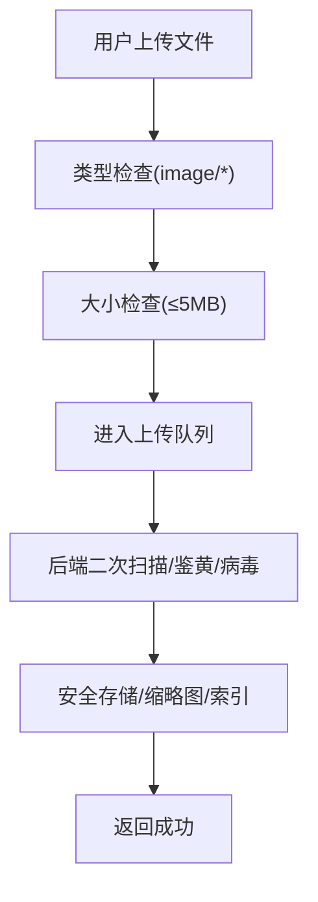
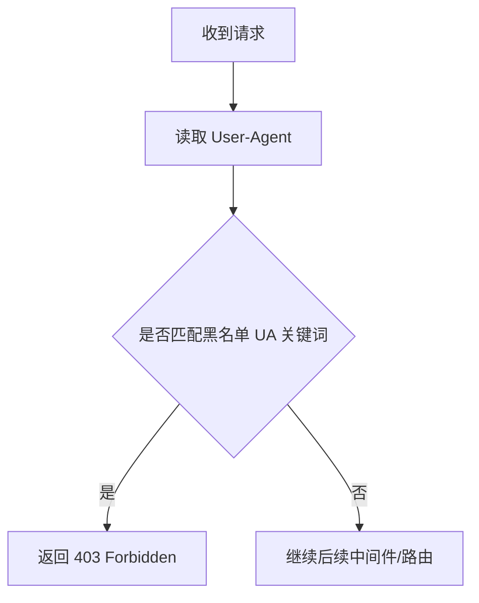
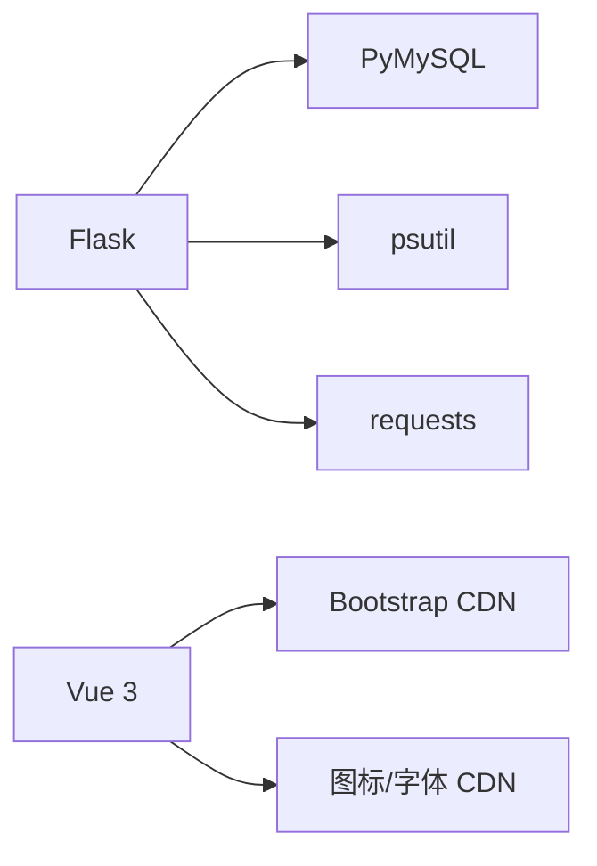

# 输入验证与清理

<cite>
**本文引用的文件**
- [app.py](file://app.py)
- [templates/base.html](file://templates/base.html)
- [templates/global_captcha.html](file://templates/global_captcha.html)
- [templates/login.html](file://templates/login.html)
- [frontend/src/api.js](file://frontend/src/api.js)
- [frontend/src/main.js](file://frontend/src/main.js)
- [frontend/src/App.vue](file://frontend/src/App.vue)
- [frontend/src/components/UploadModal.vue](file://frontend/src/components/UploadModal.vue)
- [frontend/src/components/MessageBoard.vue](file://frontend/src/components/MessageBoard.vue)
- [frontend/src/components/Chat.vue](file://frontend/src/components/Chat.vue)
- [requirements.txt](file://requirements.txt)
</cite>

## 目录
1. [简介](#简介)
2. [项目结构](#项目结构)
3. [核心组件](#核心组件)
4. [架构总览](#架构总览)
5. [详细组件分析](#详细组件分析)
6. [依赖分析](#依赖分析)
7. [性能考虑](#性能考虑)
8. [故障排查指南](#故障排查指南)
9. [结论](#结论)
10. [附录](#附录)

## 简介
本文件系统性梳理本项目的输入验证与清理策略，围绕以下目标展开：
- SQL 注入防护：参数化查询、输入过滤、数据库访问控制
- XSS 防护：输出编码、内容安全策略（CSP）、安全响应头
- 恶意内容过滤：文件上传安全、URL 验证、特殊字符处理
- 用户代理过滤：安全扫描器检测与阻断策略
- 输入验证最佳实践：前端验证、后端验证、双重验证机制
- 常见攻击向量分析与防护实施指南

## 项目结构
本项目采用前后端分离架构：
- 后端基于 Flask，提供 REST API 与模板渲染，集中实现安全中间件、速率限制、CSP 注入、安全响应头等
- 前端基于 Vue 3，通过统一 API 封装进行数据交互，部分组件内置基础输入约束（如文件类型、大小）

图表来源
- [frontend/src/main.js:1-6](file://frontend/src/main.js#L1-L6)
- [frontend/src/App.vue:1-99](file://frontend/src/App.vue#L1-L99)
- [frontend/src/api.js:1-45](file://frontend/src/api.js#L1-L45)
- [frontend/src/components/UploadModal.vue:1-116](file://frontend/src/components/UploadModal.vue#L1-L116)
- [frontend/src/components/Chat.vue:1-214](file://frontend/src/components/Chat.vue#L1-L214)
- [frontend/src/components/MessageBoard.vue:1-80](file://frontend/src/components/MessageBoard.vue#L1-L80)
- [app.py:119-194](file://app.py#L119-L194)
- [templates/base.html:1-337](file://templates/base.html#L1-L337)
- [templates/global_captcha.html:1-23](file://templates/global_captcha.html#L1-L23)
- [templates/login.html:1-37](file://templates/login.html#L1-L37)

章节来源
- [frontend/src/main.js:1-6](file://frontend/src/main.js#L1-L6)
- [frontend/src/App.vue:1-99](file://frontend/src/App.vue#L1-L99)
- [frontend/src/api.js:1-45](file://frontend/src/api.js#L1-L45)
- [app.py:119-194](file://app.py#L119-L194)

## 核心组件
- 安全中间件与响应头：统一注入 CSP、XSS/ClickJacking/嗅探防护、Referrer-Policy、HSTS（生产环境）、Permissions-Policy
- 用户代理过滤：拦截常见安全扫描器 UA
- 速率限制与 IP 白名单：内存+文件持久化的速率限制，支持手动封禁与探测封禁延长
- 全站验证码门禁：登录态下对非免检路径进行验证码二次验证
- 数据库访问：参数化查询与表初始化逻辑
- 前端输入约束：文件类型、大小限制与基础输入长度限制

章节来源
- [app.py:141-156](file://app.py#L141-L156)
- [app.py:348-412](file://app.py#L348-L412)
- [app.py:596-622](file://app.py#L596-L622)
- [app.py:641-676](file://app.py#L641-L676)
- [frontend/src/components/UploadModal.vue:61-79](file://frontend/src/components/UploadModal.vue#L61-L79)

## 架构总览
整体安全控制流如下：

图表来源
- [app.py:149-156](file://app.py#L149-L156)
- [app.py:513-593](file://app.py#L513-L593)
- [app.py:596-622](file://app.py#L596-L622)
- [app.py:641-676](file://app.py#L641-L676)
- [frontend/src/api.js:1-45](file://frontend/src/api.js#L1-L45)

## 详细组件分析

### 1) SQL 注入防护
- 参数化查询
  - 使用占位符与参数元组执行 SQL，避免字符串拼接
  - 示例路径：[app.py:202-209](file://app.py#L202-L209)
- 输入过滤与清洗
  - 对表单字段进行 strip、类型校验与长度限制
  - 示例路径：[app.py:1033-1034](file://app.py#L1033-L1034)，[app.py:1136-1137](file://app.py#L1136-L1137)
- 数据库访问控制
  - 仅在必要时连接数据库，异常捕获避免泄露细节
  - 示例路径：[app.py:680-692](file://app.py#L680-L692)

图表来源
- [app.py:1033-1034](file://app.py#L1033-L1034)
- [app.py:202-209](file://app.py#L202-L209)

章节来源
- [app.py:202-209](file://app.py#L202-L209)
- [app.py:1033-1034](file://app.py#L1033-L1034)
- [app.py:680-692](file://app.py#L680-L692)

### 2) XSS 防护
- 输出编码与 CSP
  - 模板中通过 nonce 为内联样式/脚本注入，CSP 禁止 unsafe-inline（除必要处）
  - 示例路径：[templates/base.html:8](file://templates/base.html#L8)，[templates/base.html:233](file://templates/base.html#L233)，[templates/base.html:333](file://templates/base.html#L333)
  - 后端注入 nonce 并设置 CSP：[app.py:158-178](file://app.py#L158-L178)，[app.py:641-676](file://app.py#L641-L676)
- 安全响应头
  - X-Content-Type-Options、X-Frame-Options、X-XSS-Protection、Referrer-Policy、HSTS（生产）、Permissions-Policy
  - 示例路径：[app.py:641-676](file://app.py#L641-L676)

图表来源
- [templates/base.html:8](file://templates/base.html#L8)
- [templates/base.html:233](file://templates/base.html#L233)
- [templates/base.html:333](file://templates/base.html#L333)
- [app.py:158-178](file://app.py#L158-L178)
- [app.py:641-676](file://app.py#L641-L676)

章节来源
- [templates/base.html:8](file://templates/base.html#L8)
- [templates/base.html:233](file://templates/base.html#L233)
- [templates/base.html:333](file://templates/base.html#L333)
- [app.py:158-178](file://app.py#L158-L178)
- [app.py:641-676](file://app.py#L641-L676)

### 3) 恶意内容过滤
- 文件上传安全
  - 前端限制文件类型与大小，避免超大/非图片文件进入后端
  - 示例路径：[frontend/src/components/UploadModal.vue:61-79](file://frontend/src/components/UploadModal.vue#L61-L79)
  - 后端建议：结合白名单扩展名、MIME 检测、缩略图生成、存储隔离与访问控制
- URL 验证与特殊字符处理
  - 对用户输入进行 strip、长度限制与类型校验
  - 示例路径：[app.py:1136-1137](file://app.py#L1136-L1137)
- 全局验证码门禁
  - 非免检路径在登录态下要求二次验证码，防止自动化攻击
  - 示例路径：[app.py:596-622](file://app.py#L596-L622)，[templates/global_captcha.html:1-23](file://templates/global_captcha.html#L1-L23)

图表来源
- [frontend/src/components/UploadModal.vue:61-79](file://frontend/src/components/UploadModal.vue#L61-L79)
- [app.py:596-622](file://app.py#L596-L622)

章节来源
- [frontend/src/components/UploadModal.vue:61-79](file://frontend/src/components/UploadModal.vue#L61-L79)
- [app.py:596-622](file://app.py#L596-L622)
- [templates/global_captcha.html:1-23](file://templates/global_captcha.html#L1-L23)

### 4) 用户代理过滤
- 安全扫描器检测与阻断
  - 拦截包含特定关键词的 UA，直接返回 403
  - 示例路径：[app.py:141-156](file://app.py#L141-L156)

图表来源
- [app.py:141-156](file://app.py#L141-L156)

章节来源
- [app.py:141-156](file://app.py#L141-L156)

### 5) 输入验证最佳实践
- 前端验证
  - 文件上传：类型、大小限制
  - 文本输入：长度限制与必填提示
  - 示例路径：[frontend/src/components/UploadModal.vue:61-79](file://frontend/src/components/UploadModal.vue#L61-L79)，[frontend/src/components/Chat.vue:49](file://frontend/src/components/Chat.vue#L49)
- 后端验证
  - 类型校验、长度限制、空值处理、参数化查询
  - 示例路径：[app.py:1033-1034](file://app.py#L1033-L1034)，[app.py:202-209](file://app.py#L202-L209)
- 双重验证机制
  - 全局验证码门禁 + 登录态 + CSRF Token + 速率限制
  - 示例路径：[app.py:596-622](file://app.py#L596-L622)，[templates/login.html:1-37](file://templates/login.html#L1-L37)

章节来源
- [frontend/src/components/UploadModal.vue:61-79](file://frontend/src/components/UploadModal.vue#L61-L79)
- [frontend/src/components/Chat.vue:49](file://frontend/src/components/Chat.vue#L49)
- [app.py:1033-1034](file://app.py#L1033-L1034)
- [app.py:202-209](file://app.py#L202-L209)
- [app.py:596-622](file://app.py#L596-L622)
- [templates/login.html:1-37](file://templates/login.html#L1-L37)

### 6) 常见攻击向量与防护
- SQL 注入
  - 防护：参数化查询、输入清洗、最小权限数据库账户
  - 参考路径：[app.py:202-209](file://app.py#L202-L209)
- XSS
  - 防护：CSP nonce、安全响应头、模板输出安全
  - 参考路径：[app.py:641-676](file://app.py#L641-L676)，[templates/base.html:8](file://templates/base.html#L8)
- CSRF
  - 防护：CSRF Token 注入与校验
  - 参考路径：[templates/login.html:8-9](file://templates/login.html#L8-L9)，[app.py:925](file://app.py#L925)
- 速率限制与暴力破解
  - 防护：内存+文件持久化速率限制、白名单、手动封禁、登录失败锁定
  - 参考路径：[app.py:348-412](file://app.py#L348-L412)，[app.py:504-506](file://app.py#L504-L506)
- 文件上传滥用
  - 防护：类型/大小限制、后端二次扫描、存储隔离
  - 参考路径：[frontend/src/components/UploadModal.vue:61-79](file://frontend/src/components/UploadModal.vue#L61-L79)

章节来源
- [app.py:202-209](file://app.py#L202-L209)
- [app.py:641-676](file://app.py#L641-L676)
- [templates/base.html:8](file://templates/base.html#L8)
- [templates/login.html:8-9](file://templates/login.html#L8-L9)
- [app.py:925](file://app.py#L925)
- [app.py:348-412](file://app.py#L348-L412)
- [app.py:504-506](file://app.py#L504-L506)
- [frontend/src/components/UploadModal.vue:61-79](file://frontend/src/components/UploadModal.vue#L61-L79)

## 依赖分析
- 后端依赖
  - Flask、PyMySQL、psutil、requests
  - 示例路径：[requirements.txt:1-5](file://requirements.txt#L1-L5)
- 前端依赖
  - Vue 3、Bootstrap CDN、字体/图标 CDN
  - 示例路径：[frontend/src/main.js:1-6](file://frontend/src/main.js#L1-L6)，[templates/base.html:7](file://templates/base.html#L7)

图表来源
- [requirements.txt:1-5](file://requirements.txt#L1-L5)
- [frontend/src/main.js:1-6](file://frontend/src/main.js#L1-L6)
- [templates/base.html:7](file://templates/base.html#L7)

章节来源
- [requirements.txt:1-5](file://requirements.txt#L1-L5)
- [frontend/src/main.js:1-6](file://frontend/src/main.js#L1-L6)
- [templates/base.html:7](file://templates/base.html#L7)

## 性能考虑
- 速率限制
  - 内存队列 + 文件持久化，降低频繁写盘开销
  - 建议：根据业务峰值调优窗口与上限，避免误伤正常用户
- CSP 注入
  - 每请求生成 nonce，建议在高并发场景评估模板渲染成本
- 文件上传
  - 前端预校验减少无效请求；后端建议异步处理与磁盘配额限制

## 故障排查指南
- 验证码相关
  - 现象：无法通过验证码门禁
  - 排查：确认会话中验证码状态、全局验证码开关、请求方法与表单字段
  - 参考路径：[app.py:596-622](file://app.py#L596-L622)，[templates/global_captcha.html:1-23](file://templates/global_captcha.html#L1-L23)
- 速率限制
  - 现象：频繁 429/403
  - 排查：检查 IP 是否在封禁列表、白名单、试探次数触发延长
  - 参考路径：[app.py:513-593](file://app.py#L513-L593)
- 安全响应头缺失
  - 现象：CSP 或安全头未生效
  - 排查：确认 after_request 中间件执行顺序、模板是否注入 nonce
  - 参考路径：[app.py:641-676](file://app.py#L641-L676)，[templates/base.html:8](file://templates/base.html#L8)
- 登录失败锁定
  - 现象：登录频繁失败被锁定
  - 排查：检查登录锁表与重置逻辑
  - 参考路径：[app.py:504-506](file://app.py#L504-L506)

章节来源
- [app.py:596-622](file://app.py#L596-L622)
- [templates/global_captcha.html:1-23](file://templates/global_captcha.html#L1-L23)
- [app.py:513-593](file://app.py#L513-L593)
- [app.py:641-676](file://app.py#L641-L676)
- [templates/base.html:8](file://templates/base.html#L8)
- [app.py:504-506](file://app.py#L504-L506)

## 结论
本项目在安全层面已具备较为完善的输入验证与清理策略：
- 后端通过参数化查询、输入清洗、CSP 注入与安全响应头有效降低 SQL 注入与 XSS 风险
- 前端在上传与输入层面提供基础约束，配合后端二次验证形成“双重保险”
- 速率限制、UA 黑名单与验证码门禁共同抵御自动化攻击与暴力破解
建议后续在文件上传环节引入更严格的后端扫描与访问控制，并持续优化 CSP 与速率限制策略以平衡安全与体验。

## 附录
- API 调用示例（路径）
  - [frontend/src/api.js:1-45](file://frontend/src/api.js#L1-L45)
- 应用入口与上下文
  - [frontend/src/main.js:1-6](file://frontend/src/main.js#L1-L6)
  - [app.py:119-194](file://app.py#L119-L194)