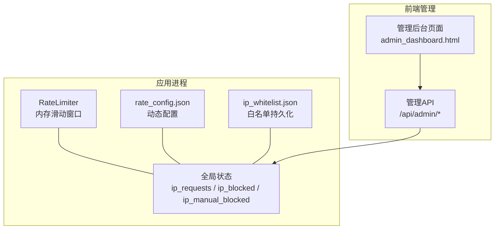
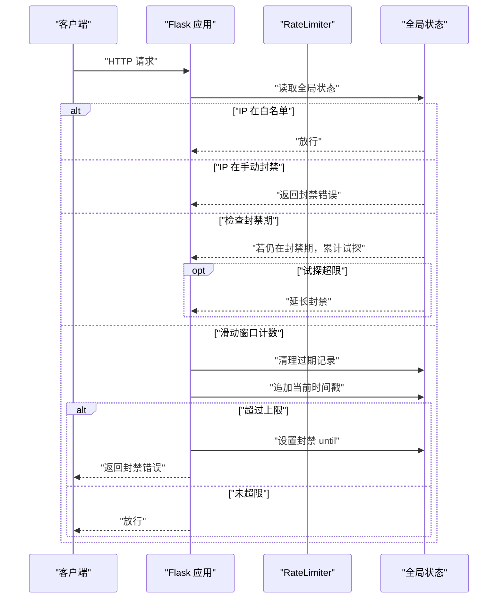
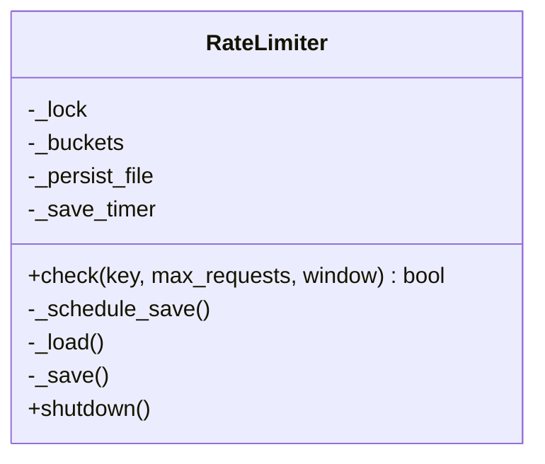
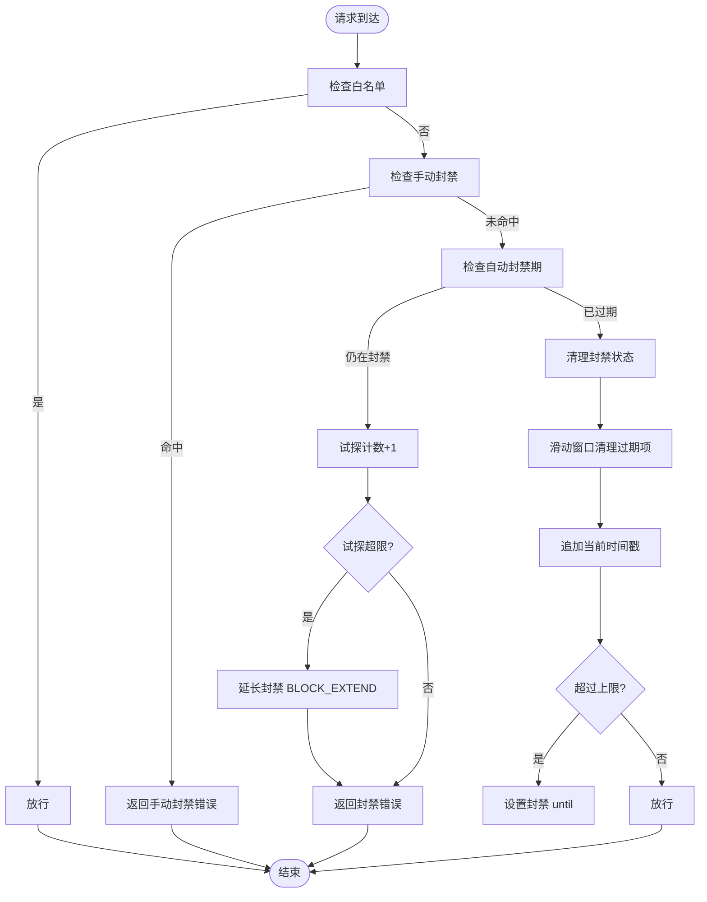
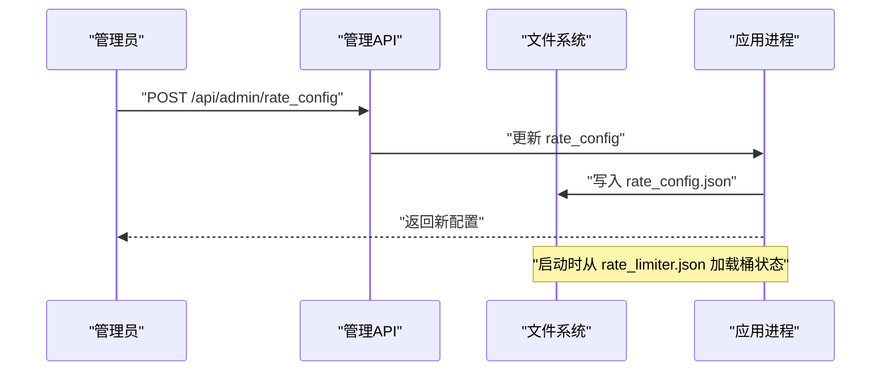
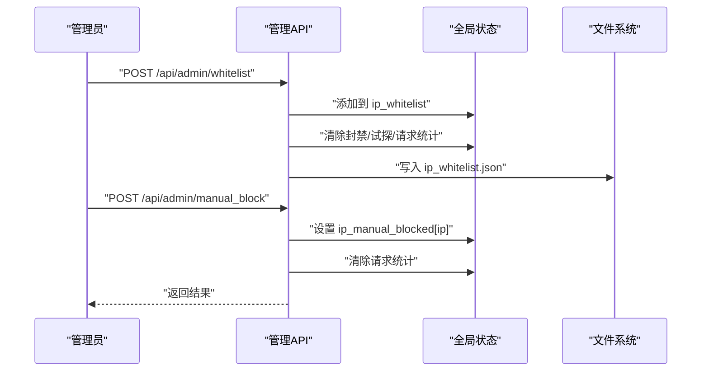

# 速率限制实现

<cite>
**本文引用的文件**
- [app.py](file://app.py)
- [rate_limiter.json](file://rate_limiter.json)
</cite>

## 目录
1. [简介](#简介)
2. [项目结构](#项目结构)
3. [核心组件](#核心组件)
4. [架构总览](#架构总览)
5. [详细组件分析](#详细组件分析)
6. [依赖分析](#依赖分析)
7. [性能考虑](#性能考虑)
8. [故障排除指南](#故障排除指南)
9. [结论](#结论)
10. [附录](#附录)

## 简介
本文件面向“速率限制实现”的技术文档，聚焦于本仓库中的内存速率限制器与配套的白名单、手动封禁、动态配置与持久化策略。内容涵盖：
- 内存速率限制器设计：滑动窗口算法、桶容量管理、并发控制
- 持久化配置策略：配置文件格式、动态更新与故障恢复
- 白名单机制：IP 白名单管理、手动封禁、权限控制
- 封禁策略：封禁时长计算、试探检测与自动解封
- 配置指南：参数调优、性能优化与监控告警
- 实际部署案例与故障排除

## 项目结构
本项目的速率限制相关实现集中在后端应用文件中，主要涉及：
- 内存速率限制器类与全局状态
- 速率限制配置文件与动态更新
- 白名单与手动封禁的管理接口
- 前端管理界面与实时统计展示



图表来源
- [app.py:31-116](file://app.py#L31-L116)
- [app.py:349-382](file://app.py#L349-L382)
- [app.py:391-412](file://app.py#L391-L412)
- [templates/admin_dashboard.html:106-234](file://templates/admin_dashboard.html#L106-L234)

章节来源
- [app.py:31-116](file://app.py#L31-L116)
- [app.py:349-382](file://app.py#L349-L382)
- [app.py:391-412](file://app.py#L391-L412)
- [templates/admin_dashboard.html:106-234](file://templates/admin_dashboard.html#L106-L234)

## 核心组件
- 内存速率限制器（RateLimiter）
  - 基于滑动窗口的内存计数器，支持键级（如 IP+路由）维度
  - 去抖保存：定期合并写入，降低磁盘压力
  - 启动时从持久化文件恢复历史状态
- 全局速率限制与封禁
  - 基于 deque 的滑动窗口计数
  - 超限时触发封禁，支持试探检测与封禁延长
  - 白名单优先放行，手动封禁即时生效
- 动态配置与持久化
  - rate_config.json：窗口、上限、封禁时长、试探阈值、追加封禁等
  - ip_whitelist.json：白名单持久化
  - rate_limiter.json：轻量内存桶的持久化（用于重启不丢失）

章节来源
- [app.py:31-116](file://app.py#L31-L116)
- [app.py:349-382](file://app.py#L349-L382)
- [app.py:391-412](file://app.py#L391-L412)
- [rate_limiter.json:1-1](file://rate_limiter.json#L1-L1)

## 架构总览
整体流程：每次请求进入 before_request，先检查白名单/手动封禁，再检查全局滑动窗口，超限则封禁并记录最近封禁。



图表来源
- [app.py:513-562](file://app.py#L513-L562)

章节来源
- [app.py:513-562](file://app.py#L513-L562)

## 详细组件分析

### 内存速率限制器（RateLimiter）
- 设计要点
  - 每个键维护一个时间戳列表（滑动窗口）
  - 每次检查清理过期项，判断是否超限
  - 使用线程锁保护共享状态
  - 去抖保存：2 秒内多次变更合并一次落盘
- 数据结构与复杂度
  - 每键 O(n) 清理过期项（n 为窗口内请求数）
  - 平均 O(1) 检查（窗口较小且清理在前）
- 并发控制
  - 采用 Lock 保护 _buckets 与保存流程
  - 保存定时器避免并发写冲突
- 持久化策略
  - 启动时从文件加载，过滤过期项
  - 关闭时强制保存，保证不丢数据



图表来源
- [app.py:31-116](file://app.py#L31-L116)

章节来源
- [app.py:31-116](file://app.py#L31-L116)

### 全局滑动窗口与封禁逻辑
- 滑动窗口
  - 使用 deque 存储当前窗口内的请求时间戳
  - 每次请求清理过期项，追加当前时间戳
- 封禁策略
  - 超限时设置 ip_blocked[ip] = now + BLOCK_DURATION
  - 封禁期内试探次数超过阈值则延长 BLOCK_EXTEND
  - 封禁到期自动清理
- 白名单与手动封禁
  - 白名单 IP 直接放行
  - 手动封禁即时生效，优先级高于自动封禁



图表来源
- [app.py:513-562](file://app.py#L513-L562)

章节来源
- [app.py:513-562](file://app.py#L513-L562)

### 动态配置与持久化
- 配置文件
  - rate_config.json：包含 RATE_LIMIT、RATE_WINDOW、BLOCK_DURATION、BLOCK_PROBE_LIMIT、BLOCK_EXTEND
  - 启动时加载，缺失字段使用默认值回退
- 配置更新
  - 管理员可通过 API 修改配置并持久化
  - 参数校验：必须为正整数
- 白名单持久化
  - ip_whitelist.json：保存白名单集合
  - 加载时去重，保存时排序输出
- 内存桶持久化
  - rate_limiter.json：保存每个键的时间戳列表
  - 启动时仅加载 65 秒内的记录，避免过期数据影响



图表来源
- [app.py:359-382](file://app.py#L359-L382)
- [app.py:4265-4284](file://app.py#L4265-L4284)

章节来源
- [app.py:359-382](file://app.py#L359-L382)
- [app.py:4265-4284](file://app.py#L4265-L4284)
- [rate_limiter.json:1-1](file://rate_limiter.json#L1-L1)

### 白名单与手动封禁管理
- 白名单
  - 支持单个添加、批量导入、删除
  - 添加时自动清除该 IP 的封禁状态
  - 保存至 ip_whitelist.json
- 手动封禁
  - 支持指定时长（秒），默认 1 小时
  - 不能对白名单 IP 进行手动封禁
  - 封禁时清除该 IP 的请求统计
- 权限控制
  - 仅管理员可进行白名单与封禁操作



图表来源
- [app.py:4154-4207](file://app.py#L4154-L4207)
- [app.py:4210-4255](file://app.py#L4210-L4255)

章节来源
- [app.py:4154-4207](file://app.py#L4154-L4207)
- [app.py:4210-4255](file://app.py#L4210-L4255)

### 前端管理与可视化
- 管理后台页面提供：
  - 白名单管理与批量操作
  - 手动封禁与批量封禁
  - 速率限制配置修改
  - IP 请求监控与统计
- 前端通过 AJAX 调用管理 API，周期性刷新数据

章节来源
- [templates/admin_dashboard.html:106-234](file://templates/admin_dashboard.html#L106-L234)

## 依赖分析
- 组件耦合
  - 全局状态与 before_request 流程强耦合，确保每次请求都受控
  - 管理 API 与全局状态直接交互，权限控制在路由装饰器中实现
- 外部依赖
  - 文件系统：持久化配置与白名单
  - 网络请求：IP 地理位置查询（用于可视化）
- 潜在风险
  - 单进程内存状态：重启后依赖持久化恢复
  - 去抖保存可能延迟最新状态写入

```mermaid
graph LR
A["before_request"] --> B["全局状态检查"]
B --> C["RateLimiter.check()"]
B --> D["白名单/手动封禁"]
E["管理API"] --> B
F["持久化文件"] <- --> B
```

图表来源
- [app.py:513-562](file://app.py#L513-L562)
- [app.py:4154-4207](file://app.py#L4154-L4207)

章节来源
- [app.py:513-562](file://app.py#L513-L562)
- [app.py:4154-4207](file://app.py#L4154-L4207)

## 性能考虑
- 时间复杂度
  - 每请求 O(n)（n 为窗口内请求数），建议合理设置窗口与上限
- 内存占用
  - 每个 IP 的 deque 与字典项随并发与窗口大小增长
- 并发安全
  - 使用线程锁保护全局状态，避免竞态
- I/O 优化
  - 去抖保存减少磁盘写入频率
- 建议
  - 对高并发场景可考虑：
    - 使用分布式缓存（如 Redis）替代内存状态
    - 将白名单与封禁状态持久化到数据库
    - 引入限流算法变体（令牌桶/漏桶）以提升吞吐

## 故障排除指南
- 问题：请求频繁被封禁
  - 检查 rate_config.json 的 RATE_LIMIT 与 RATE_WINDOW 是否过小
  - 查看封禁期剩余时间与试探计数
  - 确认是否误触白名单或手动封禁
- 问题：重启后封禁状态丢失
  - 确认 rate_limiter.json 是否存在且可读
  - 检查保存定时器是否被取消（优雅关闭时会强制保存）
- 问题：白名单无效
  - 确认 ip_whitelist.json 是否正确写入
  - 检查是否同时处于手动封禁状态
- 问题：配置修改未生效
  - 确认 /api/admin/rate_config 返回成功
  - 检查 rate_config.json 写入权限
- 问题：前端无法加载管理数据
  - 检查管理员登录状态与权限
  - 确认 /api/admin/ip_stats 等接口可用

章节来源
- [app.py:513-562](file://app.py#L513-L562)
- [app.py:359-382](file://app.py#L359-L382)
- [app.py:4154-4207](file://app.py#L4154-L4207)

## 结论
本实现以轻量内存状态为核心，结合滑动窗口与去抖保存，提供了可配置、可持久化的速率限制能力。通过白名单与手动封禁增强运营灵活性，配合管理后台实现动态治理。对于更高并发与跨节点部署，建议引入分布式存储与更复杂的限流算法。

## 附录

### 配置参数说明
- RATE_LIMIT：时间窗口内的最大请求数
- RATE_WINDOW：窗口时长（秒）
- BLOCK_DURATION：封禁时长（秒）
- BLOCK_PROBE_LIMIT：封禁期间试探阈值
- BLOCK_EXTEND：试探超限后追加封禁（秒）

章节来源
- [app.py:352-358](file://app.py#L352-L358)
- [app.py:359-382](file://app.py#L359-L382)

### 配置文件示例路径
- rate_config.json：存放速率限制动态配置
- ip_whitelist.json：存放白名单
- rate_limiter.json：存放内存桶的历史状态

章节来源
- [app.py:349-350](file://app.py#L349-L350)
- [app.py:391-392](file://app.py#L391-L392)
- [rate_limiter.json:1-1](file://rate_limiter.json#L1-L1)