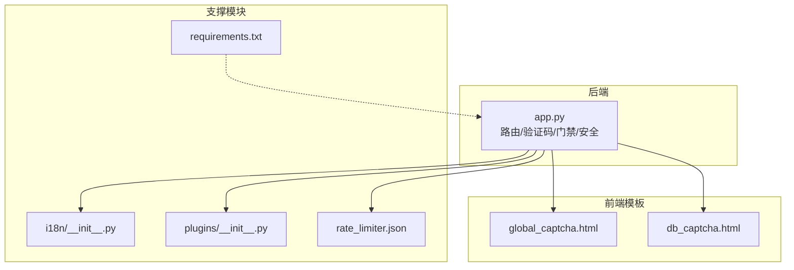
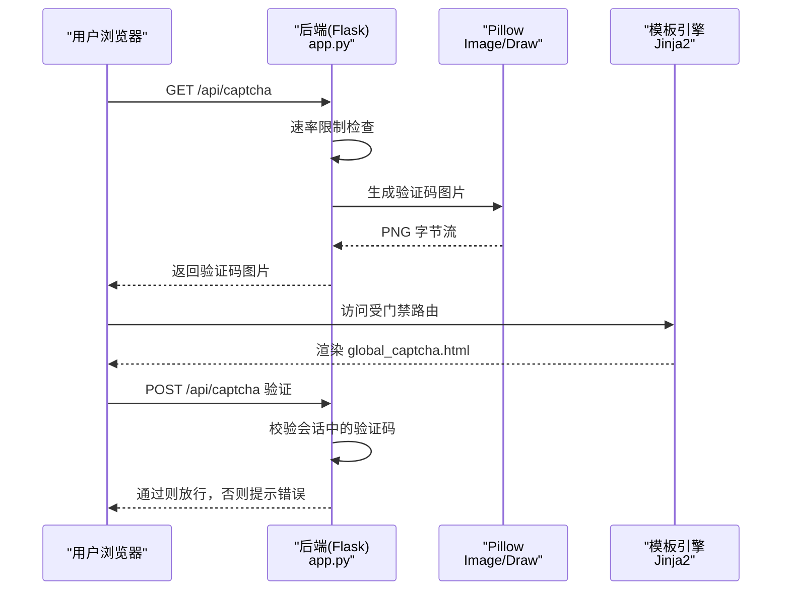
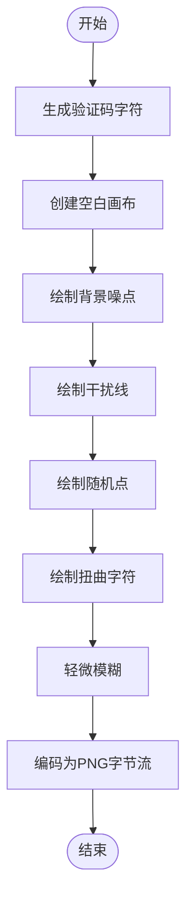
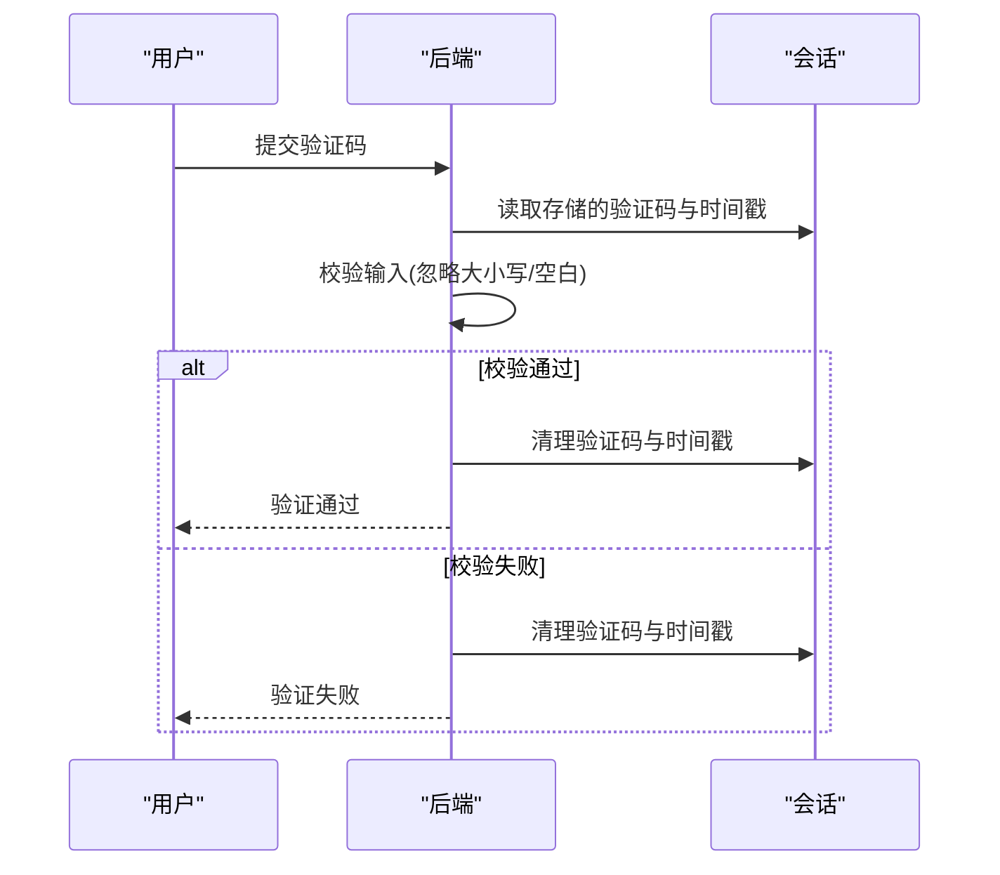
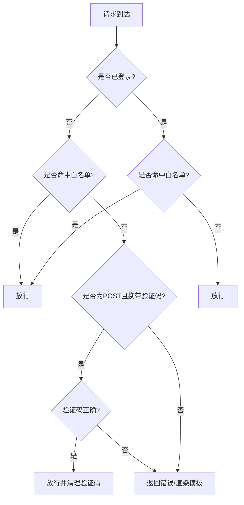
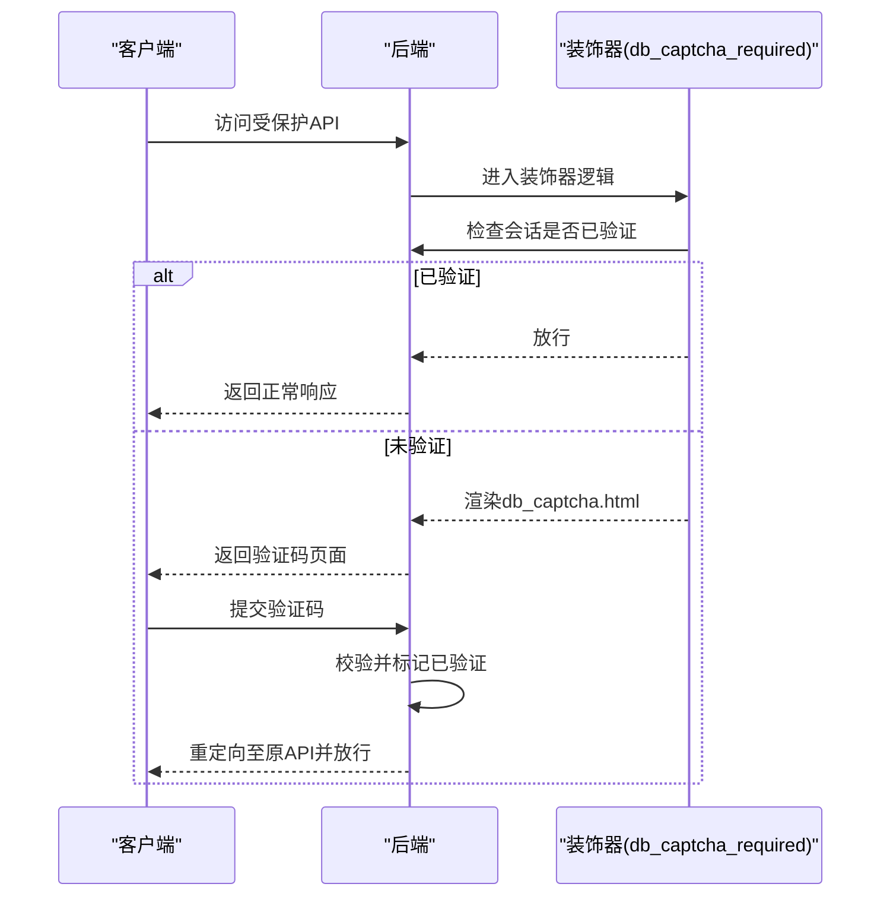
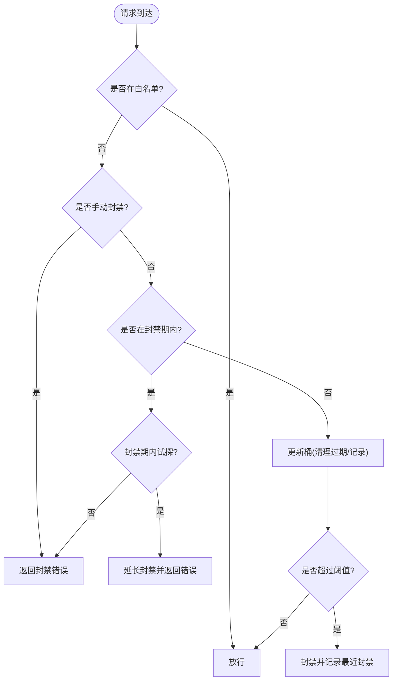
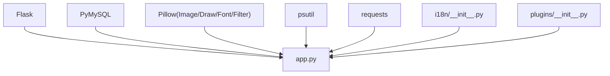

# 验证码系统

<cite>
**本文档引用的文件**
- [app.py](file://app.py)
- [templates/global_captcha.html](file://templates/global_captcha.html)
- [templates/db_captcha.html](file://templates/db_captcha.html)
- [i18n/__init__.py](file://i18n/__init__.py)
- [plugins/__init__.py](file://plugins/__init__.py)
- [requirements.txt](file://requirements.txt)
- [rate_limiter.json](file://rate_limiter.json)
</cite>

## 目录
1. [简介](#简介)
2. [项目结构](#项目结构)
3. [核心组件](#核心组件)
4. [架构总览](#架构总览)
5. [详细组件分析](#详细组件分析)
6. [依赖关系分析](#依赖关系分析)
7. [性能考虑](#性能考虑)
8. [故障排查指南](#故障排查指南)
9. [结论](#结论)
10. [附录](#附录)

## 简介
本文件面向验证码系统的开发者与运维人员，系统性阐述图形验证码生成算法、验证流程、全局验证码门禁、安全策略与部署实践。内容基于仓库中的实际实现进行提炼与可视化，帮助读者快速理解并安全地集成与优化验证码能力。

## 项目结构
验证码系统主要位于后端应用文件中，前端模板负责展示与交互，国际化与插件系统提供扩展能力。关键文件与职责如下：
- 后端核心：app.py（路由、验证码生成与验证、全局门禁、速率限制、安全响应头等）
- 前端模板：templates/global_captcha.html、templates/db_captcha.html（验证码门禁与二次验证界面）
- 国际化：i18n/__init__.py（多语言支持）
- 插件系统：plugins/__init__.py（动态扩展能力）
- 依赖声明：requirements.txt（运行环境依赖）
- 速率限制持久化：rate_limiter.json（内存速率限制的文件持久化）

**图表来源**
- [app.py](file://app.py)
- [templates/global_captcha.html](file://templates/global_captcha.html)
- [templates/db_captcha.html](file://templates/db_captcha.html)
- [i18n/__init__.py](file://i18n/__init__.py)
- [plugins/__init__.py](file://plugins/__init__.py)
- [requirements.txt](file://requirements.txt)
- [rate_limiter.json](file://rate_limiter.json)

**章节来源**
- [app.py](file://app.py)
- [templates/global_captcha.html](file://templates/global_captcha.html)
- [templates/db_captcha.html](file://templates/db_captcha.html)
- [i18n/__init__.py](file://i18n/__init__.py)
- [plugins/__init__.py](file://plugins/__init__.py)
- [requirements.txt](file://requirements.txt)
- [rate_limiter.json](file://rate_limiter.json)

## 核心组件
- 图形验证码生成与渲染：基于 Pillow 的验证码图片生成，包含字符选择、扭曲、干扰线与噪点、轻微模糊等防 OCR 技术。
- 验证码验证流程：会话存储验证码与时间戳，校验用户输入并清理会话，支持时效控制与错误处理。
- 全局验证码门禁：对未登录用户的特定路由进行验证码拦截，支持白名单与动态触发。
- 二次验证装饰器：针对数据库操作等敏感场景提供二次验证码保护。
- 速率限制与封禁：基于内存队列与文件持久化的速率限制，支持白名单、手动封禁与试探封禁延长。
- 安全响应头与会话绑定：统一的安全响应头、CSRF Token、会话超时与清理。

**章节来源**
- [app.py](file://app.py)
- [templates/global_captcha.html](file://templates/global_captcha.html)
- [templates/db_captcha.html](file://templates/db_captcha.html)

## 架构总览
验证码系统采用“后端生成 + 前端展示 + 会话校验”的轻量架构。后端提供 /api/captcha 接口生成图片，前端模板负责展示与提交；全局门禁与二次验证通过装饰器与 before_request 实现，结合速率限制与安全响应头形成完整的安全闭环。

**图表来源**
- [app.py](file://app.py)
- [templates/global_captcha.html](file://templates/global_captcha.html)

**章节来源**
- [app.py](file://app.py)
- [templates/global_captcha.html](file://templates/global_captcha.html)

## 详细组件分析

### 图形验证码生成算法
- 字符选择：从数字与字母集合中排除易混淆字符，生成固定长度的验证码。
- 图像渲染：创建背景、绘制少量噪点、添加曲线与短直线干扰、绘制扭曲字符、轻微高斯模糊。
- 输出控制：禁用缓存，确保每次请求生成新的验证码图片。

**图表来源**
- [app.py](file://app.py)

**章节来源**
- [app.py](file://app.py)

### 验证码验证流程
- 会话存储：生成验证码时写入 session 的验证码与时间戳。
- 校验逻辑：对比用户输入与会话值，忽略大小写与空白；失败时清理会话并返回错误。
- 时效控制：在修改密码等场景对验证码有效期进行严格校验。
- 错误处理：失败时清理会话，避免重复使用；前端模板展示错误提示。

**图表来源**
- [app.py](file://app.py)

**章节来源**
- [app.py](file://app.py)

### 全局验证码门禁系统
- 触发条件：未登录用户访问受保护路由时触发；已登录用户可通过白名单豁免。
- 白名单策略：硬编码的路由集合与前缀，支持静态资源、分享链接、部分 API 等。
- 动态验证：在 before_request 中根据路径判断是否需要验证码；POST 提交验证码后放行。
- 用户体验：在受保护 API 上直接返回 JSON 错误，在页面上渲染验证码模板。

**图表来源**
- [app.py](file://app.py)

**章节来源**
- [app.py](file://app.py)
- [templates/global_captcha.html](file://templates/global_captcha.html)

### 二次验证装饰器（数据库操作）
- 装饰器 db_captcha_required：对数据库查询、更新、删除等敏感 API 进行二次验证码保护。
- 行为：首次访问时渲染 db_captcha.html，提交正确验证码后在会话中标记已验证并放行。
- API 场景：当请求为 API 时返回 JSON 错误，引导前端处理。

**图表来源**
- [app.py](file://app.py)
- [templates/db_captcha.html](file://templates/db_captcha.html)

**章节来源**
- [app.py](file://app.py)
- [templates/db_captcha.html](file://templates/db_captcha.html)

### 速率限制与封禁策略
- 内存队列：按 IP 与路由维度维护时间戳队列，窗口内超过阈值即封禁。
- 文件持久化：RateLimiter 支持将桶状态持久化到文件，进程重启后可恢复。
- 白名单与手动封禁：白名单 IP 不参与限制；管理员可手动封禁并设置封禁时长。
- 试探封禁延长：封禁期内持续试探将追加封禁时长，提升抗探测能力。

**图表来源**
- [app.py](file://app.py)
- [rate_limiter.json](file://rate_limiter.json)

**章节来源**
- [app.py](file://app.py)
- [rate_limiter.json](file://rate_limiter.json)

### 安全响应头与会话绑定
- 安全响应头：X-Content-Type-Options、X-Frame-Options、X-XSS-Protection、Referrer-Policy、CSP、HSTS（生产环境）、Permissions-Policy 等。
- CSRF 保护：生成并校验 CSRF Token，非 GET 请求必须携带有效 Token。
- 会话超时：对已登录用户按 IP 维护最后活跃时间，超时则强制登出并清理会话。

**章节来源**
- [app.py](file://app.py)

## 依赖关系分析
- 运行时依赖：Flask、PyMySQL、psutil、requests。
- 图形验证码依赖：Pillow（Image/Draw/ImageFont/ImageFilter）。
- 国际化与插件：i18n 模块提供多语言支持；plugins 提供动态扩展能力。

**图表来源**
- [requirements.txt](file://requirements.txt)
- [app.py](file://app.py)
- [i18n/__init__.py](file://i18n/__init__.py)
- [plugins/__init__.py](file://plugins/__init__.py)

**章节来源**
- [requirements.txt](file://requirements.txt)
- [app.py](file://app.py)
- [i18n/__init__.py](file://i18n/__init__.py)
- [plugins/__init__.py](file://plugins/__init__.py)

## 性能考虑
- 验证码生成：Pillow 操作在内存中完成，建议在高并发场景下：
  - 使用进程池或异步框架（如 Gunicorn/uvicorn）提升吞吐。
  - 对验证码接口增加缓存层（如 Redis）以降低重复生成开销。
- 速率限制：内存队列适合单机场景；分布式部署建议使用 Redis 原生限流或集中式限流服务。
- 前端体验：验证码图片禁用缓存，避免浏览器复用；可在前端引入预加载与错误重试策略。
- 安全响应头：CSP 与 HSTS 会增加首包开销，建议在生产环境启用并配合 CDN 缓存静态资源。

## 故障排查指南
- 验证码无法显示或重复：检查 /api/captcha 的速率限制是否触发，确认会话中验证码与时间戳是否存在。
- 验证失败但提示验证码过期：检查验证码生成与校验的时间窗口逻辑，确认会话清理是否及时。
- 全局门禁误拦截：核对白名单路由与前缀配置，确认 before_request 的判断逻辑。
- 二次验证不生效：确认装饰器是否正确应用到目标路由，检查会话中的 db_captcha_verified 标志。
- 速率限制异常：检查 rate_limiter.json 的持久化文件是否可读写，确认封禁与试探逻辑是否符合预期。

**章节来源**
- [app.py](file://app.py)
- [templates/global_captcha.html](file://templates/global_captcha.html)
- [templates/db_captcha.html](file://templates/db_captcha.html)
- [rate_limiter.json](file://rate_limiter.json)

## 结论
本验证码系统通过“轻量生成 + 会话校验 + 全局门禁 + 二次验证 + 速率限制 + 安全响应头”构建了完整的安全防线。其设计兼顾易用性与安全性，适合在教育类平台等场景中部署与扩展。建议在生产环境中结合缓存与分布式限流、完善监控与告警，持续优化用户体验与安全强度。

## 附录

### 部署与配置要点
- 环境依赖：确保安装 requirements.txt 中的依赖。
- 会话与密钥：应用自动生成并持久化 SECRET_KEY，确保 HTTPS 环境下启用 Secure Cookie。
- 速率限制配置：通过管理端 API 动态调整窗口、阈值、封禁时长等参数，并持久化到 rate_config.json。
- 白名单与封禁：通过管理端 API 维护白名单与手动封禁，结合日志与通知机制进行审计。
- 监控与日志：利用系统监控 API 与日志文件，观察 CPU/内存/网络与封禁事件，及时发现异常。

**章节来源**
- [requirements.txt](file://requirements.txt)
- [app.py](file://app.py)