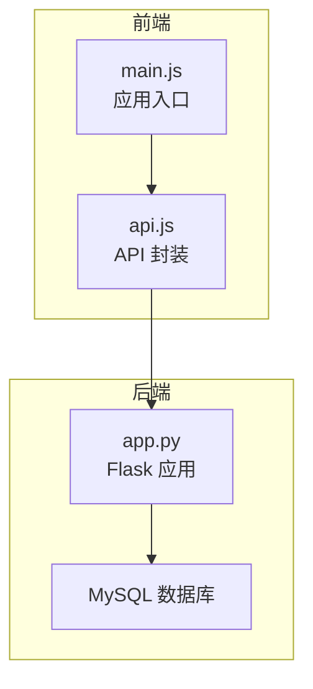
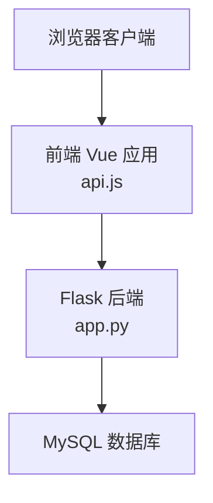
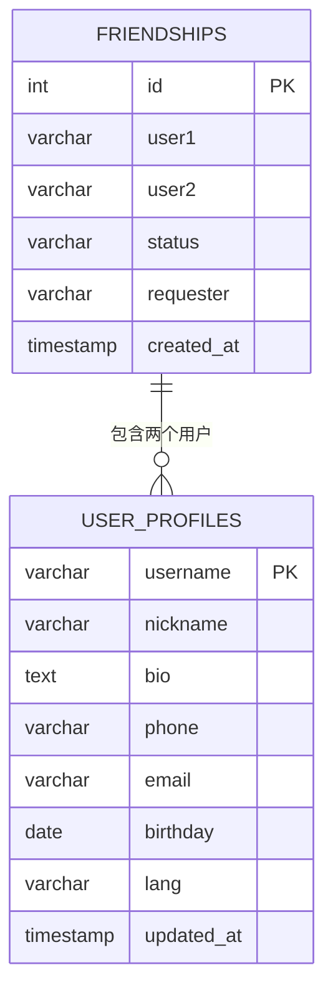
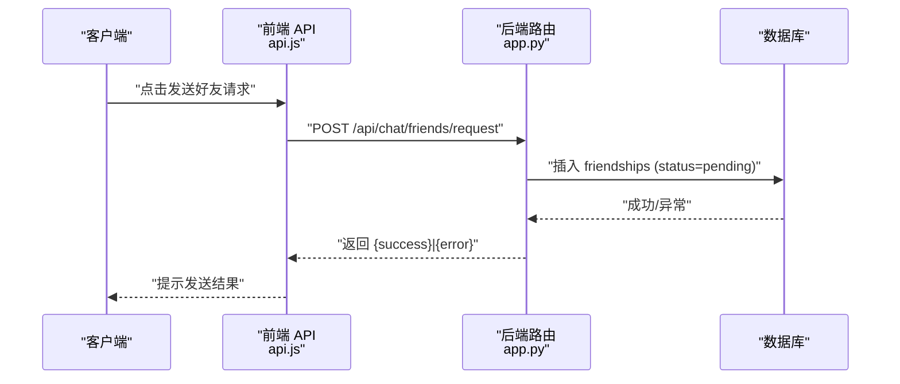
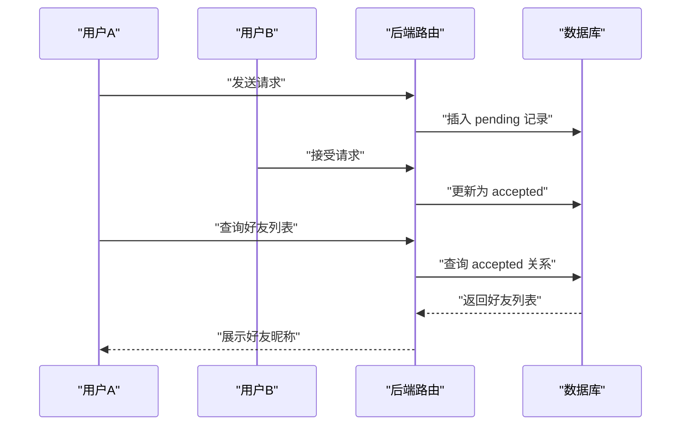
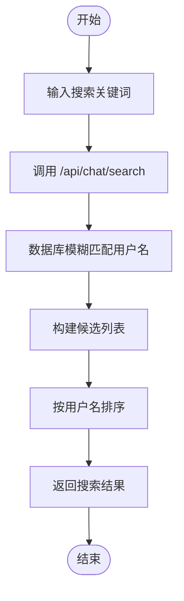
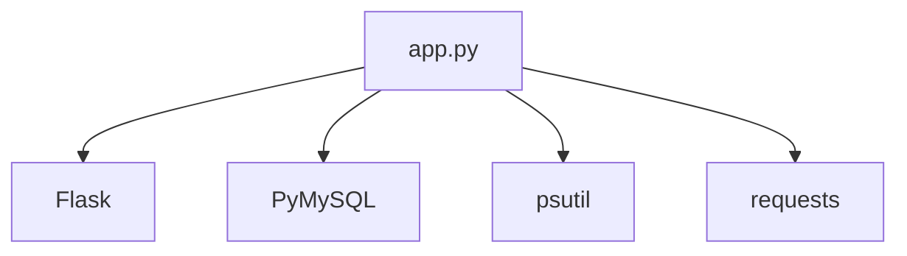

# 好友管理系统

<cite>
**本文档引用的文件**
- [app.py](file://app.py)
- [api.js](file://frontend/src/api.js)
- [main.js](file://frontend/src/main.js)
- [requirements.txt](file://requirements.txt)
- [SchoolWeb.spec](file://SchoolWeb.spec)
</cite>

## 目录
1. [简介](#简介)
2. [项目结构](#项目结构)
3. [核心组件](#核心组件)
4. [架构总览](#架构总览)
5. [详细组件分析](#详细组件分析)
6. [依赖分析](#依赖分析)
7. [性能考量](#性能考量)
8. [故障排查指南](#故障排查指南)
9. [结论](#结论)
10. [附录](#附录)

## 简介
本项目提供一个基于 Web 的“好友管理系统”，围绕用户间的好友关系进行建模与交互，包括好友列表、请求管理、关系建立与解除等核心能力，并结合聊天消息模块提供消息收发与撤回功能。系统采用前后端分离架构：后端使用 Python Flask 提供 REST API，前端使用 Vue 3 构建交互界面。

## 项目结构
- 后端入口与核心逻辑位于 app.py，包含数据库初始化、安全策略、速率限制、路由定义等。
- 前端位于 frontend/src，包含 Vue 应用入口 main.js 与 API 封装 api.js。
- 项目依赖通过 requirements.txt 管理，打包配置通过 SchoolWeb.spec 定义。

图表来源
- [main.js:1-6](file://frontend/src/main.js#L1-L6)
- [api.js:1-45](file://frontend/src/api.js#L1-L45)
- [app.py:119-139](file://app.py#L119-L139)

章节来源
- [main.js:1-6](file://frontend/src/main.js#L1-L6)
- [api.js:1-45](file://frontend/src/api.js#L1-L45)
- [app.py:119-139](file://app.py#L119-L139)

## 核心组件
- 好友关系模型
  - 使用 friendships 表存储用户间的好友关系，字段包括 user1、user2、status、requester、created_at，并通过唯一索引约束防止重复关系。
- 好友操作接口
  - 获取好友列表、获取好友请求、发送好友请求、接受好友请求、删除好友。
- 聊天消息模块
  - 支持消息发送、查询、撤回（仅发送者或管理员可执行）。
- 用户资料与搜索
  - user_profiles 表用于存储用户昵称等资料；提供按用户名的搜索接口。
- 安全与速率限制
  - 会话安全、CSP、UA 黑名单拦截、全局验证码门禁、IP 速率限制与封禁、白名单机制等。

章节来源
- [app.py:818-828](file://app.py#L818-L828)
- [app.py:3631-3733](file://app.py#L3631-L3733)
- [app.py:804-815](file://app.py#L804-L815)
- [app.py:3606-3615](file://app.py#L3606-L3615)

## 架构总览
系统采用前后端分离模式：前端通过 fetch 调用后端 /api/* 路由，后端通过 MySQL 存取数据并返回 JSON 结果。安全层贯穿于请求生命周期，包括会话、CSP、UA 拦截、验证码与速率限制。

图表来源
- [api.js:1-45](file://frontend/src/api.js#L1-L45)
- [app.py:119-139](file://app.py#L119-L139)

## 详细组件分析

### 好友关系模型与数据流
- 数据模型
  - friendships 表：存储双向好友关系，status 字段区分 pending/accepted，requester 记录发起方。
  - user_profiles 表：存储用户昵称等资料，用于展示好友信息。
- 关键流程
  - 发送请求：调用发送请求接口，向目标用户插入一条 pending 记录。
  - 接受请求：调用接受接口，将对应 pending 记录更新为 accepted。
  - 删除好友：调用删除接口，删除两条方向的记录以保证对称性。
  - 查询好友：查询 status=accepted 的记录，再补充昵称信息。

图表来源
- [app.py:818-828](file://app.py#L818-L828)
- [app.py:258-267](file://app.py#L258-L267)

图表来源
- [app.py:3674-3695](file://app.py#L3674-L3695)
- [api.js:1-45](file://frontend/src/api.js#L1-L45)

章节来源
- [app.py:818-828](file://app.py#L818-L828)
- [app.py:3631-3733](file://app.py#L3631-L3733)

### 好友添加流程（请求发送、接受处理、关系建立）
- 请求发送
  - 接口：POST /api/chat/friends/request
  - 参数：username（目标用户）
  - 行为：插入一条 pending 记录，requester 设为当前用户；若重复请求则返回错误。
- 请求接受
  - 接口：POST /api/chat/friends/accept
  - 参数：username（来自谁的请求）
  - 行为：将对方发来的 pending 记录更新为 accepted。
- 关系建立
  - 接口：GET /api/chat/friends
  - 行为：查询 status=accepted 的记录，并补充昵称信息返回。
- 删除好友
  - 接口：POST /api/chat/friends/remove
  - 行为：删除两条方向的记录，确保对称解除。

图表来源
- [app.py:3674-3733](file://app.py#L3674-L3733)

章节来源
- [app.py:3674-3733](file://app.py#L3674-L3733)

### 在线状态管理机制（状态更新、实时同步、离线通知）
- 当前实现
  - 系统未提供专门的在线状态表或心跳检测接口。
  - 聊天消息模块提供消息发送、查询与撤回，但未包含在线状态字段或订阅机制。
- 建议方案（概念性）
  - 引入在线状态表与心跳接口，定时上报心跳时间戳。
  - 前端轮询或 WebSocket 实时推送好友在线状态变化。
  - 离线通知：当好友从离线转为在线时，向其发送系统通知或消息提醒。

[本节为概念性说明，不直接分析具体文件，故无章节来源]

### 好友搜索功能（用户名匹配、模糊搜索、结果排序）
- 搜索接口
  - GET /api/chat/search
  - 行为：根据用户名进行模糊匹配，返回候选用户列表。
- 前端集成
  - 前端可通过搜索框输入关键词，调用搜索接口并展示结果。
- 排序策略
  - 默认按用户名排序；如需更复杂排序（如按活跃度、共同好友数），可在后端扩展。

图表来源
- [app.py:3606-3615](file://app.py#L3606-L3615)

章节来源
- [app.py:3606-3615](file://app.py#L3606-L3615)

### 状态检测算法（心跳机制、超时判断、状态缓存）
- 当前实现
  - 未发现心跳或超时判断的具体实现。
- 建议方案（概念性）
  - 心跳：前端定时上报 last_seen 或 ping，后端记录最近在线时间。
  - 超时：超过阈值未上报则标记为离线。
  - 缓存：使用内存缓存或 Redis 缓存在线状态，降低数据库压力。
  - 一致性：结合消息模块的在线提醒与离线消息投递策略。

[本节为概念性说明，不直接分析具体文件，故无章节来源]

### 安全考虑与隐私保护
- 会话与安全头
  - 启用 HttpOnly、SameSite、Secure（生产环境）会话 Cookie；设置 CSP、X-Frame-Options、X-XSS-Protection、Referrer-Policy、Permissions-Policy 等安全头。
- 请求拦截
  - 拦截常见安全扫描工具的 User-Agent；全局验证码门禁；IP 速率限制与封禁。
- 认证与授权
  - 登录后才可访问好友与聊天接口；管理员可撤回任意消息。
- 数据保护
  - 输入参数清洗与长度限制；敏感信息不泄露；白名单机制与手动封禁。

章节来源
- [app.py:134-139](file://app.py#L134-L139)
- [app.py:642-676](file://app.py#L642-L676)
- [app.py:142-156](file://app.py#L142-L156)
- [app.py:600-622](file://app.py#L600-L622)
- [app.py:514-562](file://app.py#L514-L562)
- [app.py:3735-3754](file://app.py#L3735-L3754)

## 依赖分析
- 后端依赖
  - Flask、PyMySQL、psutil、requests 等，通过 requirements.txt 管理。
- 打包与运行
  - 使用 PyInstaller 配置 SchoolWeb.spec，打包模板与静态资源。

图表来源
- [requirements.txt:1-5](file://requirements.txt#L1-L5)

章节来源
- [requirements.txt:1-5](file://requirements.txt#L1-L5)
- [SchoolWeb.spec:4-16](file://SchoolWeb.spec#L4-L16)

## 性能考量
- 数据库索引
  - friendships 表按 (user1,user2) 唯一键约束，建议在查询常用字段上建立合适索引以提升性能。
- 速率限制
  - IP 级别的滑动窗口限流与封禁策略，避免滥用；白名单与手动封禁提升运维灵活性。
- 前端优化
  - 前端 API 封装统一基地址，减少重复代码；合理使用缓存与懒加载。

[本节提供通用指导，不直接分析具体文件，故无章节来源]

## 故障排查指南
- 常见问题
  - 无法发送好友请求：检查目标用户是否存在、是否已发送过请求、是否为自身。
  - 无法接受好友请求：确认请求确实存在且状态为 pending。
  - 删除好友失败：确认双方关系已建立，或检查数据库连接。
  - 搜索无结果：确认关键词与用户名匹配规则，尝试更宽松的关键词。
- 定位方法
  - 查看后端日志与数据库状态；检查会话是否有效；确认速率限制是否触发封禁。
  - 前端网络面板查看请求与响应状态码。

章节来源
- [app.py:3674-3695](file://app.py#L3674-L3695)
- [app.py:3697-3714](file://app.py#L3697-L3714)
- [app.py:3716-3733](file://app.py#L3716-L3733)
- [app.py:3606-3615](file://app.py#L3606-L3615)

## 结论
本项目提供了完整的好友关系建模与基础交互能力，配合聊天消息模块形成较为完整的社交功能骨架。当前版本未包含在线状态与心跳检测等高级特性，建议后续引入在线状态表、心跳与实时推送机制，并完善状态缓存与离线通知策略。同时，应持续强化安全与性能优化，确保系统在高并发场景下的稳定性与可用性。

[本节为总结性内容，不直接分析具体文件，故无章节来源]

## 附录
- 前端 API 封装示例路径
  - [api.js:1-45](file://frontend/src/api.js#L1-L45)
- 后端路由定义示例路径
  - [app.py:3631-3733](file://app.py#L3631-L3733)
  - [app.py:3606-3615](file://app.py#L3606-L3615)