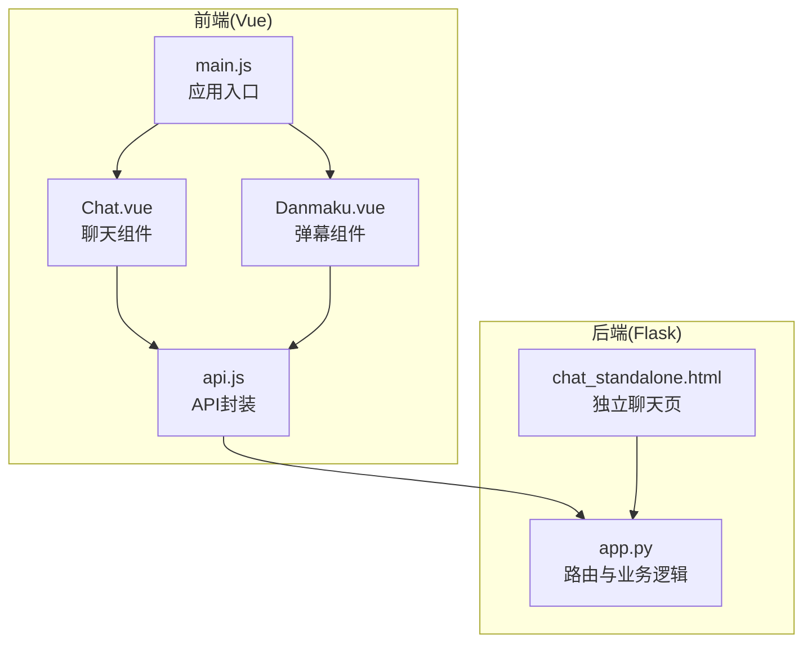
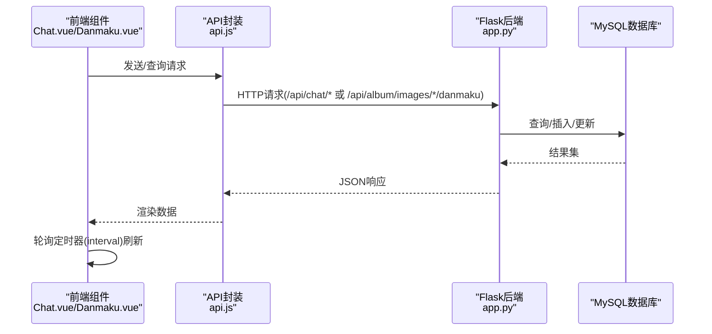
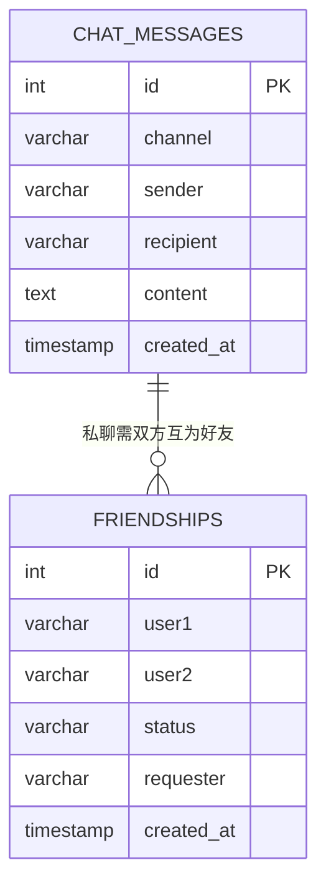
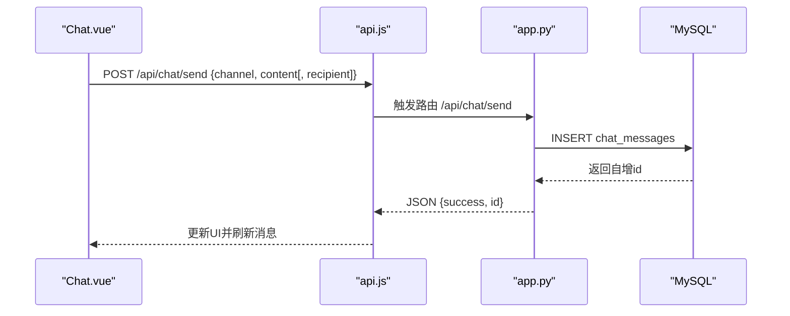
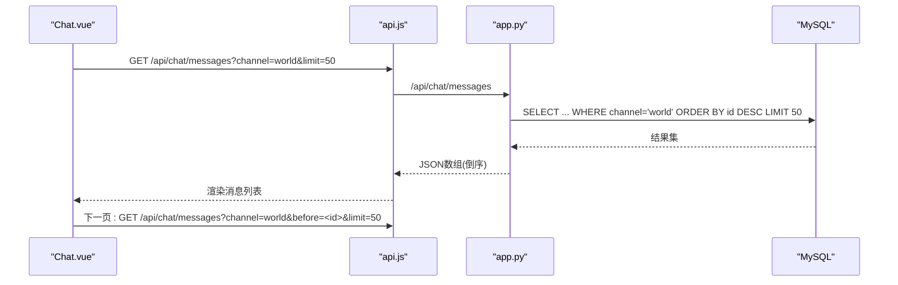
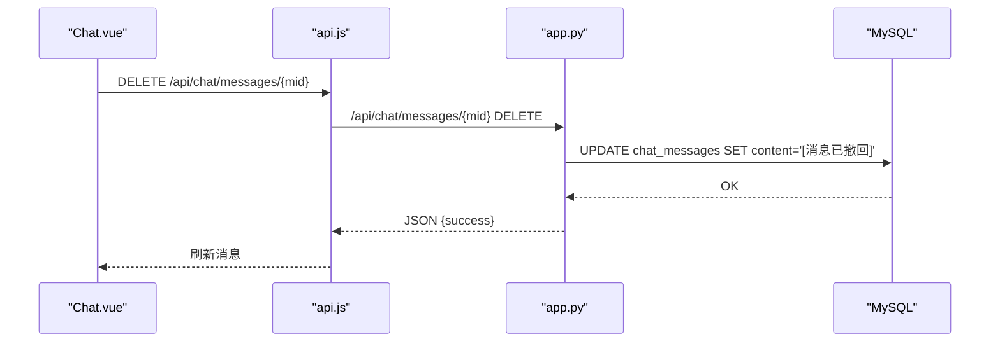
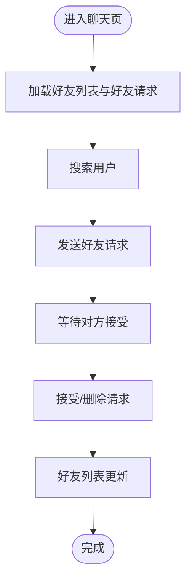
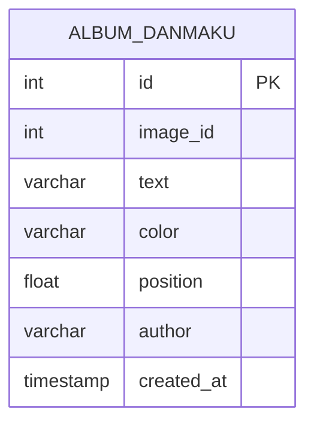
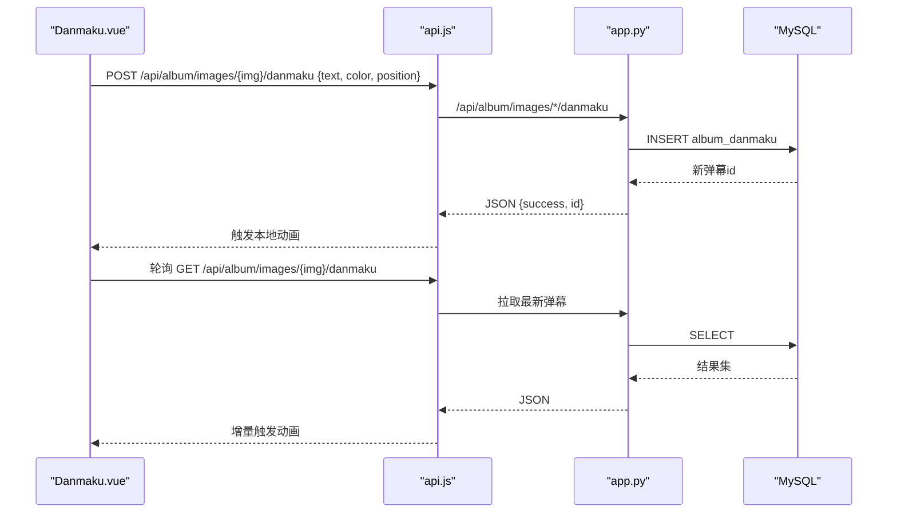
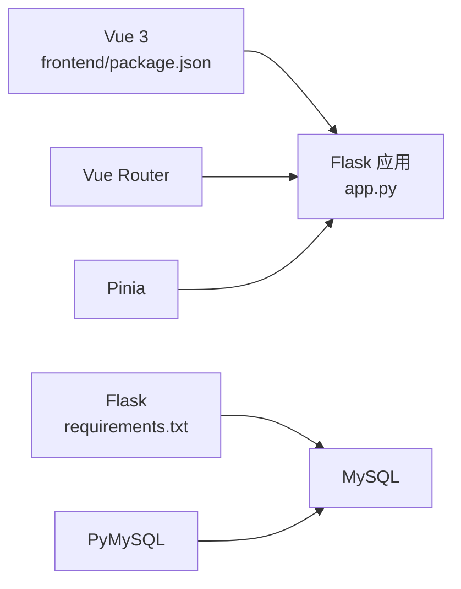

# 实时聊天系统

<cite>
**本文引用的文件**
- [app.py](file://app.py)
- [templates/chat_standalone.html](file://templates/chat_standalone.html)
- [frontend/src/components/Chat.vue](file://frontend/src/components/Chat.vue)
- [frontend/src/components/Danmaku.vue](file://frontend/src/components/Danmaku.vue)
- [frontend/src/api.js](file://frontend/src/api.js)
- [frontend/src/main.js](file://frontend/src/main.js)
- [frontend/package.json](file://frontend/package.json)
- [requirements.txt](file://requirements.txt)
</cite>

## 目录
1. [简介](#简介)
2. [项目结构](#项目结构)
3. [核心组件](#核心组件)
4. [架构总览](#架构总览)
5. [详细组件分析](#详细组件分析)
6. [依赖分析](#依赖分析)
7. [性能考量](#性能考量)
8. [故障排查指南](#故障排查指南)
9. [结论](#结论)
10. [附录](#附录)

## 简介
本技术文档面向“实时聊天系统”，围绕以下目标展开：  
- 聊天室架构设计：WebSocket 连接管理与消息路由机制  
- 消息传输协议：消息格式、序列化与反序列化  
- 好友系统：添加、状态管理与在线检测  
- 频道切换：公聊、私聊与公共频道管理  
- 弹幕功能与聊天系统集成：消息类型区分与渲染优化  
- 聊天历史记录：存储、检索与分页加载  
- 安全与性能：安全策略与优化建议  

说明：当前仓库采用轮询拉取的方式实现聊天与弹幕功能，未使用 WebSocket。本文在“架构总览”中给出基于现有实现的系统视图，并在“详细组件分析”中分别对聊天与弹幕模块进行代码级解析。

## 项目结构
前端采用 Vue 3 单页应用，后端基于 Flask 提供 REST API。模板与组件通过静态资源与 API 协同工作。

图表来源
- [frontend/src/main.js:1-6](file://frontend/src/main.js#L1-L6)
- [frontend/src/api.js:1-45](file://frontend/src/api.js#L1-L45)
- [frontend/src/components/Chat.vue:1-214](file://frontend/src/components/Chat.vue#L1-L214)
- [frontend/src/components/Danmaku.vue:1-89](file://frontend/src/components/Danmaku.vue#L1-L89)
- [app.py:3545-3755](file://app.py#L3545-L3755)
- [templates/chat_standalone.html:1-174](file://templates/chat_standalone.html#L1-L174)

章节来源
- [frontend/src/main.js:1-6](file://frontend/src/main.js#L1-L6)
- [frontend/package.json:1-21](file://frontend/package.json#L1-L21)
- [requirements.txt:1-5](file://requirements.txt#L1-L5)

## 核心组件
- 聊天消息模块：负责消息的发送、查询、撤回与分页加载
- 好友系统模块：负责好友请求、接受、删除与列表展示
- 弹幕模块：负责弹幕的发送、拉取与动画渲染
- 前端 API 封装：统一的 fetch 调用与参数处理
- 后端路由：提供聊天与弹幕相关的 REST 接口

章节来源
- [app.py:3545-3755](file://app.py#L3545-L3755)
- [frontend/src/components/Chat.vue:1-214](file://frontend/src/components/Chat.vue#L1-L214)
- [frontend/src/components/Danmaku.vue:1-89](file://frontend/src/components/Danmaku.vue#L1-L89)
- [frontend/src/api.js:1-45](file://frontend/src/api.js#L1-L45)

## 架构总览
系统采用前后端分离的架构：前端通过 fetch 调用后端 API，后端以 MySQL 存储聊天与弹幕数据。聊天与弹幕均通过轮询实现“准实时”效果。

图表来源
- [frontend/src/components/Chat.vue:80-164](file://frontend/src/components/Chat.vue#L80-L164)
- [frontend/src/components/Danmaku.vue:28-73](file://frontend/src/components/Danmaku.vue#L28-L73)
- [frontend/src/api.js:1-45](file://frontend/src/api.js#L1-L45)
- [app.py:3545-3755](file://app.py#L3545-L3755)

## 详细组件分析

### 聊天系统（公聊/私聊）
- 功能要点
  - 频道切换：世界频道与私聊频道
  - 消息发送：校验内容长度，记录活动积分
  - 历史加载：按 id 倒序分页，支持 before 参数
  - 撤回消息：仅发送者或管理员可撤回，标记为特定文本
  - 好友系统：搜索用户、发送/接受/删除好友请求、维护好友列表

- 数据模型（简化）

图表来源
- [app.py:804-829](file://app.py#L804-L829)

- 关键流程（消息发送）

图表来源
- [frontend/src/components/Chat.vue:87-97](file://frontend/src/components/Chat.vue#L87-L97)
- [frontend/src/api.js:1-45](file://frontend/src/api.js#L1-L45)
- [app.py:3582-3605](file://app.py#L3582-L3605)

- 关键流程（历史加载与分页）

图表来源
- [frontend/src/components/Chat.vue:80-85](file://frontend/src/components/Chat.vue#L80-L85)
- [app.py:3547-3580](file://app.py#L3547-L3580)

- 关键流程（撤回消息）

图表来源
- [frontend/src/components/Chat.vue:148-153](file://frontend/src/components/Chat.vue#L148-L153)
- [app.py:3736-3755](file://app.py#L3736-L3755)

- 好友系统流程

图表来源
- [frontend/src/components/Chat.vue:100-135](file://frontend/src/components/Chat.vue#L100-L135)
- [app.py:3608-3734](file://app.py#L3608-L3734)

章节来源
- [frontend/src/components/Chat.vue:1-214](file://frontend/src/components/Chat.vue#L1-L214)
- [app.py:3545-3755](file://app.py#L3545-L3755)

### 弹幕系统与聊天集成
- 功能要点
  - 弹幕发送：限制长度，支持颜色与位置
  - 弹幕拉取：按图片维度存储，前端轮询增量更新
  - 渲染优化：CSS 动画实现横向滚动，随机垂直位置与速度

- 数据模型（简化）

图表来源
- [app.py:783-793](file://app.py#L783-L793)

- 关键流程（弹幕发送与播放）

图表来源
- [frontend/src/components/Danmaku.vue:50-73](file://frontend/src/components/Danmaku.vue#L50-L73)
- [app.py:3520-3542](file://app.py#L3520-L3542)

章节来源
- [frontend/src/components/Danmaku.vue:1-89](file://frontend/src/components/Danmaku.vue#L1-L89)
- [app.py:3520-3542](file://app.py#L3520-L3542)

### 模板与独立聊天页
- 独立聊天页模板通过服务端渲染提供基础布局与脚本，前端 JS 与后端 API 协作实现消息发送、历史加载与好友交互。

章节来源
- [templates/chat_standalone.html:1-174](file://templates/chat_standalone.html#L1-L174)

## 依赖分析
- 前端依赖
  - Vue 3、Vue Router、Pinia：构建组件化界面与状态管理
  - Vite：开发与构建工具
- 后端依赖
  - Flask：Web 框架
  - PyMySQL：MySQL 连接
  - psutil、requests：系统监控与外部请求支持

图表来源
- [frontend/package.json:1-21](file://frontend/package.json#L1-L21)
- [requirements.txt:1-5](file://requirements.txt#L1-L5)

章节来源
- [frontend/package.json:1-21](file://frontend/package.json#L1-L21)
- [requirements.txt:1-5](file://requirements.txt#L1-L5)

## 性能考量
- 前端轮询策略
  - 聊天与弹幕均采用 3 秒间隔轮询，适合中小规模并发；高并发场景建议引入 WebSocket 降低带宽与服务器压力
- 分页与索引
  - 后端按 id 倒序分页，SQL 使用索引字段；建议在高频频道上增加 created_at 索引以支持时间分页
- 资源与渲染
  - 弹幕动画使用 CSS 动画，避免频繁 DOM 操作；建议限制同时活跃弹幕数量，防止动画堆积
- 数据库连接
  - 当前每次请求新建连接，建议引入连接池以减少开销

[本节为通用性能建议，不直接分析具体文件]

## 故障排查指南
- 常见错误与定位
  - 400 消息为空：检查前端输入长度与后端清洗逻辑
  - 403 撤回权限：仅发送者或管理员可撤回
  - 404 消息不存在：传入的 mid 无效
  - 500 数据库异常：确认数据库连接配置与表结构
- 日志与监控
  - 后端记录活动积分与异常日志，便于追踪问题
- 前端调试
  - 检查 fetch 请求头与凭据设置，确保 Cookie 与跨域正确传递

章节来源
- [app.py:3582-3605](file://app.py#L3582-L3605)
- [app.py:3736-3755](file://app.py#L3736-L3755)

## 结论
当前聊天系统以轮询实现消息与弹幕的准实时交互，具备清晰的模块划分与完善的后端接口。若需进一步提升实时性与性能，建议引入 WebSocket 并配合连接池、索引优化与弹幕数量限制等策略。

[本节为总结性内容，不直接分析具体文件]

## 附录

### API 定义概览
- 聊天
  - GET /api/chat/messages?channel=world|dm&with=对方用户名&before=&limit=50
  - POST /api/chat/send {channel, content[, recipient]}
  - DELETE /api/chat/messages/{mid}
  - GET /api/chat/search?q=关键词
  - GET /api/chat/friends
  - GET /api/chat/friends/requests
  - POST /api/chat/friends/request {username}
  - POST /api/chat/friends/accept {username}
  - POST /api/chat/friends/remove {username}
- 弹幕
  - POST /api/album/images/{img}/danmaku {text, color, position}
  - GET /api/album/images/{img}/danmaku

章节来源
- [app.py:3545-3755](file://app.py#L3545-L3755)
- [frontend/src/api.js:1-45](file://frontend/src/api.js#L1-L45)