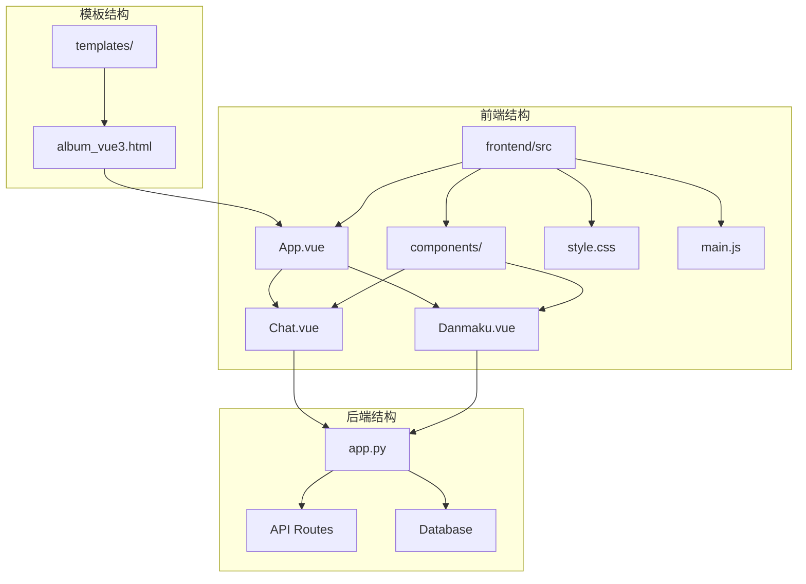
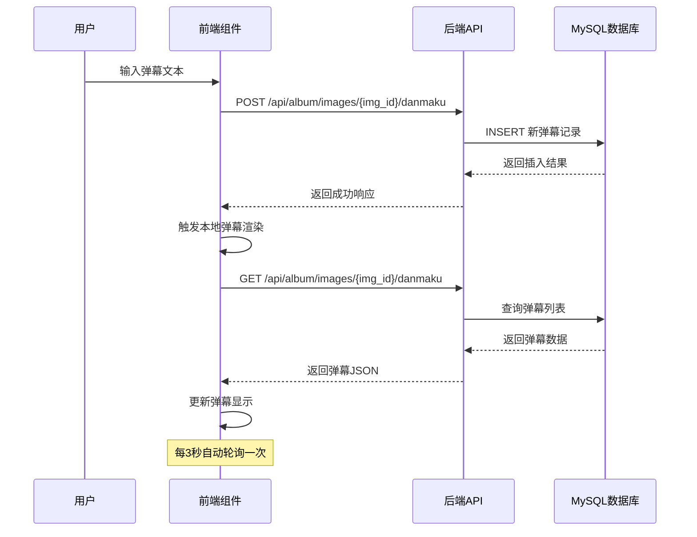
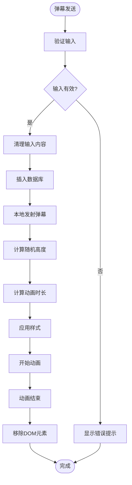
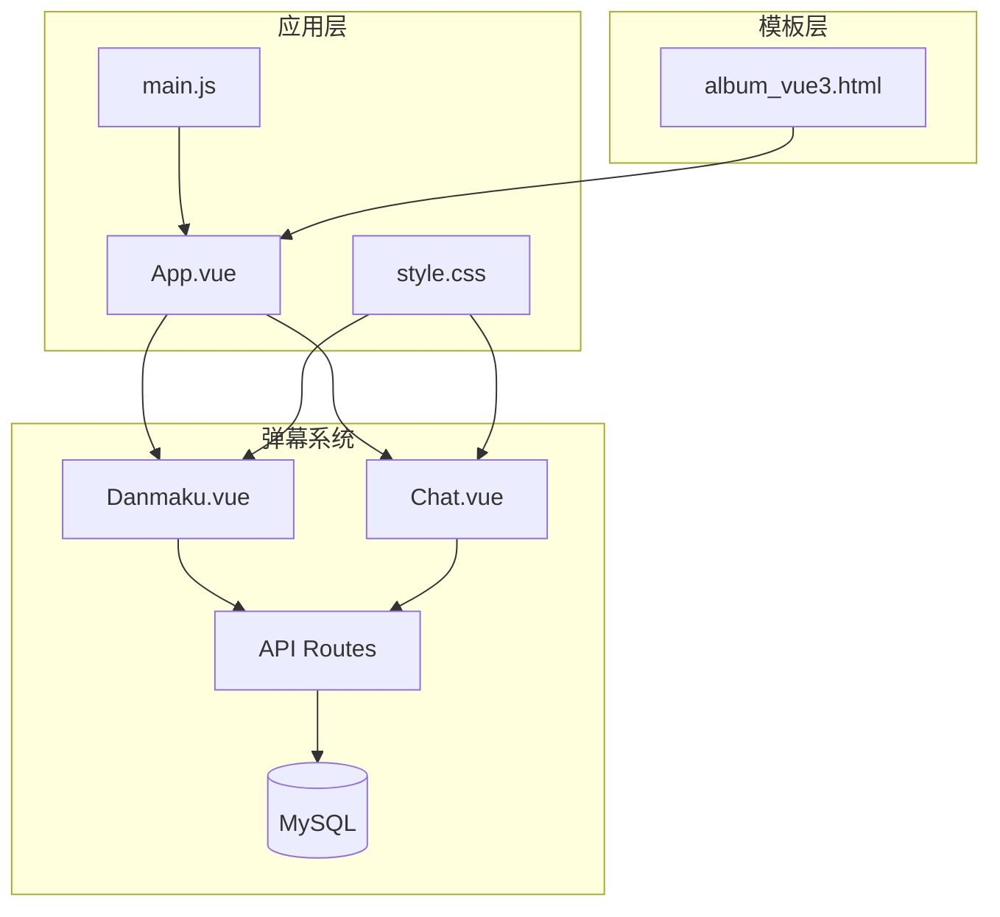

# 弹幕功能集成

<cite>
**本文档引用的文件**
- [Danmaku.vue](file://frontend/src/components/Danmaku.vue)
- [Chat.vue](file://frontend/src/components/Chat.vue)
- [app.py](file://app.py)
- [api.js](file://frontend/src/api.js)
- [main.js](file://frontend/src/main.js)
- [style.css](file://frontend/src/style.css)
- [App.vue](file://frontend/src/App.vue)
- [album_vue3.html](file://templates/album_vue3.html)
</cite>

## 目录
1. [简介](#简介)
2. [项目结构](#项目结构)
3. [核心组件](#核心组件)
4. [架构概览](#架构概览)
5. [详细组件分析](#详细组件分析)
6. [依赖关系分析](#依赖关系分析)
7. [性能考虑](#性能考虑)
8. [故障排除指南](#故障排除指南)
9. [结论](#结论)

## 简介

弹幕功能集成是本项目中的一个重要特性，它为相册图片提供了实时的弹幕展示能力。弹幕系统集成了聊天系统的架构，实现了消息类型区分、渲染机制和交互设计的完整解决方案。

弹幕功能的核心目标是在相册图片上实现流畅的滚动弹幕效果，支持用户自定义颜色、实时显示和自动轮询更新。系统采用前后端分离的设计模式，前端负责弹幕的渲染和交互，后端提供弹幕数据的存储和管理。

## 项目结构

弹幕功能主要分布在以下目录结构中：

**图表来源**
- [Danmaku.vue:1-89](file://frontend/src/components/Danmaku.vue#L1-L89)
- [Chat.vue:1-214](file://frontend/src/components/Chat.vue#L1-L214)
- [app.py:3503-3544](file://app.py#L3503-L3544)
- [album_vue3.html:1-396](file://templates/album_vue3.html#L1-L396)

**章节来源**
- [Danmaku.vue:1-89](file://frontend/src/components/Danmaku.vue#L1-L89)
- [Chat.vue:1-214](file://frontend/src/components/Chat.vue#L1-L214)
- [app.py:3503-3544](file://app.py#L3503-L3544)

## 核心组件

### 弹幕组件 (Danmaku.vue)

弹幕组件是整个弹幕系统的核心，负责处理弹幕的发送、接收、渲染和动画效果。

#### 主要功能特性：
- **实时弹幕显示**：通过定时轮询机制获取最新的弹幕数据
- **用户交互**：支持颜色选择和文本输入
- **动画效果**：使用CSS动画实现流畅的弹幕滚动
- **响应式布局**：适配不同屏幕尺寸的显示效果

#### 关键属性和方法：
- `text`: 弹幕文本输入框的双向绑定
- `color`: 弹幕颜色选择器的双向绑定
- `activeDanmaku`: 当前正在显示的弹幕列表
- `allDanmaku`: 所有弹幕的历史记录
- `emitDanmaku()`: 发射新的弹幕到舞台
- `removeItem()`: 移除已完成动画的弹幕

**章节来源**
- [Danmaku.vue:18-74](file://frontend/src/components/Danmaku.vue#L18-L74)

### 聊天组件 (Chat.vue)

聊天组件虽然主要用于传统聊天功能，但其架构为弹幕系统的集成提供了重要的参考。

#### 主要功能：
- **多频道支持**：支持世界频道和私信频道
- **好友系统**：包含好友添加、接受和删除功能
- **消息管理**：支持消息搜索、撤回等操作
- **实时更新**：通过定时轮询保持消息同步

**章节来源**
- [Chat.vue:1-214](file://frontend/src/components/Chat.vue#L1-L214)

### 后端API (app.py)

后端提供了完整的弹幕API接口，包括弹幕的增删查改操作。

#### API端点：
- `GET /api/album/images/<img_id>/danmaku` - 获取指定图片的所有弹幕
- `POST /api/album/images/<img_id>/danmaku` - 添加新的弹幕

#### 数据模型：
- `album_danmaku` 表包含弹幕的文本、颜色、位置、作者和时间戳信息

**章节来源**
- [app.py:3503-3544](file://app.py#L3503-L3544)
- [app.py:781-792](file://app.py#L781-L792)

## 架构概览

弹幕系统的整体架构采用前后端分离的设计模式，实现了清晰的职责分离和良好的可扩展性。

**图表来源**
- [Danmaku.vue:30-71](file://frontend/src/components/Danmaku.vue#L30-L71)
- [app.py:3503-3544](file://app.py#L3503-L3544)

## 详细组件分析

### 弹幕渲染引擎

弹幕渲染引擎基于CSS动画实现，具有以下特点：

#### 渲染机制：
- **CSS动画驱动**：使用`@keyframes`定义弹幕滚动动画
- **绝对定位**：弹幕元素使用绝对定位实现精确的位置控制
- **随机高度**：弹幕垂直位置通过随机算法生成，增加视觉层次
- **动态时长**：根据弹幕长度和随机因素计算动画持续时间

#### 样式系统：
- **颜色控制**：支持用户自定义弹幕颜色
- **字体设置**：统一的字体大小和粗细设置
- **阴影效果**：添加文本阴影增强可读性
- **响应式设计**：适配不同屏幕尺寸的显示效果

**图表来源**
- [Danmaku.vue:36-49](file://frontend/src/components/Danmaku.vue#L36-L49)
- [app.py:3522-3527](file://app.py#L3522-L3527)

**章节来源**
- [Danmaku.vue:76-88](file://frontend/src/components/Danmaku.vue#L76-L88)

### 消息处理流程

弹幕系统的消息处理流程包括多个阶段：

#### 发送流程：
1. **输入验证**：检查弹幕文本是否为空
2. **内容清理**：使用`sanitize_input`函数清理潜在的恶意内容
3. **数据存储**：将弹幕信息保存到MySQL数据库
4. **实时反馈**：立即在本地显示弹幕，无需等待服务器响应

#### 接收流程：
1. **定时轮询**：每3秒自动请求新的弹幕数据
2. **增量更新**：只处理新增的弹幕，避免重复渲染
3. **状态同步**：保持本地弹幕列表与服务器数据同步

**章节来源**
- [Danmaku.vue:50-71](file://frontend/src/components/Danmaku.vue#L50-L71)
- [app.py:3510-3517](file://app.py#L3510-L3517)

### 过滤机制

弹幕系统实现了多层次的内容过滤机制：

#### 输入验证：
- **长度限制**：弹幕文本最大长度为200字符
- **HTML清理**：移除潜在的恶意HTML标签
- **脚本过滤**：防止JavaScript代码注入

#### 速率限制：
- **IP级限制**：每个IP地址在时间窗口内的请求次数限制
- **持久化存储**：速率限制状态保存到文件系统
- **动态调整**：支持运行时调整限制参数

**章节来源**
- [app.py:3522-3527](file://app.py#L3522-L3527)
- [app.py:873-880](file://app.py#L873-L880)

### 实时性保证

弹幕系统通过以下机制确保实时性：

#### 轮询策略：
- **固定间隔**：每3秒进行一次弹幕数据轮询
- **增量更新**：只处理新增的弹幕，减少网络开销
- **错误恢复**：轮询失败时自动重试

#### 性能优化：
- **虚拟DOM**：使用Vue的响应式系统高效更新UI
- **内存管理**：动画结束后及时清理DOM元素
- **资源复用**：复用现有的弹幕元素而非频繁创建销毁

**章节来源**
- [Danmaku.vue:60-73](file://frontend/src/components/Danmaku.vue#L60-L73)

## 依赖关系分析

弹幕系统与其他组件的依赖关系如下：

**图表来源**
- [App.vue:47-60](file://frontend/src/App.vue#L47-L60)
- [main.js:1-6](file://frontend/src/main.js#L1-L6)
- [style.css:1-59](file://frontend/src/style.css#L1-L59)

### 组件耦合度分析

弹幕系统与其他组件的耦合程度相对较低，主要体现在：

- **UI层耦合**：与主应用的导航和布局有一定耦合
- **API层耦合**：与后端API的调用关系明确
- **样式层耦合**：共享全局样式定义

这种设计有利于系统的维护和扩展。

**章节来源**
- [App.vue:1-99](file://frontend/src/App.vue#L1-L99)
- [main.js:1-6](file://frontend/src/main.js#L1-L6)

## 性能考虑

弹幕系统在设计时充分考虑了性能优化：

### 渲染性能
- **硬件加速**：CSS动画利用GPU加速，提升渲染性能
- **批量更新**：使用Vue的响应式系统进行批量DOM更新
- **内存回收**：动画完成后及时释放DOM元素

### 网络性能
- **增量同步**：只传输新增的弹幕数据
- **压缩传输**：JSON数据传输经过压缩处理
- **连接复用**：复用HTTP连接减少握手开销

### 存储性能
- **索引优化**：弹幕表按时间戳建立索引
- **查询优化**：使用LIMIT限制返回的数据量
- **缓存策略**：热点数据在内存中缓存

## 故障排除指南

### 常见问题及解决方案

#### 弹幕无法显示
1. **检查网络连接**：确认前端能够访问后端API
2. **验证数据库连接**：检查MySQL服务状态
3. **查看浏览器控制台**：排查JavaScript错误

#### 弹幕发送失败
1. **检查输入验证**：确认弹幕文本长度和格式
2. **验证用户权限**：确保用户已登录
3. **检查API响应**：查看后端返回的错误信息

#### 性能问题
1. **监控内存使用**：检查DOM元素数量
2. **优化动画参数**：调整弹幕数量和动画时长
3. **实施节流机制**：限制弹幕发送频率

**章节来源**
- [Danmaku.vue:28-35](file://frontend/src/components/Danmaku.vue#L28-L35)
- [app.py:3510-3517](file://app.py#L3510-L3517)

## 结论

弹幕功能集成成功地将实时弹幕系统整合到相册应用中，实现了以下目标：

### 技术成就
- **完整的实时系统**：实现了从发送到显示的完整闭环
- **优秀的用户体验**：流畅的动画效果和即时的反馈
- **可靠的架构设计**：前后端分离，职责清晰

### 设计亮点
- **简洁的API设计**：RESTful接口简单易用
- **灵活的样式系统**：支持用户自定义外观
- **完善的错误处理**：全面的异常情况处理机制

### 改进建议
- **引入WebSocket**：替代轮询机制，进一步提升实时性
- **添加弹幕过滤**：实现更复杂的内容过滤规则
- **优化移动端体验**：针对移动设备进行专门优化

弹幕系统为相册应用增添了生动的互动元素，为用户创造了更加丰富的浏览体验。通过合理的架构设计和技术选型，系统在保证功能完整性的同时，也兼顾了性能和可维护性。