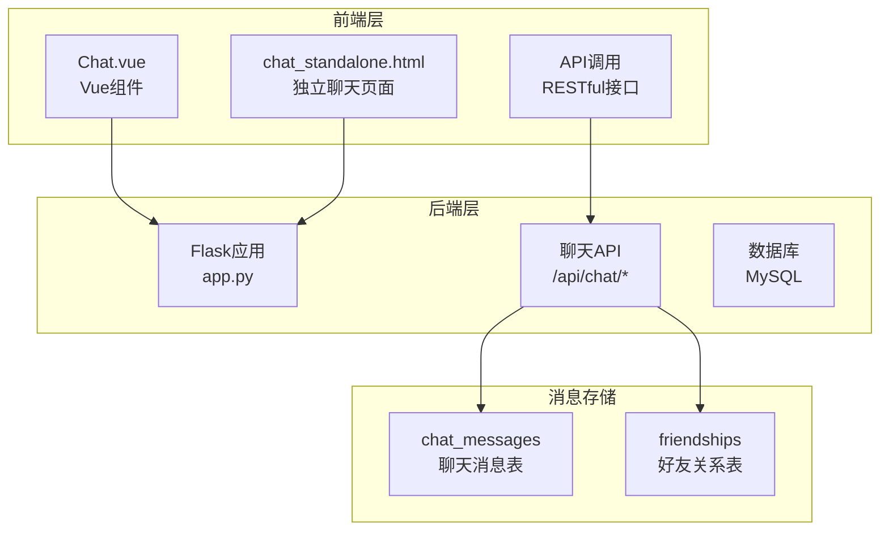
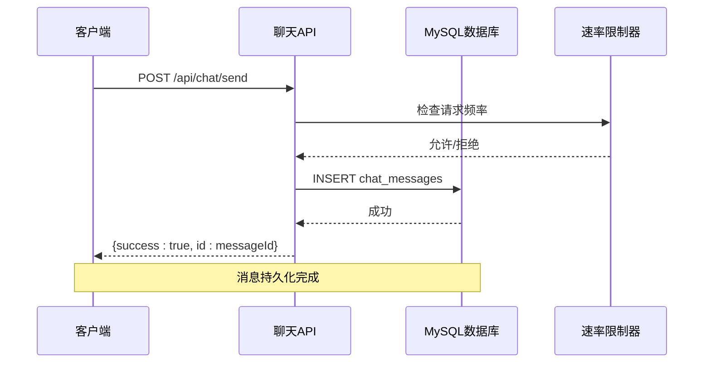
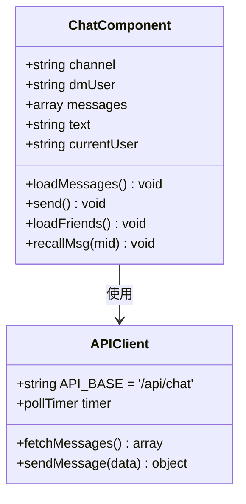
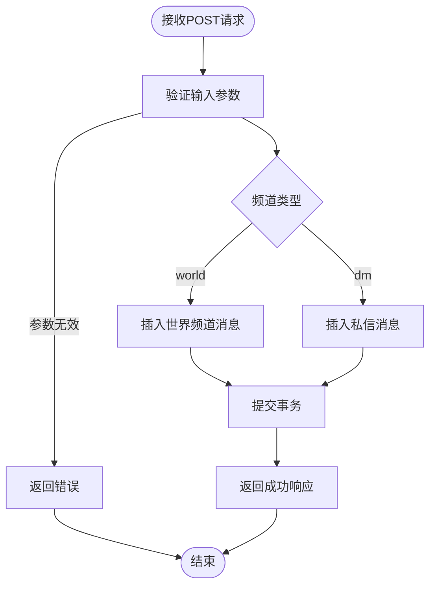
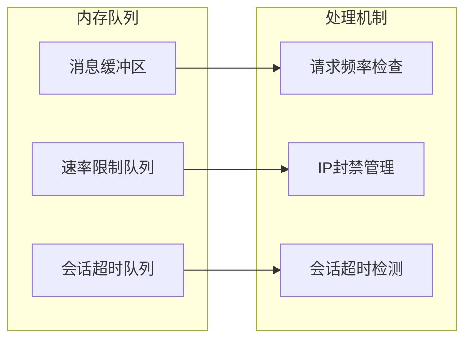
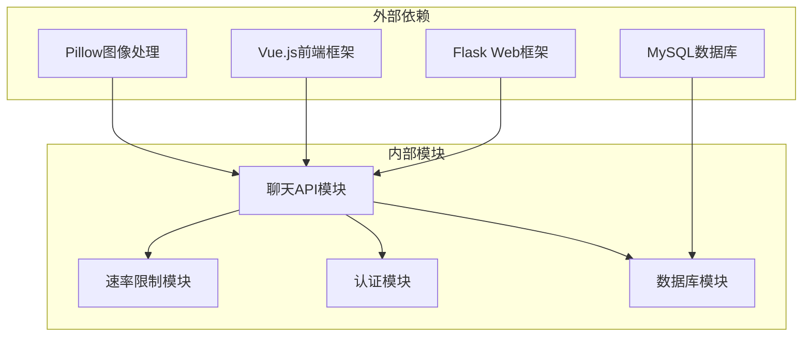
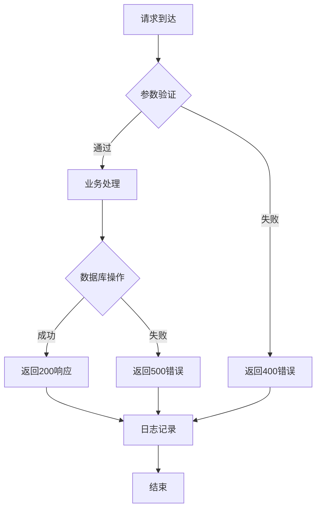

# 消息传输机制

<cite>
**本文档引用的文件**
- [app.py](file://app.py)
- [Chat.vue](file://frontend/src/components/Chat.vue)
- [chat_standalone.html](file://templates/chat_standalone.html)
</cite>

## 目录
1. [简介](#简介)
2. [项目结构](#项目结构)
3. [核心组件](#核心组件)
4. [架构概览](#架构概览)
5. [详细组件分析](#详细组件分析)
6. [依赖关系分析](#依赖关系分析)
7. [性能考虑](#性能考虑)
8. [故障排除指南](#故障排除指南)
9. [结论](#结论)

## 简介

本文档详细分析了School_Web项目中的消息传输机制，包括消息格式设计、序列化与反序列化、路由算法、队列管理、确认机制以及性能优化策略。该系统实现了基于Web的聊天功能，支持公开频道和私信两种通信模式。

## 项目结构

消息传输机制主要分布在以下模块：



**图表来源**
- [app.py:3544-3755](file://app.py#L3544-L3755)
- [Chat.vue:78-97](file://frontend/src/components/Chat.vue#L78-L97)

**章节来源**
- [app.py:803-828](file://app.py#L803-L828)
- [Chat.vue:1-214](file://frontend/src/components/Chat.vue#L1-L214)

## 核心组件

### 数据模型设计

系统采用关系型数据库存储消息和用户关系：

```mermaid
erDiagram
CHAT_MESSAGES {
int id PK
varchar channel
varchar sender
varchar recipient
text content
timestamp created_at
}
FRIENDSHIPS {
int id PK
varchar user1
varchar user2
varchar status
varchar requester
timestamp created_at
}
INDEX idx_channel ON CHAT_MESSAGES(channel)
INDEX idx_sender ON CHAT_MESSAGES(sender)
INDEX idx_recipient ON CHAT_MESSAGES(recipient)
INDEX idx_created ON CHAT_MESSAGES(created_at)
```

**图表来源**
- [app.py:803-828](file://app.py#L803-L828)

### 消息格式规范

消息传输采用JSON格式，支持以下字段：

| 字段名 | 类型 | 必需 | 描述 |
|--------|------|------|------|
| channel | string | 是 | 消息频道类型（'world'或'dm'） |
| content | string | 是 | 消息内容（最大1000字符） |
| recipient | string | 仅DM时必需 | 私信接收者用户名 |
| sender | string | 自动填充 | 发送者用户名（来自会话） |

**章节来源**
- [app.py:3581-3604](file://app.py#L3581-L3604)
- [app.py:3607-3629](file://app.py#L3607-L3629)

## 架构概览

消息传输系统采用经典的三层架构：



**图表来源**
- [app.py:3581-3604](file://app.py#L3581-L3604)
- [app.py:514-562](file://app.py#L514-L562)

## 详细组件分析

### 前端消息组件

前端使用Vue.js实现实时聊天功能：



**图表来源**
- [Chat.vue:61-164](file://frontend/src/components/Chat.vue#L61-L164)

关键特性：
- **轮询机制**：每3秒自动刷新消息列表
- **实时更新**：发送消息后立即刷新界面
- **右键撤回**：支持消息撤回功能
- **频道切换**：支持世界频道和私信频道

**章节来源**
- [Chat.vue:80-97](file://frontend/src/components/Chat.vue#L80-L97)
- [Chat.vue:158-164](file://frontend/src/components/Chat.vue#L158-L164)

### 后端API实现

后端提供完整的RESTful API：

#### 消息发送接口


**图表来源**
- [app.py:3581-3604](file://app.py#L3581-L3604)

#### 消息检索接口
支持分页和条件查询：
- **分页参数**：`before`(游标)、`limit`(数量)
- **过滤条件**：按频道类型、用户关系
- **排序规则**：按ID降序排列

**章节来源**
- [app.py:3546-3579](file://app.py#L3546-L3579)

### 消息路由算法

系统实现两种路由模式：

#### 公开频道路由
- **匹配规则**：`channel='world'`
- **查询优化**：使用索引`idx_channel`
- **性能特征**：O(log n)查找复杂度

#### 私信路由
- **双向匹配**：`(sender=user AND recipient=other) OR (sender=other AND recipient=user)`
- **用户验证**：确保用户有权访问目标私信
- **权限控制**：管理员可访问所有消息

**章节来源**
- [app.py:3556-3569](file://app.py#L3556-L3569)

### 序列化与反序列化

消息传输采用标准JSON格式：

#### 发送流程
1. **客户端序列化**：Vue组件将消息对象转换为JSON
2. **网络传输**：通过HTTP POST请求发送
3. **服务端反序列化**：Flask框架自动解析JSON
4. **数据验证**：执行输入验证和清理

#### 接收流程
1. **数据库存储**：消息内容直接存储到TEXT字段
2. **时间戳处理**：使用MySQL自动时间戳
3. **响应序列化**：查询结果转换为JSON格式

**章节来源**
- [Chat.vue:87-94](file://frontend/src/components/Chat.vue#L87-L94)
- [app.py:3546-3579](file://app.py#L3546-L3579)

### 队列管理与缓冲

系统采用内存队列实现消息缓冲：



**图表来源**
- [app.py:382-389](file://app.py#L382-L389)

关键特性：
- **滑动窗口**：基于时间窗口的请求频率控制
- **动态封禁**：根据异常行为自动延长封禁时间
- **内存持久化**：定期保存到文件系统

**章节来源**
- [app.py:31-114](file://app.py#L31-L114)
- [app.py:514-562](file://app.py#L514-L562)

### 确认机制与去重

系统实现基础的消息确认和去重机制：

#### 消息确认
- **发送确认**：成功插入数据库后返回确认
- **撤回确认**：支持消息撤回操作
- **权限验证**：仅消息发送者可撤回

#### 去重处理
- **索引优化**：为常用查询字段建立索引
- **唯一约束**：好友关系表使用唯一键约束
- **重复检测**：数据库层面防止重复数据

**章节来源**
- [app.py:3735-3754](file://app.py#L3735-L3754)
- [app.py:818-828](file://app.py#L818-L828)

## 依赖关系分析



**图表来源**
- [app.py:21-28](file://app.py#L21-L28)

**章节来源**
- [app.py:1-28](file://app.py#L1-L28)

## 性能考虑

### 查询优化策略

1. **索引优化**
   - `idx_channel`: 提高频道查询性能
   - `idx_sender`: 支持用户消息统计
   - `idx_recipient`: 优化私信查询
   - `idx_created`: 支持时间范围查询

2. **分页机制**
   - 限制每次查询返回数量（最大100条）
   - 使用游标分页避免深度偏移
   - 支持向后翻页功能

3. **缓存策略**
   - 前端轮询间隔3秒
   - 会话超时检测避免僵尸连接
   - 速率限制器内存缓存

### 错误处理策略



**图表来源**
- [app.py:3581-3604](file://app.py#L3581-L3604)

## 故障排除指南

### 常见问题诊断

1. **消息发送失败**
   - 检查网络连接状态
   - 验证用户登录状态
   - 查看浏览器开发者工具网络面板

2. **消息延迟**
   - 确认轮询间隔设置
   - 检查服务器负载情况
   - 验证数据库连接状态

3. **权限问题**
   - 确认用户身份验证
   - 检查好友关系状态
   - 验证管理员权限

### 性能监控指标

- **响应时间**：API请求平均响应时间
- **并发用户数**：同时在线用户数量
- **数据库查询**：慢查询统计
- **内存使用**：系统内存占用情况

**章节来源**
- [app.py:564-593](file://app.py#L564-L593)

## 结论

School_Web项目的消息传输机制实现了以下核心功能：

1. **可靠的消息传递**：基于MySQL的持久化存储确保消息不丢失
2. **高效的路由算法**：合理的索引设计支持快速消息检索
3. **完善的权限控制**：多层次的安全验证保护用户隐私
4. **良好的用户体验**：实时消息推送和友好的界面交互

系统在保证功能完整性的同时，通过索引优化、分页机制和缓存策略实现了较好的性能表现。建议后续可以考虑引入WebSocket实现实时双向通信，进一步提升用户体验。