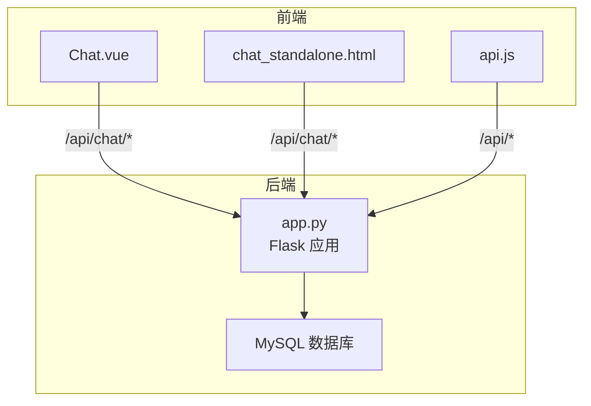
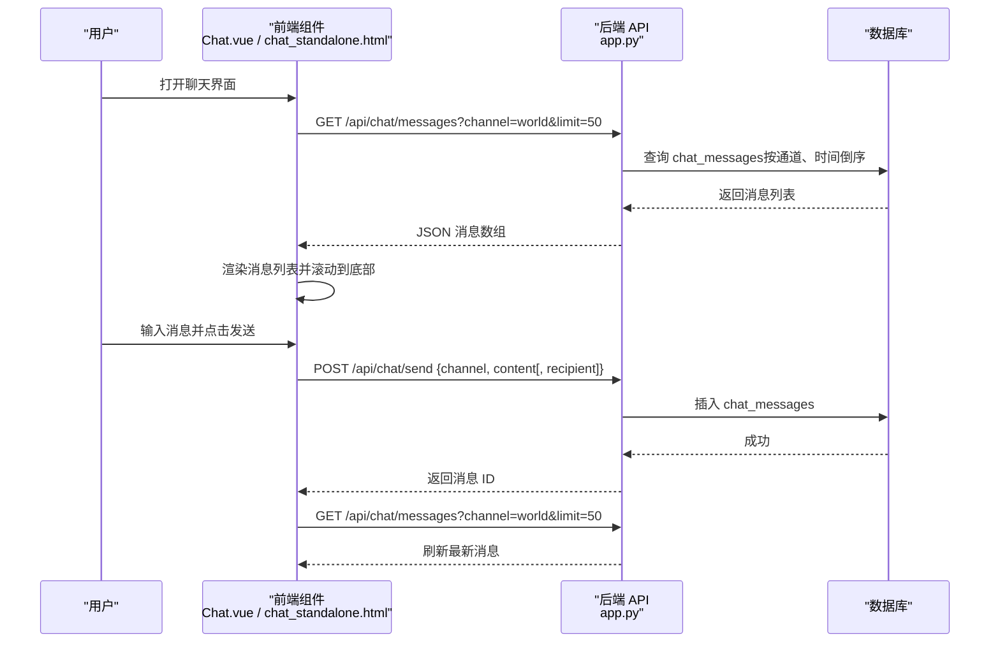
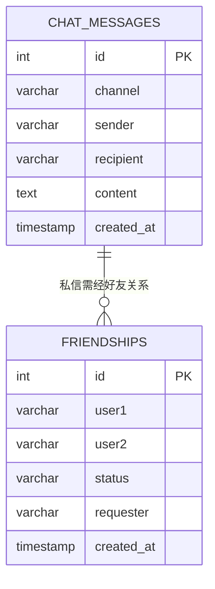
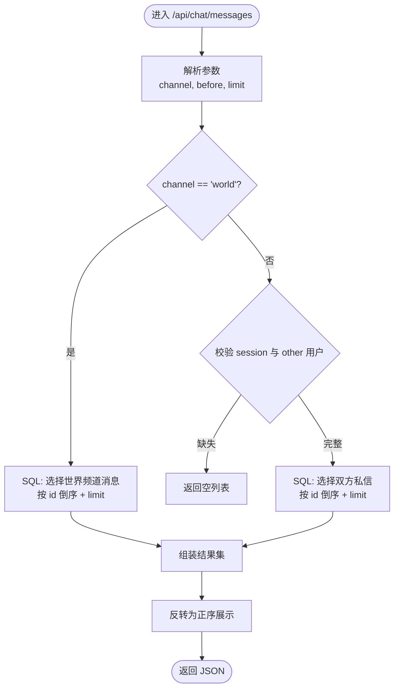
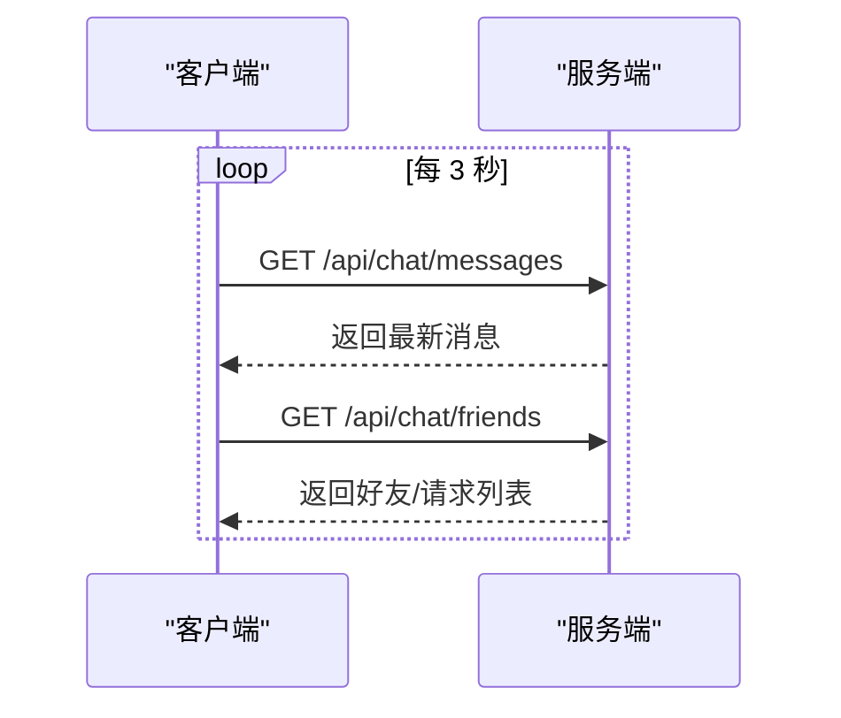
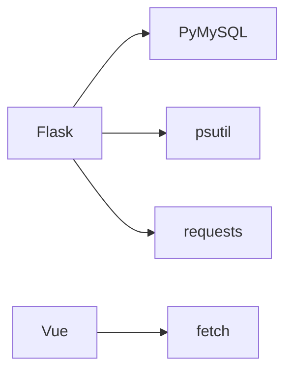

# 聊天历史管理

<cite>
**本文引用的文件**
- [app.py](file://app.py)
- [chat_standalone.html](file://templates/chat_standalone.html)
- [Chat.vue](file://frontend/src/components/Chat.vue)
- [api.js](file://frontend/src/api.js)
- [requirements.txt](file://requirements.txt)
</cite>

## 目录
1. [简介](#简介)
2. [项目结构](#项目结构)
3. [核心组件](#核心组件)
4. [架构总览](#架构总览)
5. [详细组件分析](#详细组件分析)
6. [依赖分析](#依赖分析)
7. [性能考虑](#性能考虑)
8. [故障排查指南](#故障排查指南)
9. [结论](#结论)
10. [附录](#附录)

## 简介
本文件面向“聊天历史管理系统”，围绕聊天记录存储设计、消息检索算法、历史记录同步机制、生命周期管理、安全保护与性能优化展开，结合前端与后端实现进行系统化技术说明。系统采用前后端分离架构：后端基于 Flask 提供 REST API，前端分别提供 Vue 单文件组件与独立 HTML 页面两种形态，统一通过 /api/chat 路由族访问聊天能力。

## 项目结构
- 后端入口与路由：app.py 提供数据库初始化、安全中间件、聊天系统 API 等
- 前端组件：
  - Chat.vue：Vue 单文件组件，集成侧边栏、消息列表、输入框、右键菜单等
  - chat_standalone.html：独立 HTML 页面，包含相同聊天功能的 JS 实现
  - api.js：前端通用 API 封装，便于复用调用
- 依赖：requirements.txt 指定 Flask、PyMySQL、psutil、requests 等

图表来源
- [app.py](file://app.py)
- [Chat.vue](file://frontend/src/components/Chat.vue)
- [chat_standalone.html](file://templates/chat_standalone.html)
- [api.js](file://frontend/src/api.js)

章节来源
- [app.py](file://app.py)
- [Chat.vue](file://frontend/src/components/Chat.vue)
- [chat_standalone.html](file://templates/chat_standalone.html)
- [api.js](file://frontend/src/api.js)
- [requirements.txt](file://requirements.txt)

## 核心组件
- 聊天消息表：chat_messages，支持世界频道与私信（DM）两类通道，具备按通道、发送者、接收者、创建时间的索引
- 好友关系表：friendships，记录好友关系状态与请求方
- 聊天 API 族：消息查询、发送、撤回、好友管理、用户搜索
- 前端组件：Vue 组件与独立 HTML 页面，均通过 /api/chat 与后端交互

章节来源
- [app.py:803-828](file://app.py#L803-L828)
- [app.py:3546-3754](file://app.py#L3546-L3754)
- [Chat.vue](file://frontend/src/components/Chat.vue)
- [chat_standalone.html](file://templates/chat_standalone.html)

## 架构总览
后端通过 Flask 路由提供 /api/chat 下的完整聊天能力，前端通过 fetch 调用对应接口，实现消息拉取、发送、撤回、好友管理等功能。数据库采用 MySQL，聊天相关表在应用启动时初始化。

图表来源
- [app.py:3546-3604](file://app.py#L3546-L3604)
- [Chat.vue:80-97](file://frontend/src/components/Chat.vue#L80-L97)
- [chat_standalone.html:73-88](file://templates/chat_standalone.html#L73-L88)

## 详细组件分析

### 数据模型与表结构
- chat_messages
  - 主键：id
  - 字段：channel（世界/私信）、sender、recipient（可空）、content、created_at
  - 索引：idx_channel、idx_sender、idx_recipient、idx_created
- friendships
  - 主键：id
  - 字段：user1、user2、status（pending/accepted）、requester、created_at
  - 唯一键：uk_pair(user1,user2)

图表来源
- [app.py:803-828](file://app.py#L803-L828)

章节来源
- [app.py:803-828](file://app.py#L803-L828)

### 消息检索算法
- 分页加载
  - 使用参数：channel（world/dm）、before（游标）、limit（上限 100）
  - 世界频道：按 created_at 倒序查询 channel='world'
  - 私信：双方互换 sender/recipient 组合条件
  - 结果反转为正序展示，保证最新消息在底部
- 时间范围查询
  - 通过 before 参数实现“加载更早”的翻页逻辑（基于自增 id 的游标分页）
- 关键字搜索
  - 用户搜索：支持用户名或昵称模糊匹配，避免自身
  - 消息内容搜索：当前未提供 content 关键词检索接口

图表来源
- [app.py:3546-3579](file://app.py#L3546-L3579)

章节来源
- [app.py:3546-3579](file://app.py#L3546-L3579)

### 历史记录同步机制
- 前端轮询
  - Vue 组件与独立 HTML 页面均每 3 秒轮询一次消息与好友状态，保持界面实时更新
- 离线缓存
  - 前端未实现本地持久化缓存；建议在浏览器端引入 IndexedDB 或 localStorage 作为兜底
- 数据一致性
  - 撤回消息采用软删除（标记 content=[消息已撤回]），避免物理删除导致的查询一致性问题
  - 好友关系状态变更通过后端事务保证原子性

图表来源
- [Chat.vue:158-164](file://frontend/src/components/Chat.vue#L158-L164)
- [chat_standalone.html:165-166](file://templates/chat_standalone.html#L165-L166)
- [app.py:3735-3754](file://app.py#L3735-L3754)

章节来源
- [Chat.vue:158-164](file://frontend/src/components/Chat.vue#L158-L164)
- [chat_standalone.html:165-166](file://templates/chat_standalone.html#L165-L166)
- [app.py:3735-3754](file://app.py#L3735-L3754)

### 生命周期管理
- 数据清理
  - 当前未实现自动清理策略；建议按月/季度统计消息量，超过阈值后归档至历史表或压缩字段
- 归档策略
  - 可将超过一定周期（如 6/12 个月）的历史消息迁移到只读归档表，保留必要索引以支撑查询
- 存储优化
  - 对 content 字段可考虑压缩存储（如 gzip），并建立复合索引优化查询
- 撤回与软删除
  - 撤回采用软删除，既保留审计痕迹又满足隐私需求

章节来源
- [app.py:3735-3754](file://app.py#L3735-L3754)

### 安全保护
- 访问权限
  - 所有 /api/chat 接口均受登录保护；管理员可强制撤回他人消息
- 输入清洗
  - sanitize_input 去除脚本标签与 HTML 标签，限制长度
- CSRF 与会话安全
  - 提供 CSRF 校验装饰器与会话超时控制
- 传输与前端安全
  - 后端设置安全响应头与 CSP；前端通过 fetch with credentials 传递会话

章节来源
- [app.py:907-963](file://app.py#L907-L963)
- [app.py:873-880](file://app.py#L873-L880)
- [app.py:642-676](file://app.py#L642-L676)

### 性能优化方案
- 查询优化
  - 利用现有索引（通道、发送者、接收者、创建时间）减少全表扫描
  - 对高频查询（按通道+时间）可考虑分区表或物化视图
- 分页与游标
  - 使用 id 作为游标，避免 offset 导致的深层分页性能问题
- 缓存
  - 引入 Redis 缓存最近 N 条消息与好友列表，降低数据库压力
- 并发与连接池
  - 使用连接池管理数据库连接，避免频繁创建销毁
- 前端优化
  - 消息列表虚拟滚动，仅渲染可视区域
  - 合并轮询频率与条件，避免重复请求

章节来源
- [app.py:3546-3579](file://app.py#L3546-L3579)
- [Chat.vue:80-97](file://frontend/src/components/Chat.vue#L80-L97)

## 依赖分析
- 后端依赖
  - Flask：Web 框架
  - PyMySQL：MySQL 驱动
  - psutil、requests：系统监控与网络请求
- 前端依赖
  - Vue：组件化开发
  - 浏览器原生 fetch：HTTP 请求

图表来源
- [requirements.txt](file://requirements.txt)

章节来源
- [requirements.txt](file://requirements.txt)

## 性能考虑
- 数据库层面
  - 建议为 chat_messages 增加复合索引（channel, created_at）与（sender, created_at），进一步提升查询效率
  - 对 content 字段进行压缩存储，减少磁盘占用与 IO
- 应用层面
  - 引入 Redis 缓存热门频道/用户的最近消息
  - 限制轮询频率与批量拉取数量，避免峰值流量冲击
- 前端层面
  - 消息列表虚拟化，仅渲染可见区域
  - 合并请求，避免重复渲染

## 故障排查指南
- 无法获取消息
  - 检查 /api/chat/messages 的 channel 与 before 参数是否正确
  - 确认 session 是否有效，私信场景是否传入正确的对方用户
- 发送消息失败
  - 检查 content 是否为空或超长
  - 确认 /api/chat/send 的请求体格式与权限
- 撤回消息异常
  - 确认当前用户是否为消息发送者或管理员
  - 检查数据库中 content 是否被标记为“[消息已撤回]”
- 好友请求无效
  - 检查目标用户是否存在、是否为自身
  - 确认 friendships 表中是否已存在重复请求

章节来源
- [app.py:3546-3604](file://app.py#L3546-L3604)
- [app.py:3674-3733](file://app.py#L3674-L3733)
- [app.py:3735-3754](file://app.py#L3735-L3754)

## 结论
本系统以简洁的表结构与清晰的 API 设计实现了聊天历史管理的核心能力。通过索引与游标分页保障查询性能，软删除与权限控制确保数据安全与一致性。建议后续引入缓存、归档与压缩策略，配合前端虚拟滚动与请求合并，进一步提升大规模场景下的可用性与性能。

## 附录
- 前端组件与页面
  - Chat.vue：Vue 单文件组件，包含侧边栏、消息列表、输入与右键菜单
  - chat_standalone.html：独立 HTML 页面，功能与 Vue 组件一致
  - api.js：通用 API 封装，便于复用
- 后端路由族
  - /api/chat/messages：查询消息
  - /api/chat/send：发送消息
  - /api/chat/messages/<mid>：撤回消息
  - /api/chat/search：用户搜索
  - /api/chat/friends*：好友相关接口

章节来源
- [Chat.vue](file://frontend/src/components/Chat.vue)
- [chat_standalone.html](file://templates/chat_standalone.html)
- [api.js](file://frontend/src/api.js)
- [app.py:3546-3754](file://app.py#L3546-L3754)