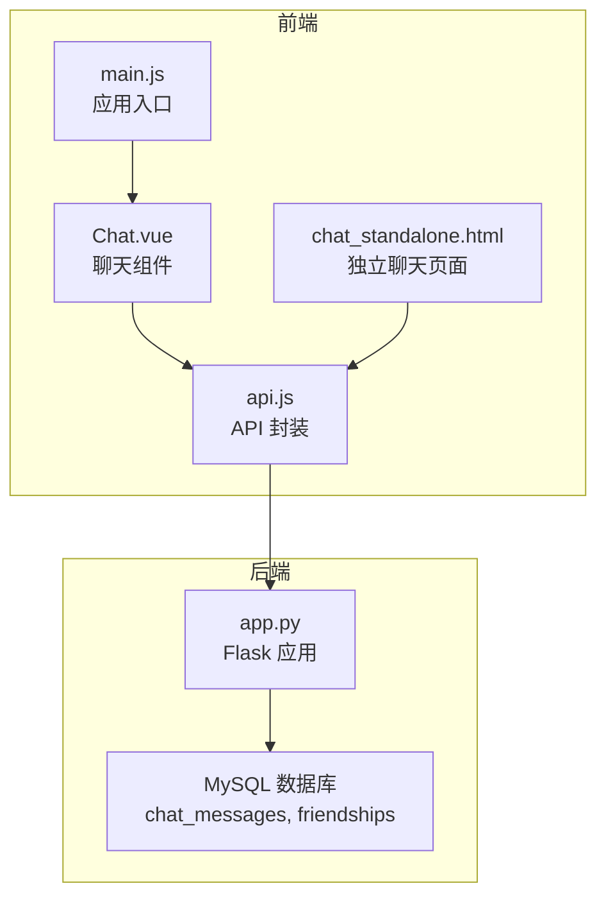
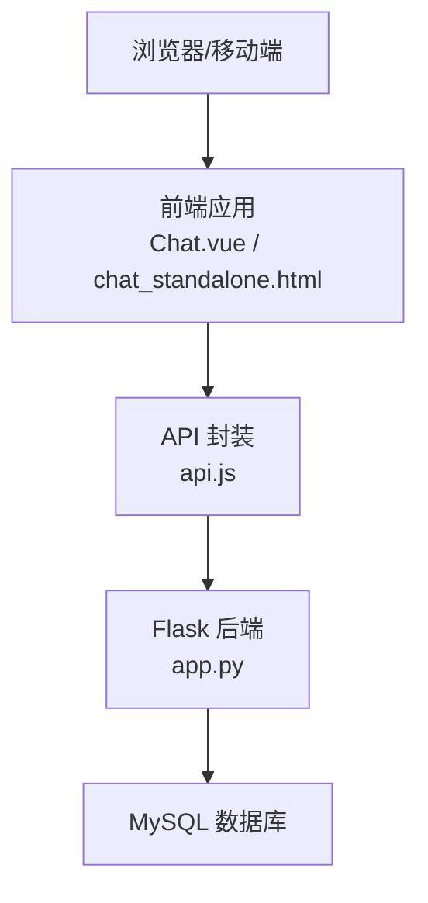
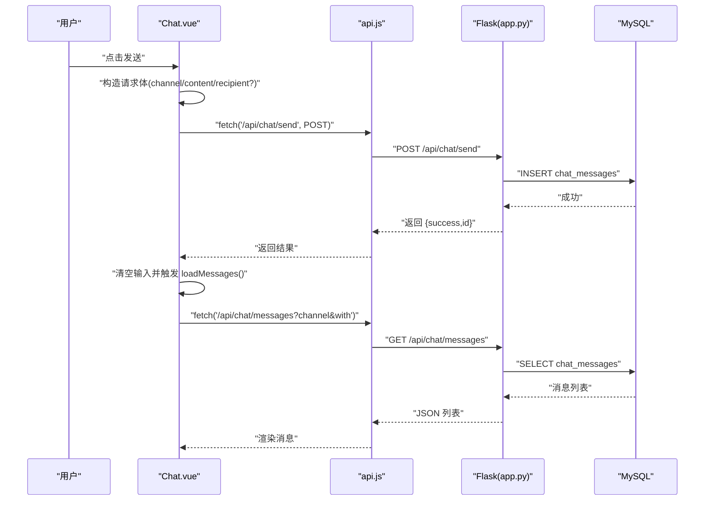
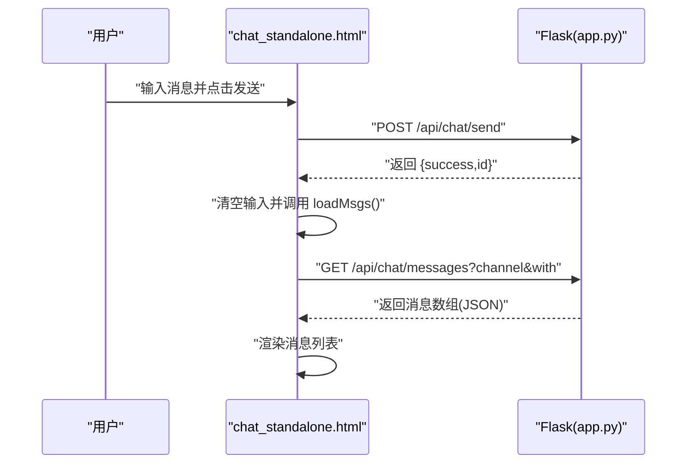
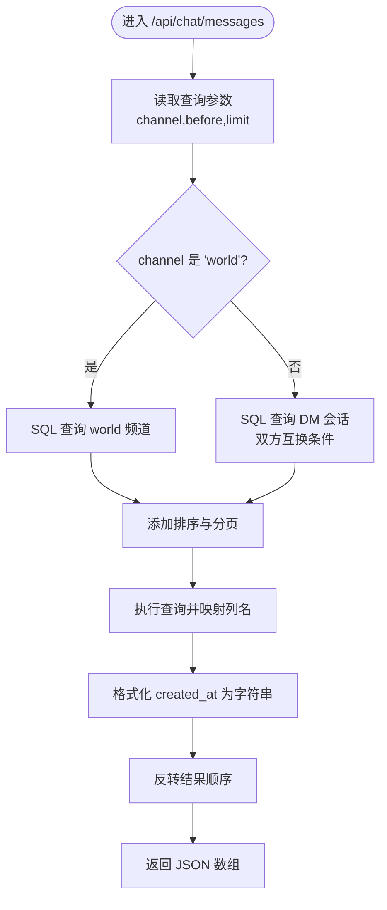
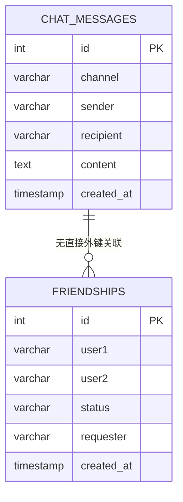
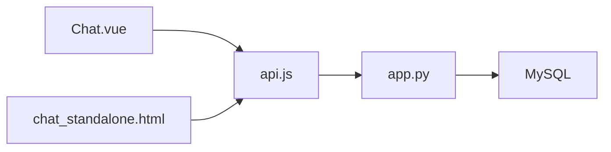
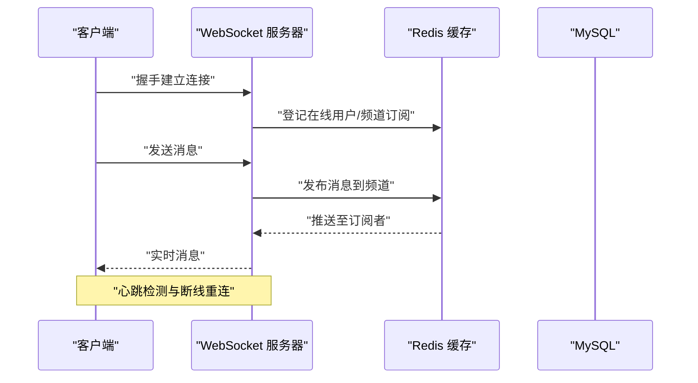

# 聊天架构设计

<cite>
**本文引用的文件**
- [app.py](file://app.py)
- [Chat.vue](file://frontend/src/components/Chat.vue)
- [chat_standalone.html](file://templates/chat_standalone.html)
- [api.js](file://frontend/src/api.js)
- [main.js](file://frontend/src/main.js)
</cite>

## 目录
1. [引言](#引言)
2. [项目结构](#项目结构)
3. [核心组件](#核心组件)
4. [架构总览](#架构总览)
5. [详细组件分析](#详细组件分析)
6. [依赖分析](#依赖分析)
7. [性能考量](#性能考量)
8. [故障排查指南](#故障排查指南)
9. [结论](#结论)
10. [附录](#附录)

## 引言
本技术文档围绕聊天系统的架构设计展开，重点解释以下方面：
- WebSocket 连接管理机制：连接建立、心跳检测与断线重连策略
- 消息路由系统：消息分发、频道路由与用户定位
- 实时通信数据流：消息序列化、传输协议与状态同步
- 整体架构模式：前后端分离、组件化结构与状态管理
- 性能优化与扩展性建议

在当前仓库中，聊天功能采用轮询（Polling）而非 WebSocket 实时推送。本文将基于现有实现进行分析，并给出向 WebSocket 迁移的建议与架构图示。

## 项目结构
前端采用 Vue 3 单页应用，后端基于 Flask 提供 REST API。聊天相关的核心文件如下：
- 前端组件：Chat.vue（Vue 组件）、api.js（API 封装）
- 模板页面：chat_standalone.html（独立聊天页面）
- 后端：app.py（Flask 应用、数据库初始化、聊天 API）

**图表来源**
- [main.js:1-6](file://frontend/src/main.js#L1-L6)
- [Chat.vue:1-214](file://frontend/src/components/Chat.vue#L1-L214)
- [api.js:1-45](file://frontend/src/api.js#L1-L45)
- [chat_standalone.html:1-174](file://templates/chat_standalone.html#L1-L174)
- [app.py:804-829](file://app.py#L804-L829)

**章节来源**
- [main.js:1-6](file://frontend/src/main.js#L1-L6)
- [Chat.vue:1-214](file://frontend/src/components/Chat.vue#L1-L214)
- [api.js:1-45](file://frontend/src/api.js#L1-L45)
- [chat_standalone.html:1-174](file://templates/chat_standalone.html#L1-L174)
- [app.py:804-829](file://app.py#L804-L829)

## 核心组件
- 前端聊天组件（Chat.vue）：负责频道切换、消息列表渲染、发送消息、好友管理与右键撤回等交互逻辑
- API 封装（api.js）：统一处理跨域 Cookie、构建查询参数与请求体
- 独立聊天页面（chat_standalone.html）：传统服务端渲染页面，同样使用轮询刷新
- 后端 Flask 应用（app.py）：提供聊天相关的 REST API，包含消息查询、发送、好友管理与数据库表结构定义

**章节来源**
- [Chat.vue:61-164](file://frontend/src/components/Chat.vue#L61-L164)
- [api.js:1-45](file://frontend/src/api.js#L1-L45)
- [chat_standalone.html:60-172](file://templates/chat_standalone.html#L60-L172)
- [app.py:3547-3745](file://app.py#L3547-L3745)

## 架构总览
当前聊天系统采用“前后端分离 + 轮询”的架构模式：
- 前端通过 fetch 发起 HTTP 请求，后端返回 JSON 数据
- 前端定时轮询刷新消息与好友状态，实现“准实时”体验
- 数据库存储在 MySQL，聊天消息与好友关系分别对应 chat_messages 与 friendships 表

**图表来源**
- [Chat.vue:78-97](file://frontend/src/components/Chat.vue#L78-L97)
- [chat_standalone.html:60-112](file://templates/chat_standalone.html#L60-L112)
- [api.js:1-45](file://frontend/src/api.js#L1-L45)
- [app.py:3547-3605](file://app.py#L3547-L3605)

## 详细组件分析

### 前端组件：Chat.vue
- 频道与私信切换：通过 channel 与 dmUser 控制当前会话类型
- 轮询刷新：每 3 秒调用 loadMessages 与 loadFriends，保持界面更新
- 消息发送：构造 channel 与 content（私信附加 recipient），POST 到 /api/chat/send
- 好友管理：请求 /api/chat/friends、/api/chat/friends/requests、/api/chat/search 等
- 右键菜单：仅发送者可撤回消息，调用 /api/chat/messages/{mid}

**图表来源**
- [Chat.vue:87-97](file://frontend/src/components/Chat.vue#L87-L97)
- [Chat.vue:158-164](file://frontend/src/components/Chat.vue#L158-L164)
- [api.js:32-33](file://frontend/src/api.js#L32-L33)
- [app.py:3582-3605](file://app.py#L3582-L3605)
- [app.py:3547-3580](file://app.py#L3547-L3580)

**章节来源**
- [Chat.vue:61-164](file://frontend/src/components/Chat.vue#L61-L164)
- [api.js:7-18](file://frontend/src/api.js#L7-L18)
- [app.py:3547-3605](file://app.py#L3547-L3605)

### 独立聊天页面：chat_standalone.html
- 使用原生 JavaScript 实现相同功能：频道切换、消息拉取、发送、好友管理
- 通过 setInterval 每 3 秒刷新消息与好友列表
- 通过 fetch 与后端 API 交互，遵循相同的鉴权与序列化规则

**图表来源**
- [chat_standalone.html:106-112](file://templates/chat_standalone.html#L106-L112)
- [chat_standalone.html:73-88](file://templates/chat_standalone.html#L73-L88)
- [app.py:3582-3605](file://app.py#L3582-L3605)
- [app.py:3547-3580](file://app.py#L3547-L3580)

**章节来源**
- [chat_standalone.html:60-172](file://templates/chat_standalone.html#L60-L172)
- [app.py:3547-3605](file://app.py#L3547-L3605)

### 后端 API：聊天模块
- 消息查询：/api/chat/messages 支持 world 与 dm 两种频道，支持分页参数 before 与 limit
- 消息发送：/api/chat/send 需登录，写入 chat_messages 表
- 用户搜索：/api/chat/search 支持用户名与昵称模糊匹配
- 好友管理：/api/chat/friends、/api/chat/friends/requests、/api/chat/friends/request、/api/chat/friends/accept、/api/chat/friends/remove
- 消息撤回：/api/chat/messages/{mid} DELETE，仅发送者可撤回

**图表来源**
- [app.py:3547-3580](file://app.py#L3547-L3580)

**章节来源**
- [app.py:3547-3745](file://app.py#L3547-L3745)
- [app.py:804-829](file://app.py#L804-L829)

### 数据模型：聊天与好友

**图表来源**
- [app.py:804-829](file://app.py#L804-L829)

**章节来源**
- [app.py:804-829](file://app.py#L804-L829)

## 依赖分析
- 前端依赖：Vue 3、浏览器 fetch、同源策略下的 Cookie 传递
- 后端依赖：Flask、pymysql、MySQL 数据库
- 聊天 API 依赖：会话鉴权（login_required）、输入清洗（sanitize_input）

**图表来源**
- [Chat.vue:78-97](file://frontend/src/components/Chat.vue#L78-L97)
- [chat_standalone.html:60-112](file://templates/chat_standalone.html#L60-L112)
- [api.js:1-45](file://frontend/src/api.js#L1-L45)
- [app.py:3547-3605](file://app.py#L3547-L3605)

**章节来源**
- [Chat.vue:78-97](file://frontend/src/components/Chat.vue#L78-L97)
- [chat_standalone.html:60-112](file://templates/chat_standalone.html#L60-L112)
- [api.js:1-45](file://frontend/src/api.js#L1-L45)
- [app.py:3547-3605](file://app.py#L3547-L3605)

## 性能考量
- 轮询频率：前端每 3 秒刷新一次，建议根据业务量调整间隔或引入服务端推送
- 分页与限制：消息查询支持 limit 上限与 before 分页，避免一次性返回大量历史消息
- 数据库索引：chat_messages 表包含 channel、sender、recipient、created_at 索引，有助于查询优化
- 输入清洗：对用户输入进行 HTML/JS 标签清理与长度限制，降低 XSS 与存储压力
- 会话与鉴权：登录态校验与 CSRF 校验，保障 API 安全

**章节来源**
- [Chat.vue:158-164](file://frontend/src/components/Chat.vue#L158-L164)
- [app.py:3547-3580](file://app.py#L3547-L3580)
- [app.py:804-829](file://app.py#L804-L829)
- [app.py:874-881](file://app.py#L874-L881)
- [app.py:908-917](file://app.py#L908-L917)
- [app.py:920-933](file://app.py#L920-L933)

## 故障排查指南
- 未登录访问：/api/* 路由在未登录时返回 401，需先完成登录流程
- CSRF 校验失败：POST 表单需携带有效 CSRF Token，否则返回 403
- 数据库异常：/api/chat/* 在数据库不可用时返回错误，检查 MySQL 连接配置
- 消息撤回权限：仅消息发送者可撤回，非发送者调用将被拒绝
- 频道与私信参数：DM 频道需提供正确的 recipient，否则查询为空

**章节来源**
- [app.py:908-917](file://app.py#L908-L917)
- [app.py:920-933](file://app.py#L920-L933)
- [app.py:3582-3605](file://app.py#L3582-L3605)
- [app.py:3736-3745](file://app.py#L3736-L3745)
- [app.py:3547-3580](file://app.py#L3547-L3580)

## 结论
当前聊天系统通过轮询实现了基本的“准实时”消息体验，具备清晰的前后端职责划分与良好的安全性控制。若要提升实时性与性能，建议引入 WebSocket 实时推送，并结合 Redis 缓存与消息队列实现高并发场景下的消息分发与状态同步。

## 附录

### WebSocket 迁移建议（概念性）
- 连接建立：客户端通过 WebSocket 连接后端，携带鉴权信息
- 心跳检测：服务端与客户端定期发送 ping/pong，超时判定断线
- 断线重连：指数退避策略与最大重试次数，恢复订阅频道
- 消息路由：按频道与用户维度路由消息，支持广播与点对点
- 状态同步：服务端维护在线用户集合与订阅关系，保证一致性

[本图为概念性示意，不对应具体源码文件]