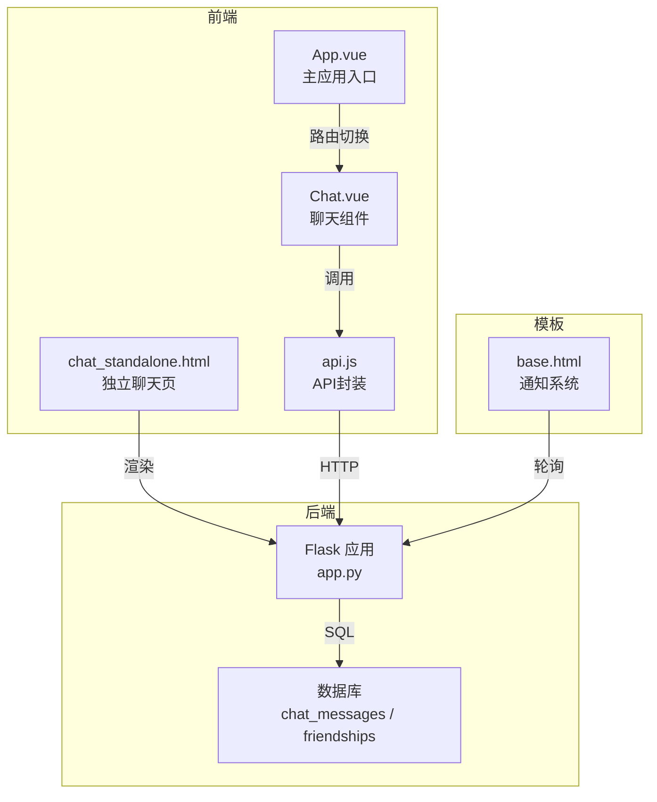
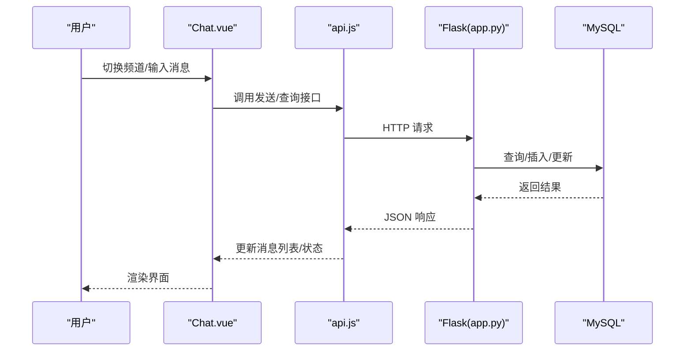
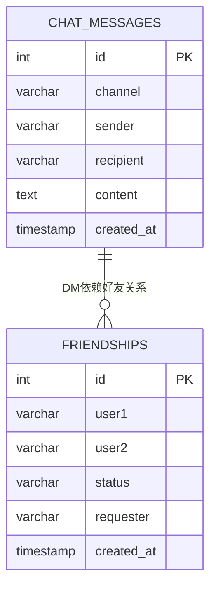
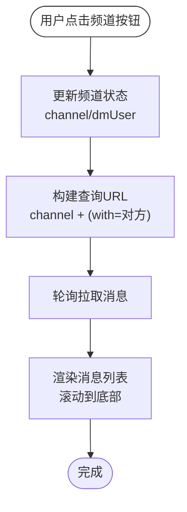
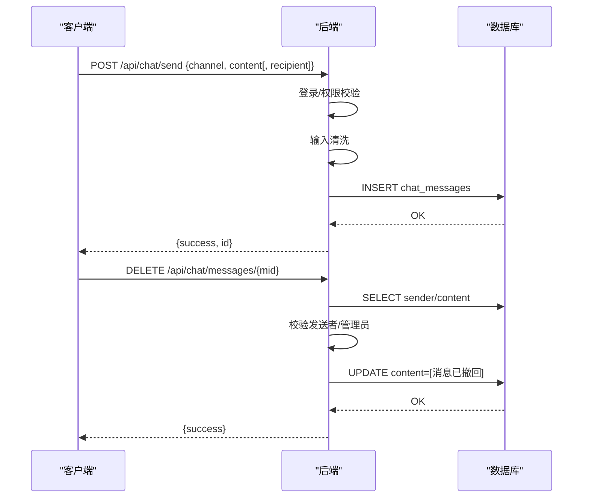
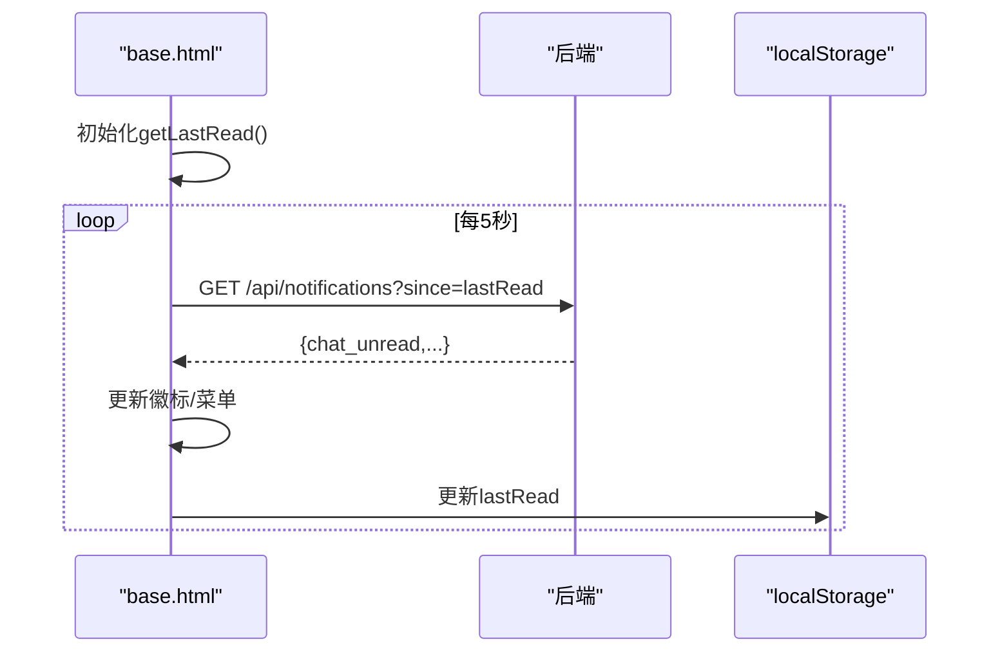
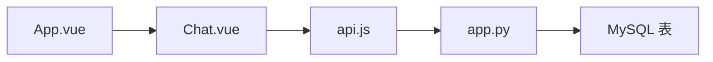

# 频道切换系统

<cite>
**本文引用的文件**
- [app.py](file://app.py)
- [frontend/src/components/Chat.vue](file://frontend/src/components/Chat.vue)
- [templates/chat_standalone.html](file://templates/chat_standalone.html)
- [frontend/src/api.js](file://frontend/src/api.js)
- [frontend/src/App.vue](file://frontend/src/App.vue)
- [templates/base.html](file://templates/base.html)
</cite>

## 目录
1. [简介](#简介)
2. [项目结构](#项目结构)
3. [核心组件](#核心组件)
4. [架构总览](#架构总览)
5. [详细组件分析](#详细组件分析)
6. [依赖分析](#依赖分析)
7. [性能考虑](#性能考虑)
8. [故障排查指南](#故障排查指南)
9. [结论](#结论)
10. [附录](#附录)

## 简介
本技术文档围绕“频道切换系统”进行深入解析，涵盖频道类型设计（私聊频道、群聊频道、公共频道）、频道创建与管理机制、频道切换算法与状态保存/恢复、消息隔离与访问控制、通知系统以及扩展性与性能优化策略。系统由前端 Vue 组件与后端 Flask 接口共同构成，采用轮询拉取的方式实现消息流，通过数据库表实现频道与好友关系的数据持久化。

## 项目结构
- 前端采用 Vue 单文件组件，聊天界面由独立组件承载，并通过统一的 API 封装进行后端交互。
- 后端基于 Flask 提供聊天相关接口，包含消息查询、发送、好友关系管理、消息撤回等。
- 模板层提供独立的聊天页面，便于在无需主应用框架的情况下直接访问聊天功能。
- 通知系统集成于基础模板中，通过轮询获取未读统计并在顶部导航栏展示。

图表来源
- [frontend/src/components/Chat.vue:1-214](file://frontend/src/components/Chat.vue#L1-L214)
- [frontend/src/api.js:1-45](file://frontend/src/api.js#L1-L45)
- [templates/chat_standalone.html:1-174](file://templates/chat_standalone.html#L1-L174)
- [app.py:3545-3754](file://app.py#L3545-L3754)
- [templates/base.html:275-336](file://templates/base.html#L275-L336)

章节来源
- [frontend/src/components/Chat.vue:1-214](file://frontend/src/components/Chat.vue#L1-L214)
- [frontend/src/api.js:1-45](file://frontend/src/api.js#L1-L45)
- [templates/chat_standalone.html:1-174](file://templates/chat_standalone.html#L1-L174)
- [app.py:3545-3754](file://app.py#L3545-L3754)
- [templates/base.html:275-336](file://templates/base.html#L275-L336)

## 核心组件
- 频道类型
  - 公共频道（世界频道）：面向全体用户的公开聊天区域，消息按 ID 倒序分页加载。
  - 私聊频道（Direct Message）：基于好友关系的双向一对一聊天，查询条件为双方互为收发方。
- 频道管理
  - 好友关系：支持添加好友、接受/拒绝请求、删除好友。
  - 消息管理：支持发送消息、撤回消息（仅发送者或管理员可执行）。
- 频道切换
  - 前端通过状态切换当前频道，同时根据频道类型拼接查询参数（公共频道无需额外参数，私聊需指定对方用户）。
- 通知系统
  - 基于本地存储记录“上次查看通知时间”，后端提供未读统计接口，前端定时轮询更新顶部通知徽标。

章节来源
- [app.py:3545-3754](file://app.py#L3545-L3754)
- [frontend/src/components/Chat.vue:64-164](file://frontend/src/components/Chat.vue#L64-L164)
- [templates/chat_standalone.html:60-166](file://templates/chat_standalone.html#L60-L166)
- [templates/base.html:275-336](file://templates/base.html#L275-L336)

## 架构总览
系统采用前后端分离模式：
- 前端负责 UI 展示、用户交互与状态管理，通过封装的 API 发起 HTTP 请求。
- 后端提供 RESTful 接口，处理鉴权、输入清洗、数据库访问与业务规则。
- 数据库包含聊天消息表与好友关系表，分别支撑公共频道与私聊频道的消息边界与访问控制。

图表来源
- [frontend/src/components/Chat.vue:80-97](file://frontend/src/components/Chat.vue#L80-L97)
- [frontend/src/api.js:1-45](file://frontend/src/api.js#L1-L45)
- [app.py:3545-3754](file://app.py#L3545-L3754)

## 详细组件分析

### 频道类型设计与区别
- 公共频道（世界频道）
  - 数据边界：按 channel='world' 进行筛选。
  - 访问控制：仅登录用户可读写。
  - 性能特征：按 id 倒序分页，限制每页数量。
- 私聊频道（DM）
  - 数据边界：双方互为 sender/recipient 的记录。
  - 访问控制：仅消息发送者或管理员可撤回。
  - 用户体验：通过好友列表选择对话对象，切换频道时更新目标用户。

图表来源
- [app.py:803-828](file://app.py#L803-L828)

章节来源
- [app.py:3545-3754](file://app.py#L3545-L3754)
- [app.py:803-828](file://app.py#L803-L828)

### 频道创建与管理机制
- 频道初始化
  - 后端启动时创建必要的数据表（聊天消息表、好友关系表），并建立索引以提升查询性能。
- 成员管理
  - 添加好友：向 friendships 表插入一条 pending 记录。
  - 接受/拒绝：更新状态字段。
  - 删除好友：删除双向好友记录。
- 权限控制
  - 登录保护：聊天相关接口均要求登录。
  - 管理员特权：消息撤回时允许管理员操作。

章节来源
- [app.py:803-828](file://app.py#L803-L828)
- [app.py:3631-3733](file://app.py#L3631-L3733)
- [app.py:907-916](file://app.py#L907-L916)
- [app.py:3735-3754](file://app.py#L3735-L3754)

### 频道切换算法与状态保存/恢复
- 切换逻辑
  - 前端维护当前频道状态与私聊目标用户，切换时更新查询参数并触发消息拉取。
  - 后端根据 channel 参数与 DM 条件构造 SQL，支持 before 分页参数。
- 状态保存/恢复
  - 前端通过组件状态与本地滚动位置保持用户体验。
  - 通知系统通过本地存储记录“上次查看时间”，避免重复提示。

图表来源
- [frontend/src/components/Chat.vue:80-85](file://frontend/src/components/Chat.vue#L80-L85)
- [frontend/src/components/Chat.vue:155-156](file://frontend/src/components/Chat.vue#L155-L156)
- [templates/chat_standalone.html:73-88](file://templates/chat_standalone.html#L73-L88)

章节来源
- [frontend/src/components/Chat.vue:64-164](file://frontend/src/components/Chat.vue#L64-L164)
- [templates/chat_standalone.html:60-166](file://templates/chat_standalone.html#L60-L166)

### 频道消息隔离机制
- 消息边界
  - 公共频道：按 channel='world' 过滤。
  - 私聊频道：按双方互为 sender/recipient 过滤。
- 访问控制
  - 发送接口：登录后方可发送。
  - 撤回接口：仅发送者或管理员可执行。
- 数据安全
  - 输入清洗：移除脚本与 HTML 标签，限制长度。
  - 鉴权装饰器：统一处理登录、CSRF、VIP/管理员权限。

图表来源
- [app.py:3581-3604](file://app.py#L3581-L3604)
- [app.py:3735-3754](file://app.py#L3735-L3754)
- [app.py:873-880](file://app.py#L873-L880)
- [app.py:907-916](file://app.py#L907-L916)

章节来源
- [app.py:3545-3754](file://app.py#L3545-L3754)
- [app.py:873-880](file://app.py#L873-L880)
- [app.py:907-916](file://app.py#L907-L916)

### 频道通知系统
- 未读统计
  - 后端提供聊天未读统计接口，按时间戳与用户身份计算。
- 通知展示
  - 基础模板中通过脚本定时轮询，更新顶部通知徽标与下拉菜单内容。
- 状态同步
  - 通过本地存储记录“上次查看通知时间”，避免重复提示。

图表来源
- [templates/base.html:285-331](file://templates/base.html#L285-L331)
- [app.py:1654-1666](file://app.py#L1654-L1666)

章节来源
- [templates/base.html:275-336](file://templates/base.html#L275-L336)
- [app.py:1654-1666](file://app.py#L1654-L1666)

## 依赖分析
- 前端依赖
  - Chat.vue 依赖 api.js 进行网络请求，依赖组件状态与定时器维持轮询。
  - App.vue 作为主入口，负责路由切换与子组件挂载。
- 后端依赖
  - Flask 路由依赖数据库连接与装饰器（登录、CSRF、VIP/管理员）。
  - 数据库表依赖索引以支撑高频查询。

图表来源
- [frontend/src/components/Chat.vue:1-214](file://frontend/src/components/Chat.vue#L1-L214)
- [frontend/src/api.js:1-45](file://frontend/src/api.js#L1-L45)
- [frontend/src/App.vue:1-99](file://frontend/src/App.vue#L1-L99)
- [app.py:3545-3754](file://app.py#L3545-L3754)

章节来源
- [frontend/src/components/Chat.vue:1-214](file://frontend/src/components/Chat.vue#L1-L214)
- [frontend/src/api.js:1-45](file://frontend/src/api.js#L1-L45)
- [frontend/src/App.vue:1-99](file://frontend/src/App.vue#L1-L99)
- [app.py:3545-3754](file://app.py#L3545-L3754)

## 性能考虑
- 查询优化
  - 为聊天消息表建立多列索引（channel/sender/recipient/created_at），降低公共频道与私聊查询成本。
  - 分页参数 before 与 limit 控制单次返回量，避免一次性传输过多数据。
- 前端轮询
  - 轮询间隔固定，建议根据实际并发与带宽调整频率，减少不必要的请求。
- 输入与安全
  - 输入清洗与装饰器校验降低恶意数据与越权风险，减少后端异常开销。
- 扩展建议
  - 引入 WebSocket 实现实时推送，替代轮询。
  - 对热门频道引入缓存层（如 Redis）以减轻数据库压力。
  - 私聊频道可按用户维度分表或分区，进一步提升查询效率。

章节来源
- [app.py:803-828](file://app.py#L803-L828)
- [app.py:3545-3579](file://app.py#L3545-L3579)
- [app.py:873-880](file://app.py#L873-L880)
- [app.py:907-916](file://app.py#L907-L916)

## 故障排查指南
- 无法切换频道
  - 检查前端状态更新与 URL 构造逻辑，确认 channel 与 DM 参数正确传递。
  - 关注后端路由参数解析与 SQL 条件。
- 消息无法发送/显示
  - 确认登录状态与权限装饰器生效。
  - 检查输入清洗是否截断内容，或数据库连接是否正常。
- 无法撤回消息
  - 核对发送者身份与管理员权限判定逻辑。
- 通知不更新
  - 检查本地存储 lastRead 是否被正确更新，轮询间隔与接口返回格式是否一致。

章节来源
- [frontend/src/components/Chat.vue:80-97](file://frontend/src/components/Chat.vue#L80-L97)
- [app.py:3581-3604](file://app.py#L3581-L3604)
- [app.py:3735-3754](file://app.py#L3735-L3754)
- [templates/base.html:285-331](file://templates/base.html#L285-L331)

## 结论
频道切换系统通过清晰的频道类型划分、完善的成员与权限管理、稳定的前后端交互协议，实现了公共与私聊场景下的消息隔离与访问控制。现有轮询机制满足基本需求，建议在高并发场景引入 WebSocket 与缓存策略以进一步提升性能与用户体验。

## 附录
- API 一览（后端）
  - GET /api/chat/messages?channel=world|dm&with=对方&before=ID&limit=N
  - POST /api/chat/send {channel, content[, recipient]}
  - DELETE /api/chat/messages/{mid}
  - GET /api/chat/friends
  - GET /api/chat/friends/requests
  - POST /api/chat/friends/request {username}
  - POST /api/chat/friends/accept {username}
  - POST /api/chat/friends/remove {username}
  - GET /api/notifications?since=时间戳

章节来源
- [app.py:3545-3754](file://app.py#L3545-L3754)
- [templates/base.html:301-324](file://templates/base.html#L301-L324)