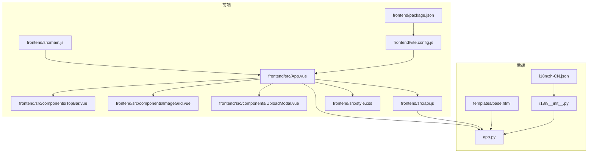
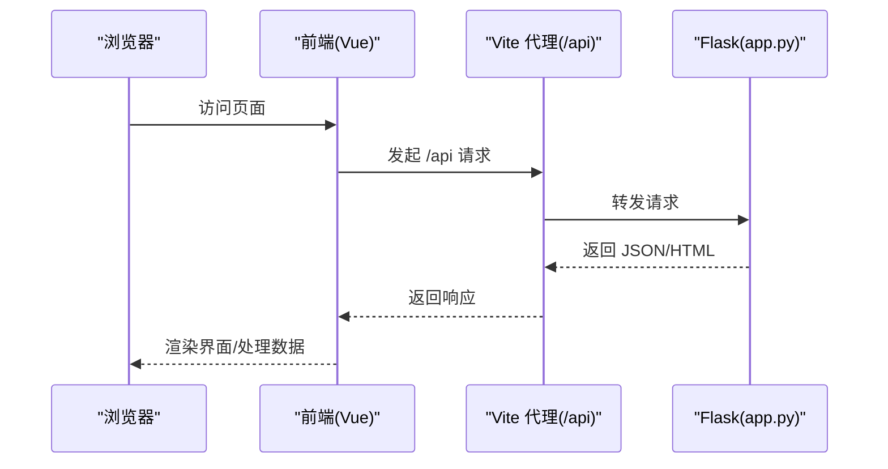
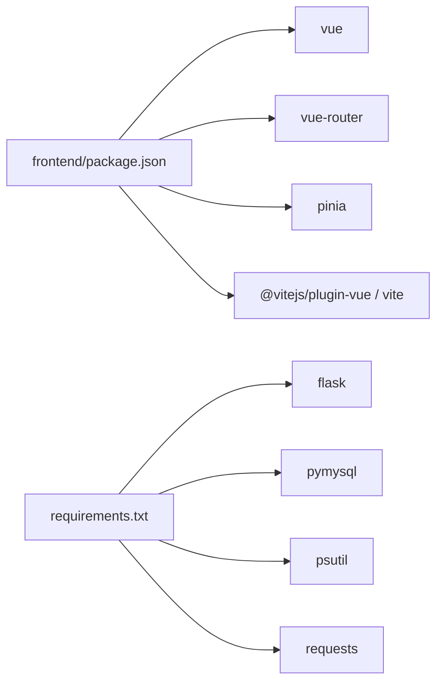

# 代码规范与约定

<cite>
**本文引用的文件**
- [app.py](file://app.py)
- [frontend/src/main.js](file://frontend/src/main.js)
- [frontend/src/api.js](file://frontend/src/api.js)
- [frontend/src/App.vue](file://frontend/src/App.vue)
- [frontend/src/components/TopBar.vue](file://frontend/src/components/TopBar.vue)
- [frontend/src/components/ImageGrid.vue](file://frontend/src/components/ImageGrid.vue)
- [frontend/src/components/UploadModal.vue](file://frontend/src/components/UploadModal.vue)
- [frontend/src/style.css](file://frontend/src/style.css)
- [frontend/package.json](file://frontend/package.json)
- [frontend/vite.config.js](file://frontend/vite.config.js)
- [templates/base.html](file://templates/base.html)
- [i18n/__init__.py](file://i18n/__init__.py)
- [i18n/zh-CN.json](file://i18n/zh-CN.json)
- [requirements.txt](file://requirements.txt)
</cite>

## 目录
1. [引言](#引言)
2. [项目结构](#项目结构)
3. [核心组件](#核心组件)
4. [架构总览](#架构总览)
5. [详细组件分析](#详细组件分析)
6. [依赖分析](#依赖分析)
7. [性能考虑](#性能考虑)
8. [故障排查指南](#故障排查指南)
9. [结论](#结论)
10. [附录](#附录)

## 引言
本规范文档面向 School_Web 项目，旨在统一 Python（Flask）与 JavaScript/ES6+（Vue 3）的编码风格、命名约定、模块组织与代码复用原则，并明确前后端交互、API 规范与异步编程最佳实践。文档同时给出文件命名规则、格式化标准（缩进、注释、文档字符串）、导入顺序与模块组织建议，以及通过实际代码片段路径展示正确实践。

## 项目结构
项目采用“后端 Flask + 前端 Vue 3（Vite 构建）”的双栈架构，模板系统基于 Jinja2（Flask）。前端资源位于 frontend/，包含 Vue 组件、API 封装、样式与构建配置；后端逻辑集中在 app.py，模板与国际化资源分别位于 templates/ 与 i18n/。

图表来源
- [frontend/src/main.js:1-6](file://frontend/src/main.js#L1-L6)
- [frontend/src/App.vue:1-99](file://frontend/src/App.vue#L1-L99)
- [frontend/src/components/TopBar.vue:1-42](file://frontend/src/components/TopBar.vue#L1-L42)
- [frontend/src/components/ImageGrid.vue:1-129](file://frontend/src/components/ImageGrid.vue#L1-L129)
- [frontend/src/components/UploadModal.vue:1-116](file://frontend/src/components/UploadModal.vue#L1-L116)
- [frontend/src/api.js:1-45](file://frontend/src/api.js#L1-L45)
- [frontend/src/style.css:1-59](file://frontend/src/style.css#L1-L59)
- [frontend/vite.config.js:1-21](file://frontend/vite.config.js#L1-L21)
- [frontend/package.json:1-21](file://frontend/package.json#L1-L21)
- [app.py:1-120](file://app.py#L1-L120)
- [templates/base.html:1-337](file://templates/base.html#L1-L337)
- [i18n/__init__.py:1-113](file://i18n/__init__.py#L1-L113)
- [i18n/zh-CN.json:1-200](file://i18n/zh-CN.json#L1-L200)

章节来源
- [frontend/src/main.js:1-6](file://frontend/src/main.js#L1-L6)
- [frontend/src/App.vue:1-99](file://frontend/src/App.vue#L1-L99)
- [app.py:1-120](file://app.py#L1-L120)

## 核心组件
- 后端应用与中间件
  - 应用实例、CORS、会话安全、安全响应头、多语言上下文注入、速率限制与 IP 白名单等。
- 前端应用入口与路由
  - Vue 应用挂载、组件组合、样式引入、主题与语言切换脚本。
- API 封装层
  - 统一前缀、凭证携带、常用业务接口导出。
- 国际化模块
  - 翻译键值加载、语言检测与预加载策略。

章节来源
- [app.py:119-194](file://app.py#L119-L194)
- [frontend/src/main.js:1-6](file://frontend/src/main.js#L1-L6)
- [frontend/src/App.vue:1-99](file://frontend/src/App.vue#L1-L99)
- [frontend/src/api.js:1-45](file://frontend/src/api.js#L1-L45)
- [i18n/__init__.py:1-113](file://i18n/__init__.py#L1-L113)

## 架构总览
前后端通过 /api 前缀通信，前端通过 Vite 开发服务器代理到后端服务。模板系统负责注入 CSP nonce 与国际化上下文，保证安全与本地化体验。

图表来源
- [frontend/vite.config.js:9-18](file://frontend/vite.config.js#L9-L18)
- [frontend/src/api.js:2-5](file://frontend/src/api.js#L2-L5)
- [app.py:119-194](file://app.py#L119-L194)

## 详细组件分析

### Python 编码规范（Flask 应用）
- 变量命名
  - 使用下划线命名法（snake_case），如：session_id、login_lockout、ip_requests。
  - 常量使用全大写加下划线（UPPER_SNAKE_CASE），如：RATE_LIMIT、BLOCK_DURATION。
- 函数命名
  - 私有辅助函数以下划线前缀区分，如：_load_whitelist、_save_whitelist、_verify_captcha。
  - 公共路由函数以动词短语命名，如：api_captcha、check_rate_limit。
- 类设计
  - RateLimiter 类职责单一：内存+文件持久化的请求桶管理，提供 check、_schedule_save、_load、_save、shutdown。
  - 设计要点：线程锁保护、定时器合并保存、异常容错、优雅关闭。
- 文档字符串
  - 类与公共方法使用三引号文档字符串，简洁说明用途、参数与返回值。
- 错误处理
  - 对外接口统一返回 JSON 或 4xx/5xx 状态码；内部异常捕获避免崩溃。
- 安全与合规
  - CSP nonce 注入、安全响应头、会话安全配置、白名单与封禁策略、UA 黑名单拦截。
- 模块组织
  - 将路由、工具函数、安全中间件按功能分段组织，保持 app.py 可读性。
- 导入顺序
  - 标准库 → 第三方库 → 项目内模块，分组清晰，便于维护。

章节来源
- [app.py:31-114](file://app.py#L31-L114)
- [app.py:149-194](file://app.py#L149-L194)
- [app.py:642-676](file://app.py#L642-L676)

### JavaScript/ES6+ 与 Vue 3 开发规范
- 文件命名
  - Vue 组件：PascalCase.vue（如 TopBar.vue、ImageGrid.vue、UploadModal.vue）。
  - API 封装：小驼峰命名（如 api.js）。
  - 样式：小驼峰命名（如 style.css）。
  - 入口：main.js。
- 变量与函数命名
  - 常量：CONSTANT_CASE（如 BASE）。
  - 函数：小驼峰（如 doSearch、loadImages）。
  - 私有函数：下划线前缀（如 _loadWhitelist）。
- 组件开发
  - 使用 Composition API（<script setup>），显式定义 props、emits、expose。
  - 通过 defineExpose 暴露内部方法供父组件调用（如 ImageGrid 的 loadImages）。
  - 使用 v-if/v-show 控制条件渲染，合理拆分模板与样式（scoped）。
- API 调用规范
  - 统一前缀 BASE，fetch 默认携带 credentials: 'include'。
  - 对外暴露具体业务函数（如 getImages、addImageComment、uploadImage）。
  - 对于复杂请求，使用 Promise.all 并行获取关联数据。
- 异步编程最佳实践
  - 使用 async/await，避免深层回调。
  - 对可能失败的网络请求进行 try/catch 包裹，避免阻塞 UI。
  - 使用防抖（setTimeout + clearTimeout）优化高频输入（如搜索）。
- 模板与样式
  - 组件样式使用 scoped，避免全局污染。
  - 使用语义化 class 命名（如 .btn、.input、.modal-overlay）。
- 构建与开发
  - Vite 配置代理 /api 与静态资源，开发端口 3000。
  - package.json 中声明依赖与脚本，遵循 ESM 模块类型。

章节来源
- [frontend/src/api.js:1-45](file://frontend/src/api.js#L1-L45)
- [frontend/src/App.vue:47-84](file://frontend/src/App.vue#L47-L84)
- [frontend/src/components/TopBar.vue:15-31](file://frontend/src/components/TopBar.vue#L15-L31)
- [frontend/src/components/ImageGrid.vue:43-106](file://frontend/src/components/ImageGrid.vue#L43-L106)
- [frontend/src/components/UploadModal.vue:48-99](file://frontend/src/components/UploadModal.vue#L48-L99)
- [frontend/src/style.css:1-59](file://frontend/src/style.css#L1-L59)
- [frontend/vite.config.js:1-21](file://frontend/vite.config.js#L1-L21)
- [frontend/package.json:1-21](file://frontend/package.json#L1-L21)

### 国际化与模板集成
- 翻译模块
  - 支持多语言键值加载、语言名称映射、语言检测与预加载。
- 模板上下文
  - 注入翻译函数、语言信息、插件区块，模板中通过 nonce 安全注入脚本。
- 语言切换
  - 前端通过 /api/lang/switch 切换语言并刷新页面。

章节来源
- [i18n/__init__.py:1-113](file://i18n/__init__.py#L1-L113)
- [templates/base.html:165-194](file://templates/base.html#L165-L194)
- [app.py:214-228](file://app.py#L214-L228)

## 依赖分析
- 前端依赖
  - Vue 3、Vue Router、Pinia、Vite、@vitejs/plugin-vue。
- 后端依赖
  - Flask、PyMySQL、psutil、requests。
- 代理与构建
  - Vite 代理 /api 与 /static/albums 到后端服务，开发端口 3000。

图表来源
- [frontend/package.json:11-19](file://frontend/package.json#L11-L19)
- [requirements.txt:1-5](file://requirements.txt#L1-L5)

章节来源
- [frontend/package.json:1-21](file://frontend/package.json#L1-L21)
- [requirements.txt:1-5](file://requirements.txt#L1-L5)

## 性能考虑
- 前端
  - 图片懒加载（loading="lazy"）、卡片悬停动画、防抖搜索、并行请求（Promise.all）。
  - 组件按需渲染（v-if）、减少不必要的响应式更新。
- 后端
  - 速率限制与封禁策略、白名单机制、CSP 降低 XSS 风险、安全响应头减少攻击面。
  - 数据库连接池与表初始化在首次访问时完成，避免重复开销。

章节来源
- [frontend/src/components/ImageGrid.vue:67-74](file://frontend/src/components/ImageGrid.vue#L67-L74)
- [app.py:513-562](file://app.py#L513-L562)
- [app.py:642-676](file://app.py#L642-L676)

## 故障排查指南
- 前端
  - 确认 Vite 代理配置正确，/api 与 /static/albums 能代理到后端。
  - 检查 fetch 请求是否携带 credentials: 'include'，避免跨域凭据问题。
- 后端
  - 检查 CORS 配置与安全响应头，确认浏览器控制台无 CSP/跨域错误。
  - 若出现 429/403，检查速率限制与封禁状态、白名单与手动封禁配置。
- 国际化
  - 确认语言切换接口 /api/lang/switch 返回 ok: true，模板上下文注入正常。

章节来源
- [frontend/vite.config.js:9-18](file://frontend/vite.config.js#L9-L18)
- [frontend/src/api.js:2-5](file://frontend/src/api.js#L2-L5)
- [app.py:131-139](file://app.py#L131-L139)
- [app.py:642-676](file://app.py#L642-L676)
- [app.py:214-228](file://app.py#L214-L228)

## 结论
本规范文档总结了 School_Web 项目的 Python 与前端开发约定，涵盖命名、模块组织、API 规范、异步实践与安全策略。建议团队在新增模块时遵循上述约定，保持一致性与可维护性。

## 附录

### 文件命名规则
- Python 文件
  - 模块：小写下划线命名（如 app.py、i18n/__init__.py）。
  - 资源：小写下划线命名（如 rate_limiter.json、ip_whitelist.json）。
- JavaScript 文件
  - 入口：main.js；API：api.js；样式：style.css。
  - 组件：PascalCase.vue（如 TopBar.vue、ImageGrid.vue）。
- CSS 文件
  - 小驼峰命名（如 style.css）。
- 模板文件
  - base.html、各功能页面模板（如 dashboard.html、album_vue3.html）。

章节来源
- [frontend/src/main.js:1-6](file://frontend/src/main.js#L1-L6)
- [frontend/src/api.js:1-45](file://frontend/src/api.js#L1-L45)
- [frontend/src/style.css:1-59](file://frontend/src/style.css#L1-L59)
- [frontend/src/components/TopBar.vue:1-42](file://frontend/src/components/TopBar.vue#L1-L42)
- [frontend/src/components/ImageGrid.vue:1-129](file://frontend/src/components/ImageGrid.vue#L1-L129)
- [templates/base.html:1-337](file://templates/base.html#L1-L337)

### 代码格式化与注释规范
- 缩进
  - Python 使用 4 空格；JavaScript/HTML/CSS 使用 2 空格（遵循现有代码风格）。
- 注释
  - 单行注释使用 #，段落注释使用三引号文档字符串。
  - 对关键流程与安全逻辑添加注释说明。
- 文档字符串
  - 类与公共函数使用三引号文档字符串，说明用途、参数与返回值。

章节来源
- [app.py:31-114](file://app.py#L31-L114)
- [i18n/__init__.py:1-113](file://i18n/__init__.py#L1-L113)

### 导入顺序与模块组织
- Python
  - 标准库 → 第三方库 → 项目内模块；按功能分段组织（路由、工具、安全中间件）。
- JavaScript
  - 依赖导入在顶部，组件导入与业务逻辑分离；API 封装集中管理。

章节来源
- [app.py:1-28](file://app.py#L1-L28)
- [frontend/src/api.js:1-5](file://frontend/src/api.js#L1-L5)

### 实际代码示例（路径）
- 前端组件与 API
  - [frontend/src/App.vue:47-84](file://frontend/src/App.vue#L47-L84)
  - [frontend/src/components/TopBar.vue:15-31](file://frontend/src/components/TopBar.vue#L15-L31)
  - [frontend/src/components/ImageGrid.vue:43-106](file://frontend/src/components/ImageGrid.vue#L43-L106)
  - [frontend/src/components/UploadModal.vue:48-99](file://frontend/src/components/UploadModal.vue#L48-L99)
  - [frontend/src/api.js:1-45](file://frontend/src/api.js#L1-L45)
- 后端应用与中间件
  - [app.py:119-194](file://app.py#L119-L194)
  - [app.py:513-562](file://app.py#L513-L562)
  - [app.py:642-676](file://app.py#L642-L676)
- 国际化与模板
  - [i18n/__init__.py:50-108](file://i18n/__init__.py#L50-L108)
  - [templates/base.html:165-194](file://templates/base.html#L165-L194)