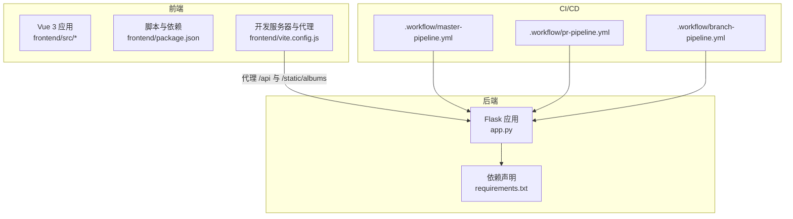
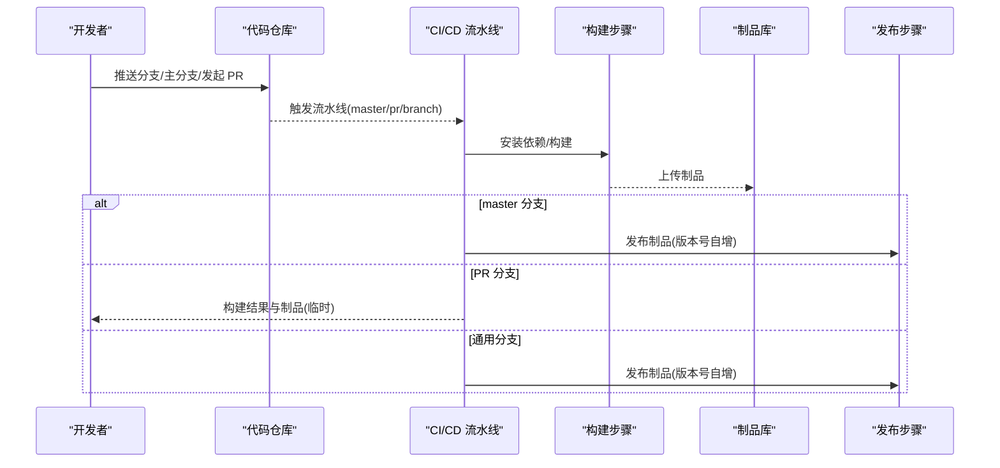
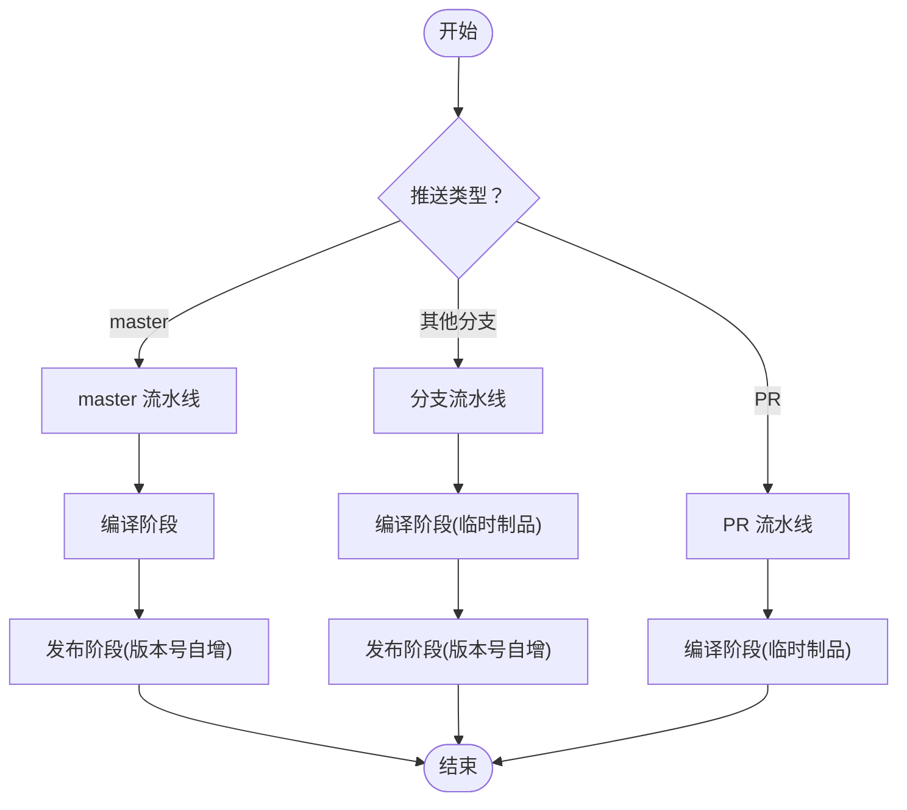
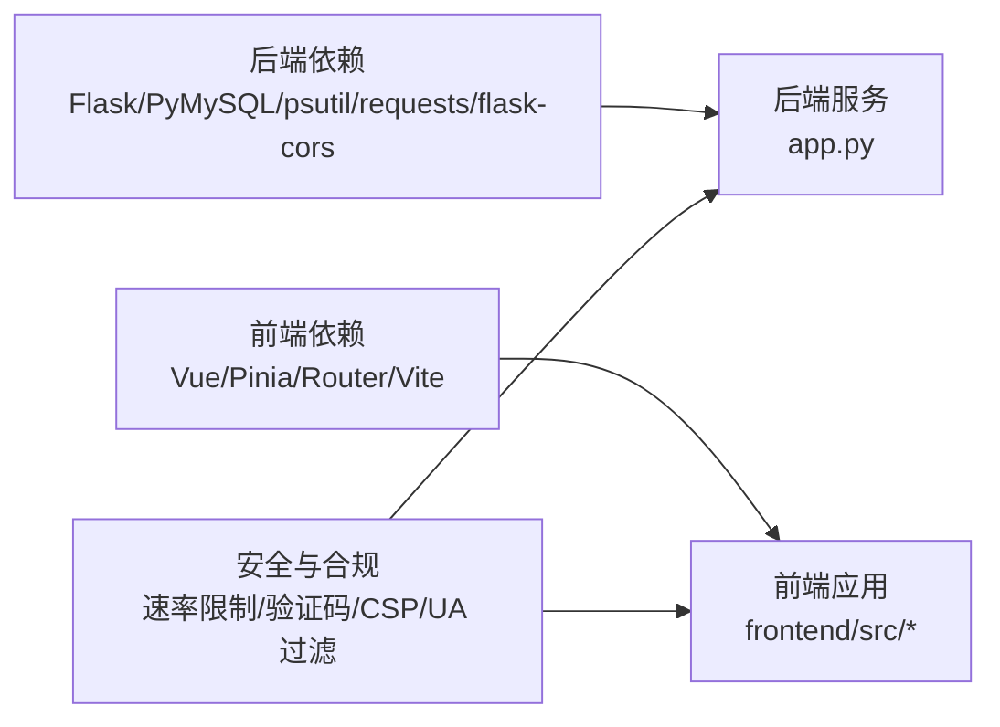

# 开发工作流程

<cite>
**本文引用的文件**   
- [master-pipeline.yml](file://.workflow/master-pipeline.yml)
- [pr-pipeline.yml](file://.workflow/pr-pipeline.yml)
- [branch-pipeline.yml](file://.workflow/branch-pipeline.yml)
- [app.py](file://app.py)
- [requirements.txt](file://requirements.txt)
- [package.json](file://frontend/package.json)
- [vite.config.js](file://frontend/vite.config.js)
- [.gitignore](file://.gitignore)
- [README.md](file://README.md)
- [安全措施清单.md](file://安全措施清单.md)
</cite>

## 目录
1. [简介](#简介)
2. [项目结构](#项目结构)
3. [核心组件](#核心组件)
4. [架构总览](#架构总览)
5. [详细组件分析](#详细组件分析)
6. [依赖分析](#依赖分析)
7. [性能考量](#性能考量)
8. [故障排查指南](#故障排查指南)
9. [结论](#结论)
10. [附录](#附录)

## 简介
本指南面向 School_Web 项目的开发团队，提供一套完整的开发工作流程规范，涵盖分支管理策略、代码审查流程、CI/CD 流水线配置、提交消息规范、开发环境同步、版本发布与回滚策略，并给出实际 Git 工作流示例与最佳实践。目标是提升协作效率、保证质量与安全性，同时降低发布风险。

## 项目结构
项目采用前后端分离架构：
- 后端：基于 Flask 的 Python 应用，负责业务逻辑、API 提供与数据库交互。
- 前端：基于 Vue 3 + Vite 的单页应用，通过代理访问后端 API。
- CI/CD：通过 .workflow 目录下的 YAML 配置文件定义流水线，分别支持 master 主分支、PR 与分支流水线。

**图示来源**
- [app.py](file://app.py)
- [requirements.txt](file://requirements.txt)
- [package.json](file://frontend/package.json)
- [vite.config.js](file://frontend/vite.config.js)
- [master-pipeline.yml](file://.workflow/master-pipeline.yml)
- [pr-pipeline.yml](file://.workflow/pr-pipeline.yml)
- [branch-pipeline.yml](file://.workflow/branch-pipeline.yml)

**章节来源**
- [README.md](file://README.md)
- [app.py](file://app.py)
- [frontend/package.json](file://frontend/package.json)
- [frontend/vite.config.js](file://frontend/vite.config.js)
- [.workflow/master-pipeline.yml](file://.workflow/master-pipeline.yml)
- [.workflow/pr-pipeline.yml](file://.workflow/pr-pipeline.yml)
- [.workflow/branch-pipeline.yml](file://.workflow/branch-pipeline.yml)

## 核心组件
- 后端服务：提供认证、系统监控、数据库工具、文件管理、相册功能等 API 与页面渲染。
- 前端应用：相册模块（Vue 3）与工具页面，通过 Vite 开发服务器与后端 API 通信。
- CI/CD 流水线：master 分支自动构建与发布、PR 分支构建与制品上传、通用分支构建与发布。
- 安全与合规：严格的速率限制、验证码门禁、CSP/安全响应头、白名单与封禁机制。

**章节来源**
- [app.py](file://app.py)
- [frontend/package.json](file://frontend/package.json)
- [frontend/vite.config.js](file://frontend/vite.config.js)
- [.workflow/master-pipeline.yml](file://.workflow/master-pipeline.yml)
- [.workflow/pr-pipeline.yml](file://.workflow/pr-pipeline.yml)
- [.workflow/branch-pipeline.yml](file://.workflow/branch-pipeline.yml)
- [安全措施清单.md](file://安全措施清单.md)

## 架构总览
下图展示了从开发者提交到 CI/CD 构建、制品上传与发布的整体流程，以及前后端交互关系。

**图示来源**
- [.workflow/master-pipeline.yml](file://.workflow/master-pipeline.yml)
- [.workflow/pr-pipeline.yml](file://.workflow/pr-pipeline.yml)
- [.workflow/branch-pipeline.yml](file://.workflow/branch-pipeline.yml)

## 详细组件分析

### 分支管理策略
- 主分支保护
  - master 分支触发 master 流水线，自动构建与发布制品，版本号自增。
  - master 分支支持标签触发与定时调度。
- 功能分支命名规范
  - 建议采用 feature/功能简述、bugfix/问题简述、hotfix/紧急修复等前缀，配合 issue 编号，如 feature/user-login-123、bugfix/password-reset-456。
- 合并流程
  - 优先通过 Pull Request 合并至 master，确保 CI 通过与代码审查。
  - master 合并后自动触发发布流程。

**章节来源**
- [.workflow/master-pipeline.yml](file://.workflow/master-pipeline.yml)
- [.workflow/branch-pipeline.yml](file://.workflow/branch-pipeline.yml)
- [.workflow/pr-pipeline.yml](file://.workflow/pr-pipeline.yml)

### 代码审查流程
- Pull Request 模板
  - 必填项：变更摘要、影响范围、测试要点、风险评估、回滚预案。
  - 建议附带截图/录屏与本地测试清单。
- 审查标准
  - 代码风格与可读性、安全与性能、测试覆盖率、兼容性与回归风险。
- 反馈处理机制
  - 审查人提出的问题需逐条回复与修正，直至通过。
  - 关键变更（安全、数据库、配置）需至少两名维护者批准。

**章节来源**
- [.workflow/pr-pipeline.yml](file://.workflow/pr-pipeline.yml)
- [README.md](file://README.md)

### CI/CD 流水线配置
- master 分支流水线
  - 触发条件：push 到 master、标签匹配、定时任务。
  - 阶段：编译（安装依赖、构建）、发布（制品版本号自增）。
- PR 分支流水线
  - 触发条件：针对 master 的 PR。
  - 阶段：编译（构建产物暂存，不上传制品库，7 天后清理）。
- 通用分支流水线
  - 触发条件：推送非 master 分支。
  - 阶段：编译（构建产物暂存）、发布（制品版本号自增）。

**图示来源**
- [.workflow/master-pipeline.yml](file://.workflow/master-pipeline.yml)
- [.workflow/pr-pipeline.yml](file://.workflow/pr-pipeline.yml)
- [.workflow/branch-pipeline.yml](file://.workflow/branch-pipeline.yml)

**章节来源**
- [.workflow/master-pipeline.yml](file://.workflow/master-pipeline.yml)
- [.workflow/pr-pipeline.yml](file://.workflow/pr-pipeline.yml)
- [.workflow/branch-pipeline.yml](file://.workflow/branch-pipeline.yml)

### 提交消息规范
- 格式：类型(作用域): 概要
- 类型：feat、fix、docs、style、refactor、test、chore、perf、ci、build
- 作用域：模块或文件夹，如 backend、frontend、deps、security
- 示例：feat(frontend): 相册组件新增标签筛选功能

**章节来源**
- [README.md](file://README.md)

### 开发环境同步流程
- 后端依赖
  - 安装：pip install -r requirements.txt
  - 环境变量：FLASK_DEBUG、ADMIN_SECRET、SECRET_KEY（由应用自动生成）
- 前端依赖
  - 安装：npm install
  - 开发：npm run dev（Vite 代理指向后端）
- 配置变更处理
  - 数据库连接、速率限制配置、白名单等通过文件持久化，变更后需重启服务生效。
  - .gitignore 中忽略 .secret_key、ip_whitelist.json、rate_config.json 等敏感文件。

**章节来源**
- [requirements.txt](file://requirements.txt)
- [frontend/package.json](file://frontend/package.json)
- [frontend/vite.config.js](file://frontend/vite.config.js)
- [.gitignore](file://.gitignore)
- [app.py](file://app.py)

### 版本发布流程与回滚策略
- 发布流程
  - master 分支：自动构建并通过发布阶段生成带自增版本号的制品。
  - 通用分支：构建完成后发布制品，便于预览与测试。
- 回滚策略
  - 依据制品库中的版本记录进行回滚，优先采用“版本号自增”的发布机制，便于定位与回退。
  - 回滚前需评估影响面与数据一致性，必要时回滚数据库迁移或配置文件。

**章节来源**
- [.workflow/master-pipeline.yml](file://.workflow/master-pipeline.yml)
- [.workflow/branch-pipeline.yml](file://.workflow/branch-pipeline.yml)

### 实际 Git 工作流示例与最佳实践
- 示例工作流
  - 新功能：git checkout -b feature/user-login-123 → 编码 → git commit → push → 创建 PR → CI 通过 → 合并 master → 自动发布
  - 紧急修复：git checkout -b hotfix/db-config-789 → 修复 → push → PR → 合并 master → 自动发布
- 最佳实践
  - 小步提交、清晰的提交信息与 PR 描述
  - 在 PR 中附带测试截图与变更影响说明
  - 严格遵守主分支保护规则，避免直接推送 master

**章节来源**
- [.workflow/pr-pipeline.yml](file://.workflow/pr-pipeline.yml)
- [.workflow/master-pipeline.yml](file://.workflow/master-pipeline.yml)

## 依赖分析
- 后端依赖
  - Flask、PyMySQL、psutil、requests、flask-cors 等，用于 Web 框架、数据库连接、系统监控、HTTP 请求与跨域支持。
- 前端依赖
  - Vue 3、Vue Router、Pinia、Vite、@vitejs/plugin-vue，用于组件化开发、状态管理与快速构建。
- 安全与合规
  - 速率限制、白名单、验证码门禁、CSP/安全响应头、UA 过滤等，保障系统安全与稳定性。

**图示来源**
- [requirements.txt](file://requirements.txt)
- [frontend/package.json](file://frontend/package.json)
- [app.py](file://app.py)
- [安全措施清单.md](file://安全措施清单.md)

**章节来源**
- [requirements.txt](file://requirements.txt)
- [frontend/package.json](file://frontend/package.json)
- [app.py](file://app.py)
- [安全措施清单.md](file://安全措施清单.md)

## 性能考量
- 速率限制与封禁：通过内存队列与持久化配置控制请求频率，减少恶意请求与资源消耗。
- 前端代理与静态资源：Vite 开发服务器代理后端 API，生产环境由后端提供静态资源，减少跨域与中间层开销。
- 构建优化：流水线中统一镜像源与依赖安装，缩短构建时间。

**章节来源**
- [app.py](file://app.py)
- [frontend/vite.config.js](file://frontend/vite.config.js)
- [.workflow/master-pipeline.yml](file://.workflow/master-pipeline.yml)

## 故障排查指南
- 常见问题
  - 依赖安装失败：检查网络与镜像源配置，确认 requirements.txt 与 package.json 无语法错误。
  - CORS 问题：确认 flask-cors 配置与前端代理设置一致。
  - 速率限制导致 429：检查 ip_whitelist.json 与 rate_config.json 配置。
- 审计与日志
  - 查看系统日志与最近封禁记录，定位异常请求来源。
  - 安全扫描报告可用于识别修复项与改进方向。

**章节来源**
- [app.py](file://app.py)
- [frontend/vite.config.js](file://frontend/vite.config.js)
- [安全措施清单.md](file://安全措施清单.md)

## 结论
通过明确的分支策略、严格的代码审查、完善的 CI/CD 流水线与安全机制，School_Web 项目能够在保证质量与安全的前提下高效迭代。建议团队持续遵循本文规范，并结合项目演进不断优化流程与工具链。

## 附录
- 关键配置参考
  - 后端：数据库配置、会话与安全响应头、速率限制参数
  - 前端：开发服务器端口与代理、构建脚本
  - CI/CD：master、PR、分支流水线触发条件与阶段

**章节来源**
- [app.py](file://app.py)
- [frontend/vite.config.js](file://frontend/vite.config.js)
- [.workflow/master-pipeline.yml](file://.workflow/master-pipeline.yml)
- [.workflow/pr-pipeline.yml](file://.workflow/pr-pipeline.yml)
- [.workflow/branch-pipeline.yml](file://.workflow/branch-pipeline.yml)