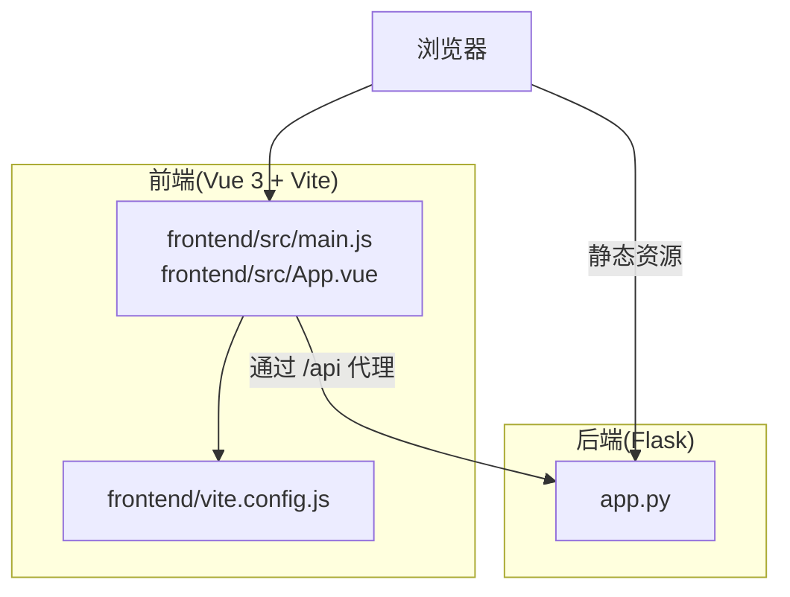
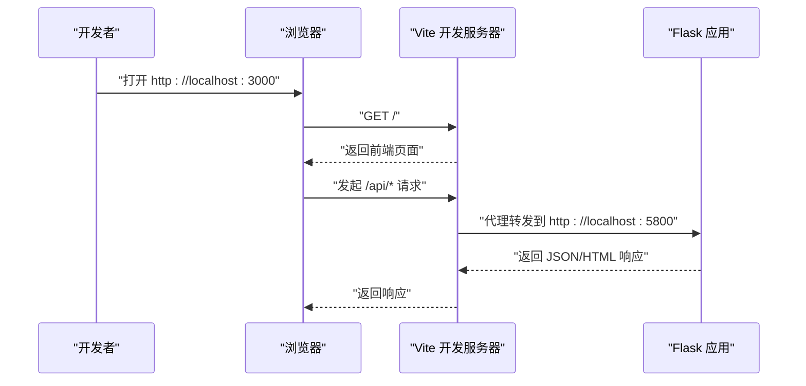
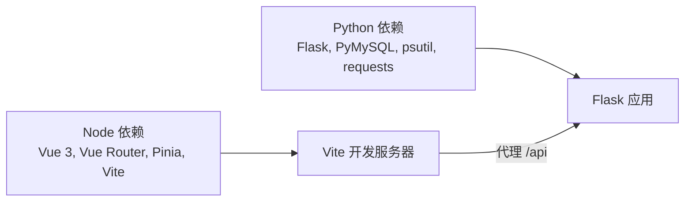

# 开发环境配置

<cite>
**本文引用的文件**
- [requirements.txt](file://requirements.txt)
- [package.json](file://frontend/package.json)
- [vite.config.js](file://frontend/vite.config.js)
- [app.py](file://app.py)
- [main.js](file://frontend/src/main.js)
- [App.vue](file://frontend/src/App.vue)
- [.gitignore](file://.gitignore)
- [SchoolWeb.spec](file://SchoolWeb.spec)
</cite>

## 目录
1. [简介](#简介)
2. [项目结构](#项目结构)
3. [核心组件](#核心组件)
4. [架构总览](#架构总览)
5. [详细组件分析](#详细组件分析)
6. [依赖分析](#依赖分析)
7. [性能考虑](#性能考虑)
8. [故障排除指南](#故障排除指南)
9. [结论](#结论)
10. [附录](#附录)

## 简介
本指南面向参与 School_Web 项目的开发者，提供从零开始搭建开发环境的完整流程与最佳实践。内容涵盖：
- 开发环境要求（Python、Node.js、数据库）
- 依赖安装流程（Python 虚拟环境、pip、npm）
- IDE 配置建议（VS Code、Python 插件、Vue.js 工具链、数据库客户端）
- 开发服务器启动（Flask 后端、Vite 前端、热重载）
- 环境变量与配置（数据库连接、API 密钥、调试模式）
- 开发工具推荐（Postman、Chrome DevTools、数据库管理工具）
- 常见问题与故障排除

## 项目结构
该项目采用前后端分离架构：
- 后端：基于 Python 的 Flask 应用，负责业务逻辑、数据库访问与 API 提供
- 前端：基于 Vue 3 + Vite 的单页应用，通过代理访问后端 API
- 构建与打包：前端构建产物由后端模板与静态资源目录提供

图表来源
- [main.js:1-6](file://frontend/src/main.js#L1-L6)
- [App.vue:1-99](file://frontend/src/App.vue#L1-L99)
- [vite.config.js:1-21](file://frontend/vite.config.js#L1-L21)
- [app.py:119-139](file://app.py#L119-L139)

章节来源
- [main.js:1-6](file://frontend/src/main.js#L1-L6)
- [App.vue:1-99](file://frontend/src/App.vue#L1-L99)
- [vite.config.js:1-21](file://frontend/vite.config.js#L1-L21)
- [app.py:119-139](file://app.py#L119-L139)

## 核心组件
- 后端框架与依赖
  - 使用 Flask 作为 Web 框架，并通过 PyMySQL 连接 MySQL 数据库
  - 依赖项定义于 requirements.txt，包含 Flask、PyMySQL、psutil、requests 等
- 前端技术栈
  - Vue 3、Vue Router、Pinia、Vite 以及 @vitejs/plugin-vue
  - 通过 package.json 定义脚本与依赖
- 开发服务器
  - 前端：Vite 默认监听 0.0.0.0:3000，并配置 /api 与 /static/albums 代理至后端
  - 后端：Flask 默认监听 127.0.0.1:5800（由前端代理访问）

章节来源
- [requirements.txt:1-5](file://requirements.txt#L1-L5)
- [package.json:1-21](file://frontend/package.json#L1-L21)
- [vite.config.js:1-21](file://frontend/vite.config.js#L1-L21)
- [app.py:119-139](file://app.py#L119-L139)

## 架构总览
下图展示了开发阶段的典型交互路径：浏览器访问前端本地服务，前端通过 Vite 代理将 API 请求转发至 Flask 后端。

图表来源
- [vite.config.js:9-18](file://frontend/vite.config.js#L9-L18)
- [app.py:119-139](file://app.py#L119-L139)

## 详细组件分析

### 后端 Flask 配置要点
- 跨域与会话
  - 启用 CORS 并限定来源为前端开发地址
  - 设置会话 Cookie 的 HttpOnly、SameSite、Secure 等属性
- 安全响应头
  - 设置 X-Content-Type-Options、X-Frame-Options、X-XSS-Protection、Referrer-Policy、Permissions-Policy
  - 注入 CSP nonce，避免 unsafe-inline，必要时保留以兼容既有内联脚本
- 数据库配置
  - 默认数据库连接参数位于 DB_CONFIG 与 ALBUM_DB_CONFIG
  - 通过 get_db()/get_album_db() 获取连接
- 速率限制与访问控制
  - 内置内存级速率限制与持久化配置
  - IP 白名单与手动封禁机制
  - 全站验证码门禁策略

章节来源
- [app.py:119-139](file://app.py#L119-L139)
- [app.py:624-639](file://app.py#L624-L639)
- [app.py:641-676](file://app.py#L641-L676)
- [app.py:680-692](file://app.py#L680-L692)
- [app.py:348-413](file://app.py#L348-L413)
- [app.py:513-593](file://app.py#L513-L593)

### 前端 Vite 配置要点
- 本地开发服务器
  - host: 0.0.0.0，port: 3000
- 代理规则
  - /api → http://localhost:5800
  - /static/albums → http://localhost:5800
- 插件
  - @vitejs/plugin-vue 支持 Vue SFC

章节来源
- [vite.config.js:1-21](file://frontend/vite.config.js#L1-L21)

### 前端入口与应用结构
- 入口文件
  - main.js 创建并挂载 Vue 应用
- 根组件
  - App.vue 定义标签页、搜索、排序、标签筛选等 UI 逻辑
  - 通过 fetch 访问 /api/album/me 获取当前用户权限

章节来源
- [main.js:1-6](file://frontend/src/main.js#L1-L6)
- [App.vue:1-99](file://frontend/src/App.vue#L1-L99)

### 构建与打包
- 前端构建产物输出至 frontend/dist
- 打包脚本在 package.json 中定义
- PyInstaller 规则 SchoolWeb.spec 指定收集模板、静态资源与 dist 目录

章节来源
- [package.json:6-10](file://frontend/package.json#L6-L10)
- [SchoolWeb.spec:8-16](file://SchoolWeb.spec#L8-L16)
- [SchoolWeb.spec:36-44](file://SchoolWeb.spec#L36-L44)

## 依赖分析
- Python 依赖
  - Flask、PyMySQL、psutil、requests 等
- Node.js 依赖
  - Vue 3、Vue Router、Pinia、Vite、@vitejs/plugin-vue
- 代理与运行时
  - 前端通过 Vite 代理访问后端；后端默认监听 5800 端口

图表来源
- [requirements.txt:1-5](file://requirements.txt#L1-L5)
- [package.json:11-19](file://frontend/package.json#L11-L19)
- [vite.config.js:9-18](file://frontend/vite.config.js#L9-L18)

章节来源
- [requirements.txt:1-5](file://requirements.txt#L1-L5)
- [package.json:1-21](file://frontend/package.json#L1-L21)
- [vite.config.js:1-21](file://frontend/vite.config.js#L1-L21)

## 性能考虑
- 前端
  - 使用 Vite 的按需编译与热重载提升开发体验
  - 合理拆分组件与懒加载，减少初始包体
- 后端
  - 速率限制与 IP 封禁降低恶意请求压力
  - 会话空闲超时与安全响应头降低会话劫持风险
- 数据库
  - 使用连接池与最小化查询开销，避免 N+1 查询
  - 对高频接口进行缓存与限流

## 故障排除指南
- 端口冲突
  - 前端默认占用 3000，后端默认占用 5800；若冲突，请在 vite.config.js 或 Flask 配置中调整
- 代理不通
  - 确认 vite.config.js 的代理目标与后端监听地址一致
  - 确认后端已启动且未报错
- 数据库连接失败
  - 检查 DB_CONFIG/ALBUM_DB_CONFIG 中的主机、用户名、密码、数据库名
  - 确认数据库服务已启动且网络可达
- CORS 错误
  - 确认 Flask 的 CORS 配置允许前端地址
- 会话与 Cookie
  - 若使用 HTTP 环境，确保 SESSION_COOKIE_SECURE 为 False
  - 确认浏览器允许第三方 Cookie（因代理与跨域）
- 文件权限与持久化
  - .secret_key、ip_whitelist.json、rate_config.json 等文件需可读写
- 速率限制导致的 429/403
  - 检查速率限制配置与封禁状态，必要时清空封禁或调整阈值

章节来源
- [vite.config.js:6-18](file://frontend/vite.config.js#L6-L18)
- [app.py:119-139](file://app.py#L119-L139)
- [app.py:624-639](file://app.py#L624-L639)
- [app.py:348-413](file://app.py#L348-L413)
- [.gitignore:1-4](file://.gitignore#L1-L4)

## 结论
通过本指南，您可以在本地快速搭建 School_Web 的开发环境，理解前后端交互与代理机制，并掌握常见问题的排查方法。建议在团队内统一环境变量与数据库配置，确保开发一致性。

## 附录

### 开发环境要求
- Python
  - 版本：满足 Flask>=3.0 的要求
- Node.js
  - 版本：满足 Vue 3、Vite、@vitejs/plugin-vue 的最低版本需求
- 数据库
  - MySQL：满足 PyMySQL 连接与表结构初始化要求

章节来源
- [requirements.txt:1-5](file://requirements.txt#L1-L5)
- [package.json:11-19](file://frontend/package.json#L11-L19)

### 依赖安装流程
- Python 虚拟环境
  - 建议使用 venv 或 conda 创建隔离环境
- pip 安装
  - 在项目根目录执行安装命令，安装 requirements.txt 中的依赖
- npm 安装
  - 在 frontend 目录执行安装命令，安装 package.json 中的依赖

章节来源
- [requirements.txt:1-5](file://requirements.txt#L1-L5)
- [package.json:1-21](file://frontend/package.json#L1-L21)

### IDE 配置建议（VS Code）
- Python 插件
  - 推荐：Python、Pylance、Flask Snippets
- Vue.js 开发工具
  - 推荐：Volar、ESLint、Prettier
- 数据库客户端
  - 推荐：MySQL Workbench、DBeaver 或 VS Code 的 MySQL 插件
- 其他
  - 配置任务与调试，便于一键启动前后端

### 开发服务器启动方法
- Flask 后端
  - 在项目根目录启动后端，默认监听 127.0.0.1:5800
- Vite 前端
  - 在 frontend 目录执行 dev 脚本，默认监听 0.0.0.0:3000
  - 通过代理将 /api 与 /static/albums 转发至后端
- 热重载
  - Vite 自带热重载，修改前端代码即时生效

章节来源
- [package.json:6-10](file://frontend/package.json#L6-L10)
- [vite.config.js:6-18](file://frontend/vite.config.js#L6-L18)
- [app.py:119-139](file://app.py#L119-L139)

### 环境变量配置
- 数据库连接
  - DB_CONFIG/ALBUM_DB_CONFIG：主机、用户、密码、数据库名
- API 密钥与安全
  - ADMIN_SECRET：管理员密钥
  - .secret_key：Flask secret_key 文件
- 调试模式
  - FLASK_DEBUG：非调试模式下启用 HSTS 等安全头
  - HTTPS：影响会话 Cookie 的 Secure 属性

章节来源
- [app.py:624-639](file://app.py#L624-L639)
- [app.py:121-129](file://app.py#L121-L129)
- [app.py:134-139](file://app.py#L134-L139)
- [app.py:673-675](file://app.py#L673-L675)

### 开发工具推荐
- API 测试：Postman
- 前端调试：Chrome DevTools
- 数据库管理：MySQL Workbench/DBeaver
- 代码质量：ESLint/Prettier（前端）、flake8/black/isort（后端）

### 常见问题与解决方案
- 代理 404 或 502
  - 确认后端已启动且监听地址正确
- 验证码/会话异常
  - 检查会话 Cookie 设置与前端 fetch 凭据
- 速率限制触发
  - 临时提高阈值或清空封禁状态文件

章节来源
- [vite.config.js:9-18](file://frontend/vite.config.js#L9-L18)
- [app.py:513-593](file://app.py#L513-L593)
- [app.py:348-413](file://app.py#L348-L413)