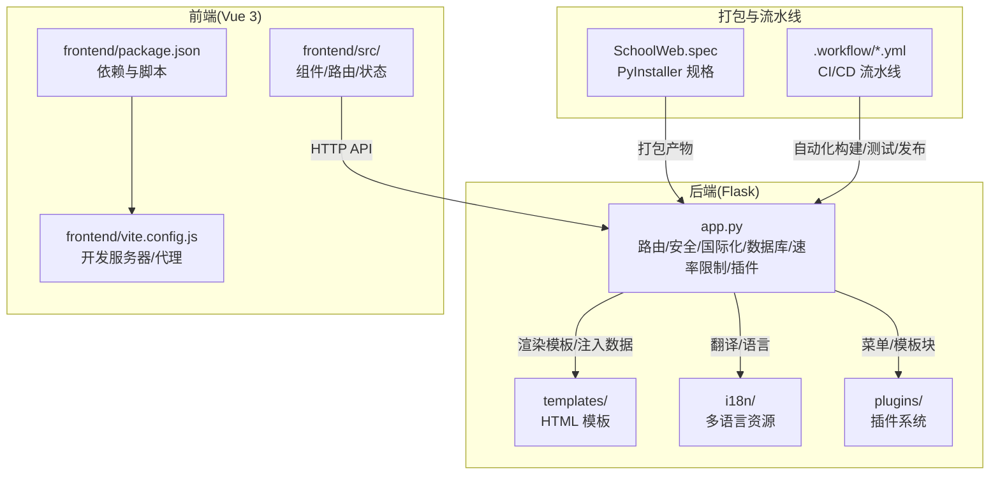
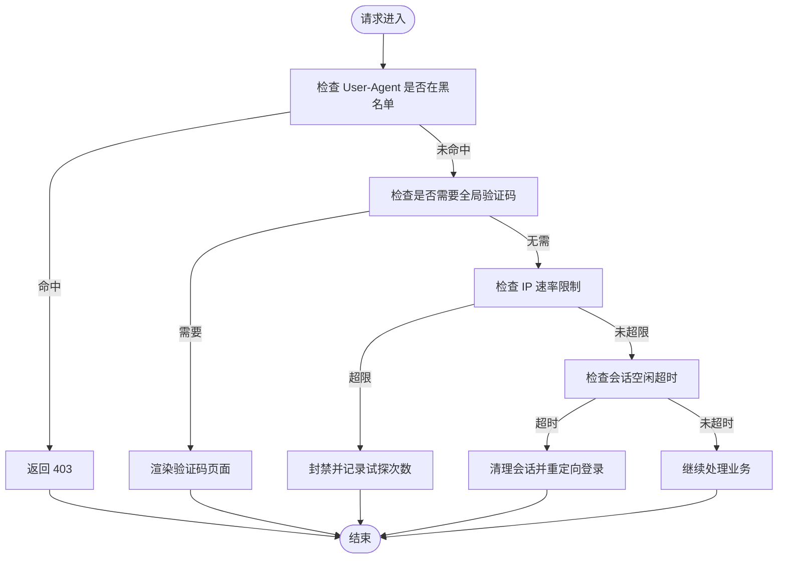
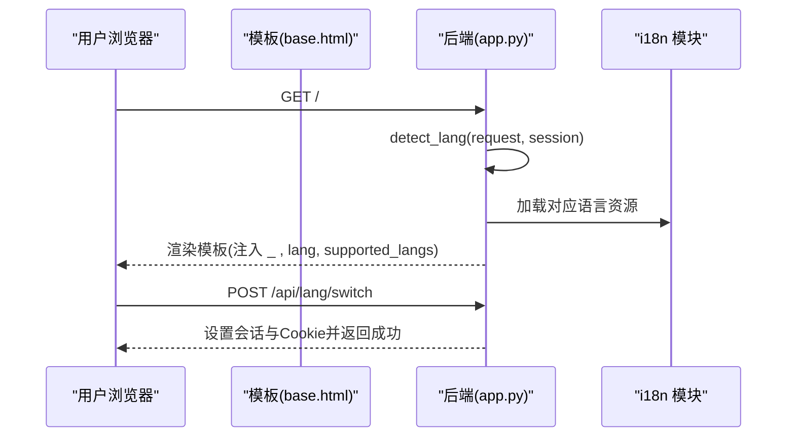
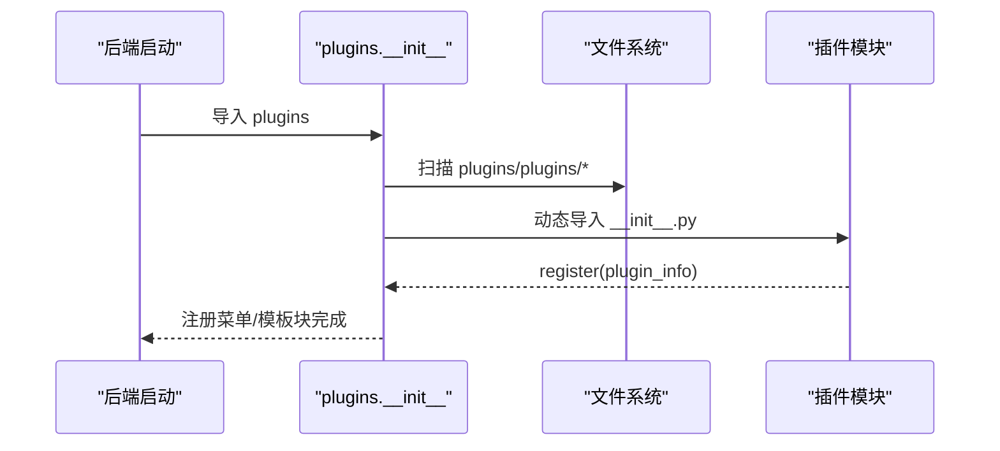
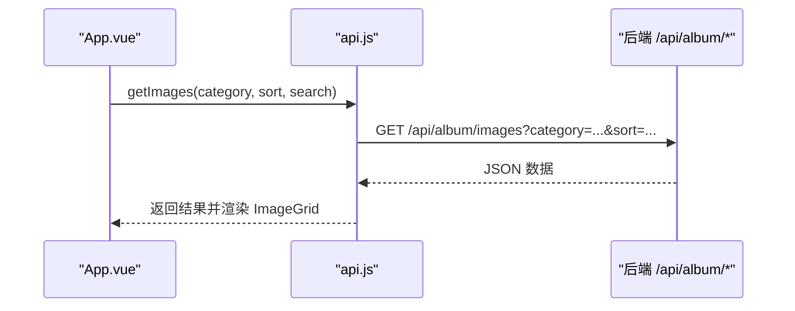
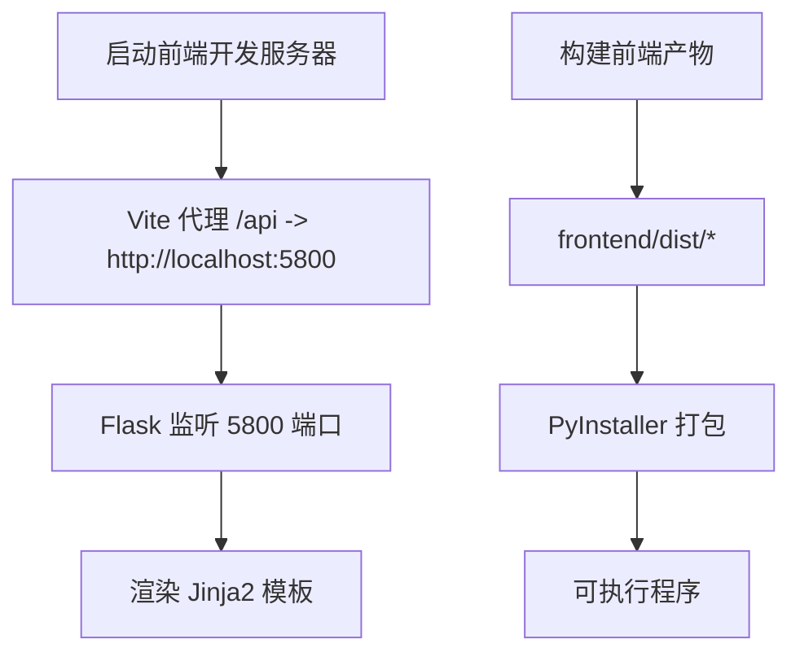
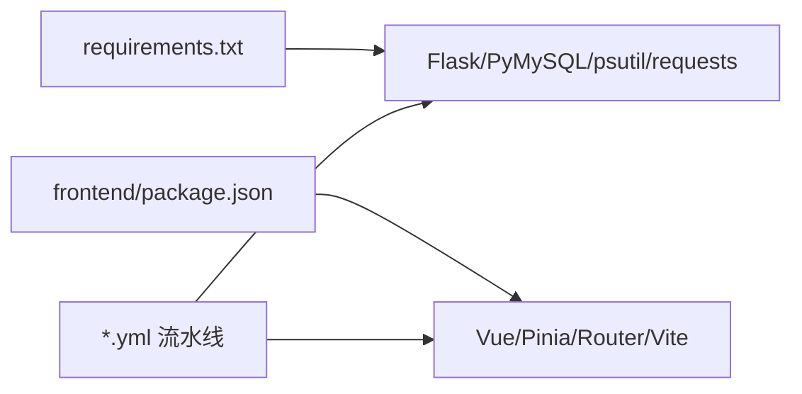

# 开发者指南

<cite>
**本文引用的文件**
- [app.py](file://app.py)
- [requirements.txt](file://requirements.txt)
- [package.json](file://frontend/package.json)
- [vite.config.js](file://frontend/vite.config.js)
- [main.js](file://frontend/src/main.js)
- [App.vue](file://frontend/src/App.vue)
- [api.js](file://frontend/src/api.js)
- [__init__.py（i18n）](file://i18n/__init__.py)
- [__init__.py（plugins）](file://plugins/__init__.py)
- [base.html](file://templates/base.html)
- [global_captcha.html](file://templates/global_captcha.html)
- [SchoolWeb.spec](file://SchoolWeb.spec)
- [branch-pipeline.yml](file://.workflow/branch-pipeline.yml)
- [master-pipeline.yml](file://.workflow/master-pipeline.yml)
- [pr-pipeline.yml](file://.workflow/pr-pipeline.yml)
</cite>

## 目录
1. [简介](#简介)
2. [项目结构](#项目结构)
3. [核心组件](#核心组件)
4. [架构总览](#架构总览)
5. [详细组件分析](#详细组件分析)
6. [依赖分析](#依赖分析)
7. [性能考虑](#性能考虑)
8. [故障排查指南](#故障排查指南)
9. [结论](#结论)
10. [附录](#附录)

## 简介
本指南面向 School_Web 的开发者，提供从代码规范、开发流程、调试与测试、性能优化到环境搭建与协作规范的完整实践手册。项目采用前后端分离架构：后端基于 Python Flask 提供 API 与模板渲染，前端基于 Vue 3 + Vite 构建，支持国际化与插件化扩展，并内置安全与访问控制机制。

## 项目结构
- 后端入口与核心逻辑位于根目录的 app.py，负责路由、安全、国际化、数据库初始化、速率限制与插件系统等。
- 前端位于 frontend/，包含 Vue 应用、构建配置与静态资源。
- 国际化资源位于 i18n/，插件系统位于 plugins/。
- 模板位于 templates/，基础布局与通用页面在此定义。
- 打包配置使用 PyInstaller 规格文件 SchoolWeb.spec。
- CI/CD 流水线位于 .workflow/。



图表来源
- [app.py](file://app.py)
- [base.html](file://templates/base.html)
- [__init__.py（i18n）](file://i18n/__init__.py)
- [__init__.py（plugins）](file://plugins/__init__.py)
- [package.json](file://frontend/package.json)
- [vite.config.js](file://frontend/vite.config.js)
- [SchoolWeb.spec](file://SchoolWeb.spec)
- [.workflow/branch-pipeline.yml](file://.workflow/branch-pipeline.yml)

章节来源
- [app.py](file://app.py)
- [package.json](file://frontend/package.json)
- [vite.config.js](file://frontend/vite.config.js)
- [base.html](file://templates/base.html)
- [SchoolWeb.spec](file://SchoolWeb.spec)

## 核心组件
- 后端核心服务
  - 安全与访问控制：CSP、XSS/ClickJacking 防护、Session 安全、UA 黑名单拦截、全局验证码门禁。
  - 速率限制：内存桶+文件持久化，支持白名单、手动封禁与动态配置。
  - 国际化：多语言资源加载、语言检测与注入模板上下文。
  - 插件系统：动态加载/卸载、菜单与模板块注入、权限控制。
  - 数据库初始化：用户资料、活动日志、相册扩展表等。
- 前端核心服务
  - 应用入口与路由：Vue 应用挂载、组件组合与状态管理。
  - API 封装：统一前缀与凭据处理，便于复用与维护。
  - 模板与主题：Bootstrap 基础样式、明暗主题切换、通知轮询与语言切换。

章节来源
- [app.py](file://app.py)
- [__init__.py（i18n）](file://i18n/__init__.py)
- [__init__.py（plugins）](file://plugins/__init__.py)
- [main.js](file://frontend/src/main.js)
- [App.vue](file://frontend/src/App.vue)
- [api.js](file://frontend/src/api.js)
- [base.html](file://templates/base.html)

## 架构总览
后端通过 Flask 提供 RESTful API 与模板渲染，前端通过 Vite 开发服务器进行热更新与代理转发，模板中注入 CSP nonce 与翻译上下文，插件系统在运行时扩展菜单与模板块。

```mermaid
graph TB
FE["前端 Vue 应用<br/>frontend/src/*"] --> |"/api/* 代理"| BE["Flask 后端<br/>app.py"]
BE --> |渲染模板/注入上下文| TMPL["Jinja2 模板<br/>templates/*"]
BE --> |多语言| I18N["i18n 资源<br/>i18n/*.json"]
BE --> |插件扩展| PLG["插件系统<br/>plugins/*"]
DEV["Vite 开发服务器<br/>vite.config.js"] <- --> |本地开发/代理| FE
BUILD["PyInstaller 打包<br/>SchoolWeb.spec"] --> |产出可执行| BE
```

图表来源
- [app.py](file://app.py)
- [base.html](file://templates/base.html)
- [__init__.py（i18n）](file://i18n/__init__.py)
- [__init__.py（plugins）](file://plugins/__init__.py)
- [vite.config.js](file://frontend/vite.config.js)
- [SchoolWeb.spec](file://SchoolWeb.spec)

## 详细组件分析

### 后端安全与访问控制
- 安全响应头：X-Content-Type-Options、X-Frame-Options、X-XSS-Protection、Referrer-Policy、CSP（nonce 注入）、HSTS（非调试环境）、Permissions-Policy。
- 用户代理过滤：拦截常见扫描器 UA。
- 全局验证码门禁：登录后对敏感路径进行二次验证码校验。
- 会话安全：HttpOnly/Secure/Lax、固定生命周期、空闲超时自动登出。
- 速率限制：内存桶+文件持久化，支持白名单、手动封禁、试探封禁延长与动态配置。



图表来源
- [app.py](file://app.py)
- [global_captcha.html](file://templates/global_captcha.html)

章节来源
- [app.py](file://app.py)
- [global_captcha.html](file://templates/global_captcha.html)

### 国际化与语言切换
- 语言检测顺序：查询参数 > 会话 > Cookie > Accept-Language > 默认。
- 翻译函数支持占位符插值，模板上下文注入翻译函数与语言信息。
- 支持语言：简中、英文、日文、韩文。



图表来源
- [app.py](file://app.py)
- [__init__.py（i18n）](file://i18n/__init__.py)
- [base.html](file://templates/base.html)

章节来源
- [app.py](file://app.py)
- [__init__.py（i18n）](file://i18n/__init__.py)
- [base.html](file://templates/base.html)

### 插件系统
- 发现与加载：扫描 plugins/plugins/ 目录，读取 plugin.json 与 __init__.py，动态导入模块并调用 register。
- 菜单与模板块：插件通过注册函数向菜单与模板注入块注册条目，按权限与顺序排序。
- 卸载：调用插件 unregister 并清理模块缓存。



图表来源
- [__init__.py（plugins）](file://plugins/__init__.py)

章节来源
- [__init__.py（plugins）](file://plugins/__init__.py)

### 前端应用与 API 封装
- 应用入口：创建 Vue 应用并挂载根组件。
- 组件组织：顶部导航、标签页切换、搜索与排序、图片网格、留言板、时间线、同学录、寄语墙、歌单、统计图等。
- API 封装：统一前缀与凭据，封装图片、评论、点赞、下载、分享、上传、统计等接口。



图表来源
- [App.vue](file://frontend/src/App.vue)
- [api.js](file://frontend/src/api.js)
- [app.py](file://app.py)

章节来源
- [main.js](file://frontend/src/main.js)
- [App.vue](file://frontend/src/App.vue)
- [api.js](file://frontend/src/api.js)

### 本地开发与构建
- 前端开发：Vite 提供热更新与代理，将 /api 与 /static/albums 代理至后端。
- 后端开发：Flask 应用监听端口，模板与静态资源由 Flask 提供。
- 打包：使用 PyInstaller 规格文件打包为可执行程序，包含模板、静态资源与密钥文件。



图表来源
- [vite.config.js](file://frontend/vite.config.js)
- [SchoolWeb.spec](file://SchoolWeb.spec)
- [app.py](file://app.py)

章节来源
- [vite.config.js](file://frontend/vite.config.js)
- [SchoolWeb.spec](file://SchoolWeb.spec)
- [package.json](file://frontend/package.json)

## 依赖分析
- 后端依赖：Flask、PyMySQL、psutil、requests、Werkzeug、Pillow。
- 前端依赖：Vue 3、Vue Router、Pinia、Vite、@vitejs/plugin-vue。
- CI/CD：流水线文件定义分支、主干与 PR 的构建与测试流程。



图表来源
- [requirements.txt](file://requirements.txt)
- [package.json](file://frontend/package.json)
- [.workflow/branch-pipeline.yml](file://.workflow/branch-pipeline.yml)

章节来源
- [requirements.txt](file://requirements.txt)
- [package.json](file://frontend/package.json)
- [.workflow/master-pipeline.yml](file://.workflow/master-pipeline.yml)
- [.workflow/pr-pipeline.yml](file://.workflow/pr-pipeline.yml)

## 性能考虑
- 前端
  - 使用 Vite 构建与按需加载，减少首屏体积。
  - 图片网格与搜索节流，避免频繁请求。
  - 明暗主题与字体资源来自 CDN，减少本地体积。
- 后端
  - 速率限制与封禁策略降低恶意请求压力。
  - 模板注入 CSP nonce，避免 unsafe-inline，提升渲染安全性。
  - 数据库索引与表结构设计（如活动日志、相册相关表）有助于查询性能。
- 数据库
  - 为高频查询字段建立索引（如用户、时间）。
  - 表结构兼容性处理（新增列时的 ALTER 操作）。

章节来源
- [app.py](file://app.py)
- [base.html](file://templates/base.html)

## 故障排查指南
- 本地开发无法访问后端 API
  - 检查 Vite 代理配置是否指向正确后端地址。
  - 确认后端 Flask 是否在 5800 端口运行。
- 前端静态资源 404
  - 确认前端已构建并产物位于 frontend/dist。
  - 检查 Flask 静态目录映射。
- 国际化显示异常
  - 确认 i18n 资源文件存在且编码为 UTF-8。
  - 检查语言检测逻辑与模板上下文注入。
- 插件未生效
  - 确认插件目录与 plugin.json 存在且格式正确。
  - 查看后端日志是否有导入异常。
- 速率限制误封
  - 检查白名单与手动封禁配置文件。
  - 调整动态配置文件中的限流参数。

章节来源
- [vite.config.js](file://frontend/vite.config.js)
- [app.py](file://app.py)
- [__init__.py（i18n）](file://i18n/__init__.py)
- [__init__.py（plugins）](file://plugins/__init__.py)

## 结论
本指南提供了 School_Web 的开发规范、流程、调试与测试、性能优化与环境搭建的系统性建议。遵循本文档可显著提升开发效率与系统稳定性，并为后续扩展与维护奠定良好基础。

## 附录

### 代码规范与约定
- Python 后端
  - 使用类型注释与清晰的函数/类命名，保持单一职责。
  - 路由层只做参数校验与调度，业务逻辑下沉至服务层。
  - 安全相关逻辑集中于装饰器或中间件，避免散落。
- JavaScript 前端
  - 组件拆分遵循“单一关注点”，使用 Composition API 组织逻辑。
  - API 封装统一前缀与凭据，避免重复代码。
  - 样式与主题变量集中管理，避免内联样式污染。
- 文件命名
  - Python：模块小写，类名驼峰，常量全大写。
  - Vue：组件文件名帕斯卡命名，页面路由与模板一一对应。
  - 国际化：语言代码与 JSON 文件名一致，键名语义化。

### 开发工作流程
- 分支管理
  - 主干保护：master/main 仅接受经审查的 PR 合并。
  - 功能分支：feature/*、hotfix/*、chore/*，提交前先同步主干。
- 代码审查
  - 至少一名维护者审查，关注安全性、性能与可维护性。
  - 通过 CI/CD 流水线检查语法与构建。
- 测试策略
  - 单元测试：后端路由与工具函数、前端组件与 API 封装。
  - 集成测试：端到端 API 行为与模板渲染。
  - 端到端测试：使用浏览器自动化验证关键流程（登录、上传、相册浏览）。

### 调试技巧与工具
- IDE 配置
  - Python：启用 Pylance、flake8 或 ruff，开启导入排序与未使用变量提示。
  - JavaScript：ESLint + Prettier，Vue SFC 语法高亮与类型检查。
- 断点调试
  - 后端：Flask 开发服务器配合 IDE 断点。
  - 前端：浏览器开发者工具断点与网络面板。
- 性能分析
  - 后端：cProfile/line_profiler 定位热点函数。
  - 前端：Chrome Performance 面板分析渲染与脚本执行。

### 性能优化方法
- 前端
  - 图片懒加载与压缩，CDN 资源缓存策略。
  - 组件级计算属性与 v-memo（如适用）减少重渲染。
- 后端
  - 速率限制与封禁策略，避免慢查询与暴力尝试。
  - 模板与静态资源缓存，CSP 与安全头减少攻击面。
- 数据库
  - 为高频查询字段添加索引，避免 SELECT *。
  - 合理拆分表与分区，定期维护统计信息。

### 开发环境搭建与常用工具
- 后端
  - Python 3.8+，虚拟环境，安装 requirements.txt。
  - MySQL 服务，配置连接参数。
- 前端
  - Node.js 18+，npm install，开发服务器端口 3000。
- 打包
  - 安装 PyInstaller，执行打包规格文件生成可执行程序。

### 贡献指南与开源协作
- 提交信息
  - 格式：类型(作用域)：简要描述；详细说明（必要时）。
  - 类型：feat、fix、docs、style、refactor、perf、test、build、ci、chore。
- 提交前检查
  - 本地测试通过，代码风格符合团队规范。
- 讨论与评审
  - 大改动开启议题讨论，PR 描述变更动机、影响范围与测试要点。
- 版本与发布
  - 使用语义化版本，变更日志记录重大修复与特性。