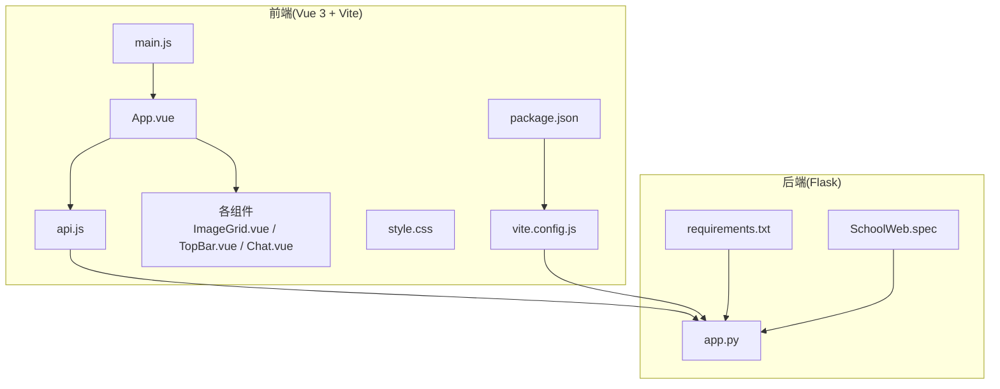
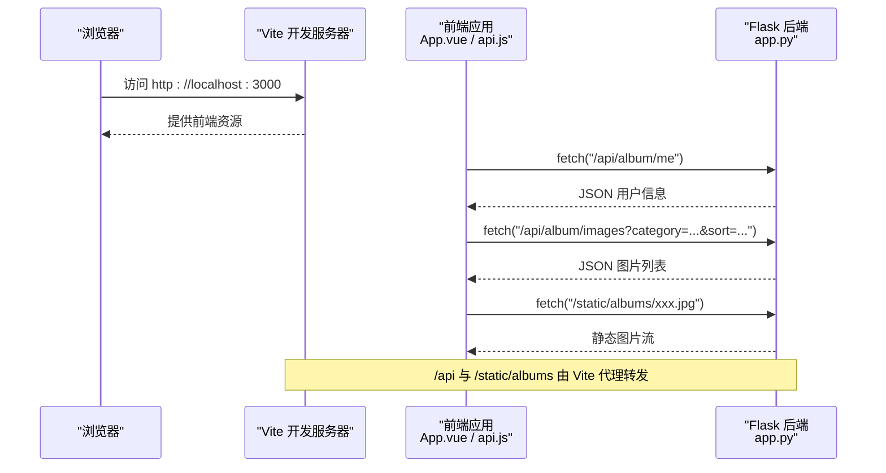
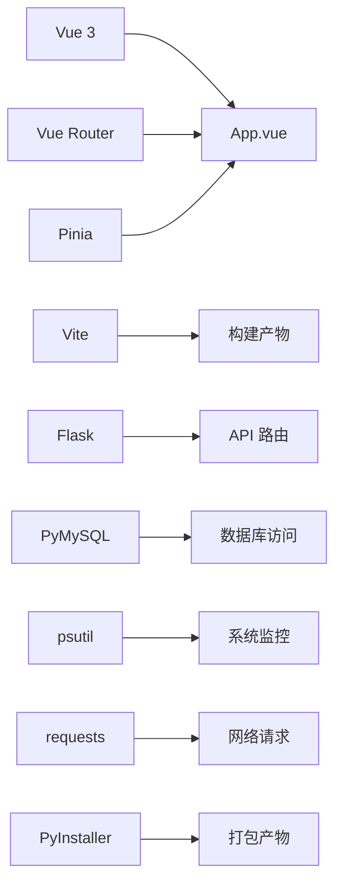

# 性能优化

<cite>
**本文引用的文件**
- [app.py](file://app.py)
- [package.json](file://frontend/package.json)
- [vite.config.js](file://frontend/vite.config.js)
- [main.js](file://frontend/src/main.js)
- [App.vue](file://frontend/src/App.vue)
- [api.js](file://frontend/src/api.js)
- [ImageGrid.vue](file://frontend/src/components/ImageGrid.vue)
- [TopBar.vue](file://frontend/src/components/TopBar.vue)
- [Chat.vue](file://frontend/src/components/Chat.vue)
- [style.css](file://frontend/src/style.css)
- [requirements.txt](file://requirements.txt)
- [SchoolWeb.spec](file://SchoolWeb.spec)
</cite>

## 目录
1. [简介](#简介)
2. [项目结构](#项目结构)
3. [核心组件](#核心组件)
4. [架构总览](#架构总览)
5. [详细组件分析](#详细组件分析)
6. [依赖分析](#依赖分析)
7. [性能考虑](#性能考虑)
8. [故障排查指南](#故障排查指南)
9. [结论](#结论)
10. [附录](#附录)

## 简介
本指南面向 School_Web 项目，系统性梳理前后端性能优化路径，涵盖前端 Vue 应用优化、静态资源压缩与代码分割、后端数据库与并发优化、网络传输与缓存策略、内存管理、性能监控与测试方法，并补充移动端与响应式优化建议。文档基于仓库现有实现进行分析与改进建议，帮助在不改变业务逻辑的前提下提升整体性能与用户体验。

## 项目结构
项目采用前后端分离架构：
- 前端基于 Vue 3 + Vite，开发服务器通过代理将 /api 与 /static/albums 请求转发至后端服务端口，便于本地联调。
- 后端基于 Flask，提供多模块 API（相册、聊天、数据库管理等），内置速率限制、CSP、安全响应头等安全与性能相关配置。
- 构建打包通过 PyInstaller 规格文件整合前端 dist 与后端资源，便于部署。

图表来源
- [main.js:1-6](file://frontend/src/main.js#L1-L6)
- [App.vue:1-99](file://frontend/src/App.vue#L1-L99)
- [api.js:1-45](file://frontend/src/api.js#L1-L45)
- [ImageGrid.vue:1-129](file://frontend/src/components/ImageGrid.vue#L1-L129)
- [TopBar.vue:1-42](file://frontend/src/components/TopBar.vue#L1-L42)
- [Chat.vue:1-214](file://frontend/src/components/Chat.vue#L1-L214)
- [style.css:1-59](file://frontend/src/style.css#L1-L59)
- [package.json:1-21](file://frontend/package.json#L1-L21)
- [vite.config.js:1-21](file://frontend/vite.config.js#L1-L21)
- [app.py:1-120](file://app.py#L1-L120)
- [requirements.txt:1-5](file://requirements.txt#L1-L5)
- [SchoolWeb.spec:1-45](file://SchoolWeb.spec#L1-L45)

章节来源
- [package.json:1-21](file://frontend/package.json#L1-L21)
- [vite.config.js:1-21](file://frontend/vite.config.js#L1-L21)
- [main.js:1-6](file://frontend/src/main.js#L1-L6)
- [App.vue:1-99](file://frontend/src/App.vue#L1-L99)
- [api.js:1-45](file://frontend/src/api.js#L1-L45)
- [ImageGrid.vue:1-129](file://frontend/src/components/ImageGrid.vue#L1-L129)
- [TopBar.vue:1-42](file://frontend/src/components/TopBar.vue#L1-L42)
- [Chat.vue:1-214](file://frontend/src/components/Chat.vue#L1-L214)
- [style.css:1-59](file://frontend/src/style.css#L1-L59)
- [app.py:1-120](file://app.py#L1-L120)
- [requirements.txt:1-5](file://requirements.txt#L1-L5)
- [SchoolWeb.spec:1-45](file://SchoolWeb.spec#L1-L45)

## 核心组件
- 前端应用入口与路由：Vue 应用在入口文件中挂载根组件，根组件负责标签页切换、工具栏与子组件渲染。
- API 封装：统一前缀与凭据传递，集中处理鉴权与跨域。
- 关键组件：
  - 图片网格组件：负责图片列表加载、懒加载占位、异步统计信息聚合。
  - 顶部栏组件：负责用户信息拉取与全局暴露，供其他组件使用。
  - 聊天组件：定时轮询消息与好友列表，注意轮询频率与资源释放。
- 后端应用：提供多条路由与中间件，包含速率限制、CSP 注入、安全响应头、数据库初始化与表结构管理等。

章节来源
- [main.js:1-6](file://frontend/src/main.js#L1-L6)
- [App.vue:1-99](file://frontend/src/App.vue#L1-L99)
- [api.js:1-45](file://frontend/src/api.js#L1-L45)
- [ImageGrid.vue:1-129](file://frontend/src/components/ImageGrid.vue#L1-L129)
- [TopBar.vue:1-42](file://frontend/src/components/TopBar.vue#L1-L42)
- [Chat.vue:1-214](file://frontend/src/components/Chat.vue#L1-L214)
- [app.py:1-120](file://app.py#L1-L120)

## 架构总览
前后端交互通过 /api 前缀，前端通过 fetch 发起请求，后端返回 JSON 或静态资源。开发阶段通过 Vite 代理将 /api 与 /static/albums 转发到后端端口，便于联调。

图表来源
- [vite.config.js:1-21](file://frontend/vite.config.js#L1-L21)
- [api.js:1-45](file://frontend/src/api.js#L1-L45)
- [app.py:1-120](file://app.py#L1-L120)

章节来源
- [vite.config.js:1-21](file://frontend/vite.config.js#L1-L21)
- [api.js:1-45](file://frontend/src/api.js#L1-L45)
- [app.py:1-120](file://app.py#L1-L120)

## 详细组件分析

### 前端性能优化要点
- 代码分割与懒加载
  - 当前组件在根组件中直接引入，建议对非首屏组件（如聊天、统计图表、播放器等）采用动态导入与路由级懒加载，减少初始包体。
  - 参考路径：[App.vue:47-60](file://frontend/src/App.vue#L47-L60)
- 图片懒加载
  - 图片标签已包含懒加载属性，建议结合 IntersectionObserver 实现更精细的占位与加载时机控制。
  - 参考路径：[ImageGrid.vue](file://frontend/src/components/ImageGrid.vue#L11)
- 组件更新与渲染
  - 使用计算属性与响应式数据避免不必要的重渲染；对高频交互（搜索、排序）增加节流/防抖。
  - 参考路径：[App.vue:73-76](file://frontend/src/App.vue#L73-L76)
- 资源体积与构建
  - 使用 Vite 的 Rollup 插件链进行 Tree Shaking 与压缩；按需引入第三方库，避免引入未使用的模块。
  - 参考路径：[package.json:1-21](file://frontend/package.json#L1-L21)
- 样式与动画
  - 减少复杂动画与重排重绘；将动画作用于合成层元素，避免影响布局。
  - 参考路径：[style.css:48-59](file://frontend/src/style.css#L48-L59)

章节来源
- [App.vue:47-60](file://frontend/src/App.vue#L47-L60)
- [ImageGrid.vue](file://frontend/src/components/ImageGrid.vue#L11)
- [App.vue:73-76](file://frontend/src/App.vue#L73-L76)
- [package.json:1-21](file://frontend/package.json#L1-L21)
- [style.css:48-59](file://frontend/src/style.css#L48-L59)

### 后端性能优化要点
- 数据库查询优化
  - 已有索引示例（活动日志、日历事件等），建议对高频查询列建立复合索引，避免全表扫描；对分页查询使用 LIMIT/OFFSET 或基于游标的分页。
  - 参考路径：[app.py:270-279](file://app.py#L270-L279)
- 连接池与并发
  - 使用连接池复用数据库连接，减少握手开销；限制并发连接数，避免阻塞。
  - 参考路径：[requirements.txt:1-5](file://requirements.txt#L1-L5)
- 速率限制与会话
  - 内存级速率限制具备去抖保存机制，建议结合 Redis 实现分布式限流与持久化；对会话空闲超时进行统一处理，避免僵尸会话占用资源。
  - 参考路径：[app.py:31-114](file://app.py#L31-L114)
- 安全与响应头
  - CSP 注入与安全响应头有助于降低 XSS 风险，同时可减少不必要的资源加载，间接提升性能。
  - 参考路径：[app.py:642-676](file://app.py#L642-L676)

章节来源
- [app.py:270-279](file://app.py#L270-L279)
- [requirements.txt:1-5](file://requirements.txt#L1-L5)
- [app.py:31-114](file://app.py#L31-L114)
- [app.py:642-676](file://app.py#L642-L676)

### 网络性能优化
- CDN 与静态资源
  - 将第三方静态资源（如字体、图标库）指向 CDN，缩短首字节时间；对图片与媒体资源进行压缩与格式优化（WebP/JPEG2000）。
  - 参考路径：[style.css:1-59](file://frontend/src/style.css#L1-L59)
- HTTP 缓存策略
  - 对静态资源设置强缓存与 ETag；对 HTML 设置 no-store 并禁用缓存，确保安全页面不被缓存。
  - 参考路径：[app.py:668-671](file://app.py#L668-L671)
- 资源预加载与优先级
  - 使用 preload/prefetch 提前加载关键资源；对非关键脚本采用 defer/async。
  - 参考路径：[vite.config.js:1-21](file://frontend/vite.config.js#L1-L21)
- 压缩传输
  - 启用 Gzip/Brotli 压缩，减少传输体积；对文本类资源优先使用 Brotli。
  - 参考路径：[app.py:642-676](file://app.py#L642-L676)

章节来源
- [style.css:1-59](file://frontend/src/style.css#L1-L59)
- [app.py:668-671](file://app.py#L668-L671)
- [vite.config.js:1-21](file://frontend/vite.config.js#L1-L21)
- [app.py:642-676](file://app.py#L642-L676)

### 内存管理优化
- Python 内存使用
  - 使用 psutil 监控进程内存；对大对象及时释放，避免闭包持有导致的循环引用；使用生成器处理大数据集。
  - 参考路径：[requirements.txt](file://requirements.txt#L3)
- 前端内存泄漏预防
  - 组件卸载时清理定时器、事件监听与轮询；对图片与 Canvas 资源及时释放。
  - 参考路径：[Chat.vue](file://frontend/src/components/Chat.vue#L164)
- 垃圾回收策略
  - 避免在渲染周期内创建临时大数组；合理拆分任务，避免主线程长时间阻塞。
  - 参考路径：[ImageGrid.vue:55-77](file://frontend/src/components/ImageGrid.vue#L55-L77)

章节来源
- [requirements.txt](file://requirements.txt#L3)
- [Chat.vue](file://frontend/src/components/Chat.vue#L164)
- [ImageGrid.vue:55-77](file://frontend/src/components/ImageGrid.vue#L55-L77)

### 性能监控与数据分析
- 指标采集
  - 前端：测量首屏时间、交互延迟、FPS；后端：请求耗时、数据库查询耗时、连接池利用率。
- 数据分析
  - 使用浏览器开发者工具与后端日志进行热点分析；定位慢查询与高延迟接口。
- 瓶颈识别
  - 结合火焰图与内存快照，识别渲染与内存瓶颈；对慢接口进行分段埋点分析。
- 参考路径：[app.py:642-676](file://app.py#L642-L676)

章节来源
- [app.py:642-676](file://app.py#L642-L676)

### 移动端与响应式优化
- 响应式布局
  - 使用媒体查询适配小屏设备；控制按钮与输入框尺寸，保证触摸可达性。
  - 参考路径：[Chat.vue:203-208](file://frontend/src/components/Chat.vue#L203-L208)
- 触摸与手势
  - 为图片网格与聊天区域提供合适的触摸反馈与滚动性能优化。
  - 参考路径：[ImageGrid.vue:109-129](file://frontend/src/components/ImageGrid.vue#L109-L129)

章节来源
- [Chat.vue:203-208](file://frontend/src/components/Chat.vue#L203-L208)
- [ImageGrid.vue:109-129](file://frontend/src/components/ImageGrid.vue#L109-L129)

### 性能测试与基准测试
- 前端测试
  - 使用 Lighthouse、WebPageTest 进行页面性能评估；对关键路径资源进行压缩与合并。
- 后端测试
  - 使用 wrk/ab 进行并发压测；对数据库查询进行 EXPLAIN 分析，优化慢查询。
- 构建产物
  - 通过 PyInstaller 规格文件确认静态资源打包完整，避免运行时缺失。
  - 参考路径：[SchoolWeb.spec](file://SchoolWeb.spec#L8)

章节来源
- [SchoolWeb.spec](file://SchoolWeb.spec#L8)

## 依赖分析
- 前端依赖
  - Vue 3、Vue Router、Pinia：现代前端框架与状态管理，建议配合动态导入与按需加载。
  - Vite：快速开发与构建工具，建议开启 Tree Shaking 与压缩。
- 后端依赖
  - Flask、PyMySQL、psutil、requests：提供 Web 服务、数据库访问与系统监控能力。
- 构建依赖
  - PyInstaller：将前端 dist 与后端资源打包为单一可执行文件。

图表来源
- [package.json:11-19](file://frontend/package.json#L11-L19)
- [requirements.txt:1-5](file://requirements.txt#L1-L5)
- [SchoolWeb.spec](file://SchoolWeb.spec#L8)

章节来源
- [package.json:11-19](file://frontend/package.json#L11-L19)
- [requirements.txt:1-5](file://requirements.txt#L1-L5)
- [SchoolWeb.spec](file://SchoolWeb.spec#L8)

## 性能考虑
- 前端
  - 代码分割、懒加载、图片懒加载、样式与动画优化、构建压缩与 Tree Shaking。
- 后端
  - 数据库索引与查询优化、连接池、速率限制与会话管理、安全响应头。
- 网络
  - CDN、HTTP 缓存、资源预加载、传输压缩。
- 内存
  - Python 内存监控与释放、前端定时器与事件清理、避免大数组与阻塞主线程。
- 监控与测试
  - 指标采集、数据分析、压测与慢查询分析。

## 故障排查指南
- 速率限制触发
  - 检查 IP 白名单与封禁状态；调整窗口与阈值；必要时迁移到分布式限流。
  - 参考路径：[app.py:514-562](file://app.py#L514-L562)
- 会话超时
  - 确认会话空闲超时配置与路由豁免；避免敏感页面被缓存。
  - 参考路径：[app.py:564-593](file://app.py#L564-L593)
- CSP 与安全头
  - 若出现资源加载失败，检查 CSP 策略与 nonce 注入；确保开发与生产环境差异。
  - 参考路径：[app.py:642-676](file://app.py#L642-L676)
- 聊天轮询
  - 检查轮询间隔与组件卸载清理，避免内存泄漏。
  - 参考路径：[Chat.vue:158-164](file://frontend/src/components/Chat.vue#L158-L164)

章节来源
- [app.py:514-562](file://app.py#L514-L562)
- [app.py:564-593](file://app.py#L564-L593)
- [app.py:642-676](file://app.py#L642-L676)
- [Chat.vue:158-164](file://frontend/src/components/Chat.vue#L158-L164)

## 结论
通过在前端实施代码分割与懒加载、在后端优化数据库与并发、在网络层面引入 CDN 与缓存策略、在内存层面加强监控与清理，以及建立完善的性能监控与测试体系，School_Web 可在保持现有功能与安全性的前提下显著提升性能与稳定性。建议优先落地图片懒加载、组件懒加载与数据库索引优化，再逐步推进 CDN 与分布式限流等方案。

## 附录
- 建议新增的优化项
  - 前端：路由级动态导入、IntersectionObserver 懒加载、组件级防抖/节流。
  - 后端：Redis 限流、连接池参数调优、慢查询日志与 EXPLAIN 分析。
  - 网络：Gzip/Brotli 压缩、preload/prefetch、CDN 资源托管。
  - 监控：关键指标埋点、性能基线与回归测试。