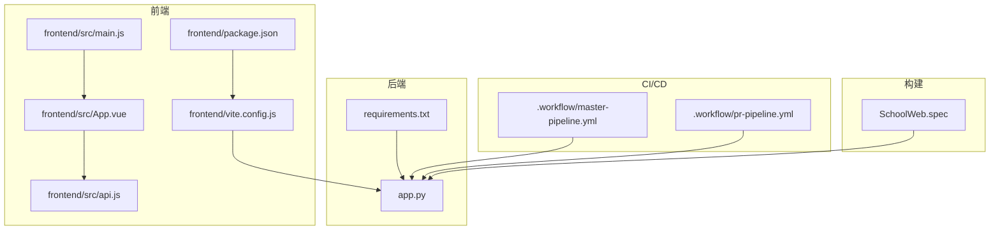
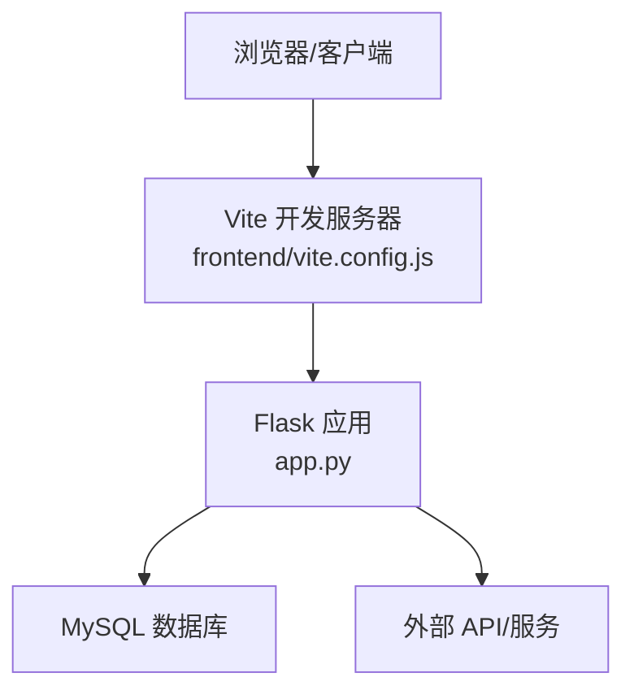
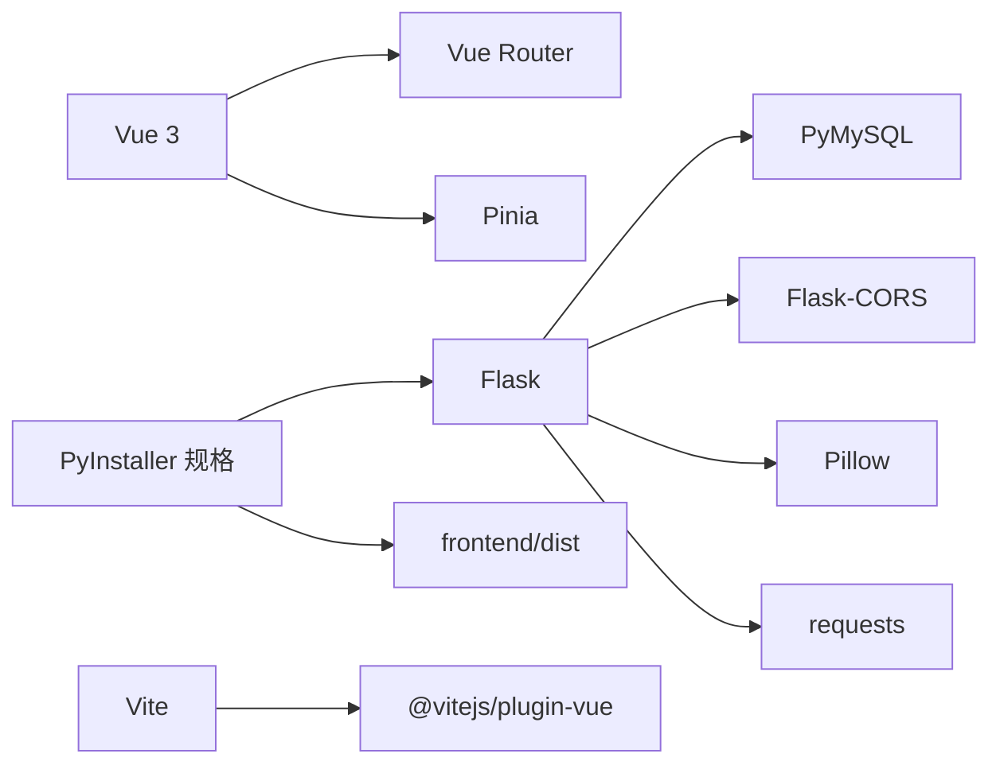

# 测试策略

<cite>
**本文引用的文件**
- [app.py](file://app.py)
- [requirements.txt](file://requirements.txt)
- [frontend/package.json](file://frontend/package.json)
- [frontend/vite.config.js](file://frontend/vite.config.js)
- [frontend/src/main.js](file://frontend/src/main.js)
- [frontend/src/App.vue](file://frontend/src/App.vue)
- [frontend/src/api.js](file://frontend/src/api.js)
- [.workflow/master-pipeline.yml](file://.workflow/master-pipeline.yml)
- [.workflow/pr-pipeline.yml](file://.workflow/pr-pipeline.yml)
- [templates/db_captcha.html](file://templates/db_captcha.html)
- [templates/admin_dashboard.html](file://templates/admin_dashboard.html)
- [SchoolWeb.spec](file://SchoolWeb.spec)
</cite>

## 目录
1. [引言](#引言)
2. [项目结构](#项目结构)
3. [核心组件](#核心组件)
4. [架构总览](#架构总览)
5. [详细组件分析](#详细组件分析)
6. [依赖分析](#依赖分析)
7. [性能考虑](#性能考虑)
8. [故障排查指南](#故障排查指南)
9. [结论](#结论)
10. [附录](#附录)

## 引言
本测试策略文档面向 School_Web 项目，目标是建立一套系统化的测试体系，覆盖 Python 后端单元测试、Vue.js 前端组件与 API 测试、数据库与集成测试、端到端测试、测试数据管理、覆盖率要求、自动化测试与持续集成、性能与压力测试，以及测试用例设计与维护策略。文档同时给出可落地的实施建议与可视化图示，帮助团队在开发过程中高效、稳定地交付高质量产品。

## 项目结构
项目采用前后端分离架构：
- 后端：基于 Flask 的 Python 应用，提供 REST API、模板渲染与静态资源服务。
- 前端：基于 Vue 3 + Vite 的 SPA，通过代理访问后端 API。
- 构建与打包：使用 PyInstaller 规格文件进行打包分发。

图表来源
- [frontend/src/main.js:1-6](file://frontend/src/main.js#L1-L6)
- [frontend/src/App.vue:1-99](file://frontend/src/App.vue#L1-L99)
- [frontend/src/api.js:1-45](file://frontend/src/api.js#L1-L45)
- [frontend/vite.config.js:1-21](file://frontend/vite.config.js#L1-L21)
- [frontend/package.json:1-21](file://frontend/package.json#L1-L21)
- [app.py:119-139](file://app.py#L119-L139)
- [requirements.txt:1-5](file://requirements.txt#L1-L5)
- [.workflow/master-pipeline.yml](file://.workflow/master-pipeline.yml)
- [.workflow/pr-pipeline.yml](file://.workflow/pr-pipeline.yml)
- [SchoolWeb.spec:1-45](file://SchoolWeb.spec#L1-L45)

章节来源
- [frontend/src/main.js:1-6](file://frontend/src/main.js#L1-L6)
- [frontend/src/App.vue:1-99](file://frontend/src/App.vue#L1-L99)
- [frontend/src/api.js:1-45](file://frontend/src/api.js#L1-L45)
- [frontend/vite.config.js:1-21](file://frontend/vite.config.js#L1-L21)
- [frontend/package.json:1-21](file://frontend/package.json#L1-L21)
- [app.py:119-139](file://app.py#L119-L139)
- [requirements.txt:1-5](file://requirements.txt#L1-L5)
- [.workflow/master-pipeline.yml](file://.workflow/master-pipeline.yml)
- [.workflow/pr-pipeline.yml](file://.workflow/pr-pipeline.yml)
- [SchoolWeb.spec:1-45](file://SchoolWeb.spec#L1-L45)

## 核心组件
- 后端应用与路由：提供多模块 API（相册、聊天、市场插件、系统工具等），并内置速率限制、会话超时、CSP 安全头等中间件逻辑。
- 前端应用与组件：包含相册浏览、留言、时间轴、同学录、寄语墙、歌单、统计等模块，通过统一 API 封装与后端交互。
- 构建与部署：Vite 开发服务器与代理配置，PyInstaller 打包规格文件定义运行时数据与依赖。

章节来源
- [app.py:230-346](file://app.py#L230-L346)
- [app.py:624-677](file://app.py#L624-L677)
- [frontend/src/App.vue:1-99](file://frontend/src/App.vue#L1-L99)
- [frontend/src/api.js:1-45](file://frontend/src/api.js#L1-L45)
- [frontend/vite.config.js:1-21](file://frontend/vite.config.js#L1-L21)
- [SchoolWeb.spec:1-45](file://SchoolWeb.spec#L1-L45)

## 架构总览
下图展示测试视角下的系统交互：前端通过本地代理访问后端 API，后端连接 MySQL 数据库，部分路由涉及外部网络工具调用。

图表来源
- [frontend/vite.config.js:6-19](file://frontend/vite.config.js#L6-L19)
- [app.py:624-677](file://app.py#L624-L677)

## 详细组件分析

### 后端测试策略（Python 单元测试）
- 测试范围
  - 路由与控制器：针对各 API 路由进行请求/响应断言，覆盖正常与异常分支。
  - 中间件与安全：CORS、CSP、会话超时、速率限制、UA 拦截等逻辑的边界条件测试。
  - 数据库初始化与表结构：初始化流程、索引与兼容性处理。
  - 工具函数：验证码生成、白名单/封禁逻辑、配置加载与持久化。
- 测试框架建议
  - 使用 pytest + Flask 测试客户端，模拟请求与会话。
  - 使用 unittest.mock 对外部依赖（如 requests、数据库连接）进行替身。
- 关键测试点
  - 速率限制：同一 IP 在窗口内触发封禁与试探延长。
  - 会话超时：非活跃 IP 在指定时间后强制登出。
  - 全局验证码门禁：API 与页面在未验证场景下的行为。
  - 数据库操作：增删改查、事务与异常回滚。
- 示例断言要点（路径指引）
  - 会话超时逻辑：[app.py:564-593](file://app.py#L564-L593)
  - 速率限制与封禁：[app.py:513-562](file://app.py#L513-L562)
  - 全局验证码门禁：[app.py:600-622](file://app.py#L600-L622)
  - 数据库初始化：[app.py:240-345](file://app.py#L240-L345)

章节来源
- [app.py:513-593](file://app.py#L513-L593)
- [app.py:600-622](file://app.py#L600-L622)
- [app.py:240-345](file://app.py#L240-L345)

### 前端测试策略（Vue.js 组件与 API 测试）
- 测试范围
  - 组件渲染与交互：按钮切换、输入框搜索、排序与筛选。
  - API 封装与调用：鉴权、错误处理、参数拼接与响应解析。
  - 路由与导航：根据权限显示不同模块。
- 测试框架建议
  - 使用 @vue/test-utils + vitest 进行组件级测试。
  - 使用 jsdom 或真实浏览器环境进行端到端测试。
- 关键测试点
  - 组件生命周期与 props 传递：TopBar、ImageGrid、TagFilter、UploadModal、MusicPlayer、Timeline、Classmates、WishWall、Playlist、StatsChart。
  - API 行为：鉴权头、错误码、下载与分享链接、点赞与评论。
  - 代理与跨域：确认 /api 与 /static/albums 代理指向正确后端地址。
- 示例断言要点（路径指引）
  - 组件注册与布局：[frontend/src/App.vue:47-84](file://frontend/src/App.vue#L47-L84)
  - API 封装：[frontend/src/api.js:1-45](file://frontend/src/api.js#L1-L45)
  - 代理配置：[frontend/vite.config.js:9-18](file://frontend/vite.config.js#L9-L18)

章节来源
- [frontend/src/App.vue:47-84](file://frontend/src/App.vue#L47-L84)
- [frontend/src/api.js:1-45](file://frontend/src/api.js#L1-L45)
- [frontend/vite.config.js:9-18](file://frontend/vite.config.js#L9-L18)

### API 接口测试
- 自动化接口测试建议
  - 使用 pytest + requests 或 httpx，结合数据库快照与断言。
  - 针对认证、鉴权、速率限制、CSP、会话超时等场景构造测试集。
- 关键接口与场景
  - 验证码接口与全局验证码门禁：[app.py:428-501](file://app.py#L428-L501)、[app.py:600-622](file://app.py#L600-L622)
  - 会话超时：[app.py:564-593](file://app.py#L564-L593)
  - 速率限制：[app.py:513-562](file://app.py#L513-L562)
  - 数据库可视化更新：[app.py:2318-2508](file://app.py#L2318-L2508)

章节来源
- [app.py:428-501](file://app.py#L428-L501)
- [app.py:600-622](file://app.py#L600-L622)
- [app.py:564-593](file://app.py#L564-L593)
- [app.py:513-562](file://app.py#L513-L562)
- [app.py:2318-2508](file://app.py#L2318-L2508)

### 集成测试方案
- 数据库集成测试
  - 使用独立测试数据库实例或容器化 MySQL，初始化与清理表结构。
  - 针对数据库可视化更新、相册扩展表、活动日志等模块进行读写集成测试。
- 前后端集成测试
  - 通过 Vite 代理将前端请求转发至后端，验证鉴权、CSP、CORS、会话与速率限制协同工作。
  - 验证验证码门禁在页面与 API 场景的行为一致性。
- 端到端测试流程
  - 使用真实浏览器（如 Playwright/Cypress）驱动用户操作：登录、浏览相册、添加评论、点赞、分享、下载、查看统计。
  - 覆盖管理员功能（如数据库可视化更新）与普通用户路径。

章节来源
- [app.py:240-345](file://app.py#L240-L345)
- [app.py:600-622](file://app.py#L600-L622)
- [frontend/vite.config.js:9-18](file://frontend/vite.config.js#L9-L18)

### 测试数据管理
- 测试数据库配置
  - 使用独立测试数据库，避免与生产数据冲突；在 CI 中使用临时数据库或 Docker Compose。
- 测试数据生成
  - 使用工厂模式或 fixtures 生成用户、相册图片、评论、点赞、分享链接等。
- 测试环境隔离
  - 通过环境变量区分开发、测试、预发布与生产；在 CI 中隔离数据库与缓存。
- 速率限制与白名单
  - 在测试中将测试 IP 加入白名单，或调整速率限制配置文件以避免误封。

章节来源
- [app.py:350-412](file://app.py#L350-L412)
- [templates/admin_dashboard.html:197-220](file://templates/admin_dashboard.html#L197-L220)

### 测试覆盖率要求
- 代码覆盖率标准
  - 后端：函数级行覆盖率≥80%，分支覆盖率≥60%。
  - 前端：组件与 API 封装的行覆盖率≥75%，关键交互路径≥80%。
- 关键路径测试
  - 会话超时、速率限制、验证码门禁、数据库可视化更新、相册 CRUD、聊天与好友关系、统计与导出。

章节来源
- [app.py:513-593](file://app.py#L513-L593)
- [app.py:513-562](file://app.py#L513-L562)
- [app.py:600-622](file://app.py#L600-L622)
- [app.py:2318-2508](file://app.py#L2318-L2508)

### 自动化测试配置与持续集成
- 测试脚本编写
  - 后端：pytest.ini 或 pyproject.toml 配置；按模块划分测试目录。
  - 前端：vitest.config.js 配置；组件测试与 API 测试分别组织。
- 测试报告生成
  - 后端：pytest-html 或 junitxml 输出；前端：Jest/vitest 的 HTML 报告。
- 持续集成中的测试执行
  - PR 流水线：运行单元与集成测试，生成覆盖率报告。
  - Master 流水线：运行全量测试与端到端测试，推送报告与制品。
- CI/CD 配置参考
  - PR 流水线：[.workflow/pr-pipeline.yml](file://.workflow/pr-pipeline.yml)
  - Master 流水线：[.workflow/master-pipeline.yml](file://.workflow/master-pipeline.yml)

章节来源
- [.workflow/pr-pipeline.yml](file://.workflow/pr-pipeline.yml)
- [.workflow/master-pipeline.yml](file://.workflow/master-pipeline.yml)

### 性能测试与压力测试
- 性能测试
  - 使用 locust 或 k6 对关键 API（相册列表、评论、点赞、分享）进行并发与响应时间测试。
- 压力测试
  - 针对速率限制、会话超时、数据库连接池与外部 API 调用进行极限负载测试。
- 指标与基线
  - P95/P99 响应时间、吞吐量、错误率、数据库连接池占用与外部服务可用性。

章节来源
- [app.py:513-562](file://app.py#L513-L562)
- [app.py:624-677](file://app.py#L624-L677)

### 测试用例设计最佳实践
- 分层设计：单元层（函数/组件）、集成层（API/数据库）、端到端层（用户任务流）。
- 边界与异常：空输入、越界参数、网络异常、鉴权失败、速率限制触发。
- 可重复性：固定种子、可控时间、可预测的外部依赖。
- 可观测性：日志、指标、错误栈与断言信息清晰。

### 测试维护策略
- 版本同步：测试随业务版本迭代同步更新。
- 回归策略：关键路径与变更热点优先回归。
- 文档化：测试用例与断言理由记录在案，便于新人接手。

## 依赖分析
- 后端依赖
  - Flask、PyMySQL、psutil、requests、Pillow、Flask-CORS 等。
- 前端依赖
  - Vue 3、Vue Router、Pinia、Vite、@vitejs/plugin-vue。
- 构建依赖
  - PyInstaller 规格文件定义打包数据与隐藏导入。

图表来源
- [requirements.txt:1-5](file://requirements.txt#L1-L5)
- [frontend/package.json:11-19](file://frontend/package.json#L11-L19)
- [SchoolWeb.spec:4-16](file://SchoolWeb.spec#L4-L16)

章节来源
- [requirements.txt:1-5](file://requirements.txt#L1-L5)
- [frontend/package.json:11-19](file://frontend/package.json#L11-L19)
- [SchoolWeb.spec:4-16](file://SchoolWeb.spec#L4-L16)

## 性能考虑
- 速率限制与会话超时：避免测试环境被误封，必要时调整配置或加入白名单。
- 数据库连接：在测试中复用连接池或使用连接池大小适配并发。
- 前端代理：确保代理目标与端口正确，避免额外延迟。
- 外部服务：对外部 API 设置超时与重试策略，防止阻塞测试。

章节来源
- [app.py:350-412](file://app.py#L350-L412)
- [app.py:513-593](file://app.py#L513-L593)
- [frontend/vite.config.js:9-18](file://frontend/vite.config.js#L9-L18)

## 故障排查指南
- 验证码与门禁
  - 若出现验证码错误或被拦截，检查会话状态与验证码接口调用顺序。
  - 参考：[app.py:428-501](file://app.py#L428-L501)、[app.py:600-622](file://app.py#L600-L622)
- 速率限制与封禁
  - 若测试被封禁，检查 IP 是否在白名单或封禁期，必要时重置封禁状态。
  - 参考：[app.py:513-562](file://app.py#L513-L562)、[app.py:350-412](file://app.py#L350-L412)
- 会话超时
  - 若出现自动登出，检查会话活跃时间与超时阈值。
  - 参考：[app.py:564-593](file://app.py#L564-L593)
- 数据库可视化更新
  - 若数据库操作失败，检查连接配置与 CAPTCHA 验证流程。
  - 参考：[app.py:2318-2508](file://app.py#L2318-L2508)、[templates/db_captcha.html:1-23](file://templates/db_captcha.html#L1-L23)

章节来源
- [app.py:428-501](file://app.py#L428-L501)
- [app.py:600-622](file://app.py#L600-L622)
- [app.py:513-562](file://app.py#L513-L562)
- [app.py:350-412](file://app.py#L350-L412)
- [app.py:564-593](file://app.py#L564-L593)
- [app.py:2318-2508](file://app.py#L2318-L2508)
- [templates/db_captcha.html:1-23](file://templates/db_captcha.html#L1-L23)

## 结论
通过分层测试策略与自动化流水线，School_Web 项目可以在开发周期内持续发现缺陷、保障质量并提升交付效率。建议优先完善后端与前端的单元测试，再推进集成与端到端测试，并在 CI 中固化覆盖率与性能基线，形成可持续的质量闭环。

## 附录
- 术语
  - CSP：内容安全策略
  - UA：用户代理
  - CSRF：跨站请求伪造
- 参考文件
  - 后端入口与配置：[app.py:119-139](file://app.py#L119-L139)
  - 前端入口与代理：[frontend/src/main.js:1-6](file://frontend/src/main.js#L1-L6)、[frontend/vite.config.js:6-19](file://frontend/vite.config.js#L6-L19)
  - 打包规格：[SchoolWeb.spec:1-45](file://SchoolWeb.spec#L1-L45)