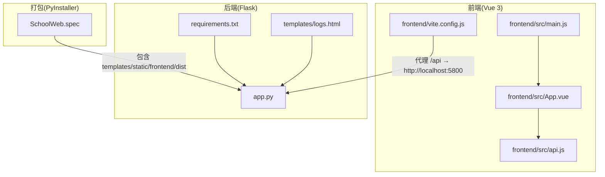
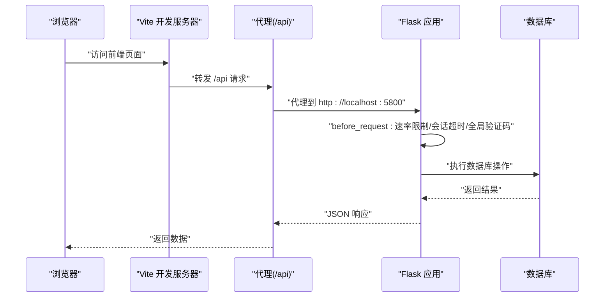
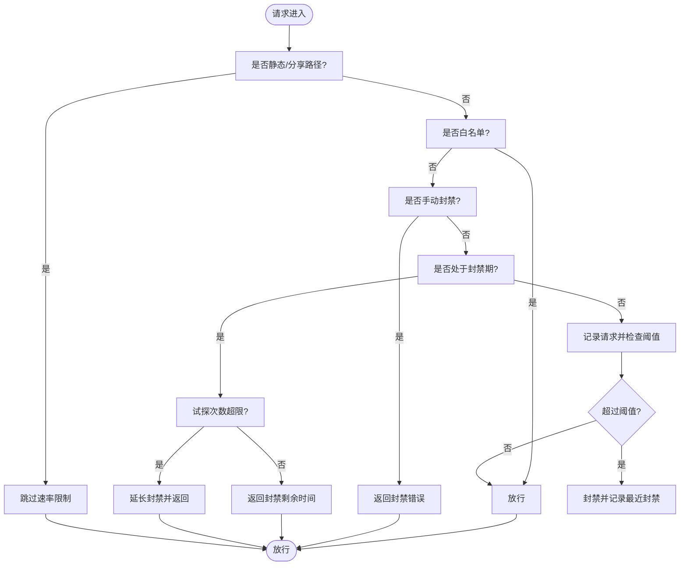
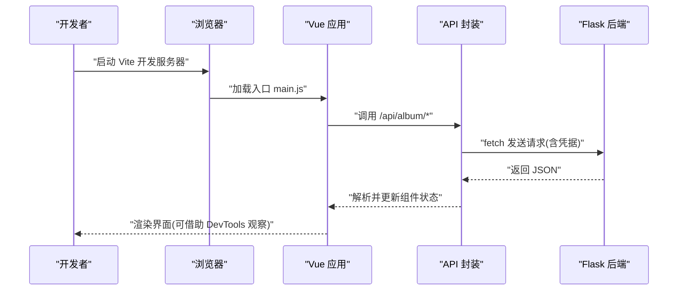
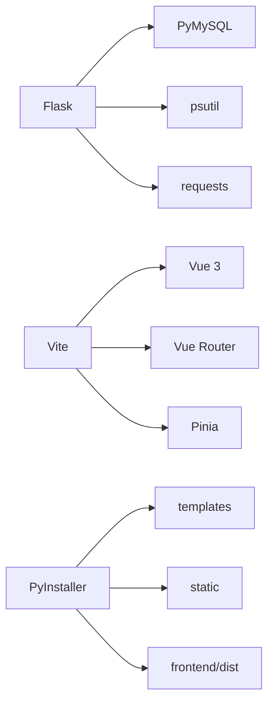

# 调试技巧与工具

<cite>
**本文引用的文件**
- [app.py](file://app.py)
- [frontend/src/main.js](file://frontend/src/main.js)
- [frontend/package.json](file://frontend/package.json)
- [frontend/vite.config.js](file://frontend/vite.config.js)
- [frontend/src/api.js](file://frontend/src/api.js)
- [frontend/src/App.vue](file://frontend/src/App.vue)
- [requirements.txt](file://requirements.txt)
- [templates/logs.html](file://templates/logs.html)
- [SchoolWeb.spec](file://SchoolWeb.spec)
</cite>

## 目录
1. [简介](#简介)
2. [项目结构](#项目结构)
3. [核心组件](#核心组件)
4. [架构总览](#架构总览)
5. [详细组件分析](#详细组件分析)
6. [依赖分析](#依赖分析)
7. [性能考虑](#性能考虑)
8. [故障排查指南](#故障排查指南)
9. [结论](#结论)
10. [附录](#附录)

## 简介
本指南面向 School_Web 项目的开发与运维人员，聚焦于调试与排障实践，涵盖以下方面：
- Flask 应用调试：开发服务器配置、错误追踪、日志分析、安全头与会话控制。
- Vue.js 前端调试：浏览器开发者工具、Vue DevTools 使用、组件状态检查、代理与跨域。
- 数据库调试：连接与建表初始化、慢查询定位、索引与事务问题排查。
- 网络调试：API 测试工具、抓包与跨域问题排查。
- 性能分析：Python 性能分析器、前端性能监控与内存泄漏检测。
- 常见问题与案例：登录/注册异常、验证码与速率限制、会话超时、白名单封禁、日志与安全头。

## 项目结构
项目采用前后端分离架构：
- 后端：Flask 应用，负责路由、认证、权限、数据库初始化与安全头设置。
- 前端：基于 Vite + Vue 3 的 SPA，通过代理转发 /api 请求至后端。
- 部署：使用 PyInstaller 打包为单文件可执行程序，包含模板、静态资源与前端构建产物。

图表来源
- [frontend/src/main.js:1-6](file://frontend/src/main.js#L1-L6)
- [frontend/src/App.vue:1-99](file://frontend/src/App.vue#L1-L99)
- [frontend/src/api.js:1-45](file://frontend/src/api.js#L1-L45)
- [frontend/vite.config.js:1-21](file://frontend/vite.config.js#L1-L21)
- [app.py:119-139](file://app.py#L119-L139)
- [requirements.txt:1-5](file://requirements.txt#L1-L5)
- [templates/logs.html:1-19](file://templates/logs.html#L1-L19)
- [SchoolWeb.spec:1-45](file://SchoolWeb.spec#L1-L45)

章节来源
- [frontend/src/main.js:1-6](file://frontend/src/main.js#L1-L6)
- [frontend/package.json:1-21](file://frontend/package.json#L1-L21)
- [frontend/vite.config.js:1-21](file://frontend/vite.config.js#L1-L21)
- [app.py:119-139](file://app.py#L119-L139)
- [requirements.txt:1-5](file://requirements.txt#L1-L5)
- [templates/logs.html:1-19](file://templates/logs.html#L1-L19)
- [SchoolWeb.spec:1-45](file://SchoolWeb.spec#L1-L45)

## 核心组件
- Flask 应用与中间件
  - 开发服务器与跨域：CORS 配置、安全响应头、会话 Cookie 设置。
  - 速率限制与封禁：内存级速率限制、白名单、手动封禁与试探封禁延长。
  - 安全扫描阻断：基于 User-Agent 的安全扫描工具拦截。
  - 全局验证码门禁：针对已登录用户的二次验证流程。
  - 日志系统：统一写入与读取日志文件，便于审计与排障。
- 前端应用
  - Vite 开发服务器：主机与端口配置、API 代理。
  - Vue 应用入口与路由：组件挂载、状态与生命周期。
  - API 封装：统一前缀与凭据传递，便于调试与一致性。
- 打包与部署
  - PyInstaller 规则：包含模板、静态资源与前端 dist 目录，隐藏导入模块列表。

章节来源
- [app.py:119-139](file://app.py#L119-L139)
- [app.py:318-382](file://app.py#L318-L382)
- [app.py:513-593](file://app.py#L513-L593)
- [app.py:600-622](file://app.py#L600-L622)
- [app.py:886-905](file://app.py#L886-L905)
- [frontend/vite.config.js:1-21](file://frontend/vite.config.js#L1-L21)
- [frontend/src/api.js:1-45](file://frontend/src/api.js#L1-L45)
- [SchoolWeb.spec:1-45](file://SchoolWeb.spec#L1-L45)

## 架构总览
下图展示前后端交互与调试关注点：前端通过 Vite 代理访问后端 API，后端进行速率限制、安全头与会话控制，同时输出日志以便排障。

图表来源
- [frontend/vite.config.js:6-18](file://frontend/vite.config.js#L6-L18)
- [app.py:513-593](file://app.py#L513-L593)
- [app.py:642-676](file://app.py#L642-L676)

章节来源
- [frontend/vite.config.js:1-21](file://frontend/vite.config.js#L1-L21)
- [app.py:513-593](file://app.py#L513-L593)
- [app.py:642-676](file://app.py#L642-L676)

## 详细组件分析

### Flask 调试要点
- 开发服务器与跨域
  - CORS 支持凭据与特定来源，注意生产环境 HTTPS 下 Secure Cookie 的行为。
  - 安全响应头：X-Content-Type-Options、X-Frame-Options、X-XSS-Protection、Referrer-Policy、Strict-Transport-Security、Permissions-Policy。
  - 会话安全：HttpOnly、SameSite、Secure（按环境变量自动调整）、永久会话时长。
- 速率限制与封禁
  - 内存级队列统计与封禁窗口，封禁期间试探次数超限将延长封禁。
  - 白名单与手动封禁：支持从文件持久化白名单，便于临时放行与审计。
- 安全扫描阻断
  - 基于 User-Agent 的黑名单拦截，避免自动化扫描。
- 全局验证码门禁
  - 对已登录用户在敏感路径进行二次验证，API 路径返回 JSON 错误。
- 日志系统
  - 统一写入与读取日志文件，模板提供“刷新/清空”操作，便于快速定位问题。

图表来源
- [app.py:513-562](file://app.py#L513-L562)
- [app.py:359-382](file://app.py#L359-L382)
- [app.py:394-412](file://app.py#L394-L412)

章节来源
- [app.py:119-139](file://app.py#L119-L139)
- [app.py:513-593](file://app.py#L513-L593)
- [app.py:642-676](file://app.py#L642-L676)
- [app.py:886-905](file://app.py#L886-L905)
- [templates/logs.html:1-19](file://templates/logs.html#L1-L19)

### Vue 前端调试要点
- 开发服务器
  - Vite 主机与端口：确保与后端代理目标一致。
  - 代理规则：将 /api 与 /static/albums 代理到后端服务地址。
- Vue 应用入口
  - 应用挂载与样式引入，便于检查渲染与样式问题。
- API 封装
  - 统一前缀与凭据传递，便于在浏览器 Network 面板中识别与复现。
- 组件状态检查
  - 使用 Vue DevTools 查看组件层级、响应式数据与生命周期钩子。
  - 在 App.vue 中观察路由切换、搜索与排序参数变化。

图表来源
- [frontend/src/main.js:1-6](file://frontend/src/main.js#L1-L6)
- [frontend/src/api.js:1-45](file://frontend/src/api.js#L1-L45)
- [frontend/vite.config.js:6-18](file://frontend/vite.config.js#L6-L18)
- [app.py:642-676](file://app.py#L642-L676)

章节来源
- [frontend/package.json:1-21](file://frontend/package.json#L1-L21)
- [frontend/vite.config.js:1-21](file://frontend/vite.config.js#L1-L21)
- [frontend/src/main.js:1-6](file://frontend/src/main.js#L1-L6)
- [frontend/src/api.js:1-45](file://frontend/src/api.js#L1-L45)
- [frontend/src/App.vue:1-99](file://frontend/src/App.vue#L1-L99)

### 数据库调试要点
- 连接与初始化
  - 获取数据库连接与相册扩展表初始化，确保所需表存在并具备索引。
- 常见问题
  - 连接失败：检查数据库配置与网络可达性。
  - 表缺失：确认初始化逻辑已执行，或手动创建表。
  - 索引缺失：根据查询模式添加必要索引，如聊天消息的通道、发送者、接收者与时间戳索引。
- 慢查询分析
  - 结合 Flask 日志与数据库慢查询日志定位热点 SQL。
  - 使用 EXPLAIN 分析查询计划，优化 WHERE、JOIN 与排序条件。

章节来源
- [app.py:680-693](file://app.py#L680-L693)
- [app.py:695-831](file://app.py#L695-L831)
- [app.py:832-866](file://app.py#L832-L866)

## 依赖分析
- Python 依赖
  - Flask、PyMySQL、psutil、requests 等，用于 Web 框架、数据库连接、系统监控与 HTTP 请求。
- 前端依赖
  - Vue 3、Vue Router、Pinia，以及 Vite 与 Vue 插件。
- 打包依赖
  - PyInstaller 规则包含模板、静态资源与前端 dist 目录，并隐藏导入模块列表。

图表来源
- [requirements.txt:1-5](file://requirements.txt#L1-L5)
- [frontend/package.json:11-19](file://frontend/package.json#L11-L19)
- [SchoolWeb.spec:8-9](file://SchoolWeb.spec#L8-L9)

章节来源
- [requirements.txt:1-5](file://requirements.txt#L1-L5)
- [frontend/package.json:1-21](file://frontend/package.json#L1-L21)
- [SchoolWeb.spec:1-45](file://SchoolWeb.spec#L1-L45)

## 性能考虑
- Python 性能分析
  - 使用 cProfile/line_profiler 定位热点函数，结合日志时间戳分析请求耗时。
- 前端性能监控
  - 使用浏览器 Performance 面板记录渲染与脚本执行，结合 Vue DevTools 观察组件重渲染频率。
- 内存泄漏检测
  - 使用 Memory 面板快照对比，排查未释放的事件监听器与定时器。
- 数据库性能
  - 为高频查询添加索引，避免全表扫描；使用 EXPLAIN 分析执行计划。

[本节为通用指导，无需列出章节来源]

## 故障排查指南

### Flask 常见问题
- 登录/注册频繁触发 429
  - 检查速率限制配置与封禁状态，确认白名单与试探封禁逻辑。
  - 参考路径：[速率限制检查:513-562](file://app.py#L513-L562)、[速率配置加载:359-382](file://app.py#L359-L382)、[白名单加载:394-412](file://app.py#L394-L412)
- 会话超时被强制登出
  - 检查会话空闲超时与 IP 最后活跃时间更新逻辑。
  - 参考路径：[会话空闲超时检查:564-593](file://app.py#L564-L593)
- 全局验证码门禁导致 API 403
  - 确认已登录且未通过验证码验证，或在受保护路径上缺少验证码。
  - 参考路径：[全局验证码门禁:600-622](file://app.py#L600-L622)
- 安全扫描被拦截
  - 检查 User-Agent 是否命中黑名单。
  - 参考路径：[安全扫描拦截:149-156](file://app.py#L149-L156)
- 跨域与凭据问题
  - 确认前端代理目标与后端 CORS 配置一致，浏览器 Network 面板查看预检请求。
  - 参考路径：[CORS 配置:131-131](file://app.py#L131-L131)、[代理配置:9-18](file://frontend/vite.config.js#L9-L18)

章节来源
- [app.py:513-593](file://app.py#L513-L593)
- [app.py:600-622](file://app.py#L600-L622)
- [app.py:149-156](file://app.py#L149-L156)
- [frontend/vite.config.js:6-18](file://frontend/vite.config.js#L6-L18)

### 前端常见问题
- API 403/401
  - 检查凭据传递与 CSRF Token，确认会话有效。
  - 参考路径：[API 封装:1-5](file://frontend/src/api.js#L1-L5)
- 跨域与代理失效
  - 确认 Vite 代理目标与后端监听地址一致，端口正确。
  - 参考路径：[代理配置:6-18](file://frontend/vite.config.js#L6-L18)
- 组件状态异常
  - 使用 Vue DevTools 检查响应式数据与生命周期，定位渲染问题。
  - 参考路径：[应用入口:1-6](file://frontend/src/main.js#L1-L6)、[组件示例:1-99](file://frontend/src/App.vue#L1-L99)

章节来源
- [frontend/src/api.js:1-45](file://frontend/src/api.js#L1-L45)
- [frontend/vite.config.js:1-21](file://frontend/vite.config.js#L1-L21)
- [frontend/src/main.js:1-6](file://frontend/src/main.js#L1-L6)
- [frontend/src/App.vue:1-99](file://frontend/src/App.vue#L1-L99)

### 数据库常见问题
- 连接失败
  - 检查数据库配置与网络连通性，确认初始化逻辑已执行。
  - 参考路径：[数据库连接:680-693](file://app.py#L680-L693)、[相册表初始化:695-831](file://app.py#L695-L831)
- 查询缓慢
  - 使用 EXPLAIN 分析执行计划，为高频查询添加索引。
  - 参考路径：[聊天消息表索引:803-816](file://app.py#L803-L816)

章节来源
- [app.py:680-693](file://app.py#L680-L693)
- [app.py:695-831](file://app.py#L695-L831)
- [app.py:803-816](file://app.py#L803-L816)

### 日志与审计
- 日志查看与清空
  - 通过模板页面查看日志内容，支持刷新与清空。
  - 参考路径：[日志模板:1-19](file://templates/logs.html#L1-L19)、[日志写入/读取:886-905](file://app.py#L886-L905)

章节来源
- [templates/logs.html:1-19](file://templates/logs.html#L1-L19)
- [app.py:886-905](file://app.py#L886-L905)

## 结论
本指南围绕 School_Web 的前后端与数据库调试提供了系统化的工具与方法建议。通过合理配置开发服务器、利用代理与安全头、结合日志与性能分析工具，可以高效定位与解决运行时问题。建议在开发与测试环境中优先启用严格的安全头与速率限制策略，在生产环境按需放宽并配合监控告警。

[本节为总结性内容，无需列出章节来源]

## 附录

### 实际调试案例与经验
- 案例一：登录频繁 429
  - 现象：短时间内多次登录请求被拒绝。
  - 排查：检查速率限制配置与封禁状态，确认是否误封或试探封禁延长。
  - 参考路径：[速率限制检查:513-562](file://app.py#L513-L562)、[速率配置加载:359-382](file://app.py#L359-L382)
- 案例二：前端 API 403
  - 现象：前端调用 /api 返回 403。
  - 排查：确认会话有效、CSRF Token 正确、后端全局验证码门禁是否生效。
  - 参考路径：[全局验证码门禁:600-622](file://app.py#L600-L622)、[API 封装:1-5](file://frontend/src/api.js#L1-L5)
- 案例三：跨域问题
  - 现象：浏览器 Network 显示跨域错误。
  - 排查：核对前端代理目标与后端 CORS 配置，确保凭据传递。
  - 参考路径：[CORS 配置:131-131](file://app.py#L131-L131)、[代理配置:9-18](file://frontend/vite.config.js#L9-L18)
- 案例四：数据库慢查询
  - 现象：页面卡顿、接口响应慢。
  - 排查：使用 EXPLAIN 分析执行计划，为高频查询添加索引。
  - 参考路径：[聊天消息表索引:803-816](file://app.py#L803-L816)

章节来源
- [app.py:513-562](file://app.py#L513-L562)
- [app.py:359-382](file://app.py#L359-L382)
- [app.py:600-622](file://app.py#L600-L622)
- [frontend/src/api.js:1-45](file://frontend/src/api.js#L1-L45)
- [frontend/vite.config.js:6-18](file://frontend/vite.config.js#L6-L18)
- [app.py:803-816](file://app.py#L803-L816)