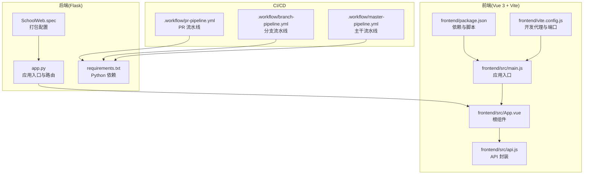
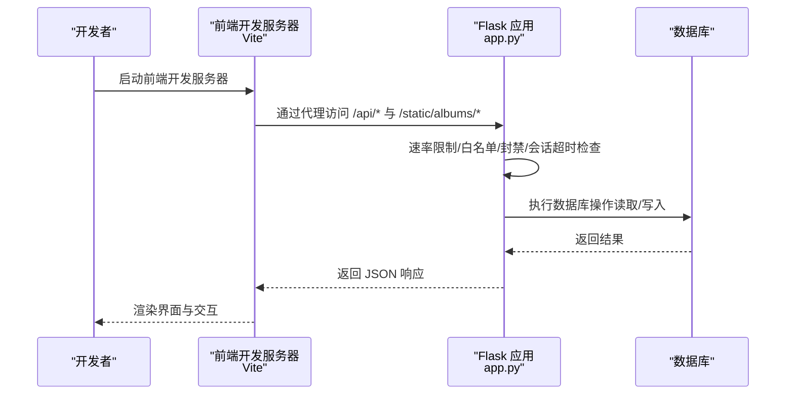
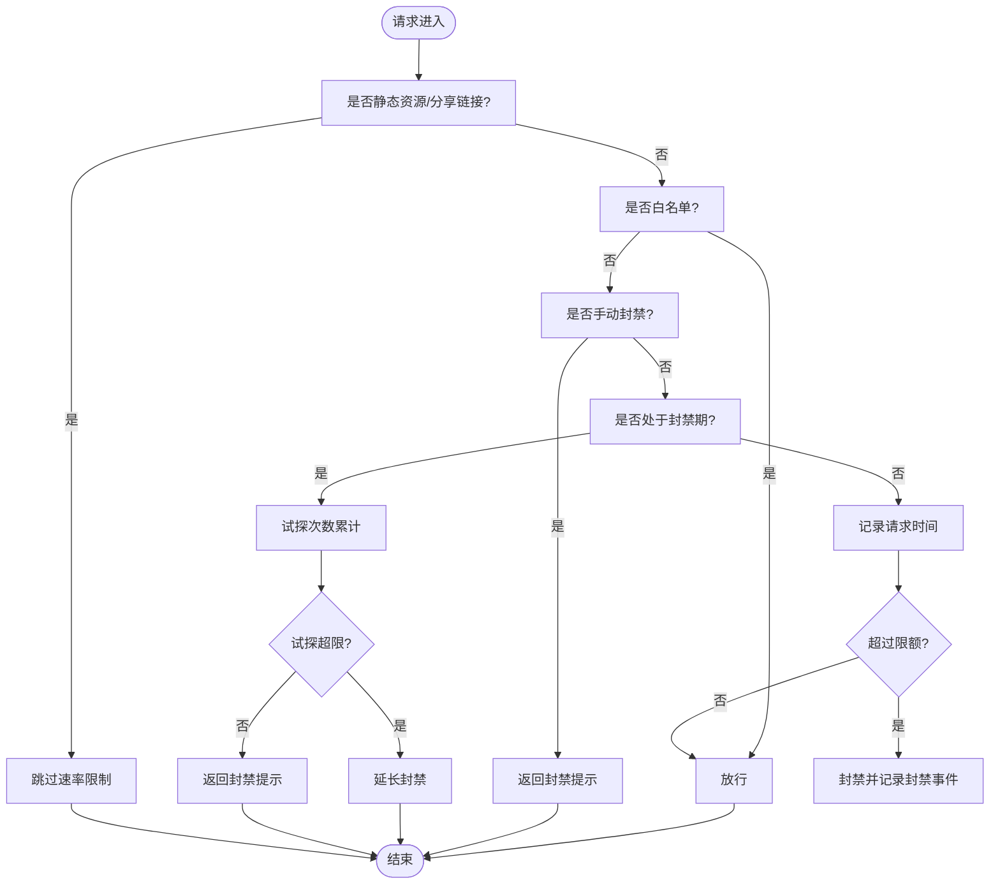
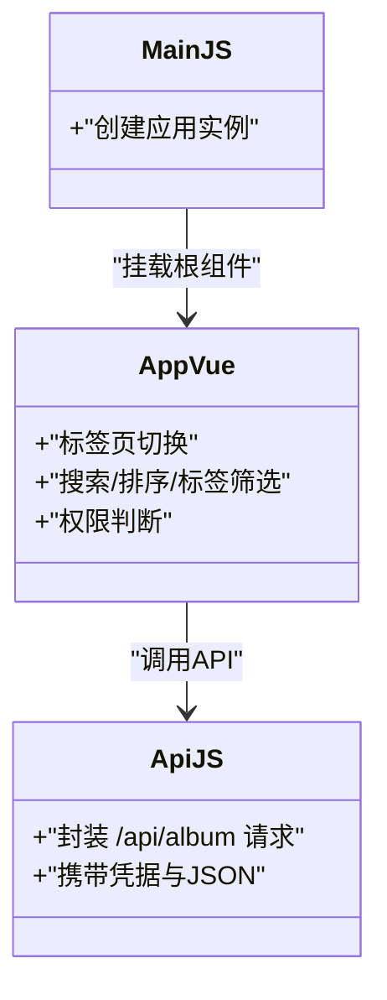
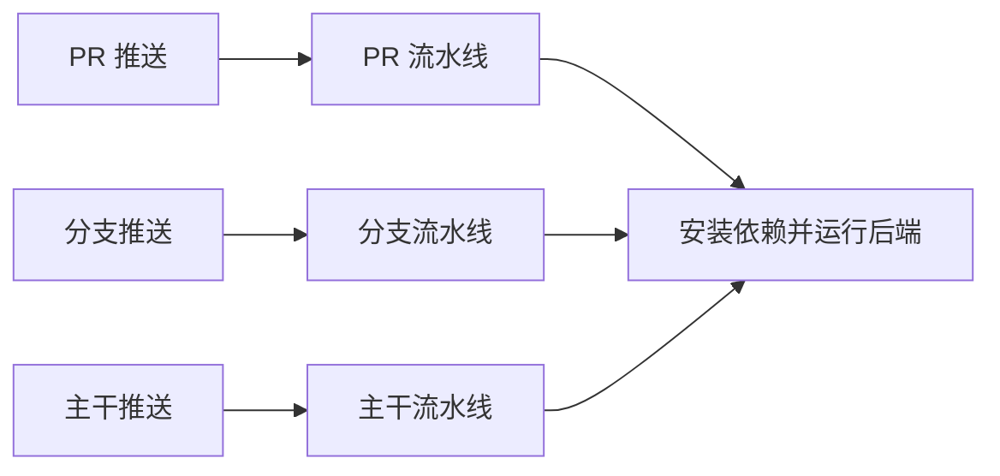
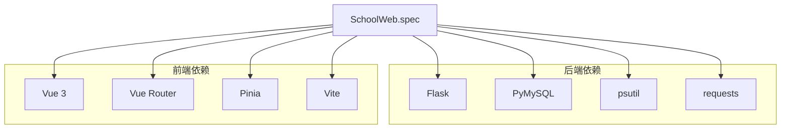

# 贡献指南

<cite>
**本文引用的文件**
- [README.md](file://README.md)
- [app.py](file://app.py)
- [frontend/package.json](file://frontend/package.json)
- [frontend/vite.config.js](file://frontend/vite.config.js)
- [frontend/src/main.js](file://frontend/src/main.js)
- [frontend/src/App.vue](file://frontend/src/App.vue)
- [frontend/src/api.js](file://frontend/src/api.js)
- [.workflow/pr-pipeline.yml](file://.workflow/pr-pipeline.yml)
- [.workflow/master-pipeline.yml](file://.workflow/master-pipeline.yml)
- [.workflow/branch-pipeline.yml](file://.workflow/branch-pipeline.yml)
- [requirements.txt](file://requirements.txt)
- [SchoolWeb.spec](file://SchoolWeb.spec)
- [.gitignore](file://.gitignore)
- [安全措施清单.md](file://安全措施清单.md)
</cite>

## 目录
1. [简介](#简介)
2. [项目结构](#项目结构)
3. [核心组件](#核心组件)
4. [架构总览](#架构总览)
5. [详细组件分析](#详细组件分析)
6. [依赖关系分析](#依赖关系分析)
7. [性能考量](#性能考量)
8. [故障排查指南](#故障排查指南)
9. [结论](#结论)
10. [附录](#附录)

## 简介
本指南面向希望参与 School_Web 项目贡献的开发者，涵盖从 Fork 项目、创建分支、提交 Pull Request 的完整流程，到代码贡献规范（编码风格、测试要求、文档更新与变更日志维护）、问题报告流程（Bug 报告模板、功能请求格式、问题标签使用）、文档贡献方式（文档改进、翻译贡献、示例代码添加）、社区行为准则（沟通礼仪、冲突解决、团队协作原则）、贡献者认可机制与维护者联系方式、新贡献者入门指导以及常见问题解答，并辅以成功贡献案例与最佳实践。

## 项目结构
项目采用前后端分离架构：
- 后端基于 Flask，负责业务逻辑、数据库交互、安全策略与 API 提供。
- 前端基于 Vue 3 + Vite，提供相册与互动功能的现代化界面。
- 模板与静态资源由后端提供，前端构建产物由后端统一托管。
- 工作流采用 YAML 管道，支持 PR、分支与主干流水线构建。

**图示来源**
- [app.py:119-139](file://app.py#L119-L139)
- [frontend/src/main.js:1-6](file://frontend/src/main.js#L1-L6)
- [frontend/src/App.vue:1-99](file://frontend/src/App.vue#L1-L99)
- [frontend/src/api.js:1-45](file://frontend/src/api.js#L1-L45)
- [frontend/package.json:1-21](file://frontend/package.json#L1-L21)
- [frontend/vite.config.js:1-21](file://frontend/vite.config.js#L1-L21)
- [.workflow/pr-pipeline.yml:1-38](file://.workflow/pr-pipeline.yml#L1-L38)
- [.workflow/branch-pipeline.yml:1-36](file://.workflow/branch-pipeline.yml#L1-L36)
- [.workflow/master-pipeline.yml:1-55](file://.workflow/master-pipeline.yml#L1-L55)
- [requirements.txt:1-5](file://requirements.txt#L1-L5)
- [SchoolWeb.spec:1-45](file://SchoolWeb.spec#L1-L45)

**章节来源**
- [README.md:212-305](file://README.md#L212-L305)
- [frontend/package.json:1-21](file://frontend/package.json#L1-L21)
- [frontend/vite.config.js:1-21](file://frontend/vite.config.js#L1-L21)
- [app.py:119-139](file://app.py#L119-L139)

## 核心组件
- 应用入口与路由
  - 后端应用入口与跨域、会话、安全头等全局配置集中于应用初始化阶段。
  - 速率限制、白名单、封禁、会话空闲超时等安全策略在请求前置处理中生效。
- 前端入口与根组件
  - 前端通过 main.js 创建应用实例，App.vue 作为根组件组织标签页、工具栏、组件挂载与用户权限判断。
  - api.js 封装相册相关 API，统一携带凭据与 JSON 请求体。
- CI/CD 管道
  - PR、分支与主干流水线分别负责构建与制品产出，便于在合并前验证变更。

**章节来源**
- [app.py:119-139](file://app.py#L119-L139)
- [frontend/src/main.js:1-6](file://frontend/src/main.js#L1-L6)
- [frontend/src/App.vue:47-84](file://frontend/src/App.vue#L47-L84)
- [frontend/src/api.js:1-45](file://frontend/src/api.js#L1-L45)
- [.workflow/pr-pipeline.yml:1-38](file://.workflow/pr-pipeline.yml#L1-L38)
- [.workflow/branch-pipeline.yml:1-36](file://.workflow/branch-pipeline.yml#L1-L36)
- [.workflow/master-pipeline.yml:1-55](file://.workflow/master-pipeline.yml#L1-L55)

## 架构总览
下图展示了后端与前端的交互关系、开发代理与 API 调用路径，以及 CI/CD 对构建的触发与制品产出。

**图示来源**
- [frontend/vite.config.js:6-19](file://frontend/vite.config.js#L6-L19)
- [app.py:513-593](file://app.py#L513-L593)
- [frontend/src/api.js:1-45](file://frontend/src/api.js#L1-L45)

## 详细组件分析

### 后端安全与速率限制组件
- 速率限制器
  - 基于内存桶与文件持久化，支持按 IP 与路由维度的请求频率控制，具备封禁与试探追加封禁机制。
- IP 白名单与封禁
  - 白名单 IP 不受速率限制；手动封禁与动态封禁策略结合，封禁期间试探次数超限将延长封禁。
- 会话空闲超时
  - IP 超时无操作将强制登出，提升会话安全性。
- 全站验证码门禁
  - 登录用户在敏感路由或非白名单路径需完成验证码二次验证。

**图示来源**
- [app.py:31-114](file://app.py#L31-L114)
- [app.py:348-413](file://app.py#L348-L413)
- [app.py:513-593](file://app.py#L513-L593)

**章节来源**
- [app.py:31-114](file://app.py#L31-L114)
- [app.py:348-413](file://app.py#L348-L413)
- [app.py:513-593](file://app.py#L513-L593)

### 前端组件与 API 封装
- 应用入口与根组件
  - main.js 创建应用实例，App.vue 组织标签页、搜索与排序、标签筛选、组件挂载与权限判断。
- API 封装
  - api.js 统一封装 /api/album 相关请求，统一携带凭据与 JSON 请求体，便于复用与测试。

**图示来源**
- [frontend/src/main.js:1-6](file://frontend/src/main.js#L1-L6)
- [frontend/src/App.vue:47-84](file://frontend/src/App.vue#L47-L84)
- [frontend/src/api.js:1-45](file://frontend/src/api.js#L1-L45)

**章节来源**
- [frontend/src/main.js:1-6](file://frontend/src/main.js#L1-L6)
- [frontend/src/App.vue:1-99](file://frontend/src/App.vue#L1-L99)
- [frontend/src/api.js:1-45](file://frontend/src/api.js#L1-L45)

### CI/CD 流水线
- PR 流水线
  - 在 PR 推送至 master 分支时触发，安装依赖并运行后端主程序，产出制品。
- 分支与主干流水线
  - 分支与主干推送触发，执行 Python 构建与制品发布步骤。

**图示来源**
- [.workflow/pr-pipeline.yml:1-38](file://.workflow/pr-pipeline.yml#L1-L38)
- [.workflow/branch-pipeline.yml:1-36](file://.workflow/branch-pipeline.yml#L1-L36)
- [.workflow/master-pipeline.yml:1-55](file://.workflow/master-pipeline.yml#L1-L55)

**章节来源**
- [.workflow/pr-pipeline.yml:1-38](file://.workflow/pr-pipeline.yml#L1-L38)
- [.workflow/branch-pipeline.yml:1-36](file://.workflow/branch-pipeline.yml#L1-L36)
- [.workflow/master-pipeline.yml:1-55](file://.workflow/master-pipeline.yml#L1-L55)

## 依赖关系分析
- 后端依赖
  - Flask、PyMySQL、psutil、requests 等，用于 Web 框架、数据库连接、系统监控、HTTP 请求。
- 前端依赖
  - Vue 3、Vue Router、Pinia，以及 Vite 开发工具与 Vue 插件。
- 打包与分发
  - 使用 PyInstaller 规则打包，包含模板、静态资源与前端构建产物。

**图示来源**
- [requirements.txt:1-5](file://requirements.txt#L1-L5)
- [frontend/package.json:11-19](file://frontend/package.json#L11-L19)
- [SchoolWeb.spec:4-16](file://SchoolWeb.spec#L4-L16)

**章节来源**
- [requirements.txt:1-5](file://requirements.txt#L1-L5)
- [frontend/package.json:1-21](file://frontend/package.json#L1-L21)
- [SchoolWeb.spec:1-45](file://SchoolWeb.spec#L1-L45)

## 性能考量
- 速率限制与封禁
  - 合理配置速率限制参数与封禁时长，避免误伤正常用户；封禁期间试探追加封禁策略有助于抵御探测。
- 会话空闲超时
  - 适度缩短空闲超时时间，降低会话被滥用的风险。
- 前端开发代理
  - 使用 Vite 代理将 /api 与 /static/albums 指向后端，减少跨域与额外转发开销。
- 构建与打包
  - CI/CD 流水线中统一安装依赖与运行，确保构建一致性；打包规则包含模板与静态资源，减少运行时 IO。

**章节来源**
- [app.py:348-413](file://app.py#L348-L413)
- [app.py:508-593](file://app.py#L508-L593)
- [frontend/vite.config.js:6-19](file://frontend/vite.config.js#L6-L19)
- [.workflow/pr-pipeline.yml:20-24](file://.workflow/pr-pipeline.yml#L20-L24)
- [SchoolWeb.spec:4-16](file://SchoolWeb.spec#L4-L16)

## 故障排查指南
- 本地开发无法访问后端 API
  - 检查前端开发服务器代理配置是否指向后端地址与端口。
  - 确认后端已启动且监听 0.0.0.0:5800，前端代理映射正确。
- 速率限制导致请求被拒
  - 检查速率限制配置文件与封禁状态；必要时加入白名单或调整参数。
- 会话超时自动登出
  - 确认会话空闲超时设置与实际操作间隔；避免长时间无操作。
- CI/CD 构建失败
  - 查看流水线日志中的依赖安装与运行命令，确保 Python 版本与依赖一致。

**章节来源**
- [frontend/vite.config.js:6-19](file://frontend/vite.config.js#L6-L19)
- [app.py:513-593](file://app.py#L513-L593)
- [.workflow/pr-pipeline.yml:20-24](file://.workflow/pr-pipeline.yml#L20-L24)

## 结论
本指南提供了从贡献流程到代码规范、问题报告、文档贡献、社区行为准则与维护者联系渠道的完整指引。建议贡献者在提交变更前，先阅读相关章节，确保符合项目约定与质量标准，共同推动 School_Web 的持续演进。

## 附录

### 贡献流程（Fork、分支与 PR）
- Fork 仓库
  - 在代码托管平台上 Fork 项目至个人账户。
- 克隆与配置
  - 克隆 Fork 后的仓库，配置上游远程仓库以便同步主干更新。
- 新建分支
  - 基于主干新建功能/修复分支，命名清晰、聚焦单一变更。
- 提交与推送
  - 提交前确保通过本地测试与格式化；推送分支至个人仓库。
- 创建 PR
  - 在主仓库创建 Pull Request，填写模板化描述与变更摘要，关联相关 Issue。
- CI/CD 与评审
  - 关注流水线状态与评审反馈，及时修正问题。

### 代码贡献规范
- 编码风格
  - 后端：遵循 Python 风格与注释规范，保持函数与类职责单一。
  - 前端：Vue 单文件组件结构清晰，API 封装统一，避免内联样式与事件。
- 测试要求
  - 新增或修改功能需补充单元测试或端到端测试；关注 CI/CD 流水线状态。
- 文档更新
  - 更新 README 或新增文档片段，确保与变更一致。
- 变更日志维护
  - 在变更日志中记录功能、修复与破坏性变更，标注版本与影响范围。

### 问题报告流程
- Bug 报告
  - 标题简洁明确；描述复现步骤、期望结果与实际结果；附带环境信息与日志片段。
- 功能请求
  - 描述需求背景、预期行为与验收条件；提供用例与优先级建议。
- 问题标签
  - 使用项目既定标签区分类型（Bug/Feature/Documentation）与优先级（P0/P1/P2）。

### 文档贡献方式
- 文档改进
  - 修订现有文档，确保术语一致、逻辑清晰、示例可运行。
- 翻译贡献
  - 在国际化目录中新增或更新翻译文件，保持键名与上下文一致。
- 示例代码添加
  - 提供最小可运行示例，配套说明与截图，便于他人快速上手。

### 社区行为准则
- 沟通礼仪
  - 尊重不同观点，使用礼貌用语，避免人身攻击。
- 冲突解决
  - 优先私下沟通；若无法解决，提请维护者介入协调。
- 团队协作
  - 遵循分支策略与评审流程，尊重他人劳动成果，积极反馈与帮助。

### 贡献者认可机制与维护者联系方式
- 贡献者认可
  - 通过变更记录与致谢页面展示贡献者名单与贡献类型。
- 维护者联系方式
  - 通过 Issue 或讨论区联系维护者，遵守沟通礼仪与响应时限。

### 新贡献者入门指导与常见问题
- 入门指导
  - 阅读 README 与开发指南，完成环境搭建与首次运行；从简单 Issue 入手。
- 常见问题
  - 依赖安装失败、端口占用、跨域与代理配置、CI/CD 构建异常等，均可在 Issue 中查找或提问。

### 成功贡献案例与最佳实践
- 案例
  - 修复速率限制误封、优化前端组件交互、完善国际化文案、改进安全响应头。
- 最佳实践
  - 小步快跑、充分测试、文档先行、评审驱动、持续集成。