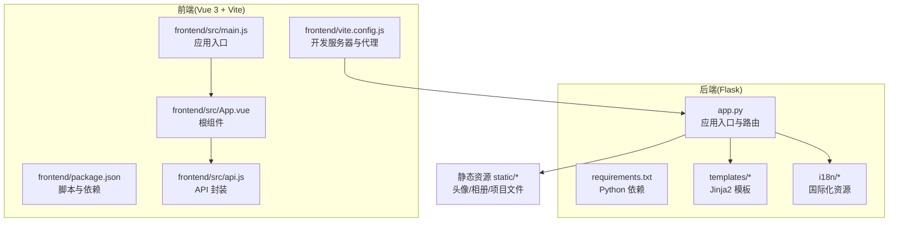
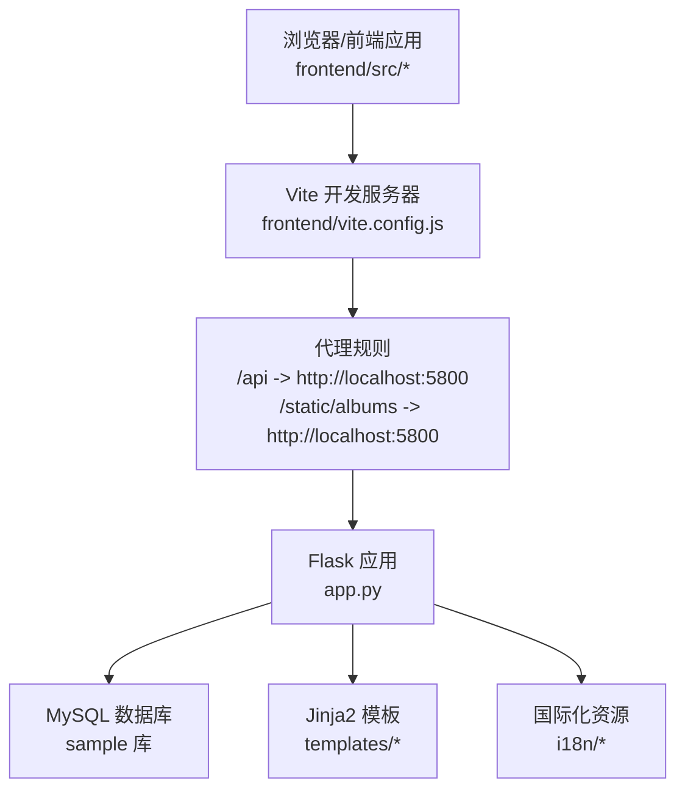
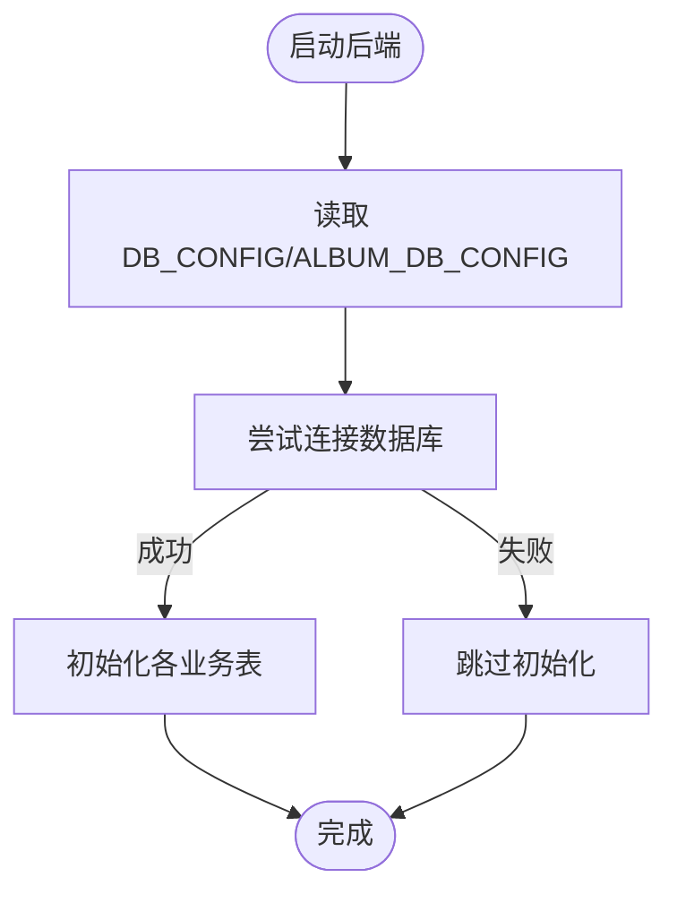
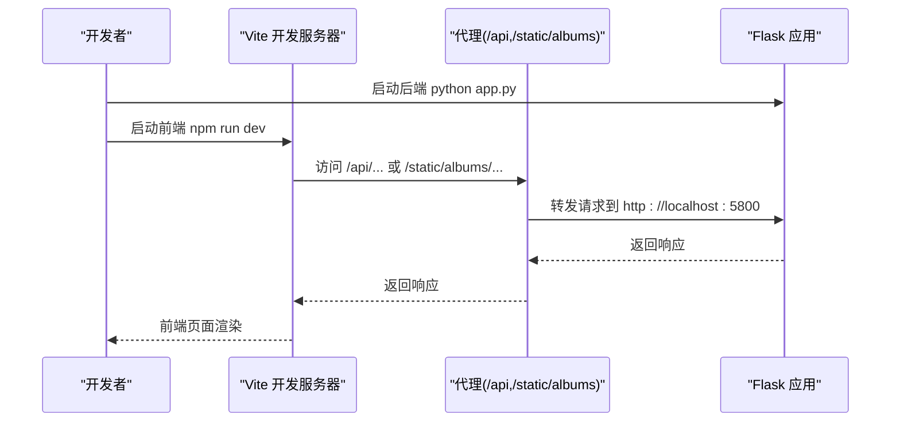
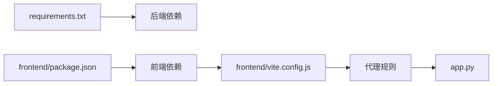

# 快速开始

<cite>
**本文引用的文件**
- [README.md](file://README.md)
- [app.py](file://app.py)
- [requirements.txt](file://requirements.txt)
- [frontend/package.json](file://frontend/package.json)
- [frontend/vite.config.js](file://frontend/vite.config.js)
- [frontend/src/main.js](file://frontend/src/main.js)
- [frontend/src/App.vue](file://frontend/src/App.vue)
- [frontend/src/api.js](file://frontend/src/api.js)
- [templates/base.html](file://templates/base.html)
- [templates/login.html](file://templates/login.html)
</cite>

## 目录
1. [简介](#简介)
2. [项目结构](#项目结构)
3. [核心组件](#核心组件)
4. [架构总览](#架构总览)
5. [详细组件分析](#详细组件分析)
6. [依赖关系分析](#依赖关系分析)
7. [性能注意事项](#性能注意事项)
8. [故障排查指南](#故障排查指南)
9. [结论](#结论)
10. [附录](#附录)

## 简介
本指南面向首次接触 School_Web 的开发者与运维人员，帮助你在本地快速完成环境准备、依赖安装、数据库初始化、开发服务器启动以及生产部署要点梳理，并提供常见问题排查与首次访问指引。

## 项目结构
- 后端基于 Flask，提供认证、系统监控、数据库工具、文件管理、相册等完整功能。
- 前端基于 Vue 3 + Vite，毕业相册采用独立前端工程，通过代理与后端 API 通信。
- 模板系统使用 Jinja2，基础布局与国际化支持位于 templates 与 i18n 目录。

**图示来源**
- [app.py:1-120](file://app.py#L1-L120)
- [requirements.txt:1-5](file://requirements.txt#L1-L5)
- [frontend/package.json:1-21](file://frontend/package.json#L1-L21)
- [frontend/vite.config.js:1-21](file://frontend/vite.config.js#L1-L21)
- [frontend/src/main.js:1-6](file://frontend/src/main.js#L1-L6)
- [frontend/src/App.vue:1-99](file://frontend/src/App.vue#L1-L99)
- [frontend/src/api.js:1-45](file://frontend/src/api.js#L1-L45)

**章节来源**
- [README.md:212-305](file://README.md#L212-L305)

## 核心组件
- 后端应用入口与路由：负责数据库初始化、安全头、CORS、国际化、速率限制、会话与安全策略等。
- 前端应用入口与组件：提供相册主界面、组件化功能模块与 API 封装。
- 开发服务器与代理：Vite 提供热更新与代理，将 /api 与相册静态资源转发至后端。

**章节来源**
- [app.py:122-198](file://app.py#L122-L198)
- [frontend/src/main.js:1-6](file://frontend/src/main.js#L1-L6)
- [frontend/src/App.vue:1-99](file://frontend/src/App.vue#L1-L99)
- [frontend/src/api.js:1-45](file://frontend/src/api.js#L1-L45)
- [frontend/vite.config.js:1-21](file://frontend/vite.config.js#L1-L21)

## 架构总览
后端与前端通过 RESTful API 交互，前端通过 Vite 代理访问后端接口。模板系统提供基础布局与国际化注入，相册前端通过 /api/album 前缀与后端交互。

**图示来源**
- [frontend/vite.config.js:6-18](file://frontend/vite.config.js#L6-L18)
- [app.py:628-641](file://app.py#L628-L641)
- [templates/base.html:156-336](file://templates/base.html#L156-L336)

## 详细组件分析

### 环境准备与依赖安装
- Python 3.8+：后端运行环境，推荐 3.10+。
- Node.js 16+：前端构建与开发环境，推荐 18+。
- MySQL 5.7+：数据库，推荐 8.0+。

安装步骤
- 安装后端依赖
  - 在项目根目录执行：pip install -r requirements.txt
- 安装前端依赖
  - 进入 frontend 目录执行：npm install

**章节来源**
- [README.md:203-209](file://README.md#L203-L209)
- [README.md:319-333](file://README.md#L319-L333)
- [requirements.txt:1-5](file://requirements.txt#L1-L5)
- [frontend/package.json:6-10](file://frontend/package.json#L6-L10)

### 数据库初始化
- 修改数据库配置
  - 在 app.py 中配置 DB_CONFIG 与 ALBUM_DB_CONFIG，确保 host、user、password、database 正确
- 创建数据库与用户表
  - 在 MySQL 中执行创建数据库与用户表的 SQL（参考 README 的“后端部署步骤”）
- 启动后端后自动初始化
  - 应用启动时会自动创建密码重置、用户资料、活动日志、管理员申请、日历事件、插件市场等表

**图示来源**
- [app.py:628-641](file://app.py#L628-L641)
- [app.py:235-348](file://app.py#L235-L348)

**章节来源**
- [README.md:334-361](file://README.md#L334-L361)
- [app.py:235-348](file://app.py#L235-L348)

### 开发服务器启动
- 启动后端 Flask 应用
  - 在项目根目录执行：python app.py
  - 默认监听 0.0.0.0:5800（可通过环境变量或源码调整）
- 启动前端 Vite 开发服务器
  - 进入 frontend 目录执行：npm run dev
  - 默认监听 0.0.0.0:3000，并通过代理将 /api 与 /static/albums 转发至后端

**图示来源**
- [frontend/vite.config.js:6-18](file://frontend/vite.config.js#L6-L18)
- [app.py:5915-5916](file://app.py#L5915-L5916)

**章节来源**
- [README.md:362-372](file://README.md#L362-L372)
- [README.md:387-393](file://README.md#L387-L393)
- [frontend/package.json:7](file://frontend/package.json#L7)

### 生产环境部署要点
- 后端
  - 使用 WSGI 服务器（如 Gunicorn/uWSGI）托管 Flask 应用
  - 设置环境变量：FLASK_DEBUG=0、ADMIN_SECRET、SECRET_KEY（可使用 app.py 自动生成的密钥文件）
  - 配置 Nginx/Apache 反向代理，将 /api 与静态资源转发至后端
- 前端
  - 构建生产包：npm run build
  - 将 frontend/dist 部署到 Nginx 静态目录，或交由后端统一提供静态资源
- 数据库
  - 确保 MySQL 服务可达，DB_CONFIG/ALBUM_DB_CONFIG 正确
  - 初始化数据库与表结构（见“数据库初始化”）

**章节来源**
- [README.md:601-664](file://README.md#L601-L664)
- [app.py:122-142](file://app.py#L122-L142)

### 首次访问与基本功能演示
- 访问地址
  - 本地访问：http://127.0.0.1:5800
  - 局域网访问：http://<本机内网IP>:5800（具体端口以启动日志为准）
- 登录与注册
  - 访问 /login 或 /register，按提示完成注册与登录
- 相册功能
  - 访问 /album 进入毕业相册，使用标签筛选、搜索、排序、上传、点赞、评论、分享等
- 管理员功能
  - 管理员可访问系统监控、数据库工具、文件管理、日志查看等

**章节来源**
- [README.md:668-727](file://README.md#L668-L727)
- [templates/login.html:1-37](file://templates/login.html#L1-L37)
- [templates/base.html:156-203](file://templates/base.html#L156-L203)

## 依赖关系分析
- 后端依赖
  - Flask、PyMySQL、psutil、requests、flask-cors 等
- 前端依赖
  - Vue 3、Vue Router、Pinia、Vite、@vitejs/plugin-vue
- 前端与后端通信
  - Vite 代理将 /api 与 /static/albums 转发至后端，避免跨域问题

**图示来源**
- [requirements.txt:1-5](file://requirements.txt#L1-L5)
- [frontend/package.json:11-19](file://frontend/package.json#L11-L19)
- [frontend/vite.config.js:6-18](file://frontend/vite.config.js#L6-L18)

**章节来源**
- [requirements.txt:1-5](file://requirements.txt#L1-L5)
- [frontend/package.json:11-19](file://frontend/package.json#L11-L19)

## 性能注意事项
- 速率限制与封禁：默认每 IP 每 15 秒最多 40 次请求，超限封禁 240 秒，可在管理后台动态调整。
- 会话超时：2 分钟无操作自动登出，提升安全性。
- 静态资源：生产环境建议开启缓存与压缩，减少带宽占用。
- 数据库连接：使用参数化查询与索引优化，避免慢查询。

**章节来源**
- [app.py:355-392](file://app.py#L355-L392)
- [app.py:516-596](file://app.py#L516-L596)

## 故障排查指南
- 后端无法启动
  - 检查端口占用与防火墙设置，确认 5800 端口可访问
  - 查看启动日志中的监听地址与调试模式
- 前端无法访问后端 API
  - 确认 Vite 代理配置正确，/api 与 /static/albums 转发至 http://localhost:5800
  - 检查后端 CORS 配置与安全头
- 数据库连接失败
  - 核对 DB_CONFIG/ALBUM_DB_CONFIG 中的 host、user、password、database
  - 确认 MySQL 服务运行且网络可达
- 登录失败或验证码错误
  - 确认图形验证码接口正常，检查 /api/captcha 是否返回图片
  - 检查会话与 CSRF 令牌是否正确传递

**章节来源**
- [app.py:134-142](file://app.py#L134-L142)
- [app.py:432-504](file://app.py#L432-L504)
- [frontend/vite.config.js:6-18](file://frontend/vite.config.js#L6-L18)

## 结论
通过本指南，你可以在本地完成 School_Web 的环境准备、依赖安装、数据库初始化与开发服务器启动。生产部署时，请关注安全头、CORS、代理与静态资源分发，并结合速率限制与会话超时策略提升系统稳定性与安全性。

## 附录
- 关键文件定位
  - 后端入口与配置：app.py
  - 后端依赖：requirements.txt
  - 前端入口与组件：frontend/src/main.js、frontend/src/App.vue、frontend/src/api.js
  - 前端开发服务器与代理：frontend/vite.config.js
  - 模板与国际化：templates/base.html、i18n/*
  - 前端依赖与脚本：frontend/package.json