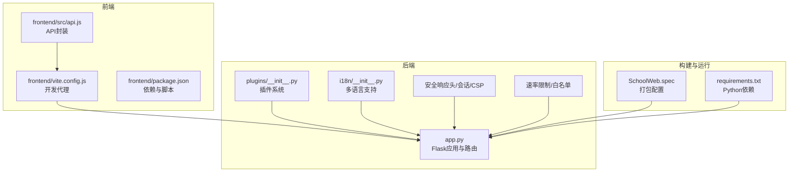
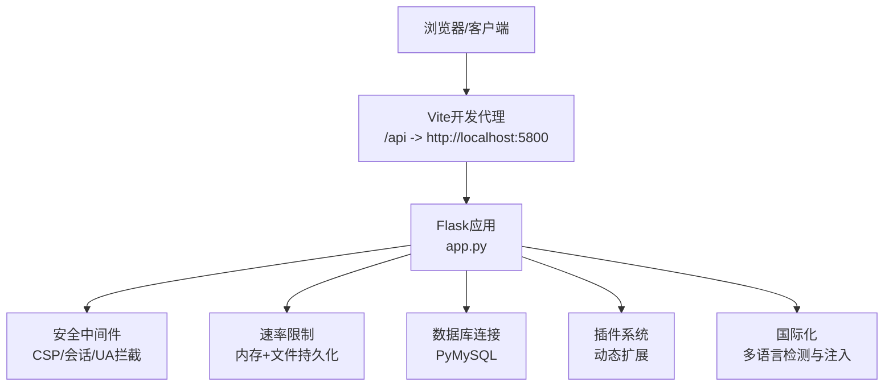
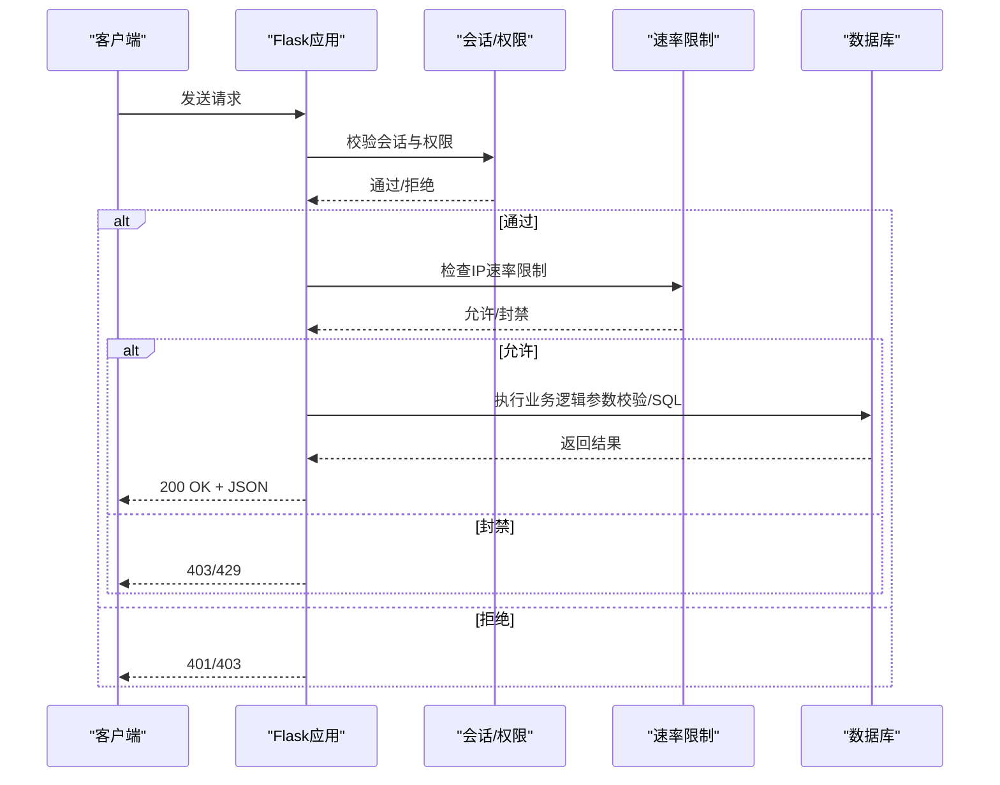
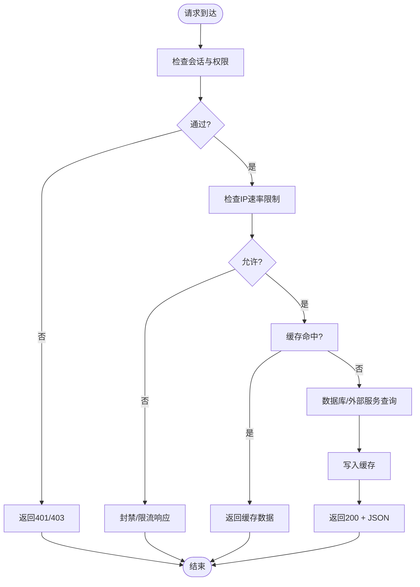
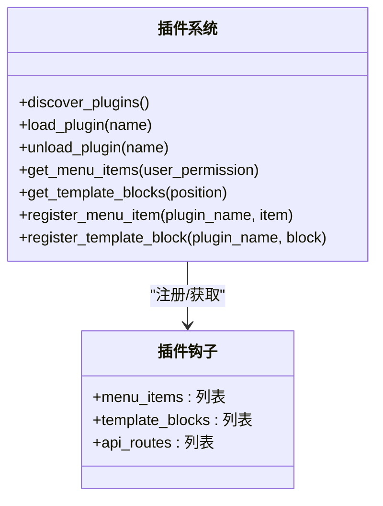
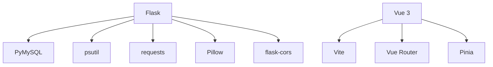

# API扩展策略

<cite>
**本文档引用的文件**
- [app.py](file://app.py)
- [README.md](file://README.md)
- [requirements.txt](file://requirements.txt)
- [SchoolWeb.spec](file://SchoolWeb.spec)
- [i18n/__init__.py](file://i18n/__init__.py)
- [plugins/__init__.py](file://plugins/__init__.py)
- [frontend/src/api.js](file://frontend/src/api.js)
- [frontend/vite.config.js](file://frontend/vite.config.js)
- [frontend/package.json](file://frontend/package.json)
- [rate_limiter.json](file://rate_limiter.json)
</cite>

## 目录
1. [引言](#引言)
2. [项目结构](#项目结构)
3. [核心组件](#核心组件)
4. [架构概览](#架构概览)
5. [详细组件分析](#详细组件分析)
6. [依赖分析](#依赖分析)
7. [性能考虑](#性能考虑)
8. [故障排查指南](#故障排查指南)
9. [结论](#结论)
10. [附录](#附录)

## 引言
本指南面向希望在School_Web平台上扩展RESTful API的开发者，系统讲解如何设计新接口、注册路由、进行参数验证、管理API版本与向后兼容、扩展安全机制（认证授权、权限控制、数据验证）、优化性能（缓存、限流、错误处理），以及配套的测试与文档生成流程。内容基于实际代码实现，确保可操作性与可追溯性。

## 项目结构
项目采用前后端分离架构：后端使用Flask提供REST API与模板渲染，前端使用Vue 3 + Vite构建，通过代理将前端请求转发至后端。插件系统支持动态扩展功能，国际化模块提供多语言支持，速率限制与安全响应头保障系统稳定与安全。

**图示来源**
- [app.py:119-139](file://app.py#L119-L139)
- [plugins/__init__.py:11-249](file://plugins/__init__.py#L11-L249)
- [i18n/__init__.py:1-113](file://i18n/__init__.py#L1-L113)
- [frontend/vite.config.js:1-21](file://frontend/vite.config.js#L1-L21)
- [frontend/src/api.js:1-45](file://frontend/src/api.js#L1-L45)
- [SchoolWeb.spec:1-45](file://SchoolWeb.spec#L1-L45)
- [requirements.txt:1-5](file://requirements.txt#L1-L5)

**章节来源**
- [README.md:212-305](file://README.md#L212-L305)
- [frontend/package.json:1-21](file://frontend/package.json#L1-L21)

## 核心组件
- Flask应用与路由：集中定义REST API与页面路由，统一处理CORS、安全响应头、会话与多语言。
- 速率限制：支持内存+文件持久化、白名单、手动封禁、试探封禁延长等策略。
- 插件系统：动态加载/卸载插件，注册菜单项、模板块与API路由钩子。
- 国际化模块：按请求/会话/Cookie/Accept-Language检测语言，提供翻译函数。
- 前端API封装：统一BASE路径与凭证传递，便于扩展新接口。
- 安全响应头：CSP、X-Frame-Options、X-XSS-Protection、HSTS等，隐藏服务器版本信息。

**章节来源**
- [app.py:119-139](file://app.py#L119-L139)
- [app.py:348-593](file://app.py#L348-L593)
- [plugins/__init__.py:11-249](file://plugins/__init__.py#L11-L249)
- [i18n/__init__.py:1-113](file://i18n/__init__.py#L1-L113)
- [frontend/src/api.js:1-45](file://frontend/src/api.js#L1-L45)

## 架构概览
后端通过before_request钩子实现全局安全与限流，after_request统一注入安全响应头；前端通过Vite代理将/api/*请求转发至Flask。插件系统通过钩子扩展菜单、模板与API路由，形成可插拔的功能扩展点。

**图示来源**
- [app.py:149-194](file://app.py#L149-L194)
- [app.py:513-593](file://app.py#L513-L593)
- [frontend/vite.config.js:6-18](file://frontend/vite.config.js#L6-L18)

**章节来源**
- [app.py:149-194](file://app.py#L149-L194)
- [app.py:513-593](file://app.py#L513-L593)
- [frontend/vite.config.js:1-21](file://frontend/vite.config.js#L1-L21)

## 详细组件分析

### 1) 新接口设计与路由注册
- 设计原则
  - 路径层次清晰：按功能域组织（如/api/album、/api/admin、/api/system）。
  - 方法语义明确：GET/POST/PUT/DELETE对应资源的读取、创建、更新、删除。
  - 返回格式一致：统一使用JSON，包含状态字段与错误信息。
  - 权限控制：在路由层或装饰器中实现权限校验。
- 路由注册方式
  - 在Flask应用中直接定义@app.route(...)或使用蓝图（Blueprint）组织模块化路由。
  - 插件系统可通过钩子注册API路由，实现动态扩展。
- 参数验证
  - 请求体参数：使用request.get_json()获取，进行类型与必填校验。
  - 查询参数：使用request.args.get()获取，进行范围与格式校验。
  - 表单参数：使用request.form.get()获取，结合CSRF令牌校验。
- 错误处理
  - 对于无效参数返回400，对于未授权/鉴权失败返回401/403，对于速率限制返回429，对于服务器错误返回500。
  - 统一错误响应结构，便于前端处理。

**章节来源**
- [README.md:499-598](file://README.md#L499-L598)
- [plugins/__init__.py:14-249](file://plugins/__init__.py#L14-L249)
- [app.py:214-228](file://app.py#L214-L228)

### 2) API版本管理与向后兼容
- 版本策略
  - 路径版本：在API前缀中加入版本号，如/api/v1/album，便于平滑演进。
  - 头部版本：通过自定义Header（如X-API-Version）声明版本，减少路径污染。
  - 文档与变更日志：在README中维护各版本接口变更，标注废弃与迁移指引。
- 向后兼容
  - 新增字段时保持默认值，避免破坏旧客户端。
  - 废弃字段保留一段时间并在响应中标注deprecated，提供迁移时间窗。
  - 严格遵守语义化版本控制，重大变更触发主版本号升级。

**章节来源**
- [README.md:1091-1101](file://README.md#L1091-L1101)

### 3) 安全机制扩展
- 认证授权
  - 会话认证：基于Flask session，设置HttpOnly、SameSite、Secure等属性，定期更换CSRF令牌。
  - 会话超时：IP维度的空闲超时（默认2分钟），超时自动登出并提示。
  - 插件侧可扩展JWT或Token方案，但需与现有会话体系协调。
- 权限控制
  - 权限等级：guest/user/vip/administrator，按等级开放接口。
  - 路由装饰器：在关键接口前增加权限校验装饰器，拒绝低权限访问。
- 数据验证
  - 输入清洗：对HTML/JS标签进行过滤，防止XSS。
  - SQL注入防护：使用参数化查询，禁止字符串拼接SQL。
  - 文件上传：限制大小、类型（魔数检测），路径穿越防护。
- 安全响应头
  - CSP使用nonce，避免unsafe-inline；HSTS仅在生产环境启用；隐藏Server版本信息。

**图示来源**
- [app.py:513-593](file://app.py#L513-L593)
- [app.py:642-676](file://app.py#L642-L676)

**章节来源**
- [app.py:133-139](file://app.py#L133-L139)
- [app.py:513-593](file://app.py#L513-L593)
- [app.py:642-676](file://app.py#L642-L676)

### 4) 性能优化
- 缓存策略
  - 静态资源：通过Nginx设置长缓存（示例配置见README），减少带宽消耗。
  - 动态接口：对热点数据使用Redis/内存缓存，设置合理TTL，避免脏读。
  - 前端缓存：在API封装中根据业务场景设置Cache-Control或ETag。
- 限流控制
  - 内存+文件持久化：支持重启后状态延续，避免恶意刷量。
  - 白名单与手动封禁：对可信IP与管理员IP豁免。
  - 试探封禁延长：封禁期内持续试探将追加封禁时长。
- 错误处理
  - 统一错误码与消息结构，便于前端快速定位问题。
  - 对数据库/外部API异常进行降级与重试策略。

**图示来源**
- [app.py:513-593](file://app.py#L513-L593)
- [rate_limiter.json:1-1](file://rate_limiter.json#L1-L1)

**章节来源**
- [app.py:348-593](file://app.py#L348-L593)
- [README.md:840-871](file://README.md#L840-L871)

### 5) 插件系统与API扩展
- 插件钩子
  - menu_items：注册菜单项，支持权限过滤。
  - template_blocks：注入模板片段（头部/底部/导航）。
  - api_routes：注册API路由，实现插件化接口扩展。
- 生命周期
  - load_plugin：动态导入插件，调用register函数。
  - unload_plugin：调用unregister清理资源。
- 示例
  - 项目启动时自动创建示例插件，演示菜单与模板注入。

**图示来源**
- [plugins/__init__.py:11-249](file://plugins/__init__.py#L11-L249)

**章节来源**
- [plugins/__init__.py:11-249](file://plugins/__init__.py#L11-L249)

### 6) 前端API封装与扩展
- 基础封装
  - 统一BASE路径与credentials: include，简化后续扩展。
  - 按功能域拆分导出方法，便于维护与测试。
- 开发代理
  - Vite代理将/api/*转发至Flask，支持跨域开发调试。
- 扩展建议
  - 新增接口时在api.js中新增方法，并在组件中按需调用。
  - 对复杂请求（如上传、分页）封装通用工具函数。

**章节来源**
- [frontend/src/api.js:1-45](file://frontend/src/api.js#L1-L45)
- [frontend/vite.config.js:1-21](file://frontend/vite.config.js#L1-L21)

## 依赖分析
- 后端依赖
  - Flask 3.0+：提供路由、模板、会话、CORS等能力。
  - PyMySQL 1.0+：MySQL连接与事务支持。
  - psutil、requests：系统监控与外部API调用。
  - Pillow：验证码图片生成。
- 前端依赖
  - Vue 3、Vue Router、Pinia：现代前端框架与状态管理。
  - Vite：快速构建与开发代理。
- 打包与部署
  - PyInstaller配置SchoolWeb.spec，包含模板、静态资源与隐藏导入。

**图示来源**
- [requirements.txt:1-5](file://requirements.txt#L1-L5)
- [SchoolWeb.spec:8-9](file://SchoolWeb.spec#L8-L9)

**章节来源**
- [requirements.txt:1-5](file://requirements.txt#L1-L5)
- [SchoolWeb.spec:1-45](file://SchoolWeb.spec#L1-L45)

## 性能考虑
- 速率限制
  - 可配置参数：请求上限、时间窗口、封禁时长、试探阈值与延长时长。
  - 文件持久化：rate_limiter.json记录桶状态，重启后恢复。
- 缓存与CDN
  - 静态资源长缓存，API响应按场景设置Cache-Control。
- 数据库优化
  - 使用索引（如用户维度、时间维度），避免全表扫描。
  - 批量操作与连接池配置，降低延迟。
- 前端优化
  - 组件懒加载、图片懒加载、请求合并与去抖。

**章节来源**
- [app.py:348-593](file://app.py#L348-L593)
- [rate_limiter.json:1-1](file://rate_limiter.json#L1-L1)
- [README.md:840-871](file://README.md#L840-L871)

## 故障排查指南
- 速率限制误封
  - 检查IP是否在白名单或手动封禁列表。
  - 调整rate_config.json中的参数，或临时提高阈值。
- 验证码问题
  - 确认Pillow安装与字体可用；检查会话存储与缓存。
- 跨域与CORS
  - 确认CORS配置与前端代理设置一致。
- 安全响应头冲突
  - 插件若需unsafe-inline，应在插件内部设置CSP并避免覆盖全局CSP。
- 会话超时频繁
  - 检查客户端活跃度与IP维度last_active记录，适当延长会话超时。

**章节来源**
- [app.py:131-139](file://app.py#L131-L139)
- [app.py:513-593](file://app.py#L513-L593)
- [README.md:953-1004](file://README.md#L953-L1004)

## 结论
通过在Flask中规范设计REST API、在插件系统中动态扩展、在前后端协同中统一参数与错误处理、在安全与性能层面建立完善的限流与响应头策略，可以高效地在School_Web平台上扩展API并保证稳定性与可维护性。建议在每次扩展前制定版本与兼容策略，完善测试与文档，确保平滑演进。

## 附录
- API接口文档与权限对照：参考README中的“API 接口文档”与“路由说明”。
- 国际化接入：在模板与接口中使用_i18n函数与会话语言偏好。
- 插件开发：参考plugins/__init__.py中的钩子与示例插件。

**章节来源**
- [README.md:499-598](file://README.md#L499-L598)
- [i18n/__init__.py:50-108](file://i18n/__init__.py#L50-L108)
- [plugins/__init__.py:195-249](file://plugins/__init__.py#L195-L249)