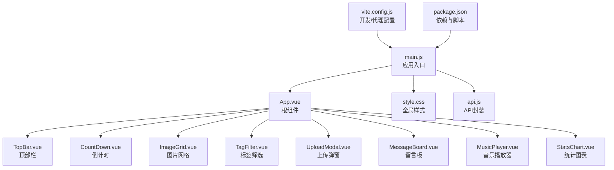
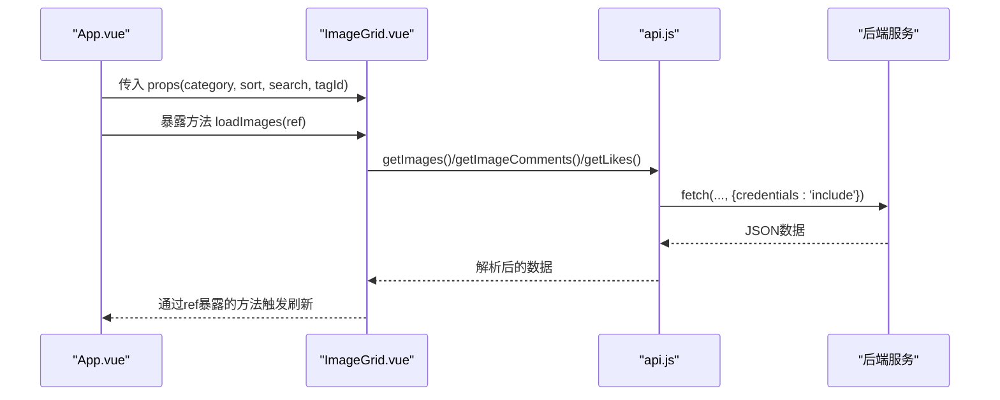
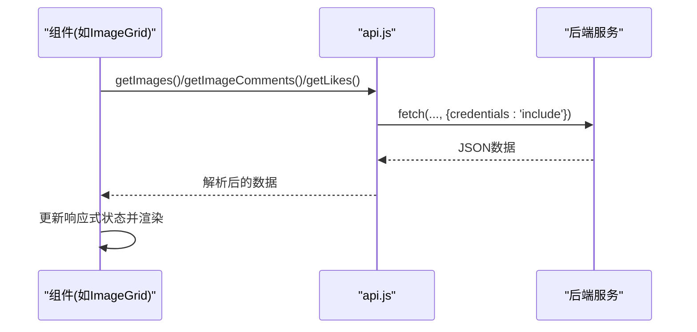
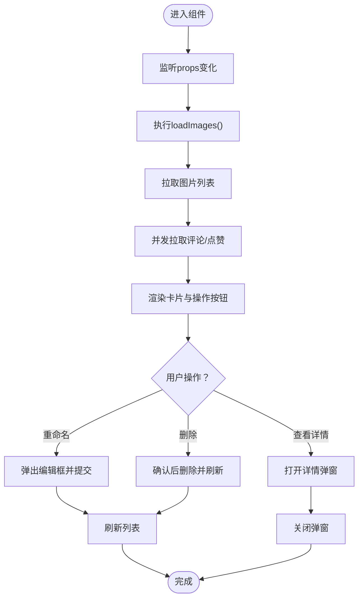
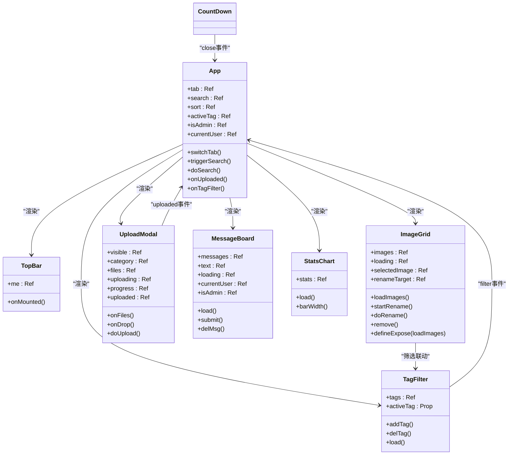
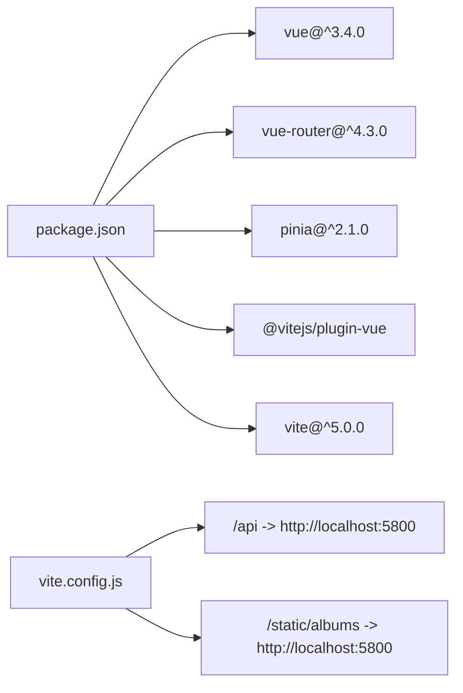

# UI组件扩展

<cite>
**本文引用的文件**
- [frontend/src/main.js](file://frontend/src/main.js)
- [frontend/src/App.vue](file://frontend/src/App.vue)
- [frontend/src/style.css](file://frontend/src/style.css)
- [frontend/package.json](file://frontend/package.json)
- [frontend/vite.config.js](file://frontend/vite.config.js)
- [frontend/src/api.js](file://frontend/src/api.js)
- [frontend/src/components/TopBar.vue](file://frontend/src/components/TopBar.vue)
- [frontend/src/components/CountDown.vue](file://frontend/src/components/CountDown.vue)
- [frontend/src/components/ImageGrid.vue](file://frontend/src/components/ImageGrid.vue)
- [frontend/src/components/TagFilter.vue](file://frontend/src/components/TagFilter.vue)
- [frontend/src/components/UploadModal.vue](file://frontend/src/components/UploadModal.vue)
- [frontend/src/components/MessageBoard.vue](file://frontend/src/components/MessageBoard.vue)
- [frontend/src/components/MusicPlayer.vue](file://frontend/src/components/MusicPlayer.vue)
- [frontend/src/components/StatsChart.vue](file://frontend/src/components/StatsChart.vue)
</cite>

## 目录
1. [引言](#引言)
2. [项目结构](#项目结构)
3. [核心组件](#核心组件)
4. [架构总览](#架构总览)
5. [详细组件分析](#详细组件分析)
6. [依赖关系分析](#依赖关系分析)
7. [性能考虑](#性能考虑)
8. [故障排查指南](#故障排查指南)
9. [结论](#结论)
10. [附录](#附录)

## 引言
本指南面向希望在School_Web项目中扩展Vue.js UI组件的开发者，系统讲解组件结构设计、属性传递与事件处理、组件注册与样式定制、与现有系统的数据绑定与状态管理、生命周期处理、响应式与移动端适配策略，并提供最佳实践与性能优化建议。文档结合仓库中的真实组件进行分析，帮助你快速上手并安全地扩展UI能力。

## 项目结构
前端采用Vite + Vue 3单页应用架构，入口为main.js，根组件为App.vue，所有业务组件位于src/components目录下，公共样式集中在src/style.css，API封装在src/api.js中，构建与开发服务器配置在frontend/vite.config.js中。

图示来源
- [frontend/src/main.js:1-6](file://frontend/src/main.js#L1-L6)
- [frontend/src/App.vue:1-99](file://frontend/src/App.vue#L1-L99)
- [frontend/src/style.css:1-59](file://frontend/src/style.css#L1-L59)
- [frontend/src/api.js:1-45](file://frontend/src/api.js#L1-L45)
- [frontend/vite.config.js:1-21](file://frontend/vite.config.js#L1-L21)
- [frontend/package.json:1-21](file://frontend/package.json#L1-L21)

章节来源
- [frontend/src/main.js:1-6](file://frontend/src/main.js#L1-L6)
- [frontend/src/App.vue:1-99](file://frontend/src/App.vue#L1-L99)
- [frontend/src/style.css:1-59](file://frontend/src/style.css#L1-L59)
- [frontend/src/api.js:1-45](file://frontend/src/api.js#L1-L45)
- [frontend/vite.config.js:1-21](file://frontend/vite.config.js#L1-L21)
- [frontend/package.json:1-21](file://frontend/package.json#L1-L21)

## 核心组件
- 入口与根组件：main.js负责挂载App.vue；App.vue作为页面容器，组织导航、工具条、内容区与底部组件。
- 通用组件：TopBar、CountDown、UploadModal、MusicPlayer等提供基础UI能力。
- 业务组件：ImageGrid、TagFilter、MessageBoard、StatsChart等承载具体功能。
- 样式与API：style.css提供全局样式与通用类；api.js统一封装后端接口调用。

章节来源
- [frontend/src/main.js:1-6](file://frontend/src/main.js#L1-L6)
- [frontend/src/App.vue:1-99](file://frontend/src/App.vue#L1-L99)
- [frontend/src/style.css:1-59](file://frontend/src/style.css#L1-L59)
- [frontend/src/api.js:1-45](file://frontend/src/api.js#L1-L45)

## 架构总览
应用采用“根组件聚合 + 子组件解耦”的模式。父组件通过props向下传递数据，子组件通过$emit向上派发事件，配合全局样式与API封装，形成清晰的数据流与交互链路。

图示来源
- [frontend/src/App.vue:34](file://frontend/src/App.vue#L34)
- [frontend/src/components/ImageGrid.vue:47-106](file://frontend/src/components/ImageGrid.vue#L47-L106)
- [frontend/src/api.js:8-44](file://frontend/src/api.js#L8-L44)

## 详细组件分析

### 组件结构设计与属性传递
- Props定义：组件通过defineProps接收外部输入，如ImageGrid接收category、sort、search、tagId；TagFilter接收activeTag；CountDown接收目标日期等。
- 默认值与校验：在组件内部根据props进行逻辑分支与渲染控制，避免未定义导致的异常。
- 受控与非受控：部分组件（如UploadModal）内部维护可见性状态(visible)，通过事件向父组件回传结果。

章节来源
- [frontend/src/components/ImageGrid.vue:47](file://frontend/src/components/ImageGrid.vue#L47)
- [frontend/src/components/TagFilter.vue:23](file://frontend/src/components/TagFilter.vue#L23)
- [frontend/src/components/CountDown.vue:19](file://frontend/src/components/CountDown.vue#L19)
- [frontend/src/components/UploadModal.vue:52](file://frontend/src/components/UploadModal.vue#L52)

### 事件处理与父子通信
- 子传父：UploadModal通过uploaded事件通知App切换标签；TagFilter通过filter事件更新父级筛选条件；CountDown通过close事件关闭自身。
- 全局事件：TopBar在用户信息加载完成后向window派发事件，便于其他模块感知用户状态变化。
- 本地存储：CountDown将目标日期持久化至localStorage，保证刷新后仍有效。

章节来源
- [frontend/src/components/UploadModal.vue:97](file://frontend/src/components/UploadModal.vue#L97)
- [frontend/src/components/TagFilter.vue:24](file://frontend/src/components/TagFilter.vue#L24)
- [frontend/src/components/CountDown.vue:18](file://frontend/src/components/CountDown.vue#L18)
- [frontend/src/components/TopBar.vue:28](file://frontend/src/components/TopBar.vue#L28)

### 组件注册与样式定制
- 自动注册：main.js直接从src/components导入各组件并在App.vue中使用，无需额外注册步骤。
- 样式作用域：组件内使用scoped样式，避免污染全局；全局样式通过style.css提供通用类（按钮、表单、模态框等）。
- 交互增强：组件内部通过ref与事件绑定实现点击、拖拽、键盘等交互，提升可用性。

章节来源
- [frontend/src/main.js:1-6](file://frontend/src/main.js#L1-L6)
- [frontend/src/App.vue:49-60](file://frontend/src/App.vue#L49-L60)
- [frontend/src/style.css:10-46](file://frontend/src/style.css#L10-L46)

### 与现有系统的集成
- 数据绑定：App.vue通过响应式变量(tab、search、sort、activeTag、isAdmin、currentUser)驱动多个子组件渲染与行为。
- 状态管理：当前项目未引入Pinia，但可通过全局window对象共享用户信息（TopBar在加载后写入window.__user并派发事件），供其他组件使用。
- 生命周期：组件在onMounted中发起网络请求或初始化定时器；在onUnmounted中清理资源（如清除定时器、关闭音频上下文）。

章节来源
- [frontend/src/App.vue:62-84](file://frontend/src/App.vue#L62-L84)
- [frontend/src/components/TopBar.vue:18-31](file://frontend/src/components/TopBar.vue#L18-L31)
- [frontend/src/components/CountDown.vue:45-51](file://frontend/src/components/CountDown.vue#L45-L51)
- [frontend/src/components/MusicPlayer.vue:116-118](file://frontend/src/components/MusicPlayer.vue#L116-L118)

### 响应式设计与移动端适配
- 媒体查询与弹性布局：全局样式包含动画背景与通用组件样式；组件内使用flex、grid与相对单位，适配不同屏幕尺寸。
- 触摸与手势：UploadModal支持拖拽上传，提升移动端体验。
- 交互反馈：通过hover、focus、disabled等状态改变提供即时反馈。

章节来源
- [frontend/src/style.css:1-59](file://frontend/src/style.css#L1-L59)
- [frontend/src/components/UploadModal.vue:75-79](file://frontend/src/components/UploadModal.vue#L75-L79)

### 组件与API的协作流程
- ImageGrid：根据props动态拼接查询参数，拉取图片列表与评论/点赞数量，支持重命名与删除操作。
- MessageBoard：加载消息列表，提交新消息，按权限删除消息。
- StatsChart：拉取统计数据并渲染卡片与排行榜。

图示来源
- [frontend/src/components/ImageGrid.vue:55-77](file://frontend/src/components/ImageGrid.vue#L55-L77)
- [frontend/src/components/MessageBoard.vue:33-52](file://frontend/src/components/MessageBoard.vue#L33-L52)
- [frontend/src/components/StatsChart.vue:47-49](file://frontend/src/components/StatsChart.vue#L47-L49)
- [frontend/src/api.js:8-44](file://frontend/src/api.js#L8-L44)

### 复杂逻辑组件流程图（以ImageGrid为例）

图示来源
- [frontend/src/components/ImageGrid.vue:55-106](file://frontend/src/components/ImageGrid.vue#L55-L106)

### 类图（展示组件间依赖与职责）

图示来源
- [frontend/src/App.vue:47-84](file://frontend/src/App.vue#L47-L84)
- [frontend/src/components/TopBar.vue:15-31](file://frontend/src/components/TopBar.vue#L15-L31)
- [frontend/src/components/ImageGrid.vue:43-106](file://frontend/src/components/ImageGrid.vue#L43-L106)
- [frontend/src/components/TagFilter.vue:21-37](file://frontend/src/components/TagFilter.vue#L21-L37)
- [frontend/src/components/UploadModal.vue:48-99](file://frontend/src/components/UploadModal.vue#L48-L99)
- [frontend/src/components/MessageBoard.vue:23-65](file://frontend/src/components/MessageBoard.vue#L23-L65)
- [frontend/src/components/StatsChart.vue:43-54](file://frontend/src/components/StatsChart.vue#L43-L54)

## 依赖关系分析
- 运行时依赖：Vue 3、vue-router、pinia（用于状态管理，当前项目未广泛使用）。
- 构建依赖：@vitejs/plugin-vue、vite。
- 开发服务器：通过vite.config.js配置代理，将/api与/static/albums转发至后端服务。

图示来源
- [frontend/package.json:11-19](file://frontend/package.json#L11-L19)
- [frontend/vite.config.js:9-18](file://frontend/vite.config.js#L9-L18)

章节来源
- [frontend/package.json:1-21](file://frontend/package.json#L1-L21)
- [frontend/vite.config.js:1-21](file://frontend/vite.config.js#L1-L21)

## 性能考虑
- 渲染优化
  - 使用懒加载与虚拟滚动：对长列表（如图片网格）可考虑分页或虚拟滚动减少DOM节点数量。
  - 合理拆分组件：将复杂区域拆分为更小的子组件，利用Vue的细粒度响应式更新。
- 网络优化
  - 并发请求：如ImageGrid对每个图片并发拉取评论与点赞，减少总耗时。
  - 请求去抖：App.vue对搜索输入使用定时器去抖，降低频繁请求。
- 资源与内存
  - 在onUnmounted中释放资源：如清除定时器、关闭音频上下文、取消未完成的请求。
  - 图片懒加载：已在模板中使用loading="lazy"，确保首屏更快。
- 样式与动画
  - 避免过度使用昂贵动画；必要时使用transform与opacity以利用GPU加速。
  - 使用CSS变量与简化的动画曲线，减少重排重绘。

章节来源
- [frontend/src/components/ImageGrid.vue:67-74](file://frontend/src/components/ImageGrid.vue#L67-L74)
- [frontend/src/App.vue:73](file://frontend/src/App.vue#L73)
- [frontend/src/components/CountDown.vue:45-51](file://frontend/src/components/CountDown.vue#L45-L51)
- [frontend/src/components/MusicPlayer.vue:116-118](file://frontend/src/components/MusicPlayer.vue#L116-L118)

## 故障排查指南
- 用户信息未加载
  - 现象：组件无法判断是否教师或当前用户。
  - 排查：确认TopBar的fetch请求成功返回；检查window.__user是否被赋值；确认浏览器跨域与cookie携带。
- 上传失败或格式不支持
  - 现象：提示文件过大或格式不支持；上传进度异常。
  - 排查：检查文件大小限制与MIME类型白名单；确认FormData构造正确；查看后端接口返回错误。
- 倒计时显示异常
  - 现象：时间不更新或目标日期无效。
  - 排查：确认localStorage中grad_date格式；检查目标日期字符串格式；验证定时器是否正常运行。
- 音频播放问题
  - 现象：静音或无法恢复。
  - 排查：确认浏览器自动播放策略；检查AudioContext状态；确保在用户交互后初始化音频。
- 统计数据为空
  - 现象：统计卡片显示0或无排行。
  - 排查：确认后端统计接口返回结构；检查网络请求是否成功。

章节来源
- [frontend/src/components/TopBar.vue:20-31](file://frontend/src/components/TopBar.vue#L20-L31)
- [frontend/src/components/UploadModal.vue:61-73](file://frontend/src/components/UploadModal.vue#L61-L73)
- [frontend/src/components/CountDown.vue:36-43](file://frontend/src/components/CountDown.vue#L36-L43)
- [frontend/src/components/MusicPlayer.vue:99-114](file://frontend/src/components/MusicPlayer.vue#L99-L114)
- [frontend/src/components/StatsChart.vue:47-49](file://frontend/src/components/StatsChart.vue#L47-L49)

## 结论
通过以上分析可知，School_Web的UI组件体系以App.vue为核心，围绕props与事件实现松耦合的组件协作，配合全局样式与API封装，形成了清晰、可扩展的前端架构。遵循本文提供的结构设计、数据绑定、生命周期与性能优化建议，你可以安全地新增或改造UI组件，满足更多业务场景需求。

## 附录
- 新增组件建议
  - 在src/components下新建.vue文件，使用<script setup>与defineProps/defineEmits。
  - 在App.vue中导入并使用，必要时通过事件与ref与父组件通信。
  - 使用style.css中的通用类或在组件内添加scoped样式。
- 开发与调试
  - 使用vite dev启动开发服务器，访问http://localhost:3000。
  - 通过浏览器开发者工具检查网络请求、样式与组件树。
- 部署
  - 使用npm run build生成静态资源，部署至Nginx或静态托管平台。

章节来源
- [frontend/vite.config.js:6-19](file://frontend/vite.config.js#L6-L19)
- [frontend/package.json:6-10](file://frontend/package.json#L6-L10)