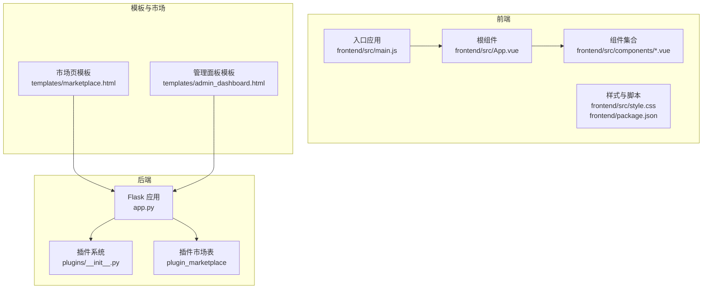
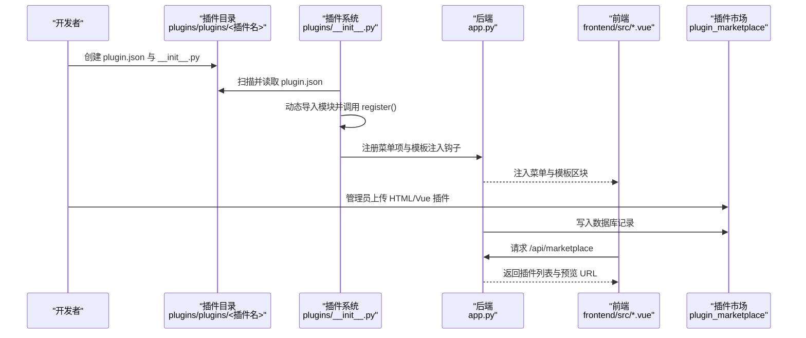
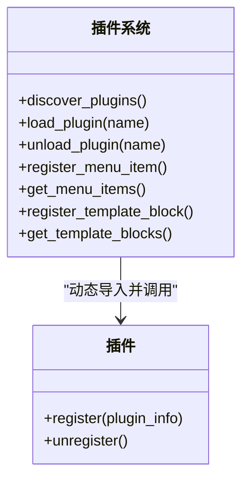
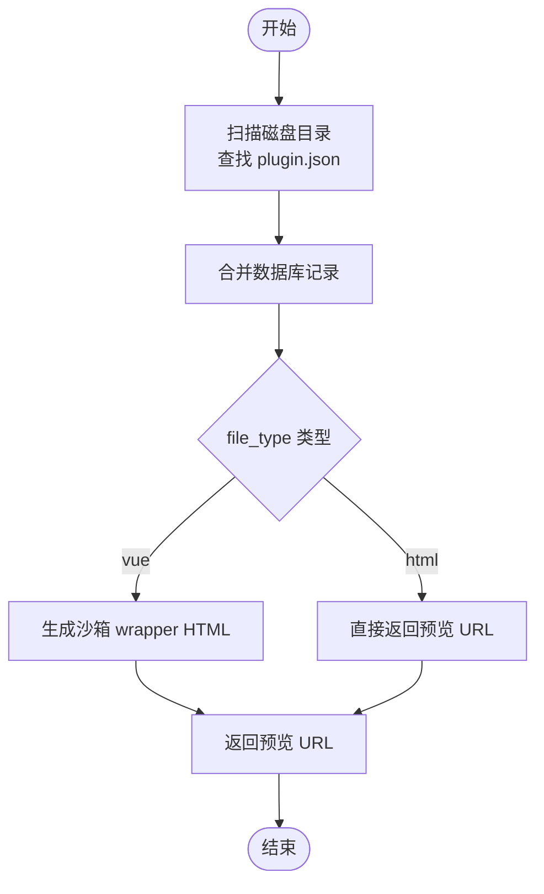
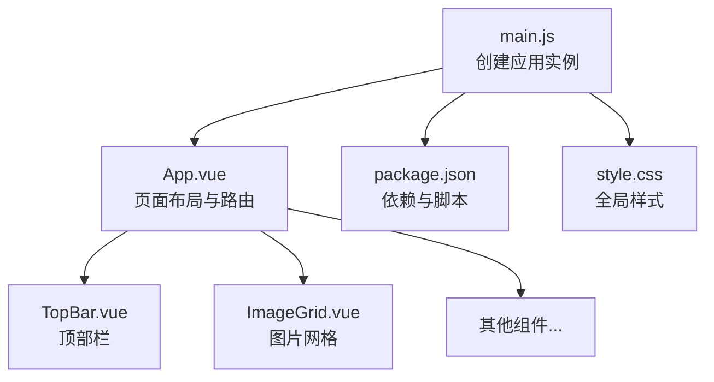
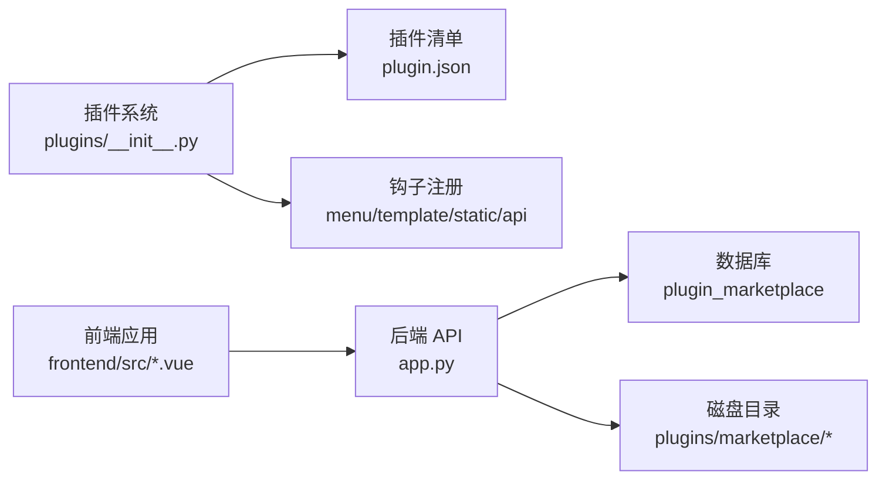

# 扩展开发

<cite>
**本文引用的文件**
- [app.py](file://app.py)
- [plugins/__init__.py](file://plugins/__init__.py)
- [plugins/plugins/sample_hello/plugin.json](file://plugins/plugins/sample_hello/plugin.json)
- [plugins/plugins/lang_ja/plugin.json](file://plugins/plugins/lang_ja/plugin.json)
- [plugins/plugins/lang_ko/plugin.json](file://plugins/plugins/lang_ko/plugin.json)
- [plugins/marketplace/markdown-editor/plugin.json](file://plugins/marketplace/markdown-editor/plugin.json)
- [frontend/src/main.js](file://frontend/src/main.js)
- [frontend/src/App.vue](file://frontend/src/App.vue)
- [frontend/src/components/TopBar.vue](file://frontend/src/components/TopBar.vue)
- [frontend/src/components/ImageGrid.vue](file://frontend/src/components/ImageGrid.vue)
- [frontend/src/style.css](file://frontend/src/style.css)
- [frontend/package.json](file://frontend/package.json)
- [templates/marketplace.html](file://templates/marketplace.html)
- [templates/admin_dashboard.html](file://templates/admin_dashboard.html)
</cite>

## 目录
1. [简介](#简介)
2. [项目结构](#项目结构)
3. [核心组件](#核心组件)
4. [架构总览](#架构总览)
5. [详细组件分析](#详细组件分析)
6. [依赖分析](#依赖分析)
7. [性能考虑](#性能考虑)
8. [故障排查指南](#故障排查指南)
9. [结论](#结论)
10. [附录](#附录)

## 简介
本指南面向希望为 School_Web 进行扩展开发的开发者，系统讲解如何设计与实现自定义插件、扩展功能模块、定制 API、开发 UI 组件以及打包分发。文档结合现有代码库中的插件系统、前端 Vue 架构、插件市场与沙箱渲染机制，给出从入门到进阶的完整路径，并提供最佳实践与性能优化建议。

## 项目结构
School_Web 的扩展能力主要由以下部分构成：
- 后端插件系统：动态发现、加载、注册钩子（菜单、模板注入、静态路由、API 路由）
- 插件市场：支持管理员上传 HTML/Vue 插件，提供预览与安装入口
- 前端 Vue 应用：组件化 UI，通过 API 与后端交互
- 模板注入：通过插件钩子向模板注入头部、底部等区块
- 速率限制与安全：统一的安全与访问控制策略

**图表来源**
- [app.py](file://app.py)
- [plugins/__init__.py](file://plugins/__init__.py)
- [frontend/src/main.js](file://frontend/src/main.js)
- [frontend/src/App.vue](file://frontend/src/App.vue)
- [frontend/src/style.css](file://frontend/src/style.css)
- [frontend/package.json](file://frontend/package.json)
- [templates/marketplace.html](file://templates/marketplace.html)
- [templates/admin_dashboard.html](file://templates/admin_dashboard.html)

**章节来源**
- [app.py](file://app.py)
- [plugins/__init__.py](file://plugins/__init__.py)
- [frontend/src/main.js](file://frontend/src/main.js)
- [frontend/src/App.vue](file://frontend/src/App.vue)
- [frontend/src/style.css](file://frontend/src/style.css)
- [frontend/package.json](file://frontend/package.json)
- [templates/marketplace.html](file://templates/marketplace.html)
- [templates/admin_dashboard.html](file://templates/admin_dashboard.html)

## 核心组件
- 插件系统：负责扫描插件目录、读取 plugin.json、动态导入模块、注册钩子、提供菜单与模板注入能力
- 插件市场：管理管理员上传的 HTML/Vue 插件，提供列表、预览与安装能力
- 前端 Vue 应用：以组件为中心的 UI 架构，通过 API 与后端交互
- 模板注入：在模板中注入头部、底部等区块，实现非侵入式扩展
- 安全与速率限制：统一的安全策略与访问控制

**章节来源**
- [plugins/__init__.py](file://plugins/__init__.py)
- [app.py](file://app.py)
- [frontend/src/App.vue](file://frontend/src/App.vue)

## 架构总览
下图展示了扩展开发的关键交互路径：插件通过钩子向后端注册菜单与模板区块；插件市场通过数据库与磁盘目录同步；前端通过 API 与后端通信，渲染 Vue 组件。

**图表来源**
- [plugins/__init__.py](file://plugins/__init__.py)
- [app.py](file://app.py)
- [frontend/src/App.vue](file://frontend/src/App.vue)
- [templates/marketplace.html](file://templates/marketplace.html)

## 详细组件分析

### 插件系统与钩子机制
- 发现与加载：扫描 plugins/plugins/ 下的子目录，读取 plugin.json 并动态导入 __init__.py
- 钩子注册：支持 menu_items、template_blocks、static_routes、api_routes 四类钩子
- 菜单与模板注入：根据用户权限过滤菜单项；按位置与顺序注入模板区块
- 生命周期：插件可实现 register()/unregister()，在加载/卸载时执行清理

**图表来源**
- [plugins/__init__.py](file://plugins/__init__.py)

**章节来源**
- [plugins/__init__.py](file://plugins/__init__.py)

### 插件清单与示例
- 示例插件：包含最小化的 plugin.json 与 __init__.py，演示菜单项与模板注入
- 语言包插件：通过 type 字段标识语言包类型，提供额外翻译文件
- 市场插件：包含 display_name、description、version、author、file_type、icon 等字段

**章节来源**
- [plugins/plugins/sample_hello/plugin.json](file://plugins/plugins/sample_hello/plugin.json)
- [plugins/plugins/lang_ja/plugin.json](file://plugins/plugins/lang_ja/plugin.json)
- [plugins/plugins/lang_ko/plugin.json](file://plugins/plugins/lang_ko/plugin.json)
- [plugins/marketplace/markdown-editor/plugin.json](file://plugins/marketplace/markdown-editor/plugin.json)

### 插件市场与沙箱渲染
- 数据结构：plugin_marketplace 表存储插件元信息；支持 HTML 与 Vue 两种文件类型
- 预览与包装：Vue 插件通过沙箱 wrapper HTML 动态解析 .vue 文件并挂载
- 列表与容错：后端合并数据库与磁盘目录，处理缺失记录或文件的情况

**图表来源**
- [app.py](file://app.py)

**章节来源**
- [app.py](file://app.py)

### 前端 Vue 架构与组件扩展
- 入口与根组件：main.js 创建应用实例，App.vue 组织页面布局与子组件
- 组件体系：TopBar、ImageGrid 等组件通过 props 与事件进行交互
- 样式与脚本：统一的样式规范与构建脚本，便于扩展与维护

**图表来源**
- [frontend/src/main.js](file://frontend/src/main.js)
- [frontend/src/App.vue](file://frontend/src/App.vue)
- [frontend/src/components/TopBar.vue](file://frontend/src/components/TopBar.vue)
- [frontend/src/components/ImageGrid.vue](file://frontend/src/components/ImageGrid.vue)
- [frontend/src/style.css](file://frontend/src/style.css)
- [frontend/package.json](file://frontend/package.json)

**章节来源**
- [frontend/src/main.js](file://frontend/src/main.js)
- [frontend/src/App.vue](file://frontend/src/App.vue)
- [frontend/src/components/TopBar.vue](file://frontend/src/components/TopBar.vue)
- [frontend/src/components/ImageGrid.vue](file://frontend/src/components/ImageGrid.vue)
- [frontend/src/style.css](file://frontend/src/style.css)
- [frontend/package.json](file://frontend/package.json)

### 模板注入与上下文变量
- 上下文注入：后端在模板上下文中注入翻译函数、语言信息、插件菜单与模板区块
- 菜单与区块：插件通过钩子注册菜单项与模板区块，按位置与顺序渲染

**章节来源**
- [app.py](file://app.py)

### API 扩展策略
- 插件 API 路由：插件可通过钩子注册 API 路由，后端统一管理
- 市场 API：提供公开与管理专用的插件市场列表接口
- 安全与速率限制：统一的速率限制与访问控制策略，保障 API 稳定性

**章节来源**
- [plugins/__init__.py](file://plugins/__init__.py)
- [app.py](file://app.py)

## 依赖分析
- 插件系统依赖于 Python 的动态导入机制与 JSON 清单
- 前端依赖 Vue 3 生态与 Vite 构建工具链
- 插件市场依赖数据库表与磁盘目录的双写一致性
- 模板注入依赖后端上下文处理器与钩子注册

**图表来源**
- [plugins/__init__.py](file://plugins/__init__.py)
- [app.py](file://app.py)
- [frontend/src/App.vue](file://frontend/src/App.vue)

**章节来源**
- [plugins/__init__.py](file://plugins/__init__.py)
- [app.py](file://app.py)
- [frontend/src/App.vue](file://frontend/src/App.vue)

## 性能考虑
- 插件加载：避免在 register 中执行耗时操作；必要时异步化
- 模板注入：减少不必要的 DOM 注入，按需渲染
- 前端组件：合理拆分组件，使用 v-if/v-show 控制渲染；避免重复请求
- API 速率限制：合理配置速率限制参数，防止滥用
- Vue 插件沙箱：避免在沙箱中执行复杂计算，尽量通过 API 与后端交互

## 故障排查指南
- 插件无法加载：检查 plugin.json 是否存在且格式正确；确认 __init__.py 是否存在并可被动态导入
- 菜单不显示：核对权限字段与用户权限等级；确认 order 排序是否影响显示
- 模板区块未生效：确认 position 与 order 设置；检查模板上下文是否正确注入
- 插件市场异常：检查数据库记录与磁盘目录一致性；确认 file_type 与预览 URL
- 前端组件交互问题：检查 props 传递与事件绑定；确认 API 返回结构与前端预期一致

**章节来源**
- [plugins/__init__.py](file://plugins/__init__.py)
- [app.py](file://app.py)
- [templates/marketplace.html](file://templates/marketplace.html)

## 结论
School_Web 提供了完善的扩展框架：通过插件系统实现功能模块化与非侵入式扩展；通过插件市场支持 HTML/Vue 插件的上传与预览；通过 Vue 组件体系实现 UI 的可组合性。遵循本文档的结构设计、配置规范与最佳实践，开发者可以高效地完成自定义插件开发、功能扩展与 UI 组件定制，并确保系统的安全性与稳定性。

## 附录

### 自定义插件开发流程
- 目录结构
  - 在 plugins/plugins/ 下创建插件目录
  - 编写 plugin.json（至少包含 name、version、description、author、license）
  - 如需代码，创建 __init__.py 并实现 register()/unregister()
- 清单字段参考
  - 必填：name、version、description、author、license
  - 可选：type（如 language）、file_type（用于市场插件）
- 钩子使用
  - 菜单项：register_menu_item(plugin_name, item)
  - 模板区块：register_template_block(plugin_name, block)
- 生命周期
  - 加载：后端扫描并动态导入模块，调用 register()
  - 卸载：调用 unregister() 并清理 sys.modules

**章节来源**
- [plugins/__init__.py](file://plugins/__init__.py)
- [plugins/plugins/sample_hello/plugin.json](file://plugins/plugins/sample_hello/plugin.json)

### 功能扩展方法
- 新功能模块开发
  - 使用插件系统注册菜单与模板区块
  - 通过 API 路由提供后端接口
  - 在前端组件中消费 API 并渲染 UI
- 现有功能增强
  - 通过模板注入增强页面元素
  - 通过钩子扩展菜单项与权限控制
- 第三方集成
  - 通过 API 路由对接外部服务
  - 在 Vue 插件中封装第三方组件

**章节来源**
- [plugins/__init__.py](file://plugins/__init__.py)
- [app.py](file://app.py)
- [frontend/src/App.vue](file://frontend/src/App.vue)

### API 扩展策略
- 自定义接口开发
  - 在插件 __init__.py 中注册 API 路由
  - 使用后端蓝图或装饰器定义路由
- 数据模型扩展
  - 在 app.py 中初始化数据库表
  - 通过 ORM 或原生 SQL 管理数据
- 业务逻辑定制
  - 在路由处理函数中实现业务规则
  - 结合速率限制与安全策略

**章节来源**
- [plugins/__init__.py](file://plugins/__init__.py)
- [app.py](file://app.py)

### UI 组件扩展
- Vue 组件开发
  - 在 frontend/src/components/ 下新增组件
  - 使用 props 与 emits 与父组件通信
  - 通过 API 与后端交互
- 样式定制
  - 在 frontend/src/style.css 中添加或复用样式类
  - 使用 scoped 样式避免冲突
- 交互增强
  - 使用事件总线或全局状态管理
  - 合理使用 v-if/v-show 控制渲染

**章节来源**
- [frontend/src/components/TopBar.vue](file://frontend/src/components/TopBar.vue)
- [frontend/src/components/ImageGrid.vue](file://frontend/src/components/ImageGrid.vue)
- [frontend/src/style.css](file://frontend/src/style.css)
- [frontend/src/App.vue](file://frontend/src/App.vue)

### 插件打包与分发
- HTML 插件
  - 将插件目录打包为压缩包，包含 plugin.json 与资源文件
  - 通过管理面板上传至 plugins/marketplace/<插件名>/
- Vue 插件
  - 将 .vue 文件与 plugin.json 放置于同一目录
  - 后端自动生成沙箱 wrapper HTML 并提供预览
- 清单与版本
  - 确保 plugin.json 中的 version 与 file_type 正确
  - 通过数据库记录与磁盘目录保持一致

**章节来源**
- [app.py](file://app.py)
- [templates/marketplace.html](file://templates/marketplace.html)
- [templates/admin_dashboard.html](file://templates/admin_dashboard.html)

### 测试与质量保证
- 单元测试
  - 对插件的 register/unregister 进行测试
  - 对 API 路由进行接口测试
- 集成测试
  - 验证插件市场上传、预览与安装流程
  - 验证模板注入与菜单渲染
- 性能测试
  - 前端组件渲染性能与 API 响应时间
  - 速率限制与并发访问下的稳定性
- 安全测试
  - 速率限制绕过与权限控制
  - 模板注入与 CSP 配置有效性

**章节来源**
- [plugins/__init__.py](file://plugins/__init__.py)
- [app.py](file://app.py)
- [templates/marketplace.html](file://templates/marketplace.html)