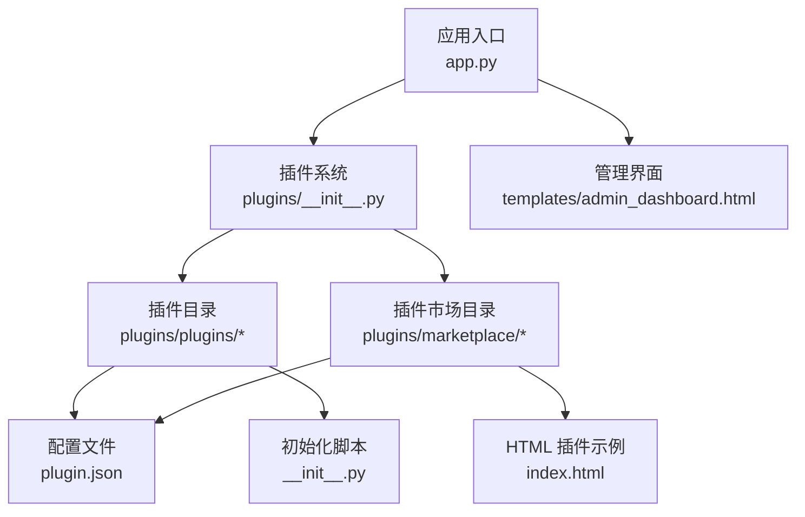
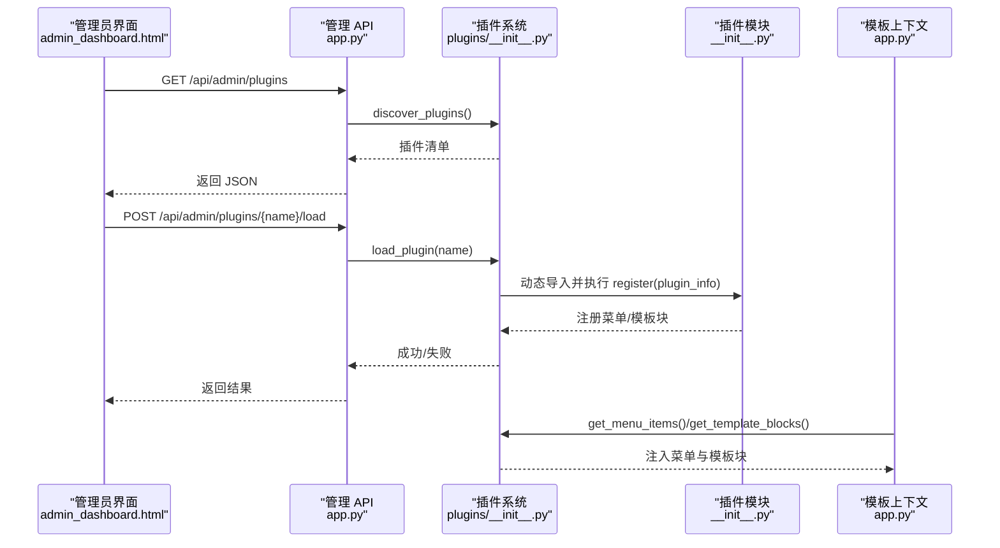
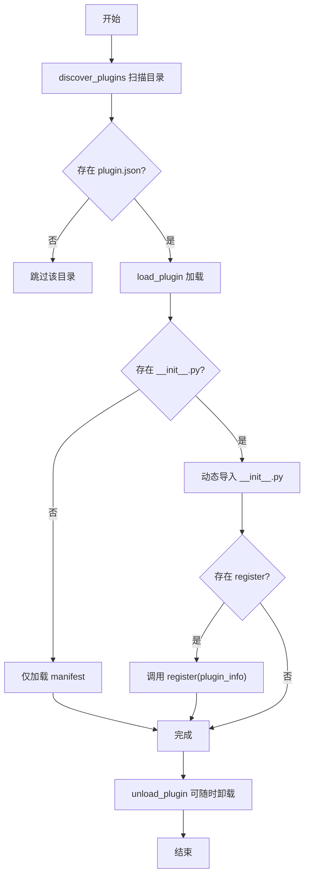
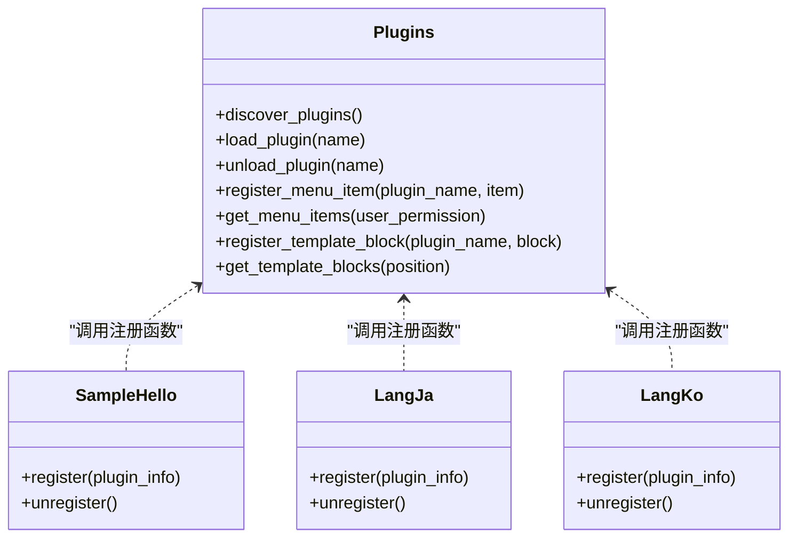
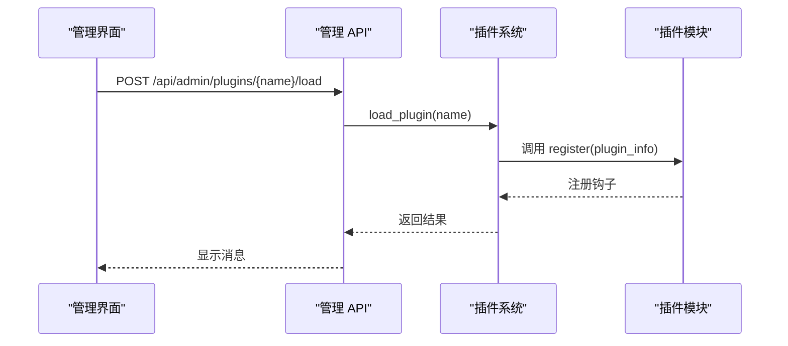
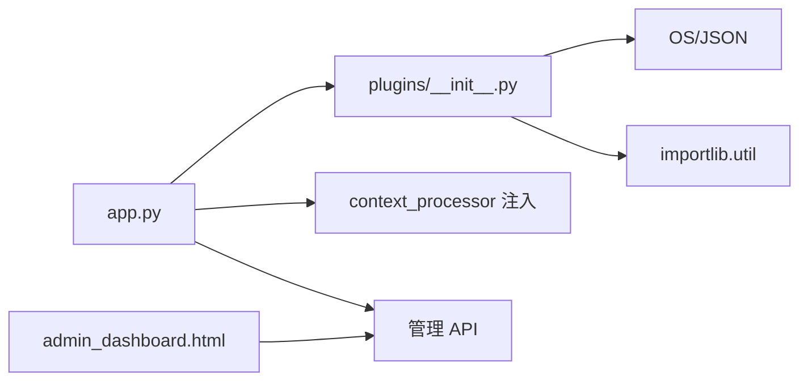

# 插件开发指南

<cite>
**本文引用的文件**   
- [plugins/__init__.py](file://plugins/__init__.py)
- [plugins/plugins/sample_hello/__init__.py](file://plugins/plugins/sample_hello/__init__.py)
- [plugins/plugins/sample_hello/plugin.json](file://plugins/plugins/sample_hello/plugin.json)
- [plugins/plugins/lang_ja/__init__.py](file://plugins/plugins/lang_ja/__init__.py)
- [plugins/plugins/lang_ko/__init__.py](file://plugins/plugins/lang_ko/__init__.py)
- [plugins/plugins/lang_ja/plugin.json](file://plugins/plugins/lang_ja/plugin.json)
- [plugins/plugins/lang_ko/plugin.json](file://plugins/plugins/lang_ko/plugin.json)
- [plugins/marketplace/markdown-editor/plugin.json](file://plugins/marketplace/markdown-editor/plugin.json)
- [plugins/marketplace/markdown-editor/index.html](file://plugins/marketplace/markdown-editor/index.html)
- [app.py](file://app.py)
- [templates/admin_dashboard.html](file://templates/admin_dashboard.html)
</cite>

## 目录
1. [引言](#引言)
2. [项目结构](#项目结构)
3. [核心组件](#核心组件)
4. [架构总览](#架构总览)
5. [详细组件分析](#详细组件分析)
6. [依赖分析](#依赖分析)
7. [性能考虑](#性能考虑)
8. [故障排查指南](#故障排查指南)
9. [结论](#结论)
10. [附录](#附录)

## 引言
本指南面向希望为 School_Web 开发插件的开发者，系统讲解插件系统的发现、加载、注册与卸载机制，明确插件目录结构与必需文件（plugin.json 与 __init__.py），规范配置文件字段与初始化函数（register/unregister）的职责，提供从创建目录到实现功能的完整示例，并总结最佳实践与常见错误规避方法。

## 项目结构
School_Web 的插件系统位于 plugins 目录下，采用“插件目录 + 配置 + 可选模块”的标准结构：
- 插件根目录：plugins/plugins
- 插件市场目录：plugins/marketplace
- 插件发现与管理：plugins/__init__.py
- 应用集成：app.py 中的插件路由与管理 API
- 管理界面：templates/admin_dashboard.html 中的插件管理前端

图表来源
- [plugins/__init__.py:1-249](file://plugins/__init__.py#L1-L249)
- [app.py:5186-5259](file://app.py#L5186-L5259)
- [templates/admin_dashboard.html:1146-1200](file://templates/admin_dashboard.html#L1146-L1200)

章节来源
- [plugins/__init__.py:11-57](file://plugins/__init__.py#L11-L57)
- [app.py:5186-5259](file://app.py#L5186-L5259)
- [templates/admin_dashboard.html:1146-1200](file://templates/admin_dashboard.html#L1146-L1200)

## 核心组件
- 插件发现与加载
  - discover_plugins：扫描 plugins/plugins 下的子目录，校验 plugin.json 存在性，判断是否存在 __init__.py，返回可加载插件清单。
  - load_plugin：动态导入 __init__.py，执行模块的 register(plugin_info)；若不存在 __init__.py，则仅加载配置（manifest-only）。
  - unload_plugin：调用模块的 unregister()（如存在），清理 sys.modules。
- 插件钩子注册与查询
  - register_menu_item / get_menu_items：注册菜单项并按权限过滤与排序。
  - register_template_block / get_template_blocks：注册模板注入块（head/footer/nav 等位置）并排序。
- 示例插件
  - sample_hello：演示如何通过 register 注册菜单项与模板块，以及如何实现空的 unregister。
- 语言包插件
  - lang_ja / lang_ko：演示如何在插件中确保翻译文件存在、扩展支持语言列表，并注入 head 模板块。
- 插件市场
  - marketplace 下的 HTML 插件示例（markdown-editor）展示了独立的 HTML 文件与对应的 plugin.json。

章节来源
- [plugins/__init__.py:25-136](file://plugins/__init__.py#L25-L136)
- [plugins/__init__.py:143-193](file://plugins/__init__.py#L143-L193)
- [plugins/plugins/sample_hello/__init__.py:1-32](file://plugins/plugins/sample_hello/__init__.py#L1-L32)
- [plugins/plugins/lang_ja/__init__.py:18-98](file://plugins/plugins/lang_ja/__init__.py#L18-L98)
- [plugins/plugins/lang_ko/__init__.py:17-89](file://plugins/plugins/lang_ko/__init__.py#L17-L89)
- [plugins/marketplace/markdown-editor/plugin.json:1-10](file://plugins/marketplace/markdown-editor/plugin.json#L1-L10)

## 架构总览
插件系统通过应用层 API 与管理界面协同工作，实现插件的发现、加载、注册与卸载，并将菜单项与模板块注入到渲染上下文中。

图表来源
- [app.py:5200-5254](file://app.py#L5200-L5254)
- [plugins/__init__.py:25-136](file://plugins/__init__.py#L25-L136)
- [app.py:181-194](file://app.py#L181-L194)

## 详细组件分析

### 插件发现与加载流程
- 发现策略
  - 遍历 plugins/plugins 子目录，要求存在 plugin.json；若存在 __init__.py，则视为可执行插件；否则作为 manifest-only 插件。
- 加载策略
  - 使用 importlib.util.spec_from_file_location 动态定位模块路径并执行 __init__.py。
  - 若模块导出 register，传入包含 manifest 与 module 的 plugin_info。
  - 记录已加载插件，便于后续卸载与路由分发。
- 卸载策略
  - 调用模块的 unregister（如存在），清理 sys.modules 中的条目。

图表来源
- [plugins/__init__.py:25-136](file://plugins/__init__.py#L25-L136)

章节来源
- [plugins/__init__.py:25-136](file://plugins/__init__.py#L25-L136)

### 插件钩子与模板注入
- 菜单项注册
  - register_menu_item 接收 { label, url, icon, permission, order }，按权限与 order 排序后提供给模板上下文。
- 模板块注册
  - register_template_block 接收 { name, template, position, order }，position 支持 head/footer/nav 等，按 order 排序后注入。
- 应用侧注入
  - app.py 的 context_processor 将 plugin_menu_items、plugin_footer_blocks、plugin_head_blocks 注入模板上下文，供页面渲染使用。

图表来源
- [plugins/__init__.py:143-193](file://plugins/__init__.py#L143-L193)
- [plugins/plugins/sample_hello/__init__.py:9-31](file://plugins/plugins/sample_hello/__init__.py#L9-L31)
- [plugins/plugins/lang_ja/__init__.py:18-34](file://plugins/plugins/lang_ja/__init__.py#L18-L34)
- [plugins/plugins/lang_ko/__init__.py:17-35](file://plugins/plugins/lang_ko/__init__.py#L17-L35)

章节来源
- [plugins/__init__.py:143-193](file://plugins/__init__.py#L143-L193)
- [app.py:181-194](file://app.py#L181-L194)

### 插件配置文件 plugin.json 规范
- 必需字段（示例插件）
  - name：插件显示名称
  - version：版本号
  - description：简要描述
  - author：作者
  - license：许可证
- 可选字段（语言包示例）
  - type：如 language
  - description_en：英文描述
- 插件市场 HTML 插件
  - plugin_name：插件目录名
  - display_name：展示名称
  - description：描述
  - version：版本
  - author：作者
  - file_type：文件类型（如 html）
  - icon：图标符号

章节来源
- [plugins/plugins/sample_hello/plugin.json:1-7](file://plugins/plugins/sample_hello/plugin.json#L1-L7)
- [plugins/plugins/lang_ja/plugin.json:1-10](file://plugins/plugins/lang_ja/plugin.json#L1-L10)
- [plugins/plugins/lang_ko/plugin.json:1-10](file://plugins/plugins/lang_ko/plugin.json#L1-L10)
- [plugins/marketplace/markdown-editor/plugin.json:1-10](file://plugins/marketplace/markdown-editor/plugin.json#L1-L10)

### 插件初始化函数 register 与 unregister
- register(plugin_info)
  - 作用：插件加载时被调用，负责注册菜单项与模板块，或进行其他初始化逻辑。
  - 示例：sample_hello 在 register 中注册菜单与页脚模板块；lang_ja/lang_ko 在 register 中确保翻译文件存在并扩展支持语言列表。
- unregister()
  - 作用：插件卸载时被调用，负责资源清理与日志输出。
  - 示例：sample_hello 提供空实现；lang_ja/lang_ko 输出语言加载/卸载日志。

章节来源
- [plugins/plugins/sample_hello/__init__.py:9-31](file://plugins/plugins/sample_hello/__init__.py#L9-L31)
- [plugins/plugins/lang_ja/__init__.py:18-43](file://plugins/plugins/lang_ja/__init__.py#L18-L43)
- [plugins/plugins/lang_ko/__init__.py:17-41](file://plugins/plugins/lang_ko/__init__.py#L17-L41)

### 插件路由与管理 API
- 插件路由分发
  - app.py 提供 /plugin/<plugin_name> 与 /plugin/<plugin_name>/<path:subpath>，若插件模块导出 route，则交由模块处理。
- 管理 API（管理员）
  - GET /api/admin/plugins：列出所有插件及其加载状态
  - POST /api/admin/plugins/{name}/load：加载指定插件
  - POST /api/admin/plugins/{name}/unload：卸载指定插件
  - POST /api/admin/plugins/reload：重新加载所有插件
- 管理界面
  - admin_dashboard.html 提供插件列表、加载/卸载按钮与“重新加载全部”功能，并联动插件市场列表。

图表来源
- [app.py:5200-5254](file://app.py#L5200-L5254)
- [templates/admin_dashboard.html:1146-1200](file://templates/admin_dashboard.html#L1146-L1200)

章节来源
- [app.py:5186-5259](file://app.py#L5186-L5259)
- [templates/admin_dashboard.html:1146-1200](file://templates/admin_dashboard.html#L1146-L1200)

### 插件市场与 HTML 插件
- 插件市场目录
  - plugins/marketplace 下的子目录代表独立插件，每个插件包含 plugin.json 与对应资源（如 index.html）。
- HTML 插件示例
  - markdown-editor：提供完整的 HTML 页面与工具栏、实时预览、拖拽分隔等功能，配合 plugin.json 提供展示信息。

章节来源
- [plugins/marketplace/markdown-editor/index.html:1-486](file://plugins/marketplace/markdown-editor/index.html#L1-L486)
- [plugins/marketplace/markdown-editor/plugin.json:1-10](file://plugins/marketplace/markdown-editor/plugin.json#L1-L10)

## 依赖分析
- 插件系统内部
  - discover_plugins 依赖 OS 与 JSON；load_plugin 依赖 importlib.util；unload_plugin 依赖 sys.modules。
- 应用层集成
  - app.py 导入 plugins 并在 before_request 中注入 i18n 与插件钩子；在 context_processor 中注入菜单与模板块。
- 管理界面
  - admin_dashboard.html 通过 AJAX 调用管理 API，驱动插件加载/卸载与市场列表展示。

图表来源
- [plugins/__init__.py:5-11](file://plugins/__init__.py#L5-L11)
- [app.py:117-117](file://app.py#L117-L117)
- [app.py:181-194](file://app.py#L181-L194)
- [templates/admin_dashboard.html:1146-1200](file://templates/admin_dashboard.html#L1146-L1200)

章节来源
- [plugins/__init__.py:5-11](file://plugins/__init__.py#L5-L11)
- [app.py:117-117](file://app.py#L117-L117)
- [app.py:181-194](file://app.py#L181-L194)
- [templates/admin_dashboard.html:1146-1200](file://templates/admin_dashboard.html#L1146-L1200)

## 性能考虑
- 动态导入成本
  - importlib.util.spec_from_file_location 与 exec_module 会带来一定开销，建议插件模块保持轻量，避免在 register 中执行耗时任务。
- 钩子注册与查询
  - 菜单与模板块按权限过滤与排序，建议合理设置 order，减少渲染时的计算量。
- 插件市场扫描
  - marketplace 目录扫描与 JSON 解析可能产生额外 IO，建议控制插件数量与层级深度。

## 故障排查指南
- 插件未被发现
  - 确认插件目录下存在 plugin.json；检查文件编码为 UTF-8。
- 加载失败
  - 检查 __init__.py 是否存在语法错误；确认模块中未抛出异常；查看应用日志中的异常堆栈。
- 注册函数未生效
  - 确认模块导出了 register；确认 register 接收 plugin_info 参数；检查是否正确调用了 register_menu_item/register_template_block。
- 卸载无效
  - 确认模块导出了 unregister；确认插件已被加载（get_loaded_plugins 可验证）。
- 权限导致菜单不可见
  - 检查菜单项的 permission 字段与用户权限等级映射（guest/user/vip/administrator）。

章节来源
- [plugins/__init__.py:75-109](file://plugins/__init__.py#L75-L109)
- [plugins/__init__.py:187-192](file://plugins/__init__.py#L187-L192)

## 结论
School_Web 的插件系统以简洁的目录结构与清晰的生命周期为核心，通过 discover/load/unregister/卸载流程与钩子注册机制，实现了菜单与模板块的动态注入。开发者只需遵循 plugin.json 字段规范与 __init__.py 的初始化约定，即可快速构建功能插件或语言包插件，并通过管理界面进行加载与卸载。

## 附录

### 从零开始创建一个插件的完整步骤
- 步骤一：创建插件目录
  - 在 plugins/plugins 下新建目录（目录名为插件唯一标识）。
- 步骤二：编写配置文件
  - 在插件目录下创建 plugin.json，填写 name、version、description、author、license 等字段；如为语言包可添加 type 与 description_en。
- 步骤三：实现初始化脚本
  - 在插件目录下创建 __init__.py，定义 register 与可选的 unregister；在 register 中调用 register_menu_item 与 register_template_block 完成注册。
- 步骤四：开发功能
  - 如需动态路由，可在模块中定义 route(subpath)；如需静态资源，可结合插件系统提供的静态路由能力。
- 步骤五：测试与上线
  - 通过管理界面加载插件，检查菜单与模板块是否正确注入；必要时在 register 中增加日志输出以便调试。

章节来源
- [plugins/plugins/sample_hello/__init__.py:9-31](file://plugins/plugins/sample_hello/__init__.py#L9-L31)
- [plugins/plugins/sample_hello/plugin.json:1-7](file://plugins/plugins/sample_hello/plugin.json#L1-L7)
- [plugins/__init__.py:60-109](file://plugins/__init__.py#L60-L109)

### 最佳实践与常见错误
- 最佳实践
  - 将插件逻辑拆分为小模块，避免在 register 中做重 IO 或阻塞操作。
  - 使用语义化的 permission 字段控制菜单可见性，避免硬编码权限判断。
  - 在 register 中统一注册钩子，在 unregister 中清理资源，保持对称。
  - 为插件提供最小可运行的 plugin.json，确保插件市场与管理界面正常识别。
- 常见错误
  - 忘记创建 plugin.json 或字段缺失，导致插件无法被发现。
  - __init__.py 语法错误或异常未捕获，导致加载失败。
  - register 未接收 plugin_info 或未调用注册函数，导致钩子未生效。
  - 卸载时未导出 unregister，或模块未被正确加载，导致资源未释放。