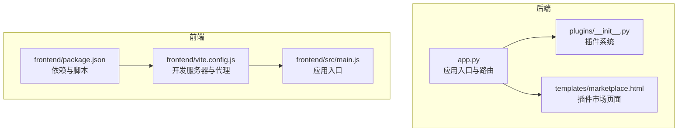
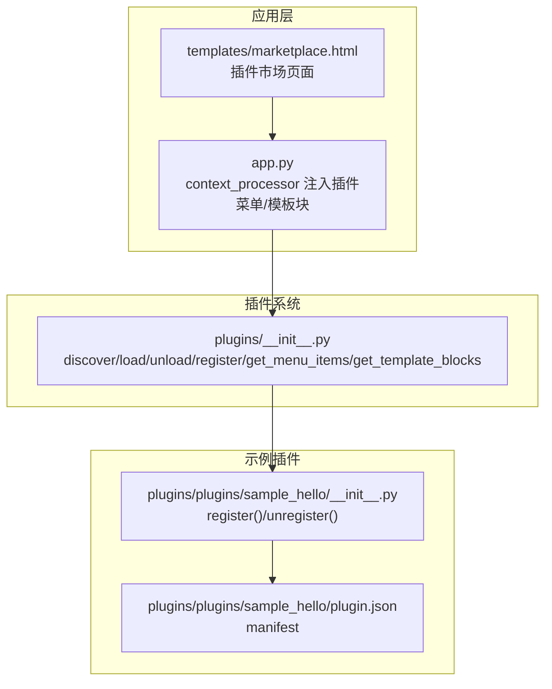
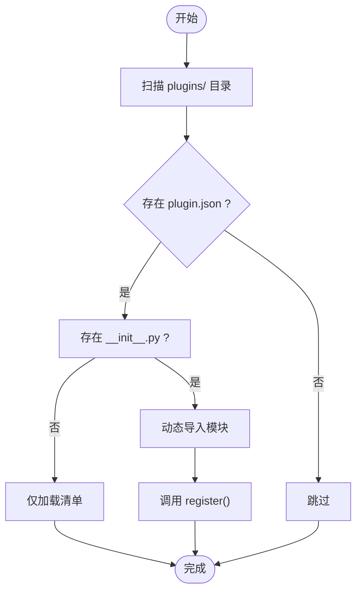
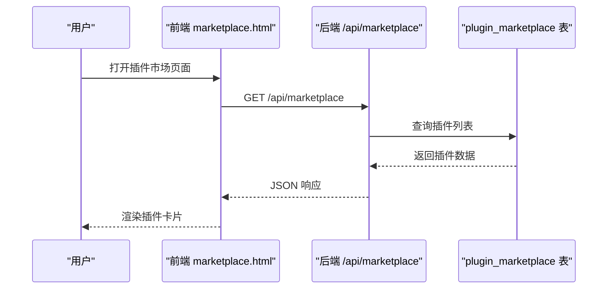
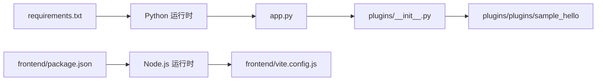

# 插件打包与分发

<cite>
**本文引用的文件**
- [plugins/__init__.py](file://plugins/__init__.py)
- [plugins/plugins/sample_hello/plugin.json](file://plugins/plugins/sample_hello/plugin.json)
- [plugins/plugins/sample_hello/__init__.py](file://plugins/plugins/sample_hello/__init__.py)
- [plugins/plugins/lang_ko/plugin.json](file://plugins/plugins/lang_ko/plugin.json)
- [plugins/plugins/lang_ja/plugin.json](file://plugins/plugins/lang_ja/plugin.json)
- [plugins/marketplace/markdown-editor/plugin.json](file://plugins/marketplace/markdown-editor/plugin.json)
- [app.py](file://app.py)
- [templates/marketplace.html](file://templates/marketplace.html)
- [frontend/package.json](file://frontend/package.json)
- [frontend/vite.config.js](file://frontend/vite.config.js)
- [frontend/src/main.js](file://frontend/src/main.js)
- [requirements.txt](file://requirements.txt)
</cite>

## 目录
1. [引言](#引言)
2. [项目结构](#项目结构)
3. [核心组件](#核心组件)
4. [架构总览](#架构总览)
5. [详细组件分析](#详细组件分析)
6. [依赖分析](#依赖分析)
7. [性能考虑](#性能考虑)
8. [故障排查指南](#故障排查指南)
9. [结论](#结论)
10. [附录](#附录)

## 引言
本指南面向希望为 School_Web 平台开发、打包与分发插件的开发者与维护者。内容涵盖插件打包流程（文件整理、依赖管理、版本控制）、插件分发策略（插件市场管理、安装部署、更新机制）、发布规范与审核标准、版本管理与兼容性测试、用户反馈处理以及插件生态建设与社区贡献方法。文档基于仓库中现有插件系统实现与前端构建配置进行说明，并提供可视化图示帮助理解。

## 项目结构
School_Web 的插件体系由后端插件系统与前端构建工具链共同支撑：
- 后端插件系统位于 plugins/ 目录，负责插件发现、加载、卸载与钩子注册（菜单、模板块等）。
- 前端工程位于 frontend/，采用 Vite + Vue 3 进行构建与开发。
- 插件市场相关页面与数据库表定义位于 templates/ 与 app.py 中。
- 依赖与运行环境通过 requirements.txt 与前端 package.json 管理。

图表来源
- [app.py:119-194](file://app.py#L119-L194)
- [plugins/__init__.py:1-249](file://plugins/__init__.py#L1-L249)
- [templates/marketplace.html:1-143](file://templates/marketplace.html#L1-L143)
- [frontend/package.json:1-21](file://frontend/package.json#L1-L21)
- [frontend/vite.config.js:1-21](file://frontend/vite.config.js#L1-L21)
- [frontend/src/main.js:1-6](file://frontend/src/main.js#L1-L6)

章节来源
- [app.py:119-194](file://app.py#L119-L194)
- [plugins/__init__.py:1-249](file://plugins/__init__.py#L1-L249)
- [templates/marketplace.html:1-143](file://templates/marketplace.html#L1-L143)
- [frontend/package.json:1-21](file://frontend/package.json#L1-L21)
- [frontend/vite.config.js:1-21](file://frontend/vite.config.js#L1-L21)
- [frontend/src/main.js:1-6](file://frontend/src/main.js#L1-L6)

## 核心组件
- 插件系统（后端）
  - 负责扫描 plugins/ 目录下的插件，读取 plugin.json 与 __init__.py，动态加载模块并调用 register()/unregister()。
  - 提供菜单项与模板块注入的钩子注册表，供插件在运行时扩展界面与导航。
- 插件市场（后端+前端）
  - 后端维护 plugin_marketplace 表，存储插件元数据（名称、显示名、描述、版本、作者、文件类型、图标等）。
  - 前端 marketplace.html 展示插件卡片，通过 /api/marketplace 获取数据并渲染。
- 前端构建（Vite + Vue 3）
  - 使用 package.json 管理依赖与脚本，vite.config.js 提供开发服务器与 API 代理，src/main.js 作为应用入口。

章节来源
- [plugins/__init__.py:25-136](file://plugins/__init__.py#L25-L136)
- [plugins/__init__.py:143-193](file://plugins/__init__.py#L143-L193)
- [app.py:319-345](file://app.py#L319-L345)
- [templates/marketplace.html:93-141](file://templates/marketplace.html#L93-L141)
- [frontend/package.json:1-21](file://frontend/package.json#L1-L21)
- [frontend/vite.config.js:1-21](file://frontend/vite.config.js#L1-L21)
- [frontend/src/main.js:1-6](file://frontend/src/main.js#L1-L6)

## 架构总览
下图展示了插件系统在运行时的交互关系：插件通过 __init__.py 的 register() 注册菜单与模板块；应用在模板上下文中注入插件提供的菜单项与模板块；插件市场页面通过 API 获取插件列表并渲染。

图表来源
- [plugins/__init__.py:25-193](file://plugins/__init__.py#L25-L193)
- [plugins/plugins/sample_hello/__init__.py:1-32](file://plugins/plugins/sample_hello/__init__.py#L1-L32)
- [plugins/plugins/sample_hello/plugin.json:1-7](file://plugins/plugins/sample_hello/plugin.json#L1-L7)
- [app.py:181-194](file://app.py#L181-L194)
- [templates/marketplace.html:93-141](file://templates/marketplace.html#L93-L141)

## 详细组件分析

### 插件系统（后端）
- 发现与加载
  - 扫描 plugins/ 子目录，要求每个插件包含 plugin.json 与可选的 __init__.py。
  - 若仅有 plugin.json，则视为“仅清单”插件（用于菜单注册等）。
  - 动态导入插件模块并调用 register()，卸载时调用 unregister()。
- 钩子机制
  - 菜单项注册：register_menu_item() 将菜单项写入注册表，按权限与排序输出。
  - 模板块注册：register_template_block() 注入头部或页脚等位置的 HTML 片段。
- 示例插件
  - sample_hello 展示如何注册菜单项与页脚模板块，便于新插件参考。

图表来源
- [plugins/__init__.py:25-110](file://plugins/__init__.py#L25-L110)

章节来源
- [plugins/__init__.py:25-136](file://plugins/__init__.py#L25-L136)
- [plugins/__init__.py:143-193](file://plugins/__init__.py#L143-L193)
- [plugins/plugins/sample_hello/__init__.py:1-32](file://plugins/plugins/sample_hello/__init__.py#L1-L32)

### 插件清单（plugin.json）
- 必填字段（示例）
  - name、version、description、author、license。
- 语言包特有字段
  - type: "language"；同时提供中文与英文描述（description 与 description_en）。
- HTML/Vue 插件市场字段
  - plugin_name、display_name、description、version、author、file_type、icon。

章节来源
- [plugins/plugins/sample_hello/plugin.json:1-7](file://plugins/plugins/sample_hello/plugin.json#L1-L7)
- [plugins/plugins/lang_ko/plugin.json:1-10](file://plugins/plugins/lang_ko/plugin.json#L1-L10)
- [plugins/plugins/lang_ja/plugin.json:1-10](file://plugins/plugins/lang_ja/plugin.json#L1-L10)
- [plugins/marketplace/markdown-editor/plugin.json:1-10](file://plugins/marketplace/markdown-editor/plugin.json#L1-L10)

### 插件市场（后端+前端）
- 数据模型
  - plugin_marketplace 表：存储插件名称、显示名、描述、版本、作者、文件类型、图标、上传者等。
- 前端页面
  - marketplace.html 通过 /api/marketplace 获取插件列表，渲染卡片并提供预览与打开按钮。
- 应用集成
  - app.py 的上下文处理器将插件菜单项与模板块注入模板，供页面渲染。

图表来源
- [templates/marketplace.html:103-141](file://templates/marketplace.html#L103-L141)
- [app.py:319-345](file://app.py#L319-L345)

章节来源
- [app.py:319-345](file://app.py#L319-L345)
- [templates/marketplace.html:1-143](file://templates/marketplace.html#L1-L143)

### 前端构建与开发（Vite + Vue 3）
- 依赖与脚本
  - package.json 定义了 Vue 3、Vue Router、Pinia 等依赖及 dev/build/preview 脚本。
- 开发服务器
  - vite.config.js 提供本地开发服务器与 API 代理，便于前后端联调。
- 应用入口
  - src/main.js 创建并挂载 Vue 应用。

章节来源
- [frontend/package.json:1-21](file://frontend/package.json#L1-L21)
- [frontend/vite.config.js:1-21](file://frontend/vite.config.js#L1-L21)
- [frontend/src/main.js:1-6](file://frontend/src/main.js#L1-L6)

## 依赖分析
- 运行时依赖
  - Flask、PyMySQL、psutil、requests 等通过 requirements.txt 管理。
- 前端依赖
  - Vue 3、Vue Router、Pinia、Vite、@vitejs/plugin-vue 等通过 package.json 管理。
- 插件系统耦合
  - 插件系统与应用通过上下文处理器解耦：插件通过钩子注册，应用在渲染阶段注入。

图表来源
- [requirements.txt:1-5](file://requirements.txt#L1-L5)
- [frontend/package.json:1-21](file://frontend/package.json#L1-L21)
- [app.py:119-194](file://app.py#L119-L194)
- [plugins/__init__.py:1-249](file://plugins/__init__.py#L1-L249)
- [plugins/plugins/sample_hello/__init__.py:1-32](file://plugins/plugins/sample_hello/__init__.py#L1-L32)

章节来源
- [requirements.txt:1-5](file://requirements.txt#L1-L5)
- [frontend/package.json:1-21](file://frontend/package.json#L1-L21)
- [app.py:119-194](file://app.py#L119-L194)
- [plugins/__init__.py:1-249](file://plugins/__init__.py#L1-L249)

## 性能考虑
- 插件加载性能
  - 插件系统采用按需加载与模块缓存，避免重复导入；建议插件内部减少全局副作用，保持注册逻辑幂等。
- 模板注入性能
  - 模板块按位置与顺序排序，尽量减少复杂 DOM 结构；避免在模板块中执行重型计算。
- 前端构建性能
  - 使用 Vite 的快速冷启动与热更新；生产构建时开启压缩与 Tree Shaking。
- 速率限制与资源保护
  - 应用内置速率限制与 IP 白名单机制，插件市场 API 请求同样受控，避免滥用。

## 故障排查指南
- 插件无法加载
  - 检查 plugins/ 下是否存在正确的 plugin.json 与 __init__.py。
  - 查看后端日志中的异常堆栈，确认动态导入与 register() 是否抛错。
- 菜单或模板块未显示
  - 确认插件已成功加载且钩子注册正确；检查用户权限是否满足要求。
- 插件市场页面空白
  - 确认 /api/marketplace 能正常访问并返回数据；检查数据库 plugin_marketplace 表是否初始化成功。
- 前端开发问题
  - 确认 vite.config.js 的代理配置与后端服务地址一致；检查 package.json 脚本与依赖安装情况。

章节来源
- [plugins/__init__.py:60-136](file://plugins/__init__.py#L60-L136)
- [app.py:181-194](file://app.py#L181-L194)
- [app.py:319-345](file://app.py#L319-L345)
- [frontend/vite.config.js:1-21](file://frontend/vite.config.js#L1-L21)
- [frontend/package.json:1-21](file://frontend/package.json#L1-L21)

## 结论
School_Web 的插件体系通过清晰的清单格式与钩子机制实现了灵活的功能扩展；结合插件市场与前端构建工具链，能够高效地完成插件的开发、打包、分发与运行。遵循本文档的打包流程、分发策略与规范，可显著提升插件质量与用户体验。

## 附录

### 插件打包流程（文件整理、依赖管理、版本控制）
- 文件整理
  - 在 plugins/ 下创建独立子目录，包含 plugin.json 与 __init__.py；若为纯清单插件，可仅保留 plugin.json。
- 依赖管理
  - 后端 Python 依赖通过 requirements.txt 管理；前端依赖通过 package.json 管理。
  - 插件自身如需额外依赖，应在插件清单中明确声明并在运行环境中提供。
- 版本控制
  - 使用语义化版本（SemVer）管理插件版本号；在 plugin.json 中维护 version 字段。
  - 对于 HTML/Vue 插件，确保文件类型与入口路径一致（如 index.html、plugin.json）。

章节来源
- [requirements.txt:1-5](file://requirements.txt#L1-L5)
- [frontend/package.json:1-21](file://frontend/package.json#L1-L21)
- [plugins/plugins/sample_hello/plugin.json:1-7](file://plugins/plugins/sample_hello/plugin.json#L1-L7)
- [plugins/marketplace/markdown-editor/plugin.json:1-10](file://plugins/marketplace/markdown-editor/plugin.json#L1-L10)

### 插件分发策略（插件市场管理、安装部署、更新机制）
- 插件市场管理
  - 通过 app.py 初始化 plugin_marketplace 表，存储插件元数据；前端 marketplace.html 展示并提供预览与打开入口。
- 安装部署
  - HTML/Vue 插件可直接放入插件目录并由插件系统发现；语言包插件通过 type: "language" 标识并注册 UI 语言切换。
- 更新机制
  - 建议在升级时更新 plugin.json 中的 version，并在插件市场中同步更新；插件系统按版本号进行兼容性判断与加载。

章节来源
- [app.py:319-345](file://app.py#L319-L345)
- [templates/marketplace.html:93-141](file://templates/marketplace.html#L93-L141)
- [plugins/plugins/lang_ko/plugin.json:1-10](file://plugins/plugins/lang_ko/plugin.json#L1-L10)
- [plugins/plugins/lang_ja/plugin.json:1-10](file://plugins/plugins/lang_ja/plugin.json#L1-L10)

### 发布规范与审核标准
- 清单完整性
  - 必填字段：name、version、description、author、license；语言包需提供 description 与 description_en。
  - HTML/Vue 插件需提供 file_type、icon 等市场展示字段。
- 安全与合规
  - 不得包含恶意代码或违反平台政策的内容；遵守 MIT 等开源许可证要求。
- 兼容性
  - 明确声明支持的 School_Web 版本范围；避免破坏性变更影响现有功能。

章节来源
- [plugins/plugins/sample_hello/plugin.json:1-7](file://plugins/plugins/sample_hello/plugin.json#L1-L7)
- [plugins/plugins/lang_ko/plugin.json:1-10](file://plugins/plugins/lang_ko/plugin.json#L1-L10)
- [plugins/plugins/lang_ja/plugin.json:1-10](file://plugins/plugins/lang_ja/plugin.json#L1-L10)
- [plugins/marketplace/markdown-editor/plugin.json:1-10](file://plugins/marketplace/markdown-editor/plugin.json#L1-L10)

### 版本管理、兼容性测试与用户反馈
- 版本管理
  - 使用 SemVer；在 plugin.json 中维护 version；发布前进行本地与集成测试。
- 兼容性测试
  - 在不同浏览器与设备上验证插件功能；对语言包进行多语言渲染测试。
- 用户反馈
  - 通过插件市场页面收集用户评价与问题；根据反馈迭代修复与优化。

### 插件生态建设与社区贡献
- 社区贡献指南
  - 提交 PR 前先阅读现有插件示例（如 sample_hello）；遵循统一的清单字段与钩子规范。
  - 新增语言包时，提供完整的翻译文件并在 UI 语言切换器中注册。
- 生态建设
  - 鼓励开发者在插件市场分享高质量插件；建立审核与推荐机制，提升整体生态质量。

章节来源
- [plugins/plugins/sample_hello/__init__.py:1-32](file://plugins/plugins/sample_hello/__init__.py#L1-L32)
- [plugins/plugins/lang_ko/plugin.json:1-10](file://plugins/plugins/lang_ko/plugin.json#L1-L10)
- [plugins/plugins/lang_ja/plugin.json:1-10](file://plugins/plugins/lang_ja/plugin.json#L1-L10)