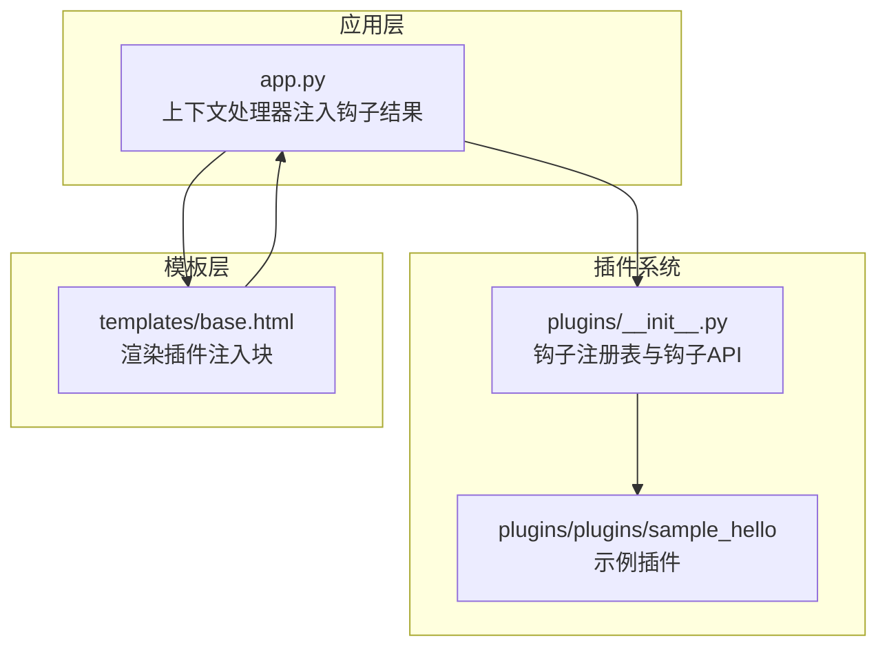
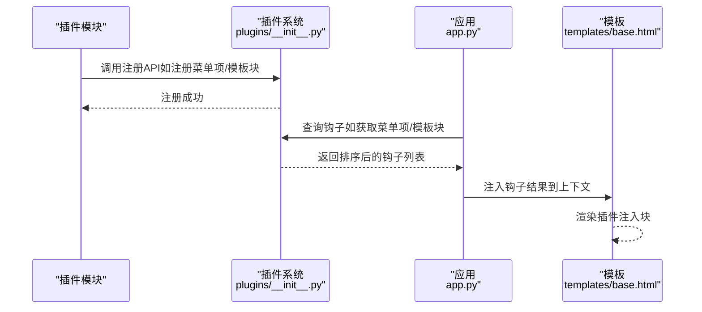
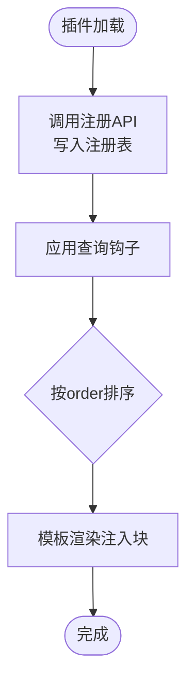
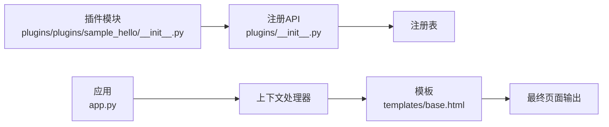

# 插件钩子系统

<cite>
**本文引用的文件**
- [app.py](file://app.py)
- [plugins/__init__.py](file://plugins/__init__.py)
- [templates/base.html](file://templates/base.html)
- [plugins/plugins/sample_hello/__init__.py](file://plugins/plugins/sample_hello/__init__.py)
- [plugins/plugins/sample_hello/plugin.json](file://plugins/plugins/sample_hello/plugin.json)
- [plugins/plugins/lang_ko/plugin.json](file://plugins/plugins/lang_ko/plugin.json)
- [plugins/plugins/lang_ja/plugin.json](file://plugins/plugins/lang_ja/plugin.json)
- [app.py](file://app.py)
- [app.py](file://app.py)
</cite>

## 目录
1. [简介](#简介)
2. [项目结构](#项目结构)
3. [核心组件](#核心组件)
4. [架构总览](#架构总览)
5. [详细组件分析](#详细组件分析)
6. [依赖分析](#依赖分析)
7. [性能考虑](#性能考虑)
8. [故障排查指南](#故障排查指南)
9. [结论](#结论)
10. [附录](#附录)

## 简介
本文件系统性梳理 School_Web 的插件钩子系统，重点围绕以下四类钩子展开：菜单项钩子（menu_items）、模板块钩子（template_blocks）、静态路由钩子（static_routes）、API 路由钩子（api_routes）。文档将解释钩子的工作原理与注册机制，说明参数格式与注册方法，阐述执行顺序与优先级管理，并给出扩展性设计建议与最佳实践。

## 项目结构
- 插件系统位于 plugins/ 目录，核心逻辑集中在 plugins/__init__.py 中，负责插件发现、加载、卸载以及钩子注册表管理。
- 应用层在 app.py 中通过上下文处理器将钩子结果注入模板上下文，供前端模板渲染使用。
- 示例插件 sample_hello 展示了菜单项与模板块的注册方式。
- 模板 base.html 展示了如何在页面中渲染插件注入的模板块。

图表来源
- [app.py](file://app.py)
- [plugins/__init__.py](file://plugins/__init__.py)
- [templates/base.html](file://templates/base.html)

章节来源
- [app.py](file://app.py)
- [plugins/__init__.py](file://plugins/__init__.py)
- [templates/base.html](file://templates/base.html)

## 核心组件
- 钩子注册表：维护四类钩子的注册列表，分别对应菜单项、模板块、静态路由与 API 路由。
- 钩子注册 API：提供注册与查询接口，如注册菜单项、注册模板块、获取菜单项、获取模板块等。
- 插件生命周期：插件加载时调用 register，卸载时调用 unregister；应用启动时会创建示例插件以演示钩子用法。
- 模板注入：通过上下文处理器将钩子结果注入模板上下文，模板中按位置渲染插件注入内容。

章节来源
- [plugins/__init__.py](file://plugins/__init__.py)
- [plugins/plugins/sample_hello/__init__.py](file://plugins/plugins/sample_hello/__init__.py)

## 架构总览
插件钩子系统采用“注册-查询-渲染”的链路：
- 插件在加载时通过注册 API 将自身钩子注册到全局注册表。
- 应用在请求前通过上下文处理器查询钩子结果，注入模板上下文。
- 模板根据注入的数据进行渲染，实现菜单与模板块的动态扩展。

图表来源
- [plugins/__init__.py](file://plugins/__init__.py)
- [app.py](file://app.py)
- [templates/base.html](file://templates/base.html)

## 详细组件分析

### 钩子类型与用途
- 菜单项钩子（menu_items）
  - 用途：向导航菜单动态添加条目，支持图标、权限控制与排序。
  - 参数格式：包含 label、url、icon、permission、order 等键。
  - 注册方法：插件在 register 中调用注册 API 完成注册。
  - 查询方法：应用通过上下文处理器注入，模板中遍历渲染。
- 模板块钩子（template_blocks）
  - 用途：在页面特定位置注入 HTML 片段，如页脚、头部等。
  - 参数格式：包含 name、template、position、order 等键。
  - 注册方法：插件在 register 中调用注册 API 完成注册。
  - 查询方法：应用按位置查询并排序，模板中渲染。
- 静态路由钩子（static_routes）
  - 用途：注册静态资源或页面的路由映射。
  - 注册方法：插件在 register 中调用注册 API 完成注册。
  - 查询与使用：应用侧统一收集并挂载到 Flask 路由系统。
- API 路由钩子（api_routes）
  - 用途：注册后端 API 路由，供前端调用。
  - 注册方法：插件在 register 中调用注册 API 完成注册。
  - 查询与使用：应用侧统一收集并挂载到 Flask 路由系统。

章节来源
- [plugins/__init__.py](file://plugins/__init__.py)
- [app.py](file://app.py)
- [templates/base.html](file://templates/base.html)

### 注册机制与执行顺序
- 注册阶段
  - 插件加载时调用 register，内部通过注册 API 将钩子加入注册表。
  - 注册表为全局共享结构，插件卸载时不会自动清理钩子，需显式管理。
- 查询与排序
  - 菜单项与模板块均按 order 字段升序排列，order 数值越小优先级越高。
  - 菜单项还支持基于权限过滤，仅返回当前用户可见项。
- 模板注入
  - 应用通过上下文处理器将钩子结果注入模板，模板按位置渲染。

图表来源
- [plugins/__init__.py](file://plugins/__init__.py)
- [app.py](file://app.py)
- [templates/base.html](file://templates/base.html)

章节来源
- [plugins/__init__.py](file://plugins/__init__.py)
- [app.py](file://app.py)
- [templates/base.html](file://templates/base.html)

### 钩子参数规范与示例

- 菜单项钩子（menu_items）
  - 关键字段：label、url、icon、permission、order。
  - 权限控制：permission 支持 all、guest、user、vip、administrator 等等级，按数值比较决定可见性。
  - 示例参考：示例插件在 register 中注册菜单项与模板块。
- 模板块钩子（template_blocks）
  - 关键字段：name、template、position、order。
  - 位置：position 支持 footer、head 等位置，模板按位置渲染。
  - 示例参考：示例插件在 register 中注册 footer 模板块。
- 静态路由钩子（static_routes）
  - 关键字段：待定义（由插件自行约定），通常包含路由路径、处理函数或静态文件路径等。
  - 使用方式：应用侧统一收集并挂载到 Flask 路由系统。
- API 路由钩子（api_routes）
  - 关键字段：待定义（由插件自行约定），通常包含路由路径、HTTP 方法、处理函数等。
  - 使用方式：应用侧统一收集并挂载到 Flask 路由系统。

章节来源
- [plugins/__init__.py](file://plugins/__init__.py)
- [plugins/plugins/sample_hello/__init__.py](file://plugins/plugins/sample_hello/__init__.py)

### 实际使用示例与最佳实践

- 示例插件（sample_hello）
  - 在 register 中注册菜单项与模板块，展示钩子的基本用法。
  - 参考路径：[plugins/plugins/sample_hello/__init__.py](file://plugins/plugins/sample_hello/__init__.py)
- 模板注入
  - 应用通过上下文处理器注入插件菜单与模板块，模板中按位置渲染。
  - 参考路径：[app.py](file://app.py)、[templates/base.html](file://templates/base.html)
- 最佳实践
  - 菜单项与模板块的 order 建议使用统一步进，便于维护优先级。
  - 权限控制应遵循最小权限原则，避免过度暴露功能。
  - 模板块中的 HTML 应注意 CSP 与安全性，避免内联脚本与危险标签。
  - 静态路由与 API 路由应避免与核心路由冲突，使用命名空间或前缀区分。

章节来源
- [plugins/plugins/sample_hello/__init__.py](file://plugins/plugins/sample_hello/__init__.py)
- [app.py](file://app.py)
- [templates/base.html](file://templates/base.html)

### 语言包插件类型
- 语言包插件在 manifest 中包含 type 字段标识为 language，用于扩展多语言支持。
- 参考路径：
  - [plugins/plugins/lang_ko/plugin.json](file://plugins/plugins/lang_ko/plugin.json)
  - [plugins/plugins/lang_ja/plugin.json](file://plugins/plugins/lang_ja/plugin.json)

章节来源
- [plugins/plugins/lang_ko/plugin.json](file://plugins/plugins/lang_ko/plugin.json)
- [plugins/plugins/lang_ja/plugin.json](file://plugins/plugins/lang_ja/plugin.json)

## 依赖分析
- 插件系统依赖于 Flask 应用的上下文处理器与模板渲染机制。
- 插件模块通过相对导入访问插件系统提供的注册 API。
- 模板层依赖上下文处理器注入的钩子结果进行渲染。

图表来源
- [plugins/plugins/sample_hello/__init__.py](file://plugins/plugins/sample_hello/__init__.py)
- [plugins/__init__.py](file://plugins/__init__.py)
- [app.py](file://app.py)
- [templates/base.html](file://templates/base.html)

章节来源
- [plugins/__init__.py](file://plugins/__init__.py)
- [app.py](file://app.py)
- [templates/base.html](file://templates/base.html)

## 性能考虑
- 钩子查询与排序在每次请求中执行，建议合理设置 order 与数量，避免过多钩子影响渲染性能。
- 模板块中的 HTML 应尽量简洁，避免复杂计算与阻塞操作。
- 对于大量插件场景，可考虑缓存钩子查询结果或延迟加载策略。

## 故障排查指南
- 插件未生效
  - 检查插件目录是否存在 plugin.json 与 __init__.py。
  - 确认插件在加载时调用了注册 API。
  - 检查权限设置是否导致菜单项不可见。
- 模板块未显示
  - 确认 position 与模板中的渲染位置一致。
  - 检查 CSP 与模板块内容是否被浏览器阻止。
- 路由冲突
  - 检查静态路由与 API 路由是否与核心路由冲突，必要时使用前缀或命名空间。

章节来源
- [plugins/__init__.py](file://plugins/__init__.py)
- [app.py](file://app.py)
- [templates/base.html](file://templates/base.html)

## 结论
School_Web 的插件钩子系统通过清晰的注册与查询机制，实现了菜单与模板块的动态扩展。结合权限控制与排序管理，系统具备良好的灵活性与可维护性。未来可进一步完善静态路由与 API 路由钩子的标准化定义与统一挂载流程，提升插件开发体验与系统稳定性。

## 附录
- 插件管理 API（管理员）
  - 获取插件列表、加载/卸载插件、重新加载所有插件、插件市场上传等。
  - 参考路径：[app.py](file://app.py)

章节来源
- [app.py](file://app.py)