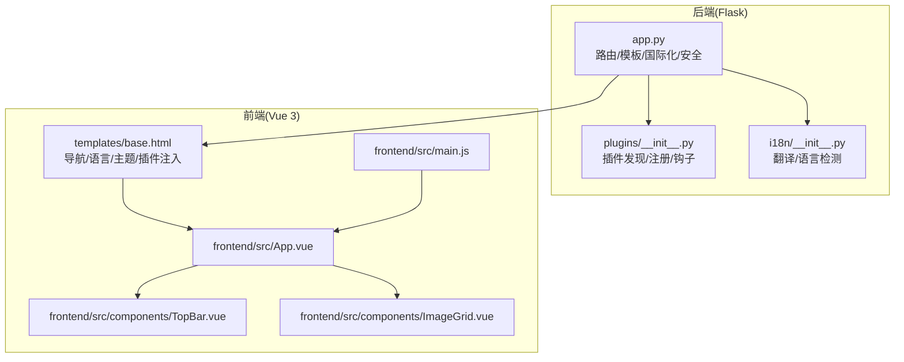
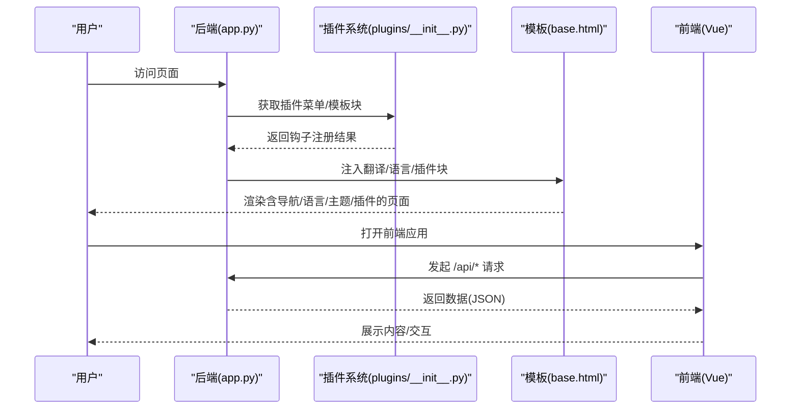
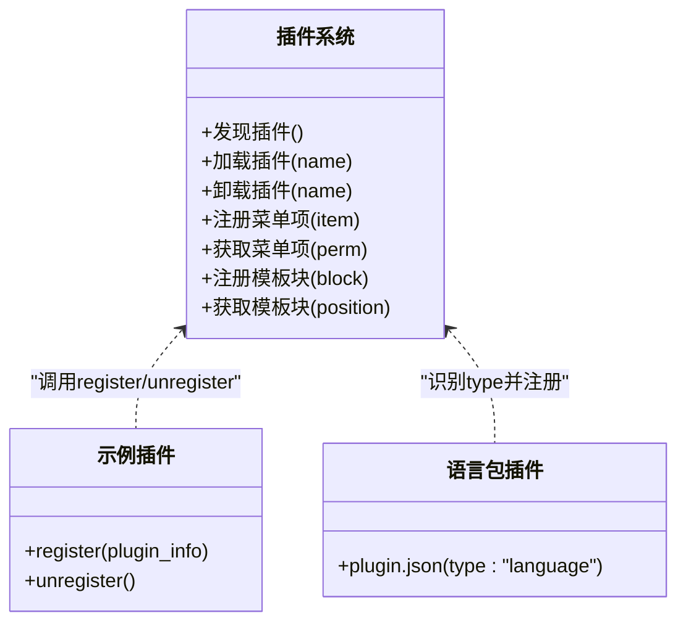
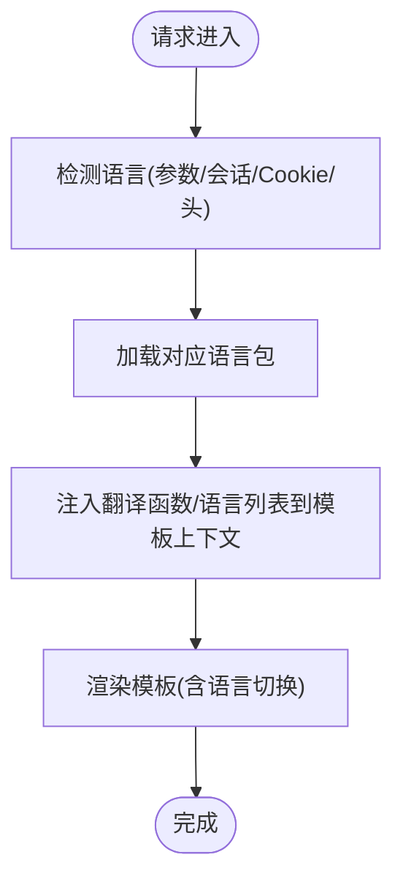
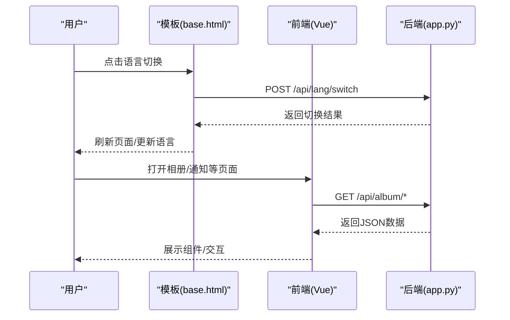
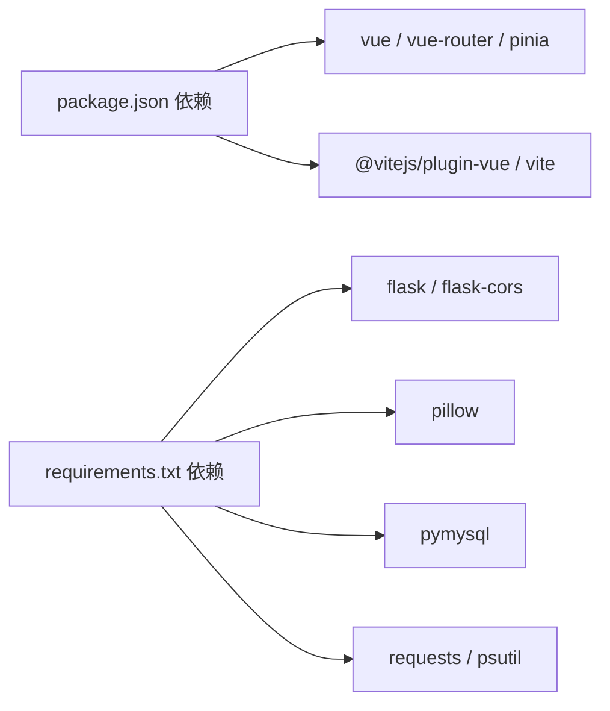

# 自定义功能扩展

<cite>
**本文档引用的文件**
- [app.py](file://app.py)
- [plugins/__init__.py](file://plugins/__init__.py)
- [plugins/plugins/sample_hello/plugin.json](file://plugins/plugins/sample_hello/plugin.json)
- [plugins/plugins/sample_hello/__init__.py](file://plugins/plugins/sample_hello/__init__.py)
- [plugins/plugins/lang_ja/plugin.json](file://plugins/plugins/lang_ja/plugin.json)
- [plugins/plugins/lang_ko/plugin.json](file://plugins/plugins/lang_ko/plugin.json)
- [plugins/marketplace/markdown-editor/plugin.json](file://plugins/marketplace/markdown-editor/plugin.json)
- [i18n/__init__.py](file://i18n/__init__.py)
- [frontend/src/main.js](file://frontend/src/main.js)
- [frontend/src/App.vue](file://frontend/src/App.vue)
- [frontend/src/components/TopBar.vue](file://frontend/src/components/TopBar.vue)
- [frontend/src/components/ImageGrid.vue](file://frontend/src/components/ImageGrid.vue)
- [templates/base.html](file://templates/base.html)
- [frontend/package.json](file://frontend/package.json)
</cite>

## 目录
1. [简介](#简介)
2. [项目结构](#项目结构)
3. [核心组件](#核心组件)
4. [架构总览](#架构总览)
5. [详细组件分析](#详细组件分析)
6. [依赖分析](#依赖分析)
7. [性能考虑](#性能考虑)
8. [故障排查指南](#故障排查指南)
9. [结论](#结论)
10. [附录](#附录)

## 简介
本指南面向希望为 School_Web 扩展自定义功能的开发者，系统讲解如何基于内置插件系统开发新功能模块、增强现有能力（如语言包与主题）、集成第三方功能，并提供测试与质量保障建议及端到端案例流程。

## 项目结构
- 后端采用 Python Flask，负责路由、模板渲染、国际化、安全策略与插件系统调度。
- 前端采用 Vue 3 + Vite，提供相册、通知、主题切换等交互界面。
- 插件系统位于 plugins/，支持菜单注入、模板块注入、静态资源与 API 路由扩展。
- 国际化位于 i18n/，支持多语言切换与语言包扩展。
- 模板 base.html 提供导航、语言切换、主题切换与插件注入位点。

**图表来源**
- [app.py](file://app.py)
- [plugins/__init__.py](file://plugins/__init__.py)
- [i18n/__init__.py](file://i18n/__init__.py)
- [frontend/src/main.js](file://frontend/src/main.js)
- [frontend/src/App.vue](file://frontend/src/App.vue)
- [frontend/src/components/TopBar.vue](file://frontend/src/components/TopBar.vue)
- [frontend/src/components/ImageGrid.vue](file://frontend/src/components/ImageGrid.vue)
- [templates/base.html](file://templates/base.html)

**章节来源**
- [app.py](file://app.py)
- [plugins/__init__.py](file://plugins/__init__.py)
- [i18n/__init__.py](file://i18n/__init__.py)
- [frontend/src/main.js](file://frontend/src/main.js)
- [frontend/src/App.vue](file://frontend/src/App.vue)
- [frontend/src/components/TopBar.vue](file://frontend/src/components/TopBar.vue)
- [frontend/src/components/ImageGrid.vue](file://frontend/src/components/ImageGrid.vue)
- [templates/base.html](file://templates/base.html)

## 核心组件
- 插件系统：动态发现、加载/卸载插件，注册菜单项与模板注入块，支持 API 与静态路由扩展。
- 国际化系统：统一翻译函数、语言检测与切换、语言包扩展。
- 前端模板与组件：基础模板提供语言/主题/插件注入位点，Vue 组件负责交互与数据请求。
- 安全与上下文：CSP nonce 注入、语言上下文注入、插件菜单与模板块注入。

**章节来源**
- [plugins/__init__.py](file://plugins/__init__.py)
- [i18n/__init__.py](file://i18n/__init__.py)
- [app.py](file://app.py)
- [templates/base.html](file://templates/base.html)

## 架构总览
后端通过 app.py 注入上下文（如翻译函数、语言信息、插件菜单与模板块），模板 base.html 使用这些上下文渲染导航、语言切换与主题切换，并在页脚注入插件提供的模板块。前端 Vue 应用通过 fetch 请求后端 API 获取用户信息与数据，组件之间通过 props 与事件通信。

**图表来源**
- [app.py](file://app.py)
- [plugins/__init__.py](file://plugins/__init__.py)
- [templates/base.html](file://templates/base.html)

## 详细组件分析

### 插件系统设计与实现
- 插件发现：扫描 plugins/plugins/ 下的子目录，要求包含 plugin.json 与可选的 __init__.py。
- 加载/卸载：动态导入模块并调用 register/unregister；记录已加载插件与钩子注册表。
- 钩子类型：菜单项、模板注入块、静态路由、API 路由。
- 菜单与模板注入：后端在模板上下文中注入插件菜单与模板块，前端模板 base.html 渲染插件注入内容。

**图表来源**
- [plugins/__init__.py](file://plugins/__init__.py)
- [plugins/plugins/sample_hello/__init__.py](file://plugins/plugins/sample_hello/__init__.py)
- [plugins/plugins/sample_hello/plugin.json](file://plugins/plugins/sample_hello/plugin.json)
- [plugins/plugins/lang_ja/plugin.json](file://plugins/plugins/lang_ja/plugin.json)
- [plugins/plugins/lang_ko/plugin.json](file://plugins/plugins/lang_ko/plugin.json)

**章节来源**
- [plugins/__init__.py](file://plugins/__init__.py)
- [plugins/plugins/sample_hello/plugin.json](file://plugins/plugins/sample_hello/plugin.json)
- [plugins/plugins/sample_hello/__init__.py](file://plugins/plugins/sample_hello/__init__.py)
- [plugins/plugins/lang_ja/plugin.json](file://plugins/plugins/lang_ja/plugin.json)
- [plugins/plugins/lang_ko/plugin.json](file://plugins/plugins/lang_ko/plugin.json)

### 国际化与语言包扩展
- 翻译函数：统一的 _() 支持占位符替换与默认值。
- 语言检测：优先查询参数、会话、Cookie，再回退 Accept-Language。
- 语言包：i18n/*.json 文件，支持新增语言；后端注入语言列表与名称映射。
- 插件语言包：type 为 language 的插件在插件市场中注册，提供额外翻译文件并加入语言切换器。

**图表来源**
- [i18n/__init__.py](file://i18n/__init__.py)
- [app.py](file://app.py)
- [templates/base.html](file://templates/base.html)

**章节来源**
- [i18n/__init__.py](file://i18n/__init__.py)
- [app.py](file://app.py)
- [templates/base.html](file://templates/base.html)

### 前端交互与模板注入
- 基础模板：提供导航栏、语言切换、主题切换、插件注入位点。
- Vue 应用：入口 main.js 创建应用，App.vue 管理标签页与子组件，TopBar 与 ImageGrid 等组件负责具体功能。
- 交互流程：前端通过 fetch 与后端 API 交互，模板中的脚本处理语言切换与通知轮询。

**图表来源**
- [templates/base.html](file://templates/base.html)
- [frontend/src/main.js](file://frontend/src/main.js)
- [frontend/src/App.vue](file://frontend/src/App.vue)
- [frontend/src/components/TopBar.vue](file://frontend/src/components/TopBar.vue)
- [frontend/src/components/ImageGrid.vue](file://frontend/src/components/ImageGrid.vue)
- [app.py](file://app.py)

**章节来源**
- [templates/base.html](file://templates/base.html)
- [frontend/src/main.js](file://frontend/src/main.js)
- [frontend/src/App.vue](file://frontend/src/App.vue)
- [frontend/src/components/TopBar.vue](file://frontend/src/components/TopBar.vue)
- [frontend/src/components/ImageGrid.vue](file://frontend/src/components/ImageGrid.vue)
- [app.py](file://app.py)

## 依赖分析
- 后端依赖：Flask、CORS、Pillow、PyMySQL、requests、psutil 等。
- 前端依赖：Vue 3、vue-router、pinia、vite、@vitejs/plugin-vue。
- 插件系统与国际化：后端通过 app.py 注入上下文，模板与前端共享语言与插件注入。

**图表来源**
- [frontend/package.json](file://frontend/package.json)
- [app.py](file://app.py)

**章节来源**
- [frontend/package.json](file://frontend/package.json)
- [app.py](file://app.py)

## 性能考虑
- 插件加载：动态导入与模块缓存，避免重复加载；钩子注册按需排序，减少渲染时计算。
- 前端组件：懒加载与虚拟滚动（如图片网格），减少首屏压力；合理使用 watch 与 onMounted 生命周期。
- 国际化：预加载支持语言，避免运行时频繁 IO；模板中仅注入必要上下文。
- 安全与缓存：CSP nonce 与严格安全头，HTML 不缓存，敏感接口配合速率限制与验证码门禁。

## 故障排查指南
- 插件无法加载
  - 检查插件目录是否存在 plugin.json 且格式正确。
  - 确认 __init__.py 中是否实现 register/unregister 并抛出异常。
  - 查看后端日志与插件系统返回信息。
- 菜单/模板块未显示
  - 确认钩子注册位置与 order；检查用户权限是否满足要求。
  - 模板 base.html 是否正确遍历并输出插件注入块。
- 语言切换无效
  - 检查 /api/lang/switch 返回值与 Cookie 设置。
  - 确认 i18n/*.json 文件存在且键名一致。
- 前端组件无数据
  - 检查 /api/* 接口返回状态与数据结构。
  - 确认前端 fetch 是否携带 credentials: include。
- 安全与封禁
  - 速率限制触发后会封禁 IP，检查封禁时长与试探次数阈值。
  - 管理员可手动封禁或维护白名单。

**章节来源**
- [plugins/__init__.py](file://plugins/__init__.py)
- [app.py](file://app.py)
- [templates/base.html](file://templates/base.html)
- [i18n/__init__.py](file://i18n/__init__.py)

## 结论
School_Web 的插件系统与国际化机制提供了清晰的扩展点：通过插件注册菜单与模板块、扩展 API 与静态资源；通过语言包与模板上下文增强本地化体验；结合前端 Vue 组件实现交互与数据展示。遵循本文档的设计原则与最佳实践，可高效地完成新功能开发、增强与第三方集成。

## 附录

### 功能扩展案例：新增语言包
- 目标：为某语言新增语言包并加入语言切换器。
- 步骤
  1) 在 i18n/ 新增语言文件，键名与现有文件保持一致。
  2) 在后端 i18n/__init__.py 的 SUPPORTED_LANGS 中添加新语言代码。
  3) 若需插件形式发布，创建 type 为 language 的插件，包含 plugin.json 与翻译文件。
  4) 在模板 base.html 的语言切换下拉菜单中展示新语言。
  5) 测试：访问页面，切换语言，确认文案与名称均正确显示。
- 质量保证
  - 单元测试：验证翻译函数对缺失键的回退行为。
  - 端到端测试：模拟不同 Accept-Language 与 Cookie 场景。
  - 回归测试：确保其他语言与插件语言包仍正常工作。

**章节来源**
- [i18n/__init__.py](file://i18n/__init__.py)
- [templates/base.html](file://templates/base.html)
- [plugins/plugins/lang_ja/plugin.json](file://plugins/plugins/lang_ja/plugin.json)
- [plugins/plugins/lang_ko/plugin.json](file://plugins/plugins/lang_ko/plugin.json)

### 功能扩展案例：HTML 插件（Markdown 编辑器）
- 目标：在插件市场中发布 HTML/Vue 插件，提供在线编辑能力。
- 步骤
  1) 在 plugins/marketplace 下创建插件目录，编写 plugin.json（包含 display_name、file_type 等）。
  2) 提供 index.html 或 Vue 组件入口，确保与后端模板上下文兼容。
  3) 在后端 app.py 中注册插件市场表与相关路由（若需要）。
  4) 在模板中通过插件注入位点渲染插件内容。
  5) 测试：访问页面，确认插件菜单项与模板块生效。
- 质量保证
  - 安全性：避免内联脚本，使用 CSP nonce；对用户输入进行过滤。
  - 兼容性：在不同浏览器与主题模式下验证 UI 与交互。
  - 性能：压缩静态资源，避免阻塞主线程。

**章节来源**
- [plugins/marketplace/markdown-editor/plugin.json](file://plugins/marketplace/markdown-editor/plugin.json)
- [app.py](file://app.py)
- [templates/base.html](file://templates/base.html)

### 功能扩展案例：增强现有功能（主题定制）
- 目标：在现有主题基础上增加新的 CSS 变量或组件样式。
- 步骤
  1) 在模板 base.html 的 style 区域新增或覆盖 CSS 变量。
  2) 通过插件模板注入块在页脚或头部注入额外样式或脚本。
  3) 前端组件中使用新的样式类或变量，确保与现有主题一致。
  4) 测试：切换明/暗主题，验证颜色与阴影等视觉效果。
- 质量保证
  - 设计一致性：遵循现有配色与排版规范。
  - 可访问性：对比度与字体大小符合可访问性标准。

**章节来源**
- [templates/base.html](file://templates/base.html)
- [plugins/__init__.py](file://plugins/__init__.py)

### 第三方功能集成策略
- 外部 API 接入
  - 在后端 app.py 中新增路由，调用外部服务并返回标准化 JSON。
  - 对外部响应进行错误处理与超时控制，必要时做缓存与降级。
- 服务集成
  - 通过插件系统注册静态资源与 API 路由，避免硬编码路径。
  - 在模板中注入必要的脚本与样式，确保 CSP 兼容。
- 数据同步
  - 设计定时任务或事件驱动机制，保证本地与外部数据一致性。
  - 对敏感字段进行脱敏与加密存储。

**章节来源**
- [app.py](file://app.py)
- [plugins/__init__.py](file://plugins/__init__.py)
- [templates/base.html](file://templates/base.html)

### 测试方法与质量保证流程
- 单元测试
  - 插件系统：验证插件发现、加载/卸载、钩子注册与权限过滤。
  - 国际化：验证翻译函数、语言检测与回退逻辑。
- 集成测试
  - 端到端：从前端页面到后端 API 的完整链路测试。
  - 安全：验证码门禁、CSP、速率限制与封禁策略验证。
- 性能测试
  - 前端：组件渲染耗时、网络请求优化与缓存命中率。
  - 后端：并发请求下的响应时间与内存占用。
- 回归测试
  - 每次变更后，对核心功能（登录、相册、通知、插件注入）进行回归验证。

**章节来源**
- [plugins/__init__.py](file://plugins/__init__.py)
- [i18n/__init__.py](file://i18n/__init__.py)
- [app.py](file://app.py)
- [templates/base.html](file://templates/base.html)