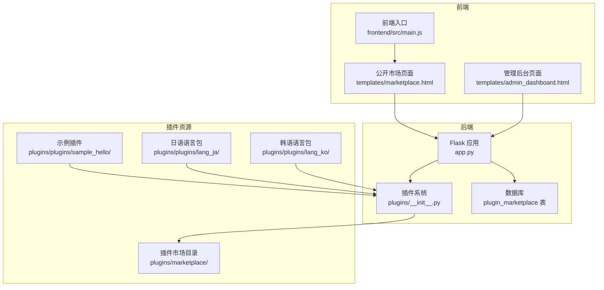
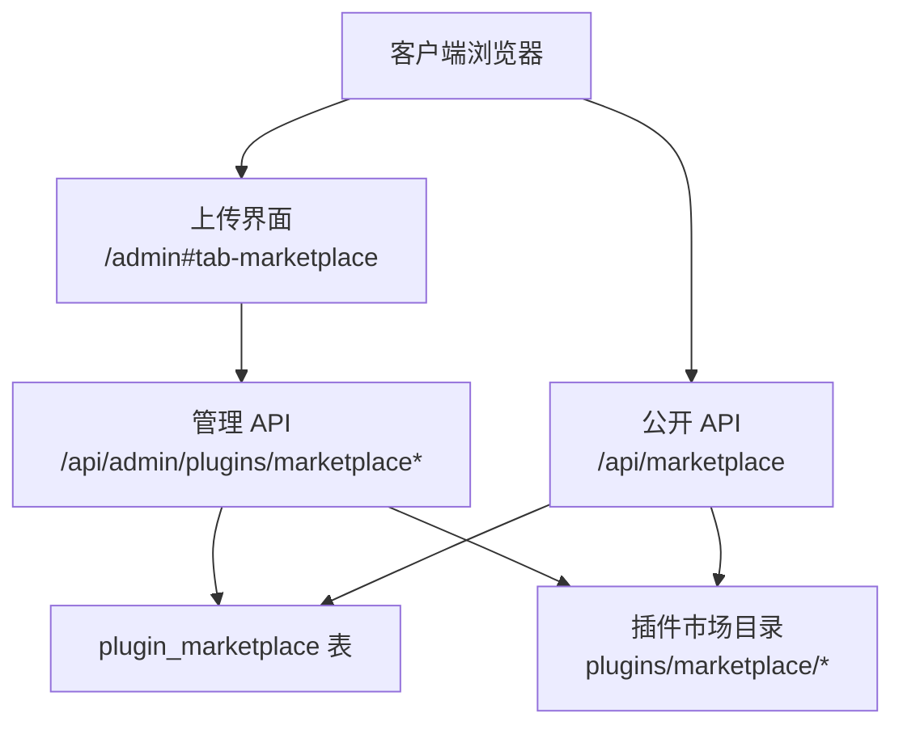
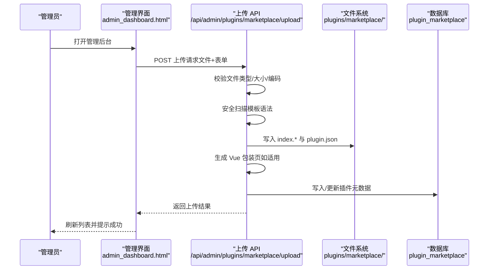
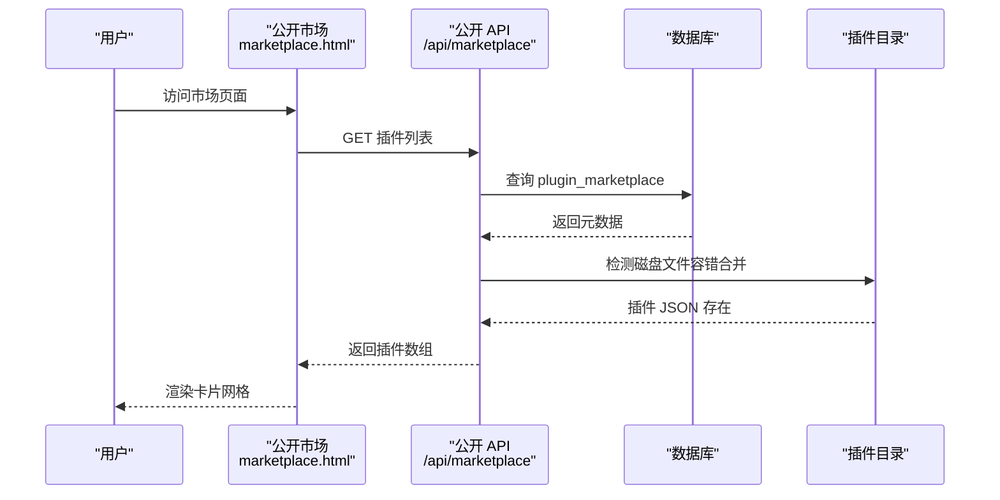
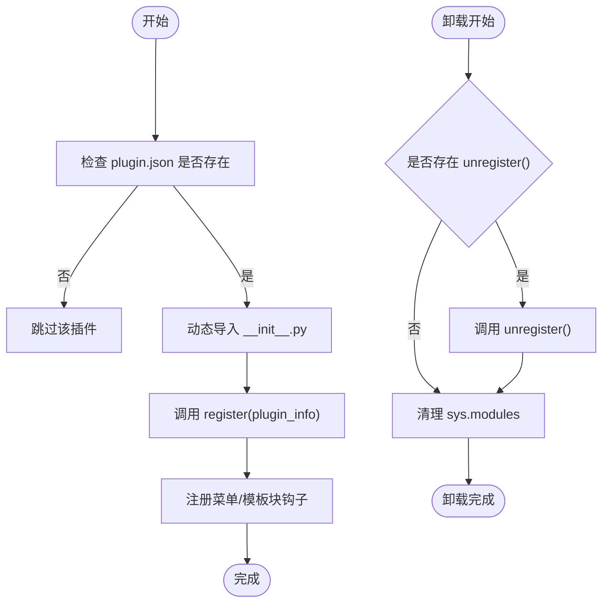
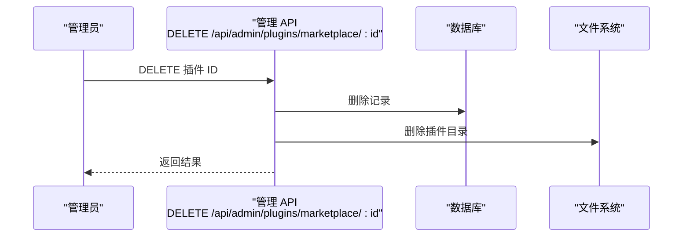
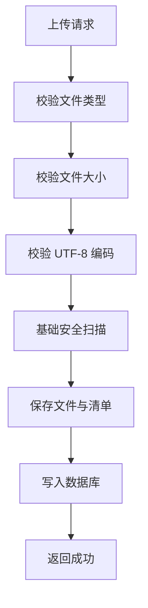
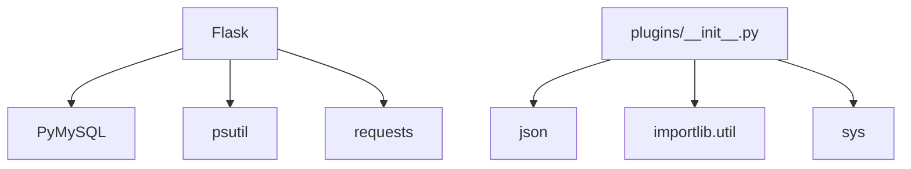

# 插件市场管理

<cite>
**本文档引用的文件**
- [app.py](file://app.py)
- [plugins/__init__.py](file://plugins/__init__.py)
- [templates/marketplace.html](file://templates/marketplace.html)
- [templates/admin_dashboard.html](file://templates/admin_dashboard.html)
- [plugins/plugins/sample_hello/plugin.json](file://plugins/plugins/sample_hello/plugin.json)
- [plugins/marketplace/markdown-editor/plugin.json](file://plugins/marketplace/markdown-editor/plugin.json)
- [plugins/plugins/lang_ja/plugin.json](file://plugins/plugins/lang_ja/plugin.json)
- [plugins/plugins/lang_ko/plugin.json](file://plugins/plugins/lang_ko/plugin.json)
- [frontend/src/main.js](file://frontend/src/main.js)
- [requirements.txt](file://requirements.txt)
</cite>

## 目录
1. [引言](#引言)
2. [项目结构](#项目结构)
3. [核心组件](#核心组件)
4. [架构总览](#架构总览)
5. [详细组件分析](#详细组件分析)
6. [依赖关系分析](#依赖关系分析)
7. [性能考虑](#性能考虑)
8. [故障排查指南](#故障排查指南)
9. [结论](#结论)
10. [附录](#附录)

## 引言
本文件面向插件市场管理的运营与技术团队，系统性阐述插件市场的整体架构与管理流程，涵盖插件上传、审核、发布与版本管理机制；插件发现与搜索功能的实现；插件启用与禁用机制（含依赖关系检查与冲突处理）；插件更新与卸载流程（含数据备份与清理策略）；以及安全机制（代码审查、权限控制与恶意插件检测）。同时提供基于仓库现有实现的实践案例与管理工具使用说明。

## 项目结构
- 后端采用 Flask 应用，统一在应用入口集中定义路由与业务逻辑。
- 插件系统位于 plugins/ 目录，支持动态发现、加载与卸载，并通过钩子向模板与菜单注入内容。
- 插件市场（Marketplace）专门用于管理员上传 HTML/Vue 插件，数据存储于 MySQL 表 plugin_marketplace，静态资源存放于 plugins/marketplace/ 下的独立目录。
- 前端模板通过 marketplace.html 展示公开插件列表，管理后台通过 admin_dashboard.html 提供上传、删除与列表管理能力。
- 前端应用入口位于 frontend/src/main.js，用于构建 Vue 应用（与插件市场功能解耦）。

**图表来源**
- [app.py:5262-5876](file://app.py#L5262-L5876)
- [plugins/__init__.py:25-136](file://plugins/__init__.py#L25-L136)
- [templates/marketplace.html:103-141](file://templates/marketplace.html#L103-L141)
- [templates/admin_dashboard.html:1233-1317](file://templates/admin_dashboard.html#L1233-L1317)
- [frontend/src/main.js:1-6](file://frontend/src/main.js#L1-L6)

**章节来源**
- [app.py:5262-5876](file://app.py#L5262-L5876)
- [plugins/__init__.py:1-249](file://plugins/__init__.py#L1-L249)
- [templates/marketplace.html:1-143](file://templates/marketplace.html#L1-L143)
- [templates/admin_dashboard.html:1-200](file://templates/admin_dashboard.html#L1-L200)
- [frontend/src/main.js:1-6](file://frontend/src/main.js#L1-L6)

## 核心组件
- 插件系统（plugins/__init__.py）
  - 功能：扫描 plugins/ 目录，解析 plugin.json，动态导入 __init__.py，注册菜单项与模板块，支持插件启用/禁用。
  - 关键接口：discover_plugins、load_plugin、unload_plugin、get_menu_items、get_template_blocks。
- 插件市场 API（app.py）
  - 管理端：上传（/api/admin/plugins/marketplace/upload）、列表（/api/admin/plugins/marketplace）、删除（/api/admin/plugins/marketplace/<int:id>）。
  - 公开端：公开列表（/api/marketplace）。
  - 预览：/plugin-market/<int:id> 与 /plugin-market/<int:id>/direct。
- 前端市场页面（templates/marketplace.html）
  - 通过 /api/marketplace 获取插件列表并渲染卡片网格。
- 管理后台（templates/admin_dashboard.html）
  - 提供上传表单、插件列表、删除操作与实时状态反馈。
- 示例与语言包插件（plugins/plugins/sample_hello、plugins/plugins/lang_ja、plugins/plugins/lang_ko）
  - 展示插件清单格式与多语言支持。

**章节来源**
- [plugins/__init__.py:25-136](file://plugins/__init__.py#L25-L136)
- [app.py:5262-5530](file://app.py#L5262-L5530)
- [app.py:5816-5876](file://app.py#L5816-L5876)
- [templates/marketplace.html:103-141](file://templates/marketplace.html#L103-L141)
- [templates/admin_dashboard.html:1233-1317](file://templates/admin_dashboard.html#L1233-L1317)
- [plugins/plugins/sample_hello/plugin.json:1-7](file://plugins/plugins/sample_hello/plugin.json#L1-L7)
- [plugins/plugins/lang_ja/plugin.json:1-10](file://plugins/plugins/lang_ja/plugin.json#L1-L10)
- [plugins/plugins/lang_ko/plugin.json:1-10](file://plugins/plugins/lang_ko/plugin.json#L1-L10)

## 架构总览
插件市场采用“数据库 + 文件系统”的双层存储模型：
- 数据库存储插件元数据（名称、显示名、描述、版本、作者、图标、文件类型、上传者、时间戳）。
- 文件系统存储插件实际资源（HTML/Vue 源文件与自动生成的沙箱包装页）。

**图表来源**
- [app.py:5262-5530](file://app.py#L5262-L5530)
- [app.py:5816-5876](file://app.py#L5816-L5876)
- [templates/admin_dashboard.html:1233-1317](file://templates/admin_dashboard.html#L1233-L1317)

## 详细组件分析

### 插件市场 API 流程
- 上传流程（管理员）
  - 客户端提交 multipart/form-data，包含文件与表单字段（插件名、显示名、描述、版本、作者、图标）。
  - 后端进行文件类型与大小校验，读取内容并执行基础安全扫描（拒绝包含危险模板语法的文件）。
  - 生成唯一目录名，写入 index.html/.vue 与 plugin.json，必要时生成 Vue 包装页。
  - 写入数据库（重复键时更新）。
  - 返回上传结果与插件信息。

**图表来源**
- [app.py:5262-5394](file://app.py#L5262-L5394)
- [templates/admin_dashboard.html:1233-1264](file://templates/admin_dashboard.html#L1233-L1264)

- 列表与预览流程
  - 管理端列表：/api/admin/plugins/marketplace 返回含上传者与磁盘存在性标记的完整信息。
  - 公开端列表：/api/marketplace 返回公开字段，用于 marketplace.html 渲染。
  - 预览：/plugin-market/<id> 提供沙箱页面，/plugin-market/<id>/direct 提供插件内容并附加沙箱 CSP。

**图表来源**
- [app.py:5816-5876](file://app.py#L5816-L5876)
- [templates/marketplace.html:103-141](file://templates/marketplace.html#L103-L141)

**章节来源**
- [app.py:5262-5394](file://app.py#L5262-L5394)
- [app.py:5457-5530](file://app.py#L5457-L5530)
- [app.py:5816-5876](file://app.py#L5816-L5876)
- [templates/marketplace.html:103-141](file://templates/marketplace.html#L103-L141)
- [templates/admin_dashboard.html:1266-1317](file://templates/admin_dashboard.html#L1266-L1317)

### 插件发现与搜索
- 发现机制
  - 插件系统扫描 plugins/ 目录，要求每个插件子目录包含 plugin.json 与可选的 __init__.py。
  - 支持“仅清单”插件（无代码），用于菜单注册等场景。
- 搜索与过滤
  - 公开端列表按更新时间倒序返回，前端 marketplace.html 以卡片网格展示，包含图标、类型、版本、作者与描述等字段。
  - 管理端列表额外包含上传者与磁盘存在性标记，便于运维排障。
- 容错合并
  - 若磁盘存在 plugin.json 而数据库无记录，API 仍会合并返回，保证系统在部分异常情况下仍可展示插件。

**章节来源**
- [plugins/__init__.py:25-58](file://plugins/__init__.py#L25-L58)
- [app.py:5816-5876](file://app.py#L5816-L5876)
- [app.py:5492-5521](file://app.py#L5492-L5521)

### 插件启用与禁用机制
- 启用（加载）
  - 通过 load_plugin 动态导入插件模块并调用其 register 函数，注册菜单项与模板块。
- 禁用（卸载）
  - 通过 unload_plugin 调用插件的 unregister 函数并清理 sys.modules。
- 权限控制
  - 插件菜单项与模板块支持按权限级别过滤，get_menu_items 依据用户权限决定可见性。
- 依赖与冲突
  - 当前实现未内置自动依赖解析与冲突检测逻辑。建议在插件清单中明确声明依赖并在 register/unregister 中自行处理。

**图表来源**
- [plugins/__init__.py:60-136](file://plugins/__init__.py#L60-L136)

**章节来源**
- [plugins/__init__.py:60-136](file://plugins/__init__.py#L60-L136)
- [plugins/__init__.py:154-193](file://plugins/__init__.py#L154-L193)

### 插件更新与卸载
- 更新
  - 管理端通过上传新版本文件实现更新：后端写入新文件并更新数据库记录（重复键更新）。
  - 建议在更新前进行备份（见“备份与清理策略”）。
- 卸载
  - 管理端删除 API 会同时删除数据库记录与文件系统资源。
  - 卸载后需清理相关权限与菜单项变更。

**图表来源**
- [app.py:5524-5530](file://app.py#L5524-L5530)

**章节来源**
- [app.py:5524-5530](file://app.py#L5524-L5530)

### 安全机制
- 速率限制与封禁
  - 内置内存速率限制器与持久化配置文件，支持白名单、手动封禁与试探封禁延长。
- 上传安全
  - 仅允许 .html 与 .vue 文件，限制最大 5MB，强制 UTF-8 编码。
  - 基础安全扫描：拒绝包含危险模板语法的文件。
- 预览沙箱
  - /plugin-market/<id> 使用沙箱页面与 CSP 限制，/plugin-market/<id>/direct 提供插件内容并附加 CSP。
- 权限控制
  - 管理端 API 均需管理员权限；公开 API 需登录。
- 其他安全头
  - 设置 X-Content-Type-Options、X-Frame-Options、Referrer-Policy、CSP、HSTS（生产环境）等。

**图表来源**
- [app.py:5262-5394](file://app.py#L5262-L5394)

**章节来源**
- [app.py:348-411](file://app.py#L348-L411)
- [app.py:5262-5394](file://app.py#L5262-L5394)
- [app.py:5655-5691](file://app.py#L5655-L5691)
- [app.py:641-676](file://app.py#L641-L676)

### 运营模式与管理工具使用
- 运营模式
  - 管理员负责上传、审核（通过文件内容与清单信息）、发布与维护。
  - 用户通过公开市场浏览与预览插件。
- 管理工具
  - 管理后台提供上传表单、列表展示与删除操作，支持批量封禁与白名单管理。
  - 前端 marketplace.html 通过异步请求获取公开列表并渲染。

**章节来源**
- [templates/admin_dashboard.html:1233-1317](file://templates/admin_dashboard.html#L1233-L1317)
- [templates/marketplace.html:103-141](file://templates/marketplace.html#L103-L141)

## 依赖关系分析
- 后端依赖
  - Flask、PyMySQL、psutil、requests。
- 插件系统依赖
  - Python 标准库（importlib、json、os）与 sys 模块。
- 前端依赖
  - Vue 应用入口位于 frontend/src/main.js，与插件市场页面解耦。

**图表来源**
- [requirements.txt:1-5](file://requirements.txt#L1-L5)
- [plugins/__init__.py:5-11](file://plugins/__init__.py#L5-L11)

**章节来源**
- [requirements.txt:1-5](file://requirements.txt#L1-L5)
- [plugins/__init__.py:5-11](file://plugins/__init__.py#L5-L11)

## 性能考虑
- 速率限制
  - 通过内存队列与持久化配置文件平衡性能与持久化需求，避免频繁 IO。
- 数据库查询
  - 插件列表查询使用索引列排序，建议在高并发场景下增加连接池与缓存。
- 文件系统
  - 插件目录结构扁平，建议控制插件数量与单文件大小，避免影响 I/O。
- 前端渲染
  - 公开端列表一次性拉取，建议在插件较多时引入分页或懒加载。

## 故障排查指南
- 上传失败
  - 检查文件类型、大小与编码；确认未包含危险模板语法；查看后端返回的错误信息。
- 列表为空
  - 确认数据库中存在记录或磁盘上存在 plugin.json；检查公开 API 的容错合并逻辑。
- 预览异常
  - 检查 /plugin-market/<id> 与 /plugin-market/<id>/direct 的路由与 CSP 设置。
- 权限问题
  - 确认用户已登录且具备访问公开 API 的权限；管理员端需具备管理员权限。

**章节来源**
- [app.py:5262-5394](file://app.py#L5262-L5394)
- [app.py:5816-5876](file://app.py#L5816-L5876)
- [app.py:5655-5691](file://app.py#L5655-L5691)

## 结论
本插件市场系统以“数据库 + 文件系统”为核心，结合 Flask 路由与插件系统钩子，实现了从上传、审核、发布到预览的完整闭环。通过速率限制、上传安全扫描与沙箱预览等机制保障安全性。建议后续增强依赖解析与冲突检测、引入版本对比与备份策略，并在高并发场景优化数据库与文件系统性能。

## 附录
- 示例插件清单
  - [plugins/plugins/sample_hello/plugin.json:1-7](file://plugins/plugins/sample_hello/plugin.json#L1-L7)
  - [plugins/marketplace/markdown-editor/plugin.json:1-10](file://plugins/marketplace/markdown-editor/plugin.json#L1-L10)
  - [plugins/plugins/lang_ja/plugin.json:1-10](file://plugins/plugins/lang_ja/plugin.json#L1-L10)
  - [plugins/plugins/lang_ko/plugin.json:1-10](file://plugins/plugins/lang_ko/plugin.json#L1-L10)
- 前端入口
  - [frontend/src/main.js:1-6](file://frontend/src/main.js#L1-L6)